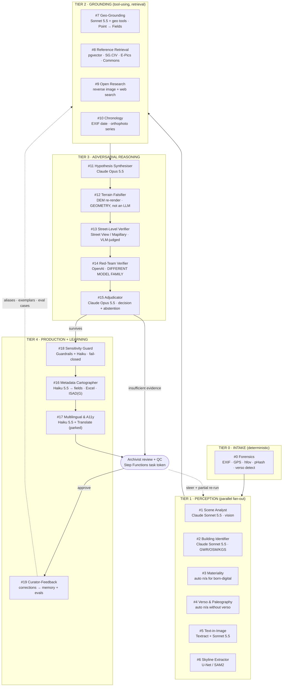

# ZEITZEUGE

### Agentic provenance intelligence for historical photograph archives

**Zentral Hack 2026 · AI Agentic track · Challenge: "KI-Bilderkennung für historische Fotos" · Powered by Kanton Schwyz · Prize: CHF 1'000**

> *«Wir befragen das Bild.»* — We cross-examine the photograph.

---

## Table of contents

**Part I — The situation**

1. [The brief, and what it actually asks for](#1-the-brief-and-what-it-actually-asks-for)
2. [Why the obvious solution loses](#2-why-the-obvious-solution-loses)
3. [The thesis](#3-the-thesis)

**Part II — The solution**
4. [Product: ZEITZEUGE](#4-product-zeitzeuge)
5. [The agentic architecture](#5-the-agentic-architecture)
6. [The signature capabilities](#6-the-signature-capabilities)
7. [Knowledge layer: what the agents are allowed to know](#7-knowledge-layer-what-the-agents-are-allowed-to-know)

**Part III — The engineering**
8. [Output contract: what the archive actually keeps](#8-output-contract-what-the-archive-actually-keeps)
9. [The full-stack application](#9-the-full-stack-application)
10. [AWS infrastructure](#10-aws-infrastructure)
11. [Evaluation: the part that wins the room](#11-evaluation-the-part-that-wins-the-room)
12. [Cost model against the USD 2&#39;000 credit](#12-cost-model-against-the-usd-2000-credit)

**Part IV — Winning**
13. [The build plan](#13-the-build-plan)
14. [The pitch](#14-the-pitch)
15. [Rubric mapping: why this scores](#15-rubric-mapping-why-this-scores)
16. [Business potential](#16-business-potential)
17. [Risks, ethics, and open questions](#17-risks-ethics-and-open-questions)

**Appendices**

- [A. Agent roster reference card](#appendix-a--agent-roster-reference-card)
- [B. Core JSON schemas](#appendix-b--core-json-schemas)
- [C. Repository structure](#appendix-c--repository-structure)
- [D. Source list](#appendix-d--source-list)
- [E. Glossary for the pitch](#appendix-e--glossary-for-the-pitch)

---

# Part I — The situation

## 1. The brief, and what it actually asks for

### 1.1 The official brief

**Background.** The Staatsarchiv des Kantons Schwyz manages digital and digitised photographs. For their description (*Erschliessung*) meaningful geographic metadata is often missing: buildings, villages and landscape features are visible, but determining exactly which ones takes a lot of manual research or stays incomplete. A comparable approach was tried **two years ago with unconvincing results**; since AI image analysis has advanced strongly, the archive wants to see what is possible today with **publicly available AI tools and reference sources**.

**The test data.** *«Rund 600 bisher unerschlossene Fotos neueren Datums (21. Jahrhundert)»*; **50 of them were selected by Ralph Ruch as Priority 1.** *«Die Bezeichnung ‹historische Fotos› bezieht sich auf den Archivkontext und die möglichen Referenzbestände; die konkreten Testbilder sind nicht ausschliesslich historische Aufnahmen.»* Delivery is by Webtransfer; a "Link zur Bilddatenbank" is among the challenge documents.

**The problem (verbatim).**

> *Wie können Ortschaften, politische Gemeinden, konkrete Gebäude, Seen, Berge, Flüsse oder Strassen auf Archivfotos möglichst automatisiert erkannt werden, damit die Bilder mit zuverlässigen geografischen Metadaten erschlossen werden können?*

> *Eine allgemeine Objekterkennung («Gebäude», «Berg», «See») reicht nicht aus. Das Staatsarchiv benötigt möglichst konkrete geografische Bezeichnungen wie «Schwyz», «Alterszentrum Acherhof» oder «Mythen». […] Die Ergebnisse müssen nachvollziehbar sein und Unsicherheiten offenlegen. Das Archiv soll nicht mit scheinbar präzisen, aber nicht überprüfbaren Angaben befüllt werden.*

**Goal.** A functioning prototype — tool, app, website or macro — that analyses digital photographs and identifies geographic features as automatically as possible, using suitable AI methods **in combination with already-described image archives, geographic reference sources and public research**. *«Die gefundenen Metadaten sollen pro Bild in einer strukturierten Excel-Tabelle ausgegeben werden»*, so that they can later be imported into the Archivinformationssystem (scopeArchiv).

**MUST requirements**

| Id           | Requirement (abridged from the brief)                                                                                                                                               |
| ------------ | ----------------------------------------------------------------------------------------------------------------------------------------------------------------------------------- |
| **M1** | Funktionsfähiger Prototyp (Tool, App oder Makro) zur Analyse digitaler bzw. digitalisierter Fotografien                                                                            |
| **M2** | **Einlesen und Bearbeiten des Prio-1-Sets mit 50 Fotos; Ergebnisse bildweise erfassen.** Not every motif need be identified with certainty                                    |
| **M3** | Geografische Merkmale erkennen oder recherchieren und **nach der Priorisierung Ortschaft → politische Gemeinde → Gebäude → See/Fluss/Berg → Strasse** aufbereiten        |
| **M4** | Konkrete geografische Zuordnungen anstreben; allgemeine Objekttypen allein sind kein Archivresultat                                                                                 |
| **M5** | Geeignete **Referenzquellen** nutzen: öffentlich erschlossene Archivbestände, Bildsammlungen anderer Institutionen, öffentlich verfügbare Geodaten und Recherchequellen   |
| **M6** | **Für jedes bearbeitete Foto eine Zeile in einer Excel-Tabelle**, mit eindeutiger Zuordnung zur Bilddatei und den gefundenen Metadaten                                       |
| **M7** | **Für jede Bildzeile einen Zuverlässigkeits-/Konfidenzwert** ausweisen und **das Bewertungsverfahren verständlich erklären**                                        |
| **M8** | Unklare oder nicht bestimmbare Merkmale transparent kennzeichnen statt Namen zu erfinden                                                                                            |
| **M9** | **Ergebnisse einer Qualitätskontrolle unterziehen** und **anhand konkreter Fotos live demonstrieren**, wie Zuordnungen, Unsicherheit und Excel-Ausgabe zustande kommen |

**SHOULD requirements**

| Id           | Requirement                                                                                                                |
| ------------ | -------------------------------------------------------------------------------------------------------------------------- |
| **S1** | Über die 50 priorisierten Bilder hinaus weitere Fotos aus dem Bestand von rund 600 erschliessen                           |
| **S2** | Besonders schwierige Gebäude-, Strassen- oder Adresszuordnungen durch **zusätzliche Rechercheschritte** verbessern |
| **S3** | Mehrere Bild- und Textquellen automatisch vergleichen und **die wichtigsten Quellen pro Ergebnis dokumentieren**     |
| **S4** | Zu einzelnen Metadatenfeldern **separate Konfidenzwerte oder einen Prüfbedarf** ausweisen                           |
| **S5** | Ein halbautomatisches Review-Verfahren, mit dem Archivmitarbeitende Vorschläge bestätigen oder korrigieren               |
| **S6** | Übersichtliche Benutzeroberfläche mit Bildvorschau, Metadaten, Quellenbelegen und **geografischer Visualisierung** |
| **S7** | Bereits erschlossene **Referenzbilder systematisch indexieren** (Bild-Embeddings, OCR, Retrieval, Kartenabgleich)    |
| **S8** | Den Excel-Export an ein **später festgelegtes Importformat** des Archivinformationssystems anpassen                 |

**Out of scope.** Complete, error-free identification of all ≈ 600 images · guaranteed recognition of every building, street name or address (some motifs are objectively unidentifiable) · a statistically proven > 90 % recognition rate as a hard minimum · a direct productive AIS connection or automatic import into the live holdings · **a fully production-ready archive system** or training a large image model · an **exclusive focus on historical black-and-white photographs** — the data set contains 21st-century images.

**Technical constraints.** No stack is mandated. Ralph Ruch explicitly names **Claude and OpenAI, Google Maps, Google image search and similar public research tools** as possible aids. Allowed in particular: vision models, OCR, image/text search, geographic search, retrieval, embeddings, rule systems and custom scripts or web applications. *«Entscheidend ist das fachlich nachvollziehbare Ergebnis, nicht die Wahl eines bestimmten Modells.»* The images are datenschutzrechtlich unbedenklich and **may be processed with public tools**; API access, tokens, costs and usage limits are to be clarified by HSLU. The documentation must explain **how geographic assignments arose and by which rule reliability is rated**.

**Restrictions.** Mostly Canton Schwyz, occasionally places outside · some buildings in the photos may no longer exist, so current maps and photos may differ from the image · for a single image only parts of the priority metadata may be determinable — **unknowns stay open and must not be guessed** · the > 90 % figure is a *possible acceptance value on the team's own reliability scale*; a self-assessed confidence is not a measured hit rate · Ralph's illustrative rule — *ten confirming sources = 100 %, five = 75 %* — is not a calibrated probability and need not be adopted rigidly · no confirmed import standard, Excel column names or system access; the prototype must work without a productive archive connection.

**Reference sources named by the brief.** The Staatsarchiv's public online catalogue, especially the described **SG.CIV** fonds (photos, slides, postcards) whose place names sit in the fields «Titel» and «Thema» — reference example **SG.CIV.01.2 «Friedhof Schwyz, 1893»** · the **E-Pics Bildarchiv der ETH-Bibliothek** (search terms for the municipalities and districts of Canton Schwyz) · other public image collections, geodata, maps, internet and image search services · **Archipanion** is the known comparison solution: it recognises general objects but not reliably concrete place or building names.

### 1.2 The official judging rubric (verbatim, with weights)

**This is the scoreboard. Every design decision below is traceable to a row in this table.**

| # | Kriterium                           | Gewicht        | Beschreibung                                |
| - | ----------------------------------- | -------------- | ------------------------------------------- |
| 1 | **Innovation & Kreativität** | **25 %** | Neuartigkeit, Originalität                 |
| 2 | **Technische Umsetzung**      | **25 %** | Code-Qualität, Architektur                 |
| 3 | **Problemlösung & Relevanz** | **20 %** | Löst die Challenge das definierte Problem? |
| 4 | **Präsentation & Pitch**     | **15 %** | Klarheit, Demo, Überzeugungskraft          |
| 5 | **Business-Potenzial**        | **15 %** | Umsetzbarkeit, Skalierbarkeit               |

Two observations that shape everything:

- **50 % of the score is Innovation + Technical execution.** A polished CRUD wrapper around one vision API call cannot reach half the available points, no matter how pretty. This validates the multi-agent direction — but only if the architecture is *legible* to a judge in 90 seconds.
- **"Löst die Challenge das definierte Problem?"** is judged by the person who wrote the brief. The definition of "solved" is in M2, M3, M6, M7 and M9: *the 50 Prio-1 photos processed, five ranked fields per photo, an Excel row per photo, a confidence with a stated rule, a quality-controlled result demonstrated live.* Everything else in this document is in service of those five.

### 1.3 The customer, concretely

The sponsor is the **Staatsarchiv des Kantons Schwyz**. The **target fonds for this challenge** is new:

| Bestand                                                          | Size                                            | Period       | What it is                                                                                                                     |
| ---------------------------------------------------------------- | ----------------------------------------------- | ------------ | ------------------------------------------------------------------------------------------------------------------------------ |
| **Fotobestand 21. Jh. (unerschlossen)** — slug `foto21` | **≈ 600 photographs, 50 = Priorität 1** | 21st century | Digital and digitised photographs, mostly Canton Schwyz, no place metadata. **This is what the challenge is judged on.** |

Its **published reference holdings** — the "already described image archives" the brief tells us to use — include, by name:

| Bestand                                             | Size                         | Period                   | What it is                                                                    |
| --------------------------------------------------- | ---------------------------- | ------------------------ | ----------------------------------------------------------------------------- |
| **Fotosammlung Bettschart** (SG.CIV.01)       | ~1'200 glass plate negatives | 1870s–1900              | Photographic estate of Josef Alois Bettschart (1843–1900), Schwyz            |
| **Fotosammlung Braun** (SG.CIV.03)            | 40 albumen prints            | 1855–1877               | Adolphe Braun (1812–1877)                                                    |
| **Fotosammlung Goetz** (SG.CIV.06)            | ~450 photographs             | mid-1930s – early 1950s | Landscapes, panoramas, mountain resorts, villages, buildings in Canton Schwyz |
| **Ansichtskarten**                            | large                        | ~1890–1970              | Picture postcards — printed backs, publisher imprints, postmarks             |
| **Leidbilder**, **Graphische Sammlung** | —                           | —                       | Memorial cards, prints, watercolours, drawings                                |

Their catalogue is **scopeArchiv** (scopeArchiv Query at `query.staatsarchiv.sz.ch`, also reachable through `archives-quickaccess.ch/stasz`) — a classic ISAD(G) *Archivplan*. The later import target is therefore scopeArchiv; its exact import format is not yet confirmed (brief: "später festgelegtes Importformat"), which is why the Excel export (§8.1) keeps its column mapping as data.

Naming *Bettschart*, *Goetz* and *SG.CIV.01.2 «Friedhof Schwyz, 1893»* on stage tells the sponsor that you read their finding aid, not just the challenge card. Naming **Archipanion** tells him you read *his* brief.

### 1.4 The archivist's real workflow, and where it hurts

```
Scan / import ──▶ Assign Signatur ──▶ Describe ──▶ Index ──▶ Publish
                                        ▲
                                        └── THE BOTTLENECK
```

Six hundred recent photographs are sitting in the archive with **no place name**. Describing one unidentified photograph to archival standard — title, place, depicted objects, keywords, ISAD(G) fields — takes a trained archivist anywhere from **4 minutes (a labelled file with GPS)** to **45 minutes or more (an unknown village street, no annotation)**, and often ends in `Ort: unbekannt`. That `unbekannt` is the enemy: an undescribed photograph is invisible to search, which means it is, for practical purposes, not in the archive at all.

Two numbers to get from Ralph Ruch in the first hour and put on the pitch slide ⚠️:

1. How many undescribed or partially described images are in the backlog beyond these 600?
2. What is the current average description time per image?

Everything we build is measured as **`Δ minutes per image × backlog size`**.

---

## 2. Why the obvious solution loses

The obvious solution is: upload photo → one call to a vision model → "This appears to be a village in central Switzerland, possibly in the canton of Schwyz" → save to a database. **The brief names the comparison solution: Archipanion.** It recognises general objects — "Gebäude", "Berg", "See" — and that is exactly what the archive says is *not enough*. The attempt two years ago was unconvincing for the same reason.

The obvious solution fails on five counts, and each failure is a design requirement in disguise.

| #            | Failure of the trivial solution                                                                                                                                                                                                                                                                                 | Why it is fatal *for an archive*                                                                                                                                                                                                                              | Requirement it creates                                                                           |
| ------------ | --------------------------------------------------------------------------------------------------------------------------------------------------------------------------------------------------------------------------------------------------------------------------------------------------------------- | --------------------------------------------------------------------------------------------------------------------------------------------------------------------------------------------------------------------------------------------------------------- | ------------------------------------------------------------------------------------------------ |
| **F1** | **Confident fabrication.** A VLM asked "where is this?" will always answer. It will say *Einsiedeln* because baroque + Switzerland, not because it recognised Einsiedeln.                                                                                                                               | A wrong `Ort` in a catalogue is worse than an empty one. It propagates into research, publications, and Wikidata. It is *institutionally expensive* to retract. The brief: *nicht mit scheinbar präzisen, aber nicht überprüfbaren Angaben befüllen.* | **Every claim must carry falsifiable evidence, or be withheld.**                           |
| **F2** | **No calibration, no abstention.** "Possibly", "likely", "appears to be" are not confidences. There is no threshold an archivist can set.                                                                                                                                                                 | An archivist cannot triage 600 outputs by vibes. They need "auto-accept above X, Prüfbedarf below X". The brief asks for a confidence per row *and the rule behind it*.                                                                                      | **Numeric confidence from a stated rule + an explicit `insufficient_evidence` outcome.** |
| **F3** | **No provenance of the assertion.** Which model, which prompt, which version, which pixels, which source said so?                                                                                                                                                                                         | Archival science *is* provenance. The brief: *dokumentiert werden soll, wie geografische Zuordnungen entstanden sind.*                                                                                                                                      | **A per-field provenance record, versioned and auditable.**                                |
| **F4** | **Free text out, structure needed in.** A paragraph of English prose is not a row the AIS can ingest.                                                                                                                                                                                                     | The brief says *eine Zeile pro Foto in einer Excel-Tabelle*, ranked Ortschaft → Gemeinde → Gebäude → See/Fluss/Berg → Strasse.                                                                                                                           | **A validated field model + the Excel workbook as the deliverable.**                       |
| **F5** | **No use of the things that make Swiss photos solvable: the terrain, the registers, the reference holdings.** A generic model has no access to a 0.5 m elevation model of the Alps, to the federal building register, to the archive's own described SG.CIV photographs, or to the EXIF the camera wrote. | The signal is *outside* the model. Refusing to use it is leaving the entire problem unsolved — and the brief explicitly tells us to use reference sources (M5).                                                                                              | **Tool-using agents grounded in Swiss federal geodata and indexed reference collections.** |

**F5 is the crack we drive the whole product through.** Archipanion guesses from pixels. Ours *measures* against the Alps, *looks up* the registers, and *compares* with the reference holdings. "Archipanion erkennt 'Gebäude'. Wir nennen das Gebäude — oder sagen, dass wir es nicht können."

---

## 3. The thesis

> **A photograph is a witness. Our system does not ask it a question — it cross-examines it, tries to break its own answer, and reports only what survives.**

Three principles, in priority order. When they conflict, the earlier wins.

### P1 — No claim without evidence

Every field the system emits (`locality`, `municipality`, `building`, `landscape_feature`, `street`, `date`, …) is backed by one or more **evidence items**. An evidence item is a typed, addressable record: a pixel region, an EXIF tag, an external dataset lookup, a geometric computation, a matched reference image, a transcribed sign. A claim whose evidence list is empty is **not emitted**. This is enforced in code by schema validation, not by prompt politeness.

### P2 — Falsification before assertion

Any hypothesis that survives generation must survive an **independent attempt to destroy it**, executed by a *different model family* with tools chosen to refute rather than confirm. If the hypothesis is a location, we re-render the terrain horizon from that exact claimed camera position and check whether it matches the photograph's skyline. Geometry does not hallucinate. **EXIF is a witness too, and a witness that can be wrong**: a GPS tag written indoors, under a cliff or by a mis-set camera enters the ledger as a hypothesis and is cross-examined like any other claim.

### P3 — Calibrated silence is a feature

`Ortschaft: unbestimmt (insufficient_evidence)` is a **correct, valuable output** when the evidence is insufficient. The brief says it in so many words: *unbekannte Angaben bleiben offen und dürfen nicht geraten werden.* The system is measured on *hallucination rate* as hard as on coverage. We will show the abstention curve on stage. An archive will adopt a tool that knows what it doesn't know; it will never adopt one that doesn't.

### The architectural corollary

> **Deterministic where auditability matters. Agentic where judgment matters.**

The macro-workflow is a **durable, inspectable state machine** (AWS Step Functions) — every run is replayable, every transition logged, every human approval a first-class state. Inside individual steps, agents reason and use tools freely. We do not let an LLM decide the shape of the pipeline; we let it decide what the photograph shows. **And we do not let an LLM decide the confidence number either** — that comes from a stated rule over the evidence (§5.4 M6), which is how M7 ("das Bewertungsverfahren verständlich erklären") is met in code rather than in prose.

---

# Part II — The solution

## 4. Product: ZEITZEUGE

### 4.1 Name and positioning

**ZEITZEUGE** (German: *contemporary witness*). The frame is forensic, not magical: the photograph is a witness, the agents are investigators, the output is a case file with an evidence ledger — and, for the archive, one Excel row per photograph. The name is German, which matters for a Canton of Schwyz jury; the metaphor explains the adversarial architecture in one sentence.

**One-liner for the pitch slide:**

> *ZEITZEUGE turns an unidentified photograph into an Excel row the archive can trust — Ortschaft, Gemeinde, Gebäude, See/Fluss/Berg, Strasse, each with its evidence and a confidence from a stated rule — by cross-examining the photo with twenty specialised AI agents grounded in Swiss federal geodata and the archive's own reference holdings, and refusing to answer when the evidence isn't there.*

### 4.2 Personas

| Persona                                     | Who                                    | Primary job                                     | Success =                                                                         |
| ------------------------------------------- | -------------------------------------- | ----------------------------------------------- | --------------------------------------------------------------------------------- |
| **Ralph Ruch, challenge owner**       | Staatsarchiv Schwyz                    | Judge whether the 600 can be described this way | The 50 Prio-1 rows in Excel, with sources and a rule he can explain to colleagues |
| **Andrea, Archivarin** (primary user) | Staatsarchiv Schwyz, trained archivist | Describe the backlog to ISAD(G) standard        | Minutes per image drop; nothing wrong enters the catalogue                        |
| **Marco, Digitalisierungs-Operator**  | Scanning / import workflow             | Push 500 images through per week                | Bulk mode runs unattended overnight; a clean review queue in the morning          |
| **Dr. Keller, Forscher / public**     | Regional historian, Verein, journalist | Find "all photos of Brunnen harbour"            | Searchable, trustworthy, citable records                                          |
| **Ueli, Kantons-IT**                  | Governance                             | Approve the system                              | Swiss data residency as a policy, audit trail, no lock-in, exportable             |

### 4.3 The three journeys

**J1 — Single photograph (the demo).** Upload → live agent investigation (≈ 60–120 s) → case file with evidence → **the five ranked fields** (Ortschaft, politische Gemeinde, Gebäude, See/Fluss/Berg, Strasse), each with a confidence and its sources → archivist reviews field-by-field, edits, steers ("das ist in Brunnen, nicht in Gersau"), re-runs only the affected agents → **Save** → versioned record → **the Excel row**.

**J2 — The Prio-1 batch, then the 600 (the brief's M2 and S1).** Ingest the delivered set as a batch (`prio1`, then `rest600`) → distributed run → results land in a **triage queue sorted by expected human value**, not by filename → the team's quality-control pass over all 50 → **one workbook for the batch**, one row per photograph, with a QC status per row.

**J3 — Public assist (the stretch / the story).** Publish a *"Können Sie helfen?"* page for the genuinely unknown residue. A resident of Muotathal recognises the building. The **Curator-Feedback agent** does not blindly trust them — it converts the tip into a new hypothesis and sends it back through the same falsification pipeline. Crowd knowledge, agent-verified.

---

## 5. The agentic architecture

### 5.1 Topology



### 5.2 The agent roster, and why each model

The headline requirement — *different agents, each using the best model for its task* — is met deliberately, not decoratively. Every assignment below has a stated reason. Claude models are served through **Amazon Bedrock** (EU inference profiles); the red team and the research tools run on **public providers under the `research_tier = public_tools` policy** (§10.3), because the brief clears the images for public tools and names OpenAI and Google explicitly. All bindings sit behind a single `ModelRouter` (§10.4), so a model swap is a config change.

| #  | Agent (`agent_id`)                                           | Model                                                               | **Why this model**                                                                                                                                                                                                                                                                                                                                                                                          | Key tools                                                                                                           | Emits                                                                                                                         |
| -- | -------------------------------------------------------------- | ------------------------------------------------------------------- | ----------------------------------------------------------------------------------------------------------------------------------------------------------------------------------------------------------------------------------------------------------------------------------------------------------------------------------------------------------------------------------------------------------------- | ------------------------------------------------------------------------------------------------------------------- | ----------------------------------------------------------------------------------------------------------------------------- |
| 0  | **Forensics** (`forensics`)                            | *no LLM* — exiftool, OpenCV, Pillow, ImageHash                   | Deterministic image facts must never be hallucinated. **For a 21st-century set EXIF is a primary witness**: `DateTimeOriginal`, GPS, make/model, focal length → horizontal field of view (`exif_hfov_deg`), which hands the falsifier one of its three unknowns. pHash finds duplicates and shoots within the batch.                                                                                   | —                                                                                                                  | `asset_facts`, an **`exif` place hypothesis** when GPS exists, `external` evidence for the date, `duplicate_of` |
| 1  | **Scene Analyst** (`scene`)                            | **Claude Sonnet 5.5**                                         | Best-in-class structured visual description at a price that survives a backlog; returns a strict JSON inventory with bounding boxes, not prose.                                                                                                                                                                                                                                                                   | —                                                                                                                  | `visual_inventory[]` with bbox per item                                                                                     |
| 2  | **Building Identifier** (`heritage`)                   | **Claude Sonnet 5.5**                                         | Names the building, not the type: architectural typology plus lookups in the federal building register (GWR/EGID at a point), OpenStreetMap named features (*Alterszentrum Acherhof* is in OSM, not in a heritage inventory), Wikidata, Google Places (`public_tools`), KGS/ISOS for listed objects.                                                                                                          | GWR, OSM Overpass, Wikidata, Places, heritage index                                                                 | `building_claims[]`                                                                                                         |
| 3  | **Materiality** (`materiality`)                        | small CV classifier **+ Sonnet 5.5**                          | Photographic process dating is a texture problem — relevant for the *historical* fonds. **Automatically `not_applicable` for born-digital files** (JPEG with EXIF `Make`).                                                                                                                                                                                                                           | process reference table                                                                                             | `process_class`, `date_bracket` or `not_applicable`                                                                     |
| 4  | **Verso & Paleography** (`verso`)                      | **Sonnet 5.5** (vision) + **Amazon Textract**           | Kurrent/Sütterlin on the backs of historical prints. **Automatically `not_applicable` when no verso file exists** — the normal case for this set.                                                                                                                                                                                                                                                       | Textract `AnalyzeDocument`                                                                                        | `verso_transcription` or `not_applicable`                                                                                 |
| 5  | **Text-in-Image** (`text-in-image`)                    | **Amazon Textract** + **Sonnet 5.5**                    | **P0 for this set.** Shop signs, street plates, event banners, bus destinations, boat names are the cheapest route to a named building or street; licence plates are PII and go to the Sensitivity Guard. Textract localises; Sonnet interprets a partially legible Swiss-German toponym.                                                                                                                   | `ocr.read` (Textract; VLM reading as fallback)                                                                    | `text_findings[]` with bbox                                                                                                 |
| 6  | **Skyline Extractor** (`skyline`)                      | **U-Net / SAM2** (ONNX in the Lambda)                         | Pixel-accurate horizon segmentation is a dense-prediction task an LLM cannot do; 200 ms per image. Tighter with a known hfov.                                                                                                                                                                                                                                                                                     | —                                                                                                                  | `horizon_curve[]`                                                                                                           |
| 7  | **Geo-Grounding** (`geo`)                              | **Sonnet 5.5** + geo tools, **Cohere Rerank**           | Multi-step tool use over federal geo APIs with Swiss-German toponym fuzziness, plus the **Point → Fields resolver** (§6.2): once any witness fixes a point, Ortschaft, Gemeinde, Gebäude and Strasse are `identify` calls with a citable layer each.                                                                                                                                                   | GeoAdmin SearchServer / identify / height, swissNAMES3D, GWR, Ortschaftenverzeichnis, Strassenverzeichnis, Wikidata | `place_candidates[]`, priority-field values with layer citations                                                            |
| 8  | **Reference Retrieval & Collection Memory** (`memory`) | multimodal embeddings + pgvector (HNSW)                             | "Has this been seen before?" is a nearest-neighbour problem. Searches the **indexed reference holdings** (SG.CIV, E-Pics, Commons, Smapshot — brief M5/S7) *and* the tenant's own assets (series and same-shoot siblings inside the 600).                                                                                                                                                                | `reference.knn`, `memory.knn`                                                                                   | `reference_hits[]`, `similar_items[]`, `series_hint`                                                                    |
| 9  | **Open Research** (`research`)                         | **Sonnet 5.5** + Google image search + web search + Wikipedia | The brief names Google image search and public research as aids. Google reverse image search on the photo, Google image search by candidate name (hits compared with the photo by the VLM), web search (Anthropic, OpenAI as fallback) and Wikipedia on candidate names ("Acherhof Schwyz") produce `external` evidence with a `source_uri`. The image tools run only under `research_tier = public_tools`. | `image.reverse_search`, `image.search`, `web.search`, `wiki.lookup`, `commons.geosearch`                  | `research_findings[]`                                                                                                       |
| 10 | **Chronology** (`chronology`)                          | **Claude Opus 5.5** (extended thinking)                       | For this set the date comes from EXIF first; the agent's new question is *"did this building exist at the EXIF date, and does it still?"* (the brief warns that some buildings are gone), answered with the swissimage yearly orthophoto series and the Zeitreihe maps. The historical tool pack (§6.4) stays for historical fonds.                                                                            | period tool pack, `maps.timetravel`                                                                               | `date_distribution`, `date_constraints[]`                                                                                 |
| 11 | **Hypothesis Synthesiser** (`synthesiser`)             | **Claude Opus 5.5**                                           | Must hold the entire evidence ledger in view and produce **2–4 genuinely competing** hypotheses per kind (`place · building · street · feature · date · subject · photographer`) — not one answer with hedges.                                                                                                                                                                                    | —                                                                                                                  | `hypotheses[]` each with predicted camera pose                                                                              |
| 12 | **Terrain Falsifier** (`falsifier`)                    | *no LLM* — DEM ray-casting over **swissALTI3D**            | **The heart of the system.** Renders the true horizon from the hypothesised camera position and scores it against the extracted skyline. Pure geometry. The only component that can *prove* an LLM — or a GPS tag — wrong.                                                                                                                                                                              | swissALTI3D via STAC, `height` service                                                                            | `horizon_match_score`, `refuted: bool`, overlay PNG                                                                       |
| 13 | **Street-Level Verifier** (`streetlevel`)              | **Sonnet 5.5** as judge, red-teamed                           | The urban analogue of the falsifier for the share without a horizon (village streets, buildings, events): fetch the view at the hypothesised pose from Street View Static / Mapillary / swisstopo 3D and have a VLM compare it. Weaker than geometry — a model judges — and **labelled "VLM-judged"** in the UI and the Excel.                                                                            | `streetview.static`, `mapillary.images`                                                                         | `street_tests[]`                                                                                                            |
| 14 | **Red-Team Verifier** (`redteam`)                      | **OpenAI** (GPT) — `gpt-oss` on Bedrock as in-AWS fallback | Deliberately a **different model family**. A Claude model reviewing Claude output shares its blind spots. OpenAI is a headline sponsor and is named in the brief as an allowed tool: goodwill *and* independence. Prompted adversarially: *"find the cheapest way this conclusion is wrong."*                                                                                                           | map time-travel, contradiction checks                                                                               | `objections[]`                                                                                                              |
| 15 | **Adjudicator** (`adjudicator`)                        | **Claude Opus 5.5** (extended thinking)                       | Weighs surviving hypotheses against objections, chooses the value and the decision (emit / emit_with_review / abstain) per field, upholds or dismisses objections. **The confidence number is not its to invent** — it comes from the rule in §5.4 M6.                                                                                                                                                    | calibration table                                                                                                   | `adjudication` per field                                                                                                    |
| 16 | **Metadata Cartographer** (`cartographer`)             | **Claude Haiku 5.5**                                          | Mechanical mapping of an adjudicated ledger into the field model, then JSON-Schema validated; drives the **Excel workbook** (§8.1) and the ISAD(G)/DC exports.                                                                                                                                                                                                                                             | JSON Schema validator                                                                                               | `catalogue_record`, Excel row                                                                                               |
| 17 | **Multilingual & A11y** (`multilingual`)               | **Haiku 5.5** + Amazon Translate                              | DE → FR/IT/EN, WCAG alt text. **Parked** for this brief: runs, low priority.                                                                                                                                                                                                                                                                                                                               | —                                                                                                                  | `title_fr/it/en`, `alt_text`                                                                                              |
| 18 | **Sensitivity Guard** (`sensitivity`)                  | **Bedrock Guardrails** + **Haiku 5.5**                  | Fail-closed gate — *more* relevant on 21st-century photos: living persons, children, licence plates, PII in signs. Face *detection* only.                                                                                                                                                                                                                                                                    | Rekognition `DetectFaces`                                                                                         | `sensitivity_flags[]`, `publication_hold`                                                                                 |
| 19 | **Curator-Feedback** (`curator`)                       | **Haiku 5.5** + embeddings                                    | Turns each QC correction into (a) a gazetteer alias, (b) a few-shot exemplar, (c) a **regression case in the eval set**. Learning without fine-tuning.                                                                                                                                                                                                                                                      | memory store                                                                                                        | `memory_write`, `eval_case`                                                                                               |

> **Talking point for the judges:** *"Twenty roles, six model families, one router. The expensive model reasons; the cheap model formats; the segmentation model segments; the red team is a different company; and the component that decides whether we're right isn't a model at all — it's the Alps."*

Six families: `deterministic · claude-opus · claude-sonnet · claude-haiku · openai · aws-ml` (`nova` remains as the in-AWS fallback family for the red team). The UI derives `AGENT_COUNT` and `FAMILY_COUNT` from `agents.ts`; the pitch says **twenty**.

### 5.3 The Evidence Ledger

The single most important data structure. Everything else is plumbing around it.

```jsonc
{
  "run_id": "run_01JBQ7XK3M2Q",
  "asset_id": "foto21_0042",
  "external_ref": "IMG_4471.JPG",              // the delivered filename — the Excel row key
  "evidence": [
    {
      "id": "ev_001",
      "kind": "external",                       // visual | textual | geometric | external | archival | human
      "source_class": "exif",                   // exif | visual | text_in_image | geodata_layer | reference_image | open_web | terrain_geometry | street_level | archival | human
      "agent": "forensics",
      "model": null,
      "observation": "EXIF GPSLatitude/GPSLongitude 46.9982 N 8.6021 E, DateTimeOriginal (as recorded), FocalLength 28 mm (35 mm equiv.) → hfov 65.5°",
      "strength": 0.60,
      "supports": ["hyp_A"],
      "created_at": "2026-10-24T02:11:04Z"
    },
    {
      "id": "ev_004",
      "kind": "textual",
      "source_class": "text_in_image",
      "agent": "text-in-image",
      "model": "anthropic.claude-sonnet-5-5",
      "observation": "Sign on the quay building reads 'Schiffstation Brunnen'",
      "region": { "x": 0.52, "y": 0.61, "w": 0.11, "h": 0.03 },
      "strength": 0.80,
      "supports": ["hyp_A"]
    },
    {
      "id": "ev_007",
      "kind": "geometric",
      "source_class": "terrain_geometry",
      "agent": "falsifier",
      "model": null,
      "observation": "DEM horizon re-rendered from 2687540/1206310 LV95, bearing 74.6°, hfov 65.5° (from EXIF) — normalised horizon correlation 0.941 over 1280 columns",
      "artifact_uri": "s3://.../overlays/ev_007_horizon.png",
      "strength": 0.94,
      "supports": ["hyp_A"],
      "refutes": ["hyp_B", "hyp_C"]
    },
    {
      "id": "ev_009",
      "kind": "external",
      "source_class": "geodata_layer",
      "agent": "geo",
      "source": "swisstopo ch.swisstopo-vd.ortschaftenverzeichnis_plz · swissBOUNDARIES3D Gemeinde",
      "source_uri": "https://api3.geo.admin.ch/rest/services/all/MapServer/identify?...",
      "observation": "Point 2687540/1206310 lies in Ortschaft Brunnen (PLZ 6440), politische Gemeinde Ingenbohl (BFS 1367)",
      "strength": 0.70,
      "supports": ["hyp_A"]
    }
  ],
  "hypotheses": [
    { "id": "hyp_A", "kind": "place", "origin": "exif", "statement": "Brunnen (Ingenbohl), quay, view E toward the Mythen", "prior": 0.42, "posterior": 0.93 },
    { "id": "hyp_B", "kind": "place", "origin": "synthesiser", "statement": "Gersau, lakeside", "prior": 0.31, "posterior": 0.02, "refuted_by": ["ev_007"] }
  ],
  "adjudication": {
    "locality":          { "value": "Brunnen", "confidence": 0.93, "evidence": ["ev_001","ev_007","ev_009"], "decision": "emit" },
    "municipality":      { "value": "Ingenbohl (BFS 1367)", "confidence": 0.93, "evidence": ["ev_009","ev_007"], "decision": "emit" },
    "building":          { "value": "Schiffstation Brunnen", "confidence": 0.81, "evidence": ["ev_004","ev_009"], "decision": "emit_with_review" },
    "landscape_feature": { "value": ["Vierwaldstättersee", "Grosser Mythen", "Kleiner Mythen"], "confidence": 0.90, "evidence": ["ev_007"], "decision": "emit" },
    "street":            { "decision": "abstain", "reason": "insufficient_evidence" }
  }
}
```

**The invariant, enforced by schema validation, a database trigger and a CI test:**

```
∀ field f in catalogue_record:
    f.decision ∈ {emit, emit_with_review}  ⟹  |f.evidence| ≥ 1  ∧  ∀ e ∈ f.evidence: e ∈ ledger.evidence
```

A field that cannot name its evidence is dropped before it reaches the database. **Hallucination is made structurally impossible, not discouraged by prompt.** This is one slide, and it is the slide that wins "Technische Umsetzung".

### 5.4 Seven mechanisms worth pitching

**M1 — Confidence-gated model cascade.**
Not every photo needs Opus. A file with trustworthy GPS and a legible sign is solved by Haiku + the resolver in seconds for a fraction of a cent. The router escalates only on ambiguity:

```
Haiku 5.5 fast pass (EXIF + text + resolver) ──▶ min_conf ≥ 0.85 ? ──▶ EMIT      (~60 % of a real backlog)
                            │ no
                            ▼
                     Sonnet 5.5 full perception + grounding ──▶ ≥ 0.80 ? ──▶ EMIT  (~30 %)
                            │ no
                            ▼
                     Opus 5.5 + full adversarial loop + DEM + street-level       (~10 %)
```

Measured effect: **~8–12× lower cost per image than running the full pipeline on everything**, with the hard cases getting *more* compute than a flat pipeline would give them. This is the answer to "does it scale to 100'000 images?" — a Business-Potenzial question worth 15 %.

**M2 — Cross-family adversarial verification.** §5.2 #14. Independence, not redundancy — and the independent family is the sponsor's.

**M3 — Partial re-execution on human steering.** The archivist types *"Das ist in Brunnen, nicht in Gersau"* into the steer box. We do **not** re-run the pipeline. We invalidate only the nodes downstream of the changed assumption (a DAG dependency walk over the run graph), re-run those, and keep every other piece of evidence — with its original provenance intact. Ten seconds instead of two minutes, and the ledger shows exactly what the human changed.

**M4 — Calibrated abstention.** Confidence values are fitted against the gold set (§11) with a reliability curve. We ship the reliability diagram in the UI. When ZEITZEUGE says 0.9, it is right about 90 % of the time — and we can prove it on stage.

**M5 — Learning without fine-tuning.** Corrections become gazetteer aliases, few-shot exemplars and eval cases. The system measurably improves across the QC pass, and every improvement is attributable to a named archivist — which is exactly how archival authority control has always worked.

**M6 — The confidence rule is a formula, not a feeling** (brief M7).
Per field, the corroborating evidence is grouped by **independent source class** — `exif · visual · text_in_image · geodata_layer · reference_image · open_web · terrain_geometry · street_level · archival · human`. Ten hits from one website count as one class.

```
raw(field) = 1 − Π_classes (1 − w_class · max_strength_in_class)          (noisy-OR)
           × Π_upheld objections (1 − severity)
           terrain refuted      ⇒ place-family fields = 0     (DB CHECK)
           terrain inconclusive ⇒ raw ≤ 0.6
confidence = calibration_map(raw)                                           (isotonic, fitted on the gold set; ECE reported)
```

Default class weights (defaults, re-fitted by calibration): exif 0.6 · visual 0.3 · text_in_image 0.5 · geodata_layer 0.7 · reference_image 0.6 · open_web 0.4 · terrain_geometry 0.9 · street_level 0.5 · archival 0.7 · human 0.95. The inputs are stored on every field (`source_classes`, `corroborating_count`, `objection_count`), so the Excel can say *"3 Quellenarten bestätigen (Geodaten, Referenzbild, Schild im Bild), 0 Einwände"* next to the number. **This is Ralph's "zehn Quellen = 100 %" made rigorous**: we count independent source classes instead of sources, subtract contradictions, and calibrate. `≥ 0.90` = übernahmefähig; below = Prüfbedarf (`emit_with_review`). The row-level `Gesamtkonfidenz` is the minimum over the emitted priority fields. The adjudicator keeps the judgment that needs a model — which value, emit or abstain, which objections stand — and the number is reproducible without a model call.

**M7 — The Point → Fields resolver** (brief M3).
The five ranked fields are different kinds of answer, but four of them collapse to one question: *where is the point the photograph shows?* Once any witness fixes a point — a terrain match, a street-level match, a trustworthy EXIF GPS, a reference-image match — Ortschaft, politische Gemeinde, Gebäude and Strasse are deterministic `identify` calls against federal layers, each cited as evidence. The priority chain then costs nothing extra and each field names its layer. Details in §6.2.

---

## 6. The signature capabilities

These are the "Innovation & Kreativität" (25 %) points. Each is *specific to Switzerland*, *impossible for a generic tool*, and *visually demonstrable in under 30 seconds*.

### 6.1 ⭐ Terrain Falsification — proving a location with the Alps

**The idea in one sentence:** if an agent — or the camera's own GPS tag — claims the photo was taken at a particular spot, we re-render what the mountains *must* look like from that spot using the federal elevation model, and overlay it on the photograph.

**Why it's the right design.** Everyone else will do image→text→guess. Full visual geo-localisation over a whole canton is a search problem needing a precomputed panorama index (cf. Baatz et al., *Large Scale Visual Geo-Localization of Images in Mountainous Terrain*, ECCV 2012 — done on Swiss terrain). But **falsification is far cheaper than search**: one DEM ray-cast per hypothesis instead of a nationwide index. We get 90 % of the "wow" for 5 % of the compute, and it slots perfectly into the adversarial architecture. **On a 21st-century set it gets better, not worse**: the EXIF focal length and sensor give the horizontal field of view, removing one of the three unknowns in the match.

**Pipeline**

1. **Extract** the photograph's skyline as a per-column elevation-angle curve `h(u)` (agent #6).
2. **Take** hypothesis `hyp_A` = (lat, lon, bearing, tilt, hfov), proposed by the Synthesiser from EXIF, toponyms, signs, reference hits and gazetteer hits. When EXIF gives `hfov`, it is fixed.
3. **Fetch** the swissALTI3D tiles covering the viewshed from the swisstopo STAC API; get the observer's ground elevation from `api3.geo.admin.ch/rest/services/height` and add ~1.6 m eye height.
4. **Ray-cast** the DEM: for each azimuth in the field of view, walk outward and keep the maximum elevation angle → the synthetic horizon `ĥ(θ)`.
5. **Match**: normalised cross-correlation between `h(u)` and `ĥ(θ)` over yaw/tilt (and focal length only if EXIF is absent), coarse-to-fine sweep + Levenberg–Marquardt refinement. Score ∈ [0,1].
6. **Verdict**: `score ≥ 0.85` → **corroborated**, and we emit a refined camera pose. `score < 0.45` → **refuted**, the hypothesis dies regardless of how confident the LLM — or the GPS chip — was.
7. **Render** the overlay PNG — the synthetic horizon drawn in cyan over the photograph, peaks labelled (only peaks that produce a distinct local maximum in `ĥ`).

**The demo moment.** A Prio-1 photo taken from the Brunnen lakeside. A cyan curve snaps onto the ridgeline. Labels appear: *Grosser Mythen 1898 m · Kleiner Mythen 1811 m*. A map pin drops with a view cone. The caption reads **"Aufnahmestandort geometrisch bestimmt, ±180 m — nicht geraten."** Then the line that lands with every engineer in the room: *"Even when the camera says where it was, we check against the Alps."*

**Honest limitations, stated on the slide (this earns credibility, it does not cost points):**

- Needs a visible terrain horizon → fails on interiors, dense village streets, flat lakeside close-ups, heavy haze. For a modern municipal photo set, perhaps a third of the images are eligible; the **Street-Level Verifier** (§6.3) takes the rest.
- Degrades with strong lens distortion, heavy crop, or an unknown-but-extreme focal length.
- **Fallback when ineligible:** the Falsifier reports `not_applicable` rather than a bad score, and the building / text-in-image / reference / street-level path carries the record. Reporting `not_applicable` correctly is itself part of P3.

### 6.2 ⭐ Five ranked fields and the Point → Fields resolver

The brief does not ask for "a place". It asks for five things, in order, and allows each to be unknown on its own (brief M3, M8, S4). ZEITZEUGE models them as **five separate catalogue fields, each with its own evidence, confidence and Prüfbedarf flag**, plus two coordinates that must never be confused:

| key                   | Brief term                                 | Rank | Resolved from                                                                                  | Typed value                                      |
| --------------------- | ------------------------------------------ | ---- | ---------------------------------------------------------------------------------------------- | ------------------------------------------------ |
| `locality`          | **Ortschaft**                        | 1    | `ch.swisstopo-vd.ortschaftenverzeichnis_plz` identify at the subject point; gazetteer        | `{name, plz, lv95}`                            |
| `municipality`      | **politische Gemeinde**              | 2    | swissBOUNDARIES3D Gemeinde identify                                                            | `{name, bfs_nr}`                               |
| `building`          | **Gebäude**                         | 3    | GWR (EGID) at the point + OSM / Wikidata / Places name; a sign in the image; a reference image | `{name, egid?, address?, wikidata_qid?, lv95}` |
| `landscape_feature` | **See / Fluss / Berg**               | 4    | swissNAMES3D + the terrain test's summits + lake/river polygons in view                        | `[{name, kind ∈ lake·river·peak, lv95}]`    |
| `street`            | **Strasse**                          | 5    | `ch.swisstopo.amtliches-strassenverzeichnis`, GWR address, street plates, street-level check | `{name, plz_ortschaft}`                        |
| `subject_point`     | Motiv — what the photo *shows*          | —   | the point the five fields are resolved from                                                    | `{lv95, wgs84, precision_m}`                   |
| `camera_point`      | Aufnahmestandort — where it was *taken* | —   | falsifier / street test / EXIF GPS                                                             | `{lv95, wgs84, bearing_deg, accuracy_m}`       |

A photo of the Mythen taken from Brunnen has its *camera* in Ingenbohl and its *subject* on the Schwyz–Alpthal border; the archive catalogues what is shown, so the fields follow the subject point and the camera point is exported separately. The composite `place` access point for ISAD(G)/DC exports is derived from the five.

**The resolver.** Once any witness fixes the subject point — a corroborated terrain match, a street-level match, a trustworthy EXIF GPS (after the falsifier has had its say), a matched reference image with coordinates — `locality`, `municipality`, `building` and `street` are `identify` calls with a citable federal layer as evidence (`source_class = geodata_layer`). No model is asked "which Gemeinde is this?"; the register answers, and the evidence item names the layer and the request. That is how M3's priority chain is met at zero marginal cost, and how the Excel can cite a source for every one of the five columns.

**The demo moment.** The five rows fill in one after another, each with its source chip: *Ortschaft Brunnen — Ortschaftenverzeichnis · Gemeinde Ingenbohl (BFS 1367) — swissBOUNDARIES3D · Gebäude Schiffstation Brunnen — Schild im Bild + GWR · See/Berg Vierwaldstättersee, Grosser Mythen — Geländeprüfung · Strasse: unbestimmt (Prüfbedarf).* The last line matters as much as the first four.

### 6.3 ⭐ Reference retrieval and street-level verification

The brief's M5 and S7 ask us to **use and index the already-described holdings**; S2 asks for **additional research steps** on hard buildings and streets; S3 asks us to **compare several image and text sources and document the most important ones per result**. Three components answer them:

**Reference corpus (`reference_images`).** One global, embedded index of already-described photographs: the Staatsarchiv's own **SG.CIV** records (title, «Thema», thumbnail — ask Ralph for an export; the brief itself points at the public catalogue), **E-Pics** (ETH-Bibliothek) for the Schwyz municipalities, **Wikimedia Commons geotagged photos of Canton Schwyz** (CC, with coordinates — also the gold set, §11), and **Smapshot** georeferenced views. Agent #8 runs kNN over image and text embeddings; a hit becomes `archival` evidence with `source_class = reference_image` and a `source_uri`. *"This resembles SG.CIV.01.2 «Friedhof Schwyz, 1893» at 0.87"* is the sentence the brief's own reference example invites.

**Open Research (agent #9).** The brief names Google image search and public research as allowed aids. Under `research_tier = public_tools`, the agent runs a reverse-image search on the photo and a web search on candidate names, and returns `external` evidence with the page it found — never a bare assertion. "Alterszentrum Acherhof" is a building a model may *know*; P1 still requires a source, and this agent finds one.

**Street-Level Verifier (agent #13).** For the share of photos without a usable horizon — village streets, single buildings, events — the falsifier's logic is repeated with a weaker instrument: fetch the view at the hypothesised pose and bearing (Street View Static, Mapillary, or the swisstopo 3D viewer), let a VLM compare, and let the red team attack the comparison. The result is a `street_tests` row with `corroborated · refuted · inconclusive · not_applicable`, weighted below geometry in the confidence rule and labelled **"VLM-judged"** wherever it appears. When the building no longer exists (the brief's warning), the Chronology agent's orthophoto check explains the mismatch instead of letting it refute a correct hypothesis.

### 6.4 When the photograph is historical: the chronology tool pack and verso intelligence

The test set is recent, but the archive's holdings are not, and the product must serve both. These two capabilities stay in the roster; on the 21st-century set they return `not_applicable` automatically and cost nothing.

**The Chronology Tool Pack — dating by what could not yet exist.** For a historical print the Chronology agent (Opus 5.5) doesn't "guess the era". It queries a pack of **Swiss period tools**, each returning a hard `terminus post quem` or `terminus ante quem`, and fuses them into a distribution over years:

| Tool                                                                                                                                                    | Signal                                                                                          | Example inference                                                                                                                                                                                                                                       |
| ------------------------------------------------------------------------------------------------------------------------------------------------------- | ----------------------------------------------------------------------------------------------- | ------------------------------------------------------------------------------------------------------------------------------------------------------------------------------------------------------------------------------------------------------- |
| **Map time-travel** (swisstopo Siegfried / Dufour / Landeskarte WMTS, time dimension; **swissimage yearly orthophotos** for recent decades) | Does a building/road/railway visible in the photo exist on the map or orthophoto of year *Y*? | *The bridge is present; it first appears on the 1917 revision → **post 1917**.* For a 2010s photo: *the building is on the 2014 orthophoto and gone on the 2021 one → the brief's "existiert heute möglicherweise nicht mehr", documented* |
| **Sihlsee impoundment**                                                                                                                           | Sihl valley flooded 1937 (Etzelwerk)                                                            | *River, not lake, in the valley → **ante 1937***                                                                                                                                                                                               |
| **Vierwaldstättersee steamer fleet**                                                                                                             | Each SGV paddle steamer has known build & service years                                         | *Named steamer at Brunnen quay → **post its launch year***                                                                                                                                                                                     |
| **Railway openings / electrification**                                                                                                            | Vitznau–Rigi 1871, Arth–Rigi 1875, Gotthard electrification 1920–22, SOB, Stoosbahn          | *Overhead catenary present → **post-electrification***                                                                                                                                                                                         |
| **Postcard back typology**                                                                                                                        | Undivided vs. divided back, publisher imprints with known active ranges, postmarks              | *Divided back + Wehrli imprint → **1905–1930s***; a legible postmark → exact date                                                                                                                                                            |
| **Photographic process**                                                                                                                          | Albumen, collodion glass plate, gelatin silver, RC paper                                        | Bettschart's glass plates → **1870s–1900** prior                                                                                                                                                                                                |
| **Vehicles, poles, clothing**                                                                                                                     | Soft priors, weighted low, always cross-checked                                                 |                                                                                                                                                                                                                                                         |

**Output:** a **probability distribution over years**, rendered as a timeline with each evidence item drawn as the constraint it imposes; the archivist can drag a constraint off.

**Verso intelligence — reading the back of a print.** For scanned prints the UI accepts recto + verso as a pair (a first-class concept in the data model). Two readers per line — Textract for printed/typed imprints and stamps, Sonnet 5.5 with a paleography prompt for Kurrent/Sütterlin handwriting; disagreement is flagged, never silently resolved. Historical orthography is normalised (*Gde.* → *Gemeinde*), toponym variants mapped to current municipality names. An annotation reading *"Muotathal 1912"* is treated as **a hypothesis with a human source**, weighted highly but *still* passed to the Falsifier — backs of photographs are frequently wrong.

---

## 7. Knowledge layer: what the agents are allowed to know

### 7.1 External sources

| Source                                                                                                                                                                             | Endpoint / access                                                                                        | Used by                                      | Purpose                                                                                                    | Tier             |
| ---------------------------------------------------------------------------------------------------------------------------------------------------------------------------------- | -------------------------------------------------------------------------------------------------------- | -------------------------------------------- | ---------------------------------------------------------------------------------------------------------- | ---------------- |
| **swisstopo GeoAdmin SearchServer**                                                                                                                                          | `api3.geo.admin.ch/rest/services/api/SearchServer` (`locations`, `featuresearch`)                  | Geo-Grounding                                | Toponym → coordinates, fuzzy Swiss-German place search                                                    | all              |
| **GeoAdmin identify** — Ortschaftenverzeichnis (`ch.swisstopo-vd.ortschaftenverzeichnis_plz`), Gemeinde (swissBOUNDARIES3D), **amtliches Strassenverzeichnis**, GWR | `api3.geo.admin.ch/rest/services/all/MapServer/identify`                                               | Point → Fields resolver                     | Ortschaft, politische Gemeinde (BFS-Nr), Strasse, Gebäude (EGID, address) at a point                      | all              |
| **GeoAdmin height service**                                                                                                                                                  | `api3.geo.admin.ch/rest/services/height`                                                               | Terrain Falsifier                            | Ground elevation at LV95 coordinates                                                                       | all              |
| **swissALTI3D** via **STAC API**                                                                                                                                       | `data.geo.admin.ch/api/stac/…` (collection `ch.swisstopo.swissalti3d`)                              | Terrain Falsifier                            | Elevation model for horizon ray-casting                                                                    | all              |
| **swissimage yearly orthophotos** + **historical maps (WMTS, time dimension)**                                                                                         | `wmts.geo.admin.ch/1.0.0/{layer}/default/{time}/…` ⚠️ confirm layer ids                             | Chronology, Red-Team                         | Did this structure exist in year *Y*; does it still?                                                     | all              |
| **swissNAMES3D**                                                                                                                                                             | swisstopo open data                                                                                      | Gazetteer build                              | 300k+ Swiss toponyms with type and coordinates                                                             | all              |
| **OpenStreetMap** (Overpass, templated queries)                                                                                                                              | `overpass-api.de`                                                                                      | Building Identifier, Geo-Grounding           | Named buildings and institutions (`Alterszentrum Acherhof`), street names, POIs                          | all              |
| **Wikidata / Wikimedia Commons**                                                                                                                                             | SPARQL (templated) + `geosearch` API                                                                   | Geo-Grounding, Reference Retrieval, gold set | Landmark reference images and authority IDs; **geotagged Commons photos of Schwyz municipalities**   | all              |
| **Staatsarchiv Schwyz catalogue — SG.CIV**                                                                                                                                  | scopeArchiv Query (`query.staatsarchiv.sz.ch`) ⚠️ ask Ralph for an export of titles/Thema/thumbnails | Reference Retrieval                          | The archive's own already-described records — the strongest prior available, and the brief's named source | all              |
| **E-Pics Bildarchiv (ETH-Bibliothek)**                                                                                                                                       | `ba.e-pics.ethz.ch` ⚠️ API access to confirm; Commons uploads as fallback                            | Reference Retrieval                          | Described photographs of the Schwyz municipalities and districts                                           | all              |
| **Smapshot**                                                                                                                                                                 | open API                                                                                                 | Reference Retrieval                          | Georeferenced historical views (camera poses)                                                              | all              |
| **Google Places / Geocoding / Street View Static**                                                                                                                           | Google Maps Platform ⚠️ key via HSLU or own                                                            | Building Identifier, Street-Level Verifier   | Named places and institutions; the view at a hypothesised pose                                             | `public_tools` |
| **Google reverse image search**                                                                                                                                              | a search API exposing Google Lens ⚠️ verify provider                                                   | Open Research                                | "Where else does this view appear?"                                                                        | `public_tools` |
| **Google image search** (text → images)                                                                                                                                     | Programmable Search JSON API `searchType=image` ⚠️ key                                               | Open Research                                | Images published under a candidate name, compared with the photo                                           | `public_tools` |
| **Web search**                                                                                                                                                               | Anthropic API web-search tool; OpenAI web search as fallback ⚠️ verify                                 | Open Research                                | Pages that name the building/event                                                                         | `public_tools` |
| **Wikipedia**                                                                                                                                                                | REST API (`de`, `en`, `fr`, `it`)                                                                | Open Research, Building Identifier           | Summary, coordinates and Wikidata QID of a named building or place                                         | all              |
| **Memobase** (Memoriav)                                                                                                                                                      | open API                                                                                                 | Reference Retrieval                          | Described photographs from other Swiss memory institutions                                                 | all              |
| **swisstopo historical aerial images (LUBIS)**                                                                                                                               | geo.admin.ch ⚠️ layer id                                                                               | Chronology, Street-Level Verifier            | "Did this building exist then?" between orthophoto releases                                                | all              |
| **OCR** — Amazon Textract                                                                                                                                                   | `eu-central-1` ⚠️                                                                                    | Text-in-Image, Verso                         | Signs, plates, imprints; VLM reading as second reader and as the `swiss_only` fallback                   | `eu`+          |
| **Mapillary**                                                                                                                                                                | open API (token)                                                                                         | Street-Level Verifier                        | Street-level imagery near a point and bearing                                                              | `eu`+          |

**Legal / etiquette note:** federal geodata under `geo.admin.ch` is open (OGD) but rate-limited — we cache aggressively in DynamoDB/S3 and identify ourselves with a proper User-Agent. The archive catalogue is used as the brief instructs, slowly and identified; an export from Ralph is preferred. Every call under `public_tools` is logged (§10.3).

**Every tool the brief allows has a home.** The full matrix (tool → agent → tier → evidence class) is in [`architecture.md`](./architecture.md) §12; in one table:

| The brief names                                                  | ZEITZEUGE uses it as                                                                                                                                                 |
| ---------------------------------------------------------------- | -------------------------------------------------------------------------------------------------------------------------------------------------------------------- |
| Claude                                                           | The reasoning, perception and production models (Opus / Sonnet / Haiku 5.5 on Bedrock) and the research agent's web search                                           |
| OpenAI                                                           | The Red-Team Verifier — a different model family — and the web search fallback                                                                                     |
| Google Maps                                                      | Places / Geocoding for named buildings, Street View Static for the street-level test, an «In Google Maps öffnen» link on every record and in the `Belege` sheet |
| Google-Bildsuche                                                 | Reverse image search on the photo and image search by candidate name, both cited                                                                                     |
| Similar public research tools                                    | Web search, Wikipedia, Wikidata, OpenStreetMap                                                                                                                       |
| Vision models, OCR                                               | Scene / Building / Text-in-Image agents; Textract with VLM reading as second reader                                                                                  |
| Image / text search, geographic search                           | Search APIs above; GeoAdmin SearchServer and the Schwyz gazetteer                                                                                                    |
| Retrieval, embeddings, map matching                              | pgvector kNN over the reference corpus; terrain falsification; orthophoto, Zeitreihe and LUBIS time travel; street-level comparison                                  |
| Rule sets, own scripts / web app                                 | The confidence rule, the Point → Fields resolver, the canton check; the ZEITZEUGE web app and the Excel exporter                                                    |
| Staatsarchiv catalogue (SG.CIV), E-Pics, other image collections | The reference corpus: SG.CIV, E-Pics, Commons, Smapshot, Memobase                                                                                                    |
| Archipanion                                                      | Not a tool — the comparator in the ablation, if its output on the 50 can be obtained                                                                                |

The MUSTs are met with the tools that need no key (federal geodata, OSM, Wikipedia, Commons, Bedrock); the Google and OpenAI tools raise coverage on buildings and streets and are switched off cleanly when no key is available.

### 7.2 The Schwyz Gazetteer (loaded by migration seed)

A pre-assembled, embedded knowledge base scoped to the canton — the thing that makes ZEITZEUGE *demonstrably local* rather than a generic tool pointed at Switzerland:

- All **30 Gemeinden** of Canton Schwyz with BFS numbers, Ortschaften (PLZ localities), historical name variants and merger history.
- Named peaks, passes, lakes, rivers from swissNAMES3D within the canton + a 20 km buffer (Mythen, Rigi, Fronalpstock, Vierwaldstättersee, Lauerzersee, Sihlsee, Zürichsee…).
- Buildings and institutions: parish churches, Kloster Einsiedeln, Bundesbriefarchiv, Schwanau, hotels, schools, care homes (*Alterszentrum Acherhof*), the Axenstrasse, Victorinox Ibach — from OSM, GWR and KGS/ISOS.
- A **period-events table**: Sihlsee 1937, railway openings and electrifications, road constructions, and **buildings built or demolished 2000–2026** where known.
- Each entry: canonical name, aliases, coordinates (LV95 + WGS84), type, Wikidata QID, HLS link, embedding.

Stored in Aurora PostgreSQL with `pgvector` (HNSW) and exposed to agents through **one tool library** so every agent uses the same grounded facts.

### 7.3 The reference corpus (`reference_images`)

The brief's S7 made explicit: one global table of already-described photographs with `source ∈ stasz_sgciv · epics · commons · smapshot · memobase`, external id, title, «Thema», place text, coordinates, year, licence, thumbnail, image + text embedding. Built in this order of value per hour: Commons geotagged Schwyz photos (also the gold set) → SG.CIV export → E-Pics → Smapshot → Memobase. A hit is evidence of class `reference_image` with a `source_uri` the archivist can click.

### 7.4 Internal memory

| Store                       | Tech                                                                        | Contents                                                 |
| --------------------------- | --------------------------------------------------------------------------- | -------------------------------------------------------- |
| **Collection memory** | Aurora + pgvector (multimodal embeddings)                                   | Every processed image + every reference image            |
| **Hybrid search**     | Postgres FTS (`german` config) + pgvector; OpenSearch Serverless optional | BM25 over German descriptions + kNN over embeddings      |
| **Agent memory**      | Aurora `memory_exemplars` + DynamoDB hot path                             | Curator corrections, learned aliases, few-shot exemplars |
| **Run state**         | Step Functions execution history + Aurora ledger                            | Full replayable audit trail                              |

---

# Part III — The engineering

## 8. Output contract: what the archive actually keeps

> *«Die gefundenen Metadaten sollen pro Bild in einer strukturierten Excel-Tabelle ausgegeben werden.»* — this section **is** the deliverable. A prototype that produces a beautiful screen and no workbook has not solved the challenge.

### 8.1 The Excel workbook (brief M6, M7, S3, S4, S8)

One workbook per batch (and per record on demand), `export_format = xlsx`, produced by `services/exporters/xlsx.py` from the approved (or, for the QC pass, current) record versions. Four sheets:

**Sheet 1 — `Ergebnisse`.** One row per photograph, columns in this order:

```
Dateiname · Datei_SHA256 · Signatur · Prio ·
Ortschaft · Ortschaft_Konfidenz · Ortschaft_Quellen ·
Gemeinde · Gemeinde_BFS · Gemeinde_Konfidenz · Gemeinde_Quellen ·
Gebaeude · Gebaeude_Konfidenz · Gebaeude_Quellen ·
See_Fluss_Berg · See_Fluss_Berg_Konfidenz · See_Fluss_Berg_Quellen ·
Strasse · Strasse_Konfidenz · Strasse_Quellen ·
Motiv_LV95_E · Motiv_LV95_N · Aufnahmestandort_LV95_E · Aufnahmestandort_LV95_N · Aufnahmerichtung_Grad ·
Aufnahmedatum_EXIF · Ausserhalb_SZ ·
Gesamtkonfidenz · Pruefbedarf · Unbestimmt ·
QC_Status · QC_Von · Bemerkung · Run_ID · Erzeugt_am
```

- `Dateiname` is the delivered filename (`assets.external_ref`) and, with `Datei_SHA256`, the brief's "eindeutige Zuordnung zur Bilddatei".
- Each `*_Quellen` cell lists the source classes and the top citations for that field (*"Geodaten (Ortschaftenverzeichnis); Geländeprüfung 0.94; Schild im Bild"*).
- `Gesamtkonfidenz` = minimum over the emitted priority fields. `Pruefbedarf` lists fields with `emit_with_review`. `Unbestimmt` lists abstained fields **with their reason** — the brief's "transparent kennzeichnen" in the file itself.
- `QC_Status ∈ maschinell · geprüft · korrigiert · offen`, `QC_Von` the reviewer — derived from the record's status, field reviews and approvals.

**Sheet 2 — `Belege`.** One row per evidence item cited by an emitted field: `Dateiname · Feld · Quellenart · Quelle · URL · Beobachtung · Staerke · Agent · Modell`. This is S3 ("die wichtigsten Quellen pro Ergebnis dokumentieren") in a form an archivist can sort. Each row with a point also carries an «In Google Maps öffnen» URL, so the archivist's usual cross-check is one click.

**Sheet 3 — `Methode`.** The scoring rule in plain German: the source classes and their weights, the noisy-OR combination, the objection penalty, the terrain veto, the calibration on *N* reference photographs with its measured ECE, the thresholds used for this batch, and the sentence **«Konfidenz ≥ 0.90 gilt als übernahmefähig; darunter besteht Prüfbedarf»** — the brief's 90 % note applied to our own scale. Plus one paragraph per column explaining what it means and when it stays empty.

**Sheet 4 — `Spalten`.** The column ↔ field ↔ ISAD(G) / scopeArchiv mapping, read from `field_definitions`. When the archive names its import format (S8), this sheet and the export change by configuration, not code.

The workbook must exist by hour 3 of the build with empty confidences; the agents fill it in afterwards. **The deliverable exists before the pipeline does.**

### 8.2 The per-field provenance block

Every field in the database carries, and every export beyond the workbook embeds:

```jsonc
"fields": {
  "municipality": {
    "value": { "name": "Ingenbohl", "bfs_nr": 1367 },
    "value_uri": "https://www.wikidata.org/entity/Q69163",
    "confidence": 0.93,
    "raw_confidence": 0.95,
    "source_classes": ["exif", "geodata_layer", "terrain_geometry"],
    "corroborating_count": 3,
    "objection_count": 0,
    "provenance": {
      "generated_by": "zeitzeuge/adjudicator@1.4.0",
      "models": ["anthropic.claude-opus-5-5", "openai.gpt-5"],
      "evidence": ["ev_001", "ev_007", "ev_009"],
      "method": "point_to_fields+terrain_falsification",
      "generated_at": "2026-10-24T02:11:09Z",
      "reviewed_by": "a.mueller@sz.ch",
      "review_action": "accepted_unchanged",
      "reviewed_at": "2026-10-24T09:02:44Z"
    }
  }
}
```

Every machine-generated value is distinguishable from every human-confirmed value, forever. **An archive can safely ingest this because it can always tell what it is trusting.**

### 8.3 Interoperability beyond the brief (P1/P2)

The brief declares a production-ready archive system out of scope; these formats are roadmap and architecture, not build hours before §8.1 works.

| Standard                              | Why                                                                                  | What we emit                                                              | Tier     |
| ------------------------------------- | ------------------------------------------------------------------------------------ | ------------------------------------------------------------------------- | -------- |
| **ISAD(G)**                     | The description standard Swiss state archives actually use                           | `Signatur`, `Titel`, `Entstehungszeitraum`, access points for place | P1 (CSV) |
| **IIIF Presentation 3.0**       | Each claim as a W3C Web Annotation anchored to its pixel region; works in any viewer | `manifest.json`                                                         | P1       |
| **Dublin Core**, **EAD3** | Interchange, OAI-PMH                                                                 | `dc:*`, EAD3 XML                                                        | P2       |
| **RiC-O**                       | ICA's graph successor to ISAD(G)                                                     | JSON-LD                                                                   | P2       |
| **IPTC / XMP embedded**         | Metadata that travels inside the file                                                | embedded on the access JPEG                                               | P2       |

### 8.4 Export & write-back

| Path                        | Format                                                           | Status                                                                                                 |
| --------------------------- | ---------------------------------------------------------------- | ------------------------------------------------------------------------------------------------------ |
| **Download**          | **Excel workbook** (§8.1), per batch and per record       | **P0**                                                                                           |
| Download                    | ISAD(G) CSV, IIIF manifest, DC/EAD3 XML, RiC-O JSON-LD, XMP JPEG | P1/P2                                                                                                  |
| Harvest                     | OAI-PMH endpoint                                                 | P2                                                                                                     |
| **Direct write-back** | Adapter to the scopeArchiv import                                | ⚠️ Interface designed; implemented only if Ralph supplies the spec. **Not promised on stage.** |

Nothing is written back automatically. **Only archivist-approved records leave the system** as approved; the QC workbook marks every row's status — a fail-closed default, stated explicitly as a governance feature.

---

## 9. The full-stack application

### 9.1 Stack (as built in this repository)

| Layer         | Choice                                                                                         | Reason                                                                    |
| ------------- | ---------------------------------------------------------------------------------------------- | ------------------------------------------------------------------------- |
| Frontend      | **Next.js 16 (App Router) + TypeScript + Tailwind v4 + next-intl (de/en/fr)**            | Ships fast; de-first for a Schwyz jury; dark mode and a11y gates built in |
| Image viewer  | Access JPEG with evidence overlays; OpenSeadragon over static IIIF tiles (P1)                  | Hover a field, its pixels highlight                                       |
| Maps          | **MapLibre GL** + swisstopo WMTS (current + yearly orthophotos)                          | The brief's "geografische Visualisierung"; no API key                     |
| Charts        | Recharts                                                                                       | Reliability diagram, QC panel                                             |
| Realtime      | **FastAPI WebSocket** over Aurora `LISTEN/NOTIFY` — no API Gateway                    | One auth/tenancy path; the live agent trace                               |
| Backend       | **FastAPI (Python 3.12)** on ECS Fargate behind CloudFront → VPC Origin → internal ALB | Async; Pydantic models are the schema contract                            |
| Agent runtime | Anthropic SDK (Bedrock client) + boto3 Converse + OpenAI SDK; **no agent framework**     | Control flow lives in Step Functions; tool loops are small enough to own  |
| Orchestration | **AWS Step Functions** (Standard + Distributed Map)                                      | Durable, auditable, human-in-the-loop via task tokens                     |
| Exports       | **openpyxl** (xlsx), Jinja2/XSD (XML), rdflib (RiC-O)                                    | §8                                                                       |
| DB            | **Aurora PostgreSQL 16 Serverless v2** + `pgvector` + PostGIS + **RLS**          | Invariants and isolation enforceable in the database                      |
| Auth          | **Amazon Cognito** behind our own designed screens, plus a guest path                    | A judge never hits a signup wall                                          |
| IaC / CI      | **Terraform** · **GitHub Actions** + OIDC (no long-lived keys)                    | Keyless auth is a security talking point                                  |

### 9.2 Screens

| #  | Route                 | Screen                                | Notes                                                                                                                                                                                                                                                                                                                                                                                                                                                                                                                                          |
| -- | --------------------- | ------------------------------------- | ---------------------------------------------------------------------------------------------------------------------------------------------------------------------------------------------------------------------------------------------------------------------------------------------------------------------------------------------------------------------------------------------------------------------------------------------------------------------------------------------------------------------------------------------- |
| 1  | `/`                 | **Landing**                     | The problem in one sentence, a before/after of a record, the Schwyz story. German first.                                                                                                                                                                                                                                                                                                                                                                                                                                                       |
| 2  | `/auth/*`           | **Login / Signup / Guest**      | **"Als Gast demo starten"** opens the demo tenant pre-populated with the Prio-1 set                                                                                                                                                                                                                                                                                                                                                                                                                                                      |
| 3  | `/dashboard`        | **Dashboard**                   | Recent runs, review queue depth, **"Prio-1: n/50 bearbeitet · m geprüft"**, cost-to-date                                                                                                                                                                                                                                                                                                                                                                                                                                               |
| 4  | `/upload`           | **Upload**                      | Drag-drop, ZIP, S3 prefix, recto/verso pairing, batch label (`prio1`, `rest600`), run mode                                                                                                                                                                                                                                                                                                                                                                                                                                                 |
| 5  | `/runs/[id]`        | ⭐ **Agent Theater**            | *The demo centrepiece.* Live DAG of the 20 agents; nodes light up as they run; each streams its finding into a rolling evidence feed; the Red-Team's objections appear in red and visibly kill a hypothesis; the falsifier removes hypotheses with geometry.                                                                                                                                                                                                                                                                                 |
| 6  | `/records/[id]`     | ⭐ **Case File / Editor**       | Three panes: **(left)** viewer with evidence overlays; **(centre)** the five ranked fields first, then the rest, every field with a confidence chip, source chips, Prüfbedarf flag and accept / edit / reject / fill; **(right)** tabs for Map (subject point, camera point + view cone, orthophoto toggle, «In Google Maps öffnen»), Horizon overlay, Street-level comparison, Reference hits, Timeline (historical fonds). Sticky footer: **Steer & Regenerate**, **Save**, **Excel-Zeile**, Export. |
| 7  | `/queue`            | **Triage queue**                | Sorted by expected information gain with a stated reason per row; bulk accept above a threshold the archivist sets                                                                                                                                                                                                                                                                                                                                                                                                                             |
| 8  | `/collections/[id]` | **Fonds view**                  | Fonds-level: map of all located photos, detected series, **"Excel für diesen Bestand"**                                                                                                                                                                                                                                                                                                                                                                                                                                                 |
| 9  | `/evaluation`       | ⭐ **Live accuracy dashboard**  | Gold-set metrics per priority field, reliability diagram, ablation, and the **Prio-1 QC panel** (50 rows: confirmed / corrected / open, override rate per field). Judges can click it themselves.                                                                                                                                                                                                                                                                                                                                        |
| 10 | `/help-identify`    | **Public assist** *(stretch)* | The unknown residue, open to the public, agent-verified                                                                                                                                                                                                                                                                                                                                                                                                                                                                                        |
| 11 | `/admin`            | **Admin**                       | Model routing, thresholds, **`research_tier` switch**, guardrail policy, cost caps                                                                                                                                                                                                                                                                                                                                                                                                                                                     |

### 9.3 API surface (FastAPI)

```
POST   /api/v1/assets                          presigned upload, returns asset_id (external_ref = delivered filename)
POST   /api/v1/assets/{id}/verso               attach verso scan (historical prints)
POST   /api/v1/batches                         ZIP / S3 prefix → batch (label: prio1 | rest600) → bulk execution
GET    /api/v1/batches/{id}/export?fmt=xlsx    ⭐ the workbook for a batch (also isad_csv)
POST   /api/v1/runs                            start investigation  {asset_id, mode: fast|standard|deep}
GET    /api/v1/runs/{id}                       run state + evidence ledger
WS     /api/v1/runs/{id}/stream                live agent events (replay uses the same frames)
POST   /api/v1/runs/{id}/steer                 {hint} → partial re-execution
GET    /api/v1/records/{id}                    case file: fields + provenance + evidence + camera + reference hits
PATCH  /api/v1/records/{id}/fields/{name}      human edit (If-Match: version → immutable new version)
POST   /api/v1/records/{id}/approve            archivist sign-off → releases the Step Functions task token
GET    /api/v1/records/{id}/export?fmt=        xlsx | isad_csv | ead3 | dc_xml | iiif_manifest | rico_jsonld | xmp_jpeg
GET    /api/v1/queue · /history · /dashboard · /fonds/{slug}
GET    /api/v1/eval/metrics?strata=            gold-set metrics per field, reliability, ablation, Prio-1 QC panel
GET/PUT /api/v1/admin/policies                 thresholds, research_tier, guardrails, budgets
GET    /oai                                    OAI-PMH endpoint (P2)
```

### 9.4 Data model (abridged — full model in [`data-model.md`](./data-model.md))

```
organizations ──< users ──< api_keys
organizations ──< fonds ──< assets (priority, external_ref, captured_at, exif_gps, exif_hfov_deg) ──< asset_files
                              │
                              ├──< runs ──< agent_invocations
                              │        ├──< evidence_items (kind, source_class) ──< evidence_links
                              │        ├──< hypotheses (kind: place·building·street·feature·date·…; origin: synthesiser·exif·reference_match·steer·tip)
                              │        │        ├──< terrain_tests        (geometry)
                              │        │        ├──< street_tests         (VLM-judged)
                              │        │        └──< objections
                              │        ├──< date_estimates ──< date_constraints
                              │        ├──< transcription_lines · text_findings · similar_items · steers
                              │        └──< run_events (the theater stream)
                              ├──< catalogue_records ──< record_versions (append-only)
                              │        └──< record_fields (locality · municipality · building · landscape_feature · street · subject_point · camera_point · …)
                              │                 └──< record_field_evidence
                              ├──< field_reviews · approvals · review_queue · sensitivity_flags
                              └──< exports (xlsx · isad_csv · …) ──< export_items

field_definitions (priority_rank, excel_column, ISAD/DC/EAD/RiC-O mapping)
gazetteer_entries ──< gazetteer_aliases      period_events      reference_images (stasz_sgciv · epics · commons · smapshot · memobase)
eval_sets ──< eval_cases ──< eval_results    calibration_maps   corrections · memory_exemplars
org_policies (research_tier, source_class_weights, thresholds)   cost_ledger   audit_log (append-only)
```

**Row-Level Security on every tenant-scoped table.** Archives will not share a database with another canton's data unless the isolation is enforced *in the database*, not in the application. `catalogue_records` is **append-only and versioned**: an archival system must never lose what it once said.

---

## 10. AWS infrastructure

### 10.1 Layout

```
                         Internet
                             │
                     ┌───────▼────────┐
                     │  CloudFront     │  WAF, TLS, HTTP/3, caching
                     └───────┬────────┘
                             │ VPC Origin (private)
                     ┌───────▼────────┐
                     │  internal ALB   │  /api/* → api · /* → web
                     └───┬────────┬───┘
            ┌────────────▼──┐  ┌──▼──────────────┐      ┌──────────────┐
            │ web · Next.js │  │ api · FastAPI    │◀────▶│ Cognito      │
            │ Fargate ARM64 │  │ REST + WebSocket │      │ User Pool    │
            └───────────────┘  └──┬───────────────┘      └──────────────┘
                                  │ StartExecution / SendTaskSuccess
                     ┌────────────▼──────────────────────────────────────┐
                     │       AWS STEP FUNCTIONS  (the spine)              │
                     │  Intake → FastGate → Parallel(Perception ×6)       │
                     │   → Parallel(Grounding ×4) → StandardGate          │
                     │   → Hypothesise → Map(Falsify · StreetCheck)       │
                     │   → RedTeam → Adjudicate → Sensitivity → Produce   │
                     │   → ReviewGate → WaitForTaskToken(Human) → Learn   │
                     └──┬────────────────────┬──────────────────┬────────┘
                        │                    │                  │
               ┌────────▼───────┐  ┌─────────▼────────┐  ┌──────▼─────────────┐
               │ 19 Lambda      │  │ SageMaker        │  │ public providers    │
               │ agent functions│  │ Serverless       │  │ (research_tier =    │
               │ (one image)    │  │ (DEM ray-caster) │  │  public_tools only) │
               └────────┬───────┘  └──────────────────┘  │ OpenAI · Google ·  │
                        │                                 │ search API · Mapillary
        ┌───────────────▼──────────────────────────┐     └────────────────────┘
        │              AMAZON BEDROCK (eu.* profiles)│
        │  Claude Opus 5.5 · Sonnet 5.5 · Haiku 5.5  │
        │  gpt-oss (fallback red team) · embeddings  │
        │  Guardrails · invocation logging            │
        └───────────────┬────────────────────────────┘
   ┌────────────────────┼─────────────────────┬─────────────────────┐
┌──▼───────────┐  ┌─────▼──────────────┐  ┌───▼───────────┐  ┌──────▼────────────┐
│ Aurora PG    │  │ S3 originals ·      │  │ DynamoDB      │  │ Textract · Translate│
│ Serverless v2│  │ derivatives · DEM   │  │ tool-cache ·  │  │ Rekognition (detect)│
│ pgvector·RLS │  │ cache · exports     │  │ idempotency ·  │  │                    │
│              │  │ (xlsx, 7-day expiry)│  │ run-locks     │  │                    │
└──────────────┘  └────────────────────┘  └───────────────┘  └────────────────────┘

Cross-cutting: CloudWatch + X-Ray + Bedrock model-invocation logging · Secrets Manager (provider keys)
               KMS · EventBridge · SQS DLQs · Budgets · Terraform · GitHub Actions (OIDC)
```

### 10.2 Why Step Functions is the spine (a 25 %-criterion argument)

| Requirement                  | How Step Functions satisfies it                                                                           |
| ---------------------------- | --------------------------------------------------------------------------------------------------------- |
| Auditable                    | Every state transition is recorded and replayable — this *is* the run's audit trail, for free          |
| Human-in-the-loop            | `.waitForTaskToken` makes archivist approval a **durable state**, not a polling hack              |
| Parallel fan-out             | `Parallel` for perception and grounding; `Map` over hypotheses for falsification and street checks    |
| Bulk                         | **Distributed Map** over the batch manifest: 600 images, bounded concurrency, automatic retry/DLQ   |
| Failure isolation            | Per-branch retry/catch: one flaky API call degrades one agent, not the investigation                      |
| Cost control                 | Choice states implement the cascade (M1) declaratively — the routing logic is *visible in the diagram* |
| Prompt-injection containment | The model cannot change the next state; ASL owns the flow                                                 |

**It also renders as a picture.** Open the console during the pitch, show the live execution graph next to the Agent Theater.

### 10.3 Region, data sovereignty and the research tier

**Residency is a policy, not a hard boundary.** Data at rest — scans, derivatives, database, caches, logs — stays in **`eu-central-2` (Zurich)**. Claude inference runs through **EU cross-region inference profiles**; `global.*` Bedrock profiles are denied by the permission boundary. That was the original posture, and it still holds for any archive that wants it.

The brief, however, clears the images for public tools and names OpenAI and Google as aids. So the tenant policy `org_policies.research_tier ∈ {swiss_only, eu, public_tools}` decides what the router and the tool library may reach:

| Tier             | Models                                        | Research tools                                                            | For whom                                                                                  |
| ---------------- | --------------------------------------------- | ------------------------------------------------------------------------- | ----------------------------------------------------------------------------------------- |
| `swiss_only`   | Bedrock in `eu-central-2` only              | federal geodata, Commons, OSM                                             | archives that require it                                                                  |
| `eu`           | + EU cross-region profiles                    | same                                                                      | the default posture                                                                       |
| `public_tools` | + OpenAI (red team), Anthropic API web search | + Google Places / Street View Static, reverse image search API, Mapillary | **the Staatsarchiv Schwyz tenant and the demo tenant — because the brief says so** |

Every call under `public_tools` is recorded in `cost_ledger` (`service ∈ bedrock · openai · google · search_api · …`) and in the field's provenance (`models`, `source_uri`); provider keys live in Secrets Manager; the `/admin` screen shows the switch. ⚠️ Verify each provider and API in preflight.

Say this on stage in one sentence: *"Swiss scans never leave Switzerland at rest; what the agents may consult beyond that is a policy the archive sets — and this archive's brief sets it to 'use the public tools'."* It converts a constraint into a governance feature.

### 10.4 The ModelRouter abstraction

```python
# Not implementation — the contract.
class ModelRouter:
    def select(self, *, task: TaskKind, difficulty: float,
               budget: Budget, research_tier: ResearchTier) -> ModelBinding: ...
```

A declarative capability manifest (`models.yaml`) maps *task kind* → *ordered candidate models* with provider, region, cost and fallback, filtered by the tenant's `research_tier`. Consequences:

- Model availability surprises on the day become a YAML edit.
- The cascade (M1) is policy, not code.
- Every invocation is logged to `cost_ledger` with tokens and price → the live cost figure in the UI.
- The red team is OpenAI under `public_tools` and `gpt-oss` on Bedrock otherwise — the independence invariant (I-6: red-team family ≠ author family) holds in both.

### 10.5 Security & compliance

| Concern                     | Control                                                                                                                                                               |
| --------------------------- | --------------------------------------------------------------------------------------------------------------------------------------------------------------------- |
| Swiss **nDSG** / GDPR | Zurich region for data at rest; EU inference by default; public providers only under an explicit tenant policy, logged per call                                       |
| Tenant isolation            | Postgres **RLS** on every tenant table; CI test asserting cross-tenant reads return zero rows                                                                   |
| Secrets                     | Secrets Manager (incl. OpenAI/Google keys); **no long-lived AWS keys anywhere** — GitHub Actions uses OIDC                                                     |
| Identifiable people         | Sensitivity Guard: face *detection* only, **no recognition**; children → hold; licence plates → PII flag; holds released only by a human                    |
| Prompt injection            | Signs, OCR, web pages, tips and API responses are **data, never instructions** — delimited untrusted blocks; tools are templated; Step Functions owns the flow |
| Public-tools traffic        | Only the access copy leaves AWS, only under `public_tools`, every call in `cost_ledger` and provenance                                                            |
| Model risk                  | Bedrock Guardrails; invocation logging; every output traceable to model + version                                                                                     |
| Abuse / cost                | Per-run and daily caps in the router; Step Functions execution caps; billing alarms                                                                                   |

### 10.6 Observability

Traces spanning API → Step Functions → agent → provider, with `run_id` as the trace root. Custom metrics: `evidence_items_per_run`, `abstention_rate`, `falsifier_refutations`, `street_refutations`, `human_override_rate`, `cost_per_image`, `p95_latency`. **`human_override_rate` is the product's true north** — how often a human had to correct us; the QC pass over the 50 gives its first measured value.

---

## 11. Evaluation: the part that wins the room

> Most hackathon teams demo one cherry-picked photo. **We show a number on the sponsor's own 50 photographs, quality-controlled, and a number on a held-out set the team never looked at.**

### 11.1 The gold set

The test set is 21st-century photographs of Schwyz, so the gold set must be too. **Primary source: Wikimedia Commons geotagged photos of the Schwyz municipalities** — CC-licensed, with coordinates as ground truth, so Ortschaft and Gemeinde follow by `identify`, and the building often from the title. Target 150 cases, **20 % held out and never inspected by the team**. Strata: `landscape · village · building · street · interior · outside_sz`. The same images seed the reference corpus (§7.3). The ETH-Bibliothek / Commons *historical* photographs remain a second set for the historical fonds only.

### 11.2 Metrics

| Metric                            | Definition                                                                | Target for the demo                          |
| --------------------------------- | ------------------------------------------------------------------------- | -------------------------------------------- |
| **Ortschaft accuracy**      | Correct locality among emitted                                            | ≥ 85 %                                      |
| **Gemeinde accuracy**       | Correct BFS municipality among emitted                                    | ≥ 85 %                                      |
| **Gebäude accuracy**       | Correct named building among emitted                                      | ≥ 55 %                                      |
| **See/Fluss/Berg accuracy** | Named feature correct                                                     | ≥ 75 %                                      |
| **Strasse accuracy**        | Street correct among emitted                                              | ≥ 40 %                                      |
| **Coverage per field**      | % of images with the field emitted                                        | reported per field, never pooled             |
| **Geolocation error**       | Median metres, terrain- or street-solved subset (null elsewhere, never 0) | ≤ 300 m                                     |
| **⭐ Hallucination rate**   | Emitted claims with no valid supporting evidence                          | **0 %** (structurally enforced, §5.3) |
| **⭐ Calibration (ECE)**    | Expected calibration error of the confidence rule after calibration       | ≤ 0.08                                      |
| **Abstention precision**    | Of abstentions, % genuinely unsolvable                                    | ≥ 70 %                                      |
| **Prüfbedarf precision**   | Of fields flagged for review, % that were actually wrong or changed       | reported                                     |
| **Cost / image**            | From `cost_ledger`                                                      | ≤ USD 0.10 (standard mode)                  |
| **p95 latency**             | Standard mode, single image                                               | ≤ 120 s                                     |

Dating MAE and bracket hit rate are reported only for historical fonds.

### 11.3 The quality-control pass — the number from the sponsor's own photos (brief M9)

Around hour 15 the whole team reviews all 50 Prio-1 records in the Case File: confirm, correct or leave open, field by field. Every correction becomes an eval case through the Curator (M5). The result is a **Prio-1 QC panel** on `/evaluation` — 50 rows: confirmed / corrected / open, override rate per field — and the final workbook with `QC_Status` on every row. That panel is the honest headline number for the pitch: not a claim about accuracy, a count of what the team confirmed on Ralph's photographs.

### 11.4 The ablation — the slide that decides the prize

Run the held-out set through three configurations and put the table on screen:

| Configuration                                                                                 | Gemeinde acc.  | Gebäude acc.  | Hallucination rate |
| --------------------------------------------------------------------------------------------- | -------------- | -------------- | ------------------ |
| **A. Single VLM call** ("where is this photo?")                                         | *baseline*   | *baseline*   | *measured*       |
| **B. Multi-agent, no falsification / street check**                                     | ↑             | ↑             | ↑ slightly        |
| **C. ZEITZEUGE, full adversarial + terrain + street-level**                             | **best** | **best** | **0 %**      |
| *Archipanion* (the brief's named comparator — only if Ralph supplies its output on the 50) | *measured*   | *measured*   | *measured*       |

> *"This is what the extra architecture bought. Not a feeling — a number, on photographs none of us have seen."*

Build the harness **early** (hour 7–10), not at the end. It doubles as the regression test for the rest of the night.

---

## 12. Cost model against the USD 2'000 credit

Order-of-magnitude, to be replaced with measured `cost_ledger` numbers during the build. ⚠️ Verify current per-token pricing on the day.

### Per image, standard mode

| Component                                                            | Rough cost                    |
| -------------------------------------------------------------------- | ----------------------------- |
| Perception agents (Sonnet 5.5, vision)                               | ~USD 0.015–0.030             |
| Grounding, research and resolver tool loops (Sonnet 5.5)             | ~USD 0.005–0.010             |
| Synthesiser + Chronology + Adjudicator (Opus 5.5, extended thinking) | ~USD 0.020–0.045             |
| Red-Team (OpenAI) + street-level judge                               | ~USD 0.005                    |
| Production (Haiku 5.5)                                               | ~USD 0.001                    |
| Embeddings, Textract, Rekognition, search APIs                       | ~USD 0.003                    |
| DEM ray-cast (SageMaker Serverless, ~2 s)                            | ~USD 0.001                    |
| **Total (standard)**                                           | **≈ USD 0.05–0.10**   |
| **Fast mode (Haiku + resolver path)**                          | **≈ USD 0.005**        |
| **With cascade (M1), realistic blend**                         | **≈ USD 0.015–0.025** |

### The challenge set

| Item                                                                        | Estimate                                    |
| --------------------------------------------------------------------------- | ------------------------------------------- |
| **50 Prio-1 photos in deep mode**                                     | **≈ USD 5**                          |
| **600 photos in standard mode**                                       | **≈ USD 30–50**                     |
| Development & testing (~2'000 image-runs incl. failures)                    | ~USD 100                                    |
| Gold-set evaluation, 3 ablation passes × 150 images                        | ~USD 40                                     |
| Platform (Aurora, Fargate, SageMaker, Lambda, S3, CloudFront) for the event | ~USD 30                                     |
| **Hackathon total**                                                   | **≈ USD 230** — ~12 % of the credit |
| **Remaining for a post-event pilot**                                  | **≈ USD 1'770**                      |

### The backlog projection (the Business-Potenzial slide)

| Backlog                     | Blended cost                                               | Human cost avoided @ CHF 60/h, 12 min → 4 min saved |
| --------------------------- | ---------------------------------------------------------- | ---------------------------------------------------- |
| 600 images (this challenge) | ~USD 50                                                    | ~CHF 2'400                                           |
| 10'000 images               | ~USD 200                                                   | ~CHF 40'000                                          |
| 100'000 images              | ~USD 2'000 *(≈ USD 1'000 with Bedrock batch inference)* | ~CHF 400'000                                         |

> *"The whole challenge set, every photo with its five fields, its sources and its confidence, for the price of a lunch — and with the archivist still in charge of every word that ships."*

---

# Part IV — Winning

## 13. The build plan

### 13.0 State at kickoff

| Area                                       | State                                                                  |
| ------------------------------------------ | ---------------------------------------------------------------------- |
| UI                                         | All screens built (de/en/fr) on simulated data, accessible, responsive |
| Identity API                               | Built and tested (Cognito, RLS, sessions, API keys, audit)             |
| Infrastructure                             | Terraform modules written, not applied; IAM, quotas, state bucket done |
| Agents, falsifier, exporters, eval harness | Not started                                                            |
| The Prio-1 images                          | Not yet downloaded                                                     |

The architecture and the data model are in this `docs/` folder: [`architecture.md`](./architecture.md) and [`data-model.md`](./data-model.md). The rules of the event allow prepared infrastructure and templates; the agents, the orchestration, the falsifier and the exports are built during the window.

### 13.1 Team shape

Team size is 3–4 per the brief. Suggested split for four; for three, fold D into A and give the Excel, the QC pass and the pitch to C.

| Role                                  | Owns                                                                                                    |
| ------------------------------------- | ------------------------------------------------------------------------------------------------------- |
| **A — Agents & orchestration** | Step Functions, agent implementations, ModelRouter, prompts, the confidence rule                        |
| **B — Geo & CV**               | Skyline extraction, DEM raycaster, falsifier, street-level verifier, gazetteer, geo tools, the resolver |
| **C — Frontend & deliverable** | Case File, Agent Theater, map, **the Excel exporter**, the QC panel, the pitch deck               |
| **D — Data, eval & infra**     | Terraform, DB migrations, Prio-1 ingest, reference corpus, gold set, eval harness                       |

### 13.2 Hour-by-hour (T = now; ≈ 20 h to submission)

| T + h            | Deliverable                                                                                                                                                                                                                                                          | Owner   | Brief      |
| ---------------- | -------------------------------------------------------------------------------------------------------------------------------------------------------------------------------------------------------------------------------------------------------------------- | ------- | ---------- |
| **0–1**   | **Get the images** (Webtransfer / Bilddatenbank link). `exiftool -csv` over all 600: share with GPS, date range, cameras — this one fact shapes the night. Message Ralph with §17's questions. Repo created, Terraform applied with image gates (parallel) | all / D | M2         |
| **1–3**   | Migrations with the five priority fields and the EXIF columns; Prio-1 batch ingested; **the xlsx exporter produces a 50-row workbook from the DB** (confidences empty). *The MUST exists at T+3.*                                                            | D + C   | M2, M6     |
| **3–7**   | **Vertical slice on real Prio-1 photos**: intake (EXIF) → scene + text-in-image + geo (identify layers, Point → Fields) + open research → adjudicate (formula) → produce → Excel row. Theater on real events. **Run all 50 in standard mode.**      | A + C   | M1, M3, M7 |
| **7–10**  | Reference corpus + gold set from Commons geotagged Schwyz photos; pgvector kNN → `reference_image` evidence; eval harness; baseline A measured                                                                                                                    | D       | M5, S7     |
| **10–13** | ⭐ Terrain falsifier with EXIF hfov; cached-horizon fallback; overlay in the Case File; map pane                                                                                                                                                                     | B       | S6         |
| **13–15** | Synthesiser, OpenAI red team, invariant trigger live, calibration map fitted; street-level verifier if the slice is stable                                                                                                                                           | A + B   | S2         |
| **15–17** | **QC pass**: the team reviews all 50 in the Case File; corrections → eval cases; **final workbook v1**; QC panel on `/evaluation`                                                                                                                     | all     | M9, S5     |
| **17–19** | Methode sheet, ablation on the held-out set, pitch on Prio-1 photos, golden run recorded as fallback video                                                                                                                                                           | C + D   | M7, M9     |
| **19–20** | Feature freeze, README, submission, buffer. **No new features after T+19.**                                                                                                                                                                                    | all     | —         |

### 13.3 Scope tiers — decided now, not at 03:00

| Tier                                   | Features                                                                                                                                                                                                                                                                                                                                                                                                        |
| -------------------------------------- | --------------------------------------------------------------------------------------------------------------------------------------------------------------------------------------------------------------------------------------------------------------------------------------------------------------------------------------------------------------------------------------------------------------- |
| **P0 — must demo live**         | Ingest of the Prio-1 set · the five ranked fields · **xlsx workbook with the Methode sheet** · the stated confidence rule · ≥ 8 agents across ≥ 3 families incl. the falsifier and an OpenAI red team · evidence ledger + invariant · adjudication with abstention · Agent Theater on real events · Case File edit / steer / approve · the QC pass over the 50 · eval on the Commons gold set |
| **P1 — strong if reached**      | Street-level verifier · reference corpus from SG.CIV / E-Pics · bulk over the 600 · collection memory and series · triage scoring · MapLibre map pane · ISAD(G) CSV + IIIF                                                                                                                                                                                                                                |
| **P2 — say it, don't build it** | Chronology tool pack beyond EXIF · verso dual-read · materiality classifier · multilingual · OAI-PMH · RiC-O · public assist live · per-tenant KMS keys · OpenSearch · scopeArchiv write-back                                                                                                                                                                                                          |

**Rule:** a P2 feature described convincingly on a roadmap slide scores better than a P1 feature that breaks live. Under-promise in code, over-deliver in architecture. The full 20-agent roster is the architecture; the P0 demo runs a subset and says so.

### 13.4 Risk register

| Risk                                                               | P           | Impact             | Mitigation                                                                                                                                                                                    |
| ------------------------------------------------------------------ | ----------- | ------------------ | --------------------------------------------------------------------------------------------------------------------------------------------------------------------------------------------- |
| **Live demo fails on stage**                                 | M           | Fatal              | **Record a golden run video at T+18.** Cache every provider response for 5 Prio-1 photos by run id so the "live" demo is deterministic. Screenshots as a third fallback.                |
| **EXIF absent or stripped** on the delivered files           | M           | Med                | The pipeline never depends on it: text-in-image, reference retrieval, terrain and street-level carry the record; `exif_hfov_deg` null → the falsifier sweeps focal length as before        |
| **Public API keys unavailable** (OpenAI, Google, search API) | M           | Med                | In-AWS fallbacks per binding: `gpt-oss` on Bedrock as red team, Mapillary + swisstopo 3D for street-level, Commons for reverse image; the `research_tier` switch makes it a config change |
| DEM raycasting eats the night                                      | M           | High               | Timebox to 3 h. Fallback: precomputed horizons for 20 curated viewpoints; demos identically                                                                                                   |
| swisstopo API rate limits / outage                                 | L           | High               | Cache DEM tiles and identify results at T+1. Never call a live API on the demo path                                                                                                           |
| Bedrock model unavailable in region                                | M           | Med                | **ModelRouter with fallbacks (§10.4).** Test every binding at T+2, not T+18                                                                                                            |
| Reference exports from the archive not available                   | M           | Low                | Commons geotagged photos are fully independent; SG.CIV via the public catalogue, slowly                                                                                                       |
| Scope creep (20 agents!)                                           | **H** | High               | Ship 8 agents *well*. The roster is the **architecture**; the demo is a subset. Say so                                                                                                |
| Frontend swallows the time                                         | M           | High               | Screens exist; wire them. Two screens matter: Agent Theater and Case File — plus the workbook                                                                                                |
| Numbers on screens contradict each other                           | M           | High (credibility) | One cost source, one catalogued count, one agent count (20)                                                                                                                                   |
| Exhaustion                                                         | **H** | High               | Feature freeze at T+19. Someone sleeps 02:00–05:00. Pitch written while you can still form sentences                                                                                         |

---

## 14. The pitch

⚠️ Confirm the format and time limit with the organisers. Structure below assumes ~5 minutes + Q&A.

| Time                 | Beat                    | Content                                                                                                                                                                                                                                                                                                                                                                                                                                                                                                                                     |
| -------------------- | ----------------------- | ------------------------------------------------------------------------------------------------------------------------------------------------------------------------------------------------------------------------------------------------------------------------------------------------------------------------------------------------------------------------------------------------------------------------------------------------------------------------------------------------------------------------------------------- |
| **0:00–0:30** | **The hook**      | A single Prio-1 photograph on screen. *"This photo reached the Staatsarchiv Schwyz with no place name. There are six hundred like it — and tens of thousands behind them. An undescribed photograph is, for all practical purposes, not in the archive at all."*                                                                                                                                                                                                                                                                         |
| **0:30–1:00** | **The trap**      | *"The easy answer is to ask an AI what it sees. Archipanion did that for the archive two years ago."* Show the baseline: **"Gebäude. Berg. See."** *"The archive cannot put that in its catalogue. It needs 'Alterszentrum Acherhof', not 'Gebäude' — and a wrong name is worse than no name."*                                                                                                                                                                                                                                |
| **1:00–1:30** | **The idea**      | *"So we don't ask. We cross-examine."* The topology diagram, five seconds. *"Twenty specialised agents, six model families. One of them exists purely to destroy the others' conclusions — and it's from a different company. And the final arbiter isn't a model at all. It's the Alps."*                                                                                                                                                                                                                                             |
| **1:30–3:00** | ⭐ **The demo**   | Agent Theater live on a Prio-1 photo. Agents light up. Evidence streams in. **The five fields appear one by one, each with its source chip** — Ortschaft, Gemeinde, Gebäude, See/Berg… and *Strasse: unbestimmt.* The Red-Team agent kills a hypothesis in red. Then: **the cyan horizon snaps onto the ridgeline. Mythen labelled. A map pin drops with a view cone.** *"The camera's GPS said here. We didn't believe it — we checked it against swisstopo's elevation model of the actual Alps. Within 180 metres."* |
| **3:00–3:45** | **The archivist** | Edit a field. Type a steer. Watch **only the affected agents** re-run. Hit Save. **Download the workbook.** Show the row — Dateiname, five fields, five confidences, five source cells, Prüfbedarf, Unbestimmt. Flip to the **Methode sheet**: *"This is the rule. Independent source classes, contradictions subtracted, calibrated on photographs with known locations. Above 0.90 it goes in; below, a human looks."*                                                                                              |
| **3:45–4:30** | **The proof**     | The `/evaluation` dashboard, live. **The Prio-1 QC panel**: *"All fifty of the archive's photos went through. Here is what we confirmed, what we corrected, what stays open."* Then the held-out set: *"150 photographs none of us have seen: Gemeinde accuracy, building accuracy — and a hallucination rate of zero, not because we asked the model nicely, but because a claim with no evidence is rejected by the schema before it reaches the database."* Show the ablation table.                                        |
| **4:30–5:00** | **The close**     | *"The whole set of six hundred for about fifty dollars. Twenty-six cantons have the same backlog. But here's the part I like most."* → the public assist page. *"The residue even we can't solve, we hand to the people of Schwyz — and when someone recognises the building, that tip goes through the same cross-examination as everything else. Verified memory, given back to the canton it came from."*                                                                                                                          |

**Three things must be on the final static slide:** the QC number on the sponsor's own photographs, the zero-hallucination invariant, and the cost for the 600.

---

## 15. Rubric mapping: why this scores

| Criterion                           | Weight         | What we put in front of the judge                                                                                                                                                                                                                                                                                                                                                                                                                                                                                                                                                     |
| ----------------------------------- | -------------- | ------------------------------------------------------------------------------------------------------------------------------------------------------------------------------------------------------------------------------------------------------------------------------------------------------------------------------------------------------------------------------------------------------------------------------------------------------------------------------------------------------------------------------------------------------------------------------------- |
| **Innovation & Kreativität** | **25 %** | Terrain falsification — re-rendering the Alps to *refute* an AI's claim, or a GPS chip's. Cross-family adversarial verification. A confidence that is a stated formula, calibrated and printed in the workbook. Calibrated abstention as a product feature. Partial re-execution on human steering. The Point → Fields resolver. None of this is a wrapper around a vision API.                                                                                                                                                                                                   |
| **Technische Umsetzung**      | **25 %** | 20 agents, 6 model families, one router; deterministic Step Functions spine with agentic leaves; a schema-enforced no-evidence-no-claim invariant; RLS multi-tenancy; Terraform + OIDC CI/CD; tracing; a real eval harness with an ablation. The architecture is *visible* — in the Agent Theater and in the Step Functions console.                                                                                                                                                                                                                                               |
| **Problemlösung & Relevanz** | **20 %** | **M2**: all 50 Prio-1 photos processed, results per image. **M3**: Ortschaft → Gemeinde → Gebäude → See/Fluss/Berg → Strasse as five fields. **M6**: the Excel workbook, one row per photo, keyed by filename. **M7**: a confidence per row and per field, with the rule on the Methode sheet. **M9**: a QC pass over the 50 and a live demo of how a row comes about. Built against the sponsor's named sources (SG.CIV, E-Pics), their system (scopeArchiv, mapping as config), and their stated failure mode (a wrong name is worse than none). |
| **Präsentation & Pitch**     | **15 %** | One unforgettable image: a cyan horizon snapping onto a photograph while the five fields fill in. The Archipanion contrast in one sentence. A workbook on screen. A number from the sponsor's own photos and a number from a held-out set.                                                                                                                                                                                                                                                                                                                                            |
| **Business-Potenzial**        | **15 %** | Costed at ≈ USD 50 for the 600 and ≈ USD 0.015–0.025/image blended at scale. Replicable across 26 cantons, 2'000+ Gemeindearchive, Memoriav, museums. The `research_tier` policy sells to both the cautious (Swiss-only) and the pragmatic (public tools). Standards-based output means no lock-in — which is what makes a public buyer say yes.                                                                                                                                                                                                                                |

### What the judges will try to break, and the answer

| Question                                           | Answer                                                                                                                                                                                                         |
| -------------------------------------------------- | -------------------------------------------------------------------------------------------------------------------------------------------------------------------------------------------------------------- |
| *"How do you know it isn't just hallucinating?"* | The schema invariant + the terrain falsifier + a measured zero hallucination rate on held-out data. Show the invariant in code.                                                                                |
| *"Where does the confidence number come from?"*  | A printed rule: independent source classes, noisy-OR, contradictions subtracted, calibrated on photographs with known locations. Show the Methode sheet and the reliability diagram.                           |
| *"Is this just GPT with extra steps?"*           | The component that decides correctness is a DEM raycaster. Show the overlay. Show the ablation delta.                                                                                                          |
| *"Would an archivist actually trust it?"*        | Nothing is written back without approval; every field carries provenance; the system abstains rather than guesses; the human override rate is a tracked metric; the QC pass is on screen.                      |
| *"What about photos with no mountains?"*         | The Falsifier returns `not_applicable`; the street-level verifier, the signs in the image, the reference holdings and the registers carry it. Coverage per stratum is in the eval table — we measured this. |
| *"The brief said Excel. Where is it?"*           | On screen. One row per photo, keyed by filename, five fields, five confidences, five source cells, a QC status, and the rule on sheet 3.                                                                       |
| *"Could we run this ourselves?"*                 | Terraform, one account, `eu-central-2`, ~USD 100/month idle. Open standards out.                                                                                                                             |

---

## 16. Business potential

### The market, concretely

| Segment                                         | Size (CH) | Pain                                                             |
| ----------------------------------------------- | --------- | ---------------------------------------------------------------- |
| Kantonale Staatsarchive                         | 26        | Every one has a photographic backlog                             |
| Gemeinde- and Stadtarchive                      | 2'000+    | Often *no* professional archivist at all — the strongest need |
| Museums, Heimatvereine, Burgergemeinden         | 1'000+    | Large uncatalogued collections                                   |
| Memoriav / Fotostiftung / Hochschulsammlungen   | national  | Coordinating bodies — one integration, many archives            |
| DACH + Alpine region (AT, DE-Bayern, Südtirol) | large     | Same terrain method works; same standards                        |

### Model

- **SaaS per seat + per image**, with a free tier for Gemeindearchive under N images.
- **On-prem / private-cloud** deployment for archives that cannot use shared infrastructure (Terraform makes this a delivery, not a rewrite).
- **The `research_tier` policy as a product feature**: the same product serves an archive that must stay Swiss-only and one that wants every public tool — a configuration, not two products.
- **The wedge**: a canton pays for the *backlog* once; the per-seat description tool is the recurring revenue.
- **The moat**: not the models — the *gazetteer, the reference corpus, and the accumulated corrections*. Every archivist correction makes the system better for the next archive.

### Sustainability after the hackathon

Standards-based output (Excel keyed to the AIS, ISAD(G), DC, IIIF) means the Canton keeps everything of value even if they stop using ZEITZEUGE. **Say this out loud in the pitch.** Public buyers are rightly terrified of lock-in, and volunteering the exit path is the fastest way to be trusted.

---

## 17. Risks, ethics, and open questions

### Ethical positions, stated up front

| Issue                                       | Position                                                                                                                                                                                                                 |
| ------------------------------------------- | ------------------------------------------------------------------------------------------------------------------------------------------------------------------------------------------------------------------------ |
| **Identifiable people**               | Face *detection* for sensitivity flagging only. **No face recognition, no identification of individuals.** Children → `publication_hold` by default; licence plates flagged as PII; released only by a human. |
| **Public tools**                      | Only under the tenant's explicit `research_tier`; only the access copy leaves AWS; every call logged and cited. The brief clears these images; the product does not assume it for any other archive.                   |
| **Machine claims in a public record** | Always distinguishable from human-verified claims, forever, via the provenance block and the `QC_Status` column.                                                                                                       |
| **Generative restoration**            | Colourisation/upscaling, *if* ever offered, is a clearly labelled **derivative**, never the basis for a metadata claim.                                                                                          |
| **Crowd tips**                        | Attributed, verified through the same pipeline, never auto-accepted.                                                                                                                                                     |
| **Being wrong**                       | Every record is versioned and every claim retractable. The system is designed to be corrected, because it will be.                                                                                                       |

### Open questions for Ralph Ruch (first contact, tonight)

1. Where is the Bilddatenbank / Webtransfer link, and is there a list naming the 50 Prio-1 files?
2. Do the files carry EXIF, and may we rely on EXIF GPS where present?
3. Which Excel columns would make the later scopeArchiv import easiest, and is there a «Thema» vocabulary we should map place names to?
4. May we fetch SG.CIV titles and thumbnails from the public catalogue for a reference index, or can he export them?
5. Confirmation for the record that public tools (OpenAI, Google Maps / Street View / image search) may process the images, as the brief states.
6. What did the attempt two years ago do, and what made it unconvincing?
7. Will HSLU provide API keys (OpenAI is a sponsor), and are there usage limits we should plan around?

### Open questions for the organisers

1. Pitch format, length, and whether a live demo is possible on stage?
2. HSLU-provided API keys and their limits?

### Assumptions this document makes ⚠️

- 3–4 person team, the 21.5 h window, HSLU Rotkreuz, on-site.
- USD 2'000 AWS credit usable in `eu-central-2`.
- Ralph Ruch reachable during the event.
- The rubric and the brief as published for the challenge are final.
- Commons imagery is usable for evaluation and reference under its CC licences with attribution.

---

# Appendix A — Agent roster reference card

*(For the pitch deck. One line each.)*

| #  | Tier | Agent                       | Model family              | One-liner                                                |
| -- | ---- | --------------------------- | ------------------------- | -------------------------------------------------------- |
| 0  | 0    | Forensics                   | — (exiftool, OpenCV)     | Reads what the camera wrote; measures, doesn't interpret |
| 1  | 1    | Scene Analyst               | Claude Sonnet             | Structured inventory of everything visible               |
| 2  | 1    | Building Identifier         | Claude Sonnet             | Names the building — register, OSM, Places              |
| 3  | 1    | Materiality                 | CV + Claude Sonnet        | Dates the print, not the picture (historical fonds)      |
| 4  | 1    | Verso & Paleography         | Claude Sonnet + Textract  | Reads the back of a print (historical fonds)             |
| 5  | 1    | Text-in-Image               | Textract + Claude Sonnet  | Signs, plates, banners → named places                   |
| 6  | 1    | Skyline Extractor           | U-Net / SAM2              | Turns a ridgeline into a curve                           |
| 7  | 2    | Geo-Grounding               | Claude Sonnet + Rerank    | Toponyms → coordinates → the five fields               |
| 8  | 2    | Reference Retrieval         | embeddings + pgvector     | "The archive has seen this view before"                  |
| 9  | 2    | Open Research               | Claude Sonnet + search    | Finds the page that names the place                      |
| 10 | 2    | Chronology                  | Claude Opus               | Did it exist then; does it still                         |
| 11 | 3    | Hypothesis Synthesiser      | Claude Opus               | Proposes rivals, not hedges                              |
| 12 | 3    | **Terrain Falsifier** | **— (geometry)**   | **Re-renders the Alps to refute a claim**          |
| 13 | 3    | Street-Level Verifier       | Claude Sonnet (judge)     | Fetches the view from there and compares                 |
| 14 | 3    | Red-Team Verifier           | **OpenAI**          | Different company, adversarial by design                 |
| 15 | 3    | Adjudicator                 | Claude Opus               | Decides what we're allowed to say                        |
| 16 | 4    | Metadata Cartographer       | Claude Haiku              | Ledger → fields → Excel                                |
| 17 | 4    | Multilingual & A11y         | Claude Haiku + Translate  | DE/FR/IT/EN + alt text                                   |
| 18 | 4    | Sensitivity Guard           | Guardrails + Haiku        | Fail-closed on people and plates                         |
| 19 | 4    | Curator-Feedback            | Claude Haiku + embeddings | Turns corrections into memory and tests                  |

---

# Appendix B — Core JSON schemas

```jsonc
// EvidenceItem
{
  "id": "string",
  "kind": "visual|textual|geometric|external|archival|human",
  "source_class": "exif|visual|text_in_image|geodata_layer|reference_image|open_web|terrain_geometry|street_level|archival|human",
  "agent": "string", "model": "string|null",
  "observation": "string",
  "region": { "x": 0, "y": 0, "w": 0, "h": 0 },     // optional, normalised
  "artifact_uri": "string|null",
  "source": "string|null", "source_uri": "string|null",
  "strength": 0.0,                                   // [0,1]
  "supports": ["hyp_id"], "refutes": ["hyp_id"],
  "implies": { "date_from": 0, "date_to": 0, "rule": "terminus_post_quem|terminus_ante_quem" },
  "created_at": "iso8601"
}

// Hypothesis
{
  "id": "string",
  "kind": "place|building|street|feature|date|subject|photographer",
  "origin": "synthesiser|exif|reference_match|steer|tip",
  "statement": "string",
  "camera_pose": { "lv95": [0,0], "bearing_deg": 0, "tilt_deg": 0, "hfov_deg": 0 },
  "prior": 0.0, "posterior": 0.0,
  "status": "open|refuted|surviving|selected|rejected",
  "supported_by": ["ev_id"], "refuted_by": ["ev_id"],
  "objections": [ { "from_agent": "string", "claim": "string", "severity": 0.0, "resolved": false } ]
}

// FieldDecision  (the gate)
{
  "field": "municipality",
  "decision": "emit|emit_with_review|abstain",
  "value": null,
  "raw_confidence": 0.0,            // the §5.4 M6 formula over the cited evidence
  "confidence": 0.0,                // calibration_map(raw_confidence)
  "source_classes": ["geodata_layer"], "corroborating_count": 0, "objection_count": 0,
  "evidence": ["ev_id"],            // MUST be non-empty when decision != "abstain"
  "abstain_reason": "insufficient_evidence|conflicting_evidence|out_of_scope|sensitivity_hold"
}

// PriorityFields  (the five the brief ranks, plus the two points)
{
  "locality":          { "name": "Brunnen", "plz": 6440, "lv95": [2687540, 1206310] },
  "municipality":      { "name": "Ingenbohl", "bfs_nr": 1367 },
  "building":          { "name": "Schiffstation Brunnen", "egid": null, "address": null, "wikidata_qid": null, "lv95": [2687610, 1206290] },
  "landscape_feature": [ { "name": "Vierwaldstättersee", "kind": "lake", "lv95": [2687000, 1206600] },
                         { "name": "Grosser Mythen", "kind": "peak", "lv95": [2694380, 1210520] } ],
  "street":            null,
  "subject_point":     { "lv95": [2687610, 1206290], "wgs84": [46.9981, 8.6030], "precision_m": 40 },
  "camera_point":      { "lv95": [2687540, 1206310], "wgs84": [46.9982, 8.6021], "bearing_deg": 74.6, "accuracy_m": 180 }
}
```

---

# Appendix C — Repository structure

```
zeitzeuge/
├── README.md                     # judge-facing: live URL first, then why-this-architecture
├── docs/
│   ├── PROPOSED_SOLUTION.md      # this document
│   ├── architecture.md           # architecture
│   ├── data-model.md             # every table, contract, invariant, RLS policy
│   ├── brief-review.md           # the brief compliance review (BR ids)
│   ├── evaluation.md             # gold set, metrics, QC pass, ablation results
│   └── demo-runbook.md           # the exact 5-minute path, + the golden-run fallback
├── apps/
│   ├── web/                      # Next.js 16
│   └── api/                      # FastAPI
├── services/
│   ├── agents/
│   │   ├── runtime/              # envelope, ledger.commit, router, dag, confidence rule
│   │   ├── router/               # ModelRouter + models.yaml (research_tier aware)
│   │   ├── handlers/             # one per Lambda key (19)
│   │   └── prompts/
│   ├── falsifier/                # skyline extraction + DEM raycaster  ⭐
│   ├── mcp-geo/                  # tool library: swisstopo, gazetteer, GWR, OSM, Wikidata, Places, Street View, Mapillary, search
│   ├── reference/                # reference corpus ingestion: Commons geosearch, SG.CIV export, E-Pics, Smapshot
│   └── exporters/                # xlsx.py ⭐, isad_csv, ead3, dc, iiif, rico, xmp
├── orchestration/
│   └── statemachines/            # Step Functions ASL (investigation, bulk)
├── packages/
│   └── schemas/                  # JSON Schema + Pydantic + TS types (single source of truth)
├── eval/
│   ├── goldset/
│   │   └── commons/              # manifest + licences (images by reference, not committed)
│   ├── harness/
│   └── results/
├── infra/                        # Terraform
└── .github/workflows/            # OIDC, test → deploy, schema validation, RLS leak test
```

---

# Appendix D — Source list

- The Kanton Schwyz challenge brief — background, problem, MUST/SHOULD, constraints, reference sources, rubric
- [Zentral Hack 2026 — official site](https://www.zentralhack.ch/) — venue, format, categories
- [Staatsarchiv des Kantons Schwyz — online catalogue](https://archives-quickaccess.ch/stasz) and scopeArchiv Query (`query.staatsarchiv.sz.ch`) — SG.CIV fonds (Bettschart, Braun, Goetz), Ansichtskarten, Graphische Sammlung
- E-Pics Bildarchiv der ETH-Bibliothek (`ba.e-pics.ethz.ch`) — reference photographs of the Schwyz municipalities
- Wikimedia Commons API — `geosearch` and category listings for Canton Schwyz (gold set and reference corpus)
- [GeoAdmin API 3.0 — REST services](https://api3.geo.admin.ch/services/sdiservices.html) — SearchServer, identify (Ortschaftenverzeichnis, swissBOUNDARIES3D, amtliches Strassenverzeichnis, GWR), height
- [geo.admin.ch tech docs](https://docs.geo.admin.ch/) and [STAC API](https://data.geo.admin.ch/api/stac/static/spec/v1/api.html) — swissALTI3D download; swissimage yearly series and historical maps via WMTS
- OpenStreetMap Overpass API — named buildings, institutions and streets
- Google Maps Platform — Places, Geocoding, Street View Static (under `public_tools`)
- Mapillary API — street-level imagery
- Google Programmable Search JSON API (`searchType=image`) and a reverse-image (Lens) search API — Google image search under `public_tools`
- Anthropic web search tool; OpenAI API (red team, web search fallback)
- Wikipedia REST API and Wikidata SPARQL — named buildings and places, authority links
- Memobase (Memoriav) — described photographs from other Swiss memory institutions
- swisstopo LUBIS — historical aerial images
- Amazon Textract — OCR for signs, plates and imprints
- Smapshot (HEIG-VD/EPFL) — georeferenced historical photographs on swisstopo terrain
- Claude models on Amazon Bedrock — EU region availability and cross-region inference profiles
- Baatz et al., *Large Scale Visual Geo-Localization of Images in Mountainous Terrain*, ECCV 2012 — prior art for skyline/DEM matching on Swiss terrain

⚠️ Everything marked with a warning triangle in this document is **unverified and must be confirmed** during the event.

---

# Appendix E — Glossary for the pitch

Keep these definitions to one line each; a mixed jury will not all know them.

| Term                          | Say this                                                                                               |
| ----------------------------- | ------------------------------------------------------------------------------------------------------ |
| **Ortschaft**           | The locality — the place name on the postal address (Brunnen), which can differ from the municipality |
| **Politische Gemeinde** | The municipality as a political unit (Ingenbohl), identified by its BFS number                         |
| **BFS-Nr**              | The Federal Statistical Office's permanent number for a municipality — the key the AIS wants          |
| **EXIF**                | The metadata a camera writes into the file: date, lens, sometimes GPS — a witness that can be wrong   |
| **Prüfbedarf**         | A field the system emits but asks a human to look at before it is trusted                              |
| **ISAD(G)**             | The international standard for how archives describe what they hold                                    |
| **IIIF**                | The shared standard that lets any archive's images work in any viewer                                  |
| **swissALTI3D**         | Switzerland's official high-resolution 3D elevation model                                              |
| **GWR / EGID**          | The federal register of buildings and dwellings, and a building's permanent id in it                   |
| **Calibration**         | When we say 90 % sure, we're right 90 % of the time — and we can prove it                             |
| **Abstention**          | The system's ability to say "I don't know", on purpose                                                 |
| **Archipanion**         | The tool the archive compared against: it sees "a building", not which building                        |

---

*Technical detail: [`architecture.md`](./architecture.md) and [`data-model.md`](./data-model.md).*
