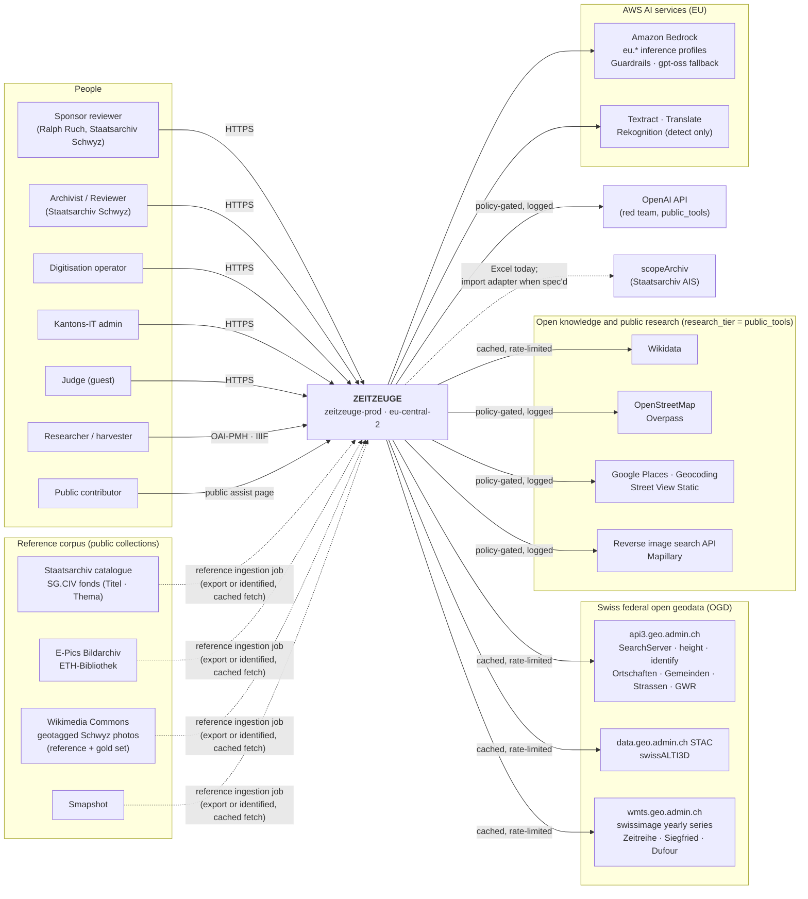
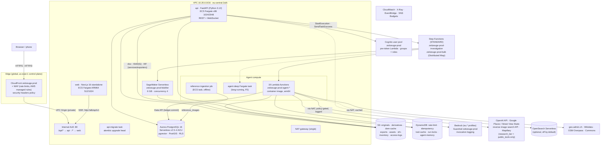
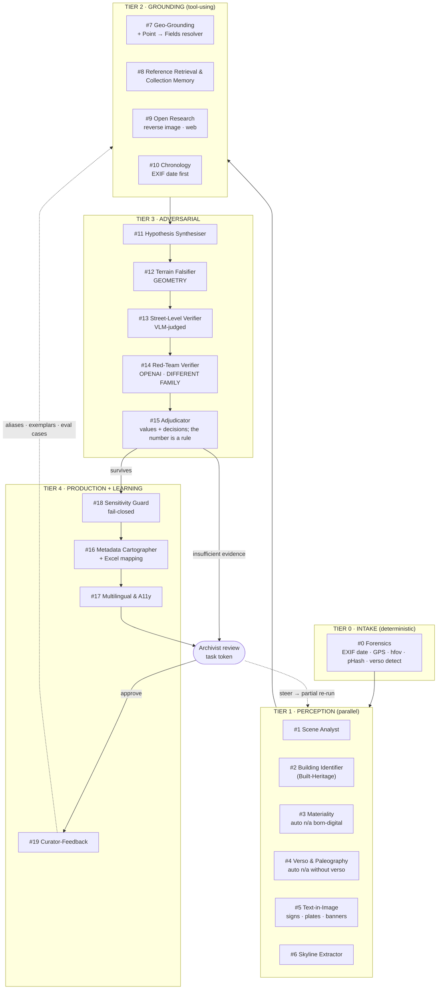
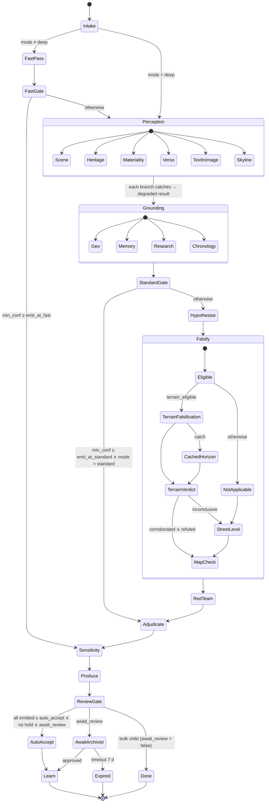
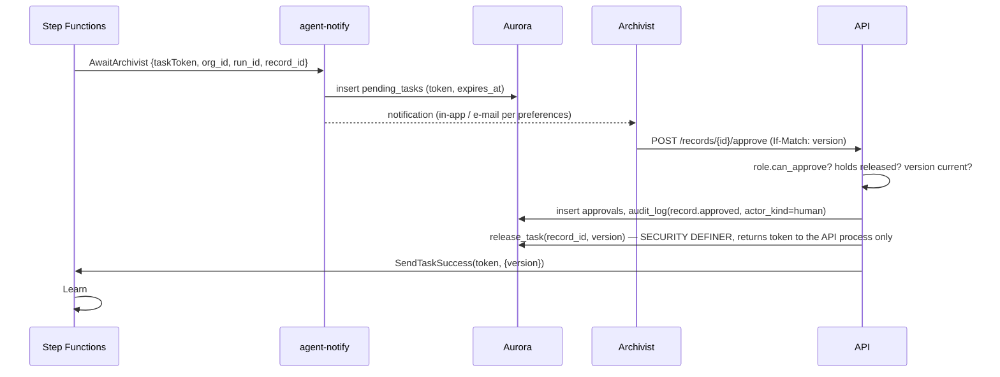
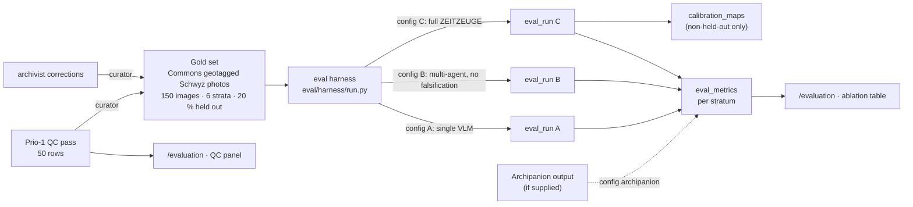

# ZEITZEUGE — Architecture

> *«Wir befragen das Bild.»* — the photograph is a witness; the system cross-examines it and reports only what survives.

| | |
|---|---|
| **Status** | Hackathon day 1. The technical counterpart of [`PROPOSED_SOLUTION.md`](./PROPOSED_SOLUTION.md), covering its §5, §7, §9 and §10 in depth. |
| **Scope** | Every technical aspect of the solution: system context, containers, the 20-agent pipeline, orchestration, the terrain falsifier, the five ranked geographic fields, evidence and decision layer, the confidence rule, the Excel export, the research tier, API, frontend, AWS infrastructure, security, observability, cost, evaluation, CI/CD, delivery plan. |
| **Companion** | [`data-model.md`](./data-model.md) — every table, contract, invariant and RLS policy referenced here. [`brief-review.md`](./brief-review.md) — the brief gaps BR-1…BR-19 this document closes. |
| **Inputs** | The Kanton Schwyz challenge brief, [`PROPOSED_SOLUTION.md`](./PROPOSED_SOLUTION.md) (design), `apps/web` (built UI on simulated data), `apps/api` (built identity slice, 65 tests + RLS suite), `infra/` (17 Terraform modules, ~250 resources, planned not applied), `orchestration/statemachines` (ASL skeletons), `.github/workflows` (5 workflows). |
| **Legend** | ✅ built · 🟡 written, not deployed/wired · 🔲 designed here, to build · ⚠️ verify before relying on it |

---

## Table of contents

1. [Drivers: what the architecture must achieve](#1-drivers-what-the-architecture-must-achieve)
2. [Architectural principles](#2-architectural-principles)
3. [System context](#3-system-context)
4. [Container view](#4-container-view)
5. [The agent architecture](#5-the-agent-architecture)
6. [Orchestration: the deterministic spine](#6-orchestration-the-deterministic-spine)
7. [Signature capabilities, technically](#7-signature-capabilities-technically)
8. [Evidence, adjudication, calibration](#8-evidence-adjudication-calibration)
9. [Human-in-the-loop, catalogue and exports](#9-human-in-the-loop-catalogue-and-exports)
10. [The API](#10-the-api)
11. [The frontend](#11-the-frontend)
12. [Knowledge layer and external data](#12-knowledge-layer-and-external-data)
13. [AWS infrastructure](#13-aws-infrastructure)
14. [Security, privacy and compliance](#14-security-privacy-and-compliance)
15. [Observability](#15-observability)
16. [Cost architecture](#16-cost-architecture)
17. [Evaluation architecture](#17-evaluation-architecture)
18. [Reliability and the demo path](#18-reliability-and-the-demo-path)
19. [CI/CD and environments](#19-cicd-and-environments)
20. [Repository layout](#20-repository-layout)
21. [Delivery: what is real, what is simulated, what gets built in 21.5 h](#21-delivery-what-is-real-what-is-simulated-what-gets-built-in-215-h)
22. [Architecture decision records](#22-architecture-decision-records)
23. [Known gaps and their fixes](#23-known-gaps-and-their-fixes)
24. [Risks and open questions](#24-risks-and-open-questions)

---

## 1. Drivers: what the architecture must achieve

### 1.1 The brief

The official brief (Kanton Schwyz / Staatsarchiv, contact **Ralph Ruch**) states the problem in one sentence:

> *Wie können Ortschaften, politische Gemeinden, konkrete Gebäude, Seen, Berge, Flüsse oder Strassen auf Archivfotos möglichst automatisiert erkannt werden, damit die Bilder mit zuverlässigen geografischen Metadaten erschlossen werden können?*

General object recognition («Gebäude», «Berg», «See») is explicitly insufficient; the archive needs concrete names such as «Schwyz», «Alterszentrum Acherhof», «Mythen». Results must be nachvollziehbar and must disclose uncertainty: the archive must not be filled with seemingly precise but unverifiable entries.

**The test set:** ≈ 600 bisher unerschlossene Fotos neueren Datums (21. Jahrhundert), of which **50 are Priorität 1**, selected by Ralph Ruch and delivered by Webtransfer (a «Link zur Bilddatenbank» is among the challenge documents). «Historische Fotos» refers to the archive context and to the reference holdings; the test images are not exclusively historical, and an exclusive focus on historical black-and-white photographs is out of scope.

**Goal:** a functioning prototype (tool, app, website or macro) that analyses the photos and identifies geographic features as automatically as possible, combining AI methods with already-described image archives, geographic reference sources and public research — and writes **the metadata per image into a structured Excel table** so it can later be imported into the Archivinformationssystem (scopeArchiv).

| # | MUST | Architecture |
|---|---|---|
| M1 | Functioning prototype (tool/app/macro) for analysing digital or digitised photographs | §4–§11 |
| M2 | Read and process the **Prio-1 set of 50**, results captured per image (not every motif need be identified) | `assets.priority`, the Prio-1 batch (§6.6), dashboard counter (§11.2) |
| M3 | Recognise or research geographic features and present them in the priority **Ortschaft → politische Gemeinde → Gebäude → See/Fluss/Berg → Strasse** | Five ranked fields + Point → Fields resolver (§7.7, data-model §8.4) |
| M4 | Concrete geographic assignments; general object types are not an archive result | P1 invariant (§8.1): a named, sourced claim or nothing |
| M5 | Use reference sources: public archive holdings, other institutions' image collections, public geodata and research sources | Reference corpus (§7.4), geodata tools (§5.6), open research (§7.6), research tier (§13.3) |
| M6 | **One Excel row per photo**, with a unique link to the image file and the metadata found | Excel export (§9.6) |
| M7 | **A reliability/confidence value per row** and an understandable explanation of the scoring method | The confidence rule (§8.5), the «Methode» sheet (§9.6) |
| M8 | Mark unclear or undeterminable features transparently instead of inventing names | Abstention (§8.4), `Unbestimmt` column |
| M9 | **Quality control**, and a **live demo on concrete photos** of how assignments, uncertainty and the Excel output come about | QC pass (§9.7), Agent Theater (§11.4), the demo path (§18) |

| # | SHOULD | Architecture |
|---|---|---|
| S1 | Describe more of the ≈ 600 beyond the 50 | Bulk Distributed Map (§6.6) |
| S2 | Improve difficult building/street/address assignments with additional research steps | Deep pass (§6.3), street-level verification (§7.5), open research (§7.6) |
| S3 | Compare several image and text sources automatically; document the most important sources per result | Evidence ledger with `source`/`source_uri` (§8), «Belege» sheet (§9.6) |
| S4 | Separate confidence per field, or a «Prüfbedarf» flag | Per-field confidence; `emit_with_review` (§8.2) |
| S5 | A semi-automatic review procedure for archivists | Case File + triage queue (§9.1–§9.3) |
| S6 | A clear UI with image preview, metadata, source evidence and geographic visualisation | §11; map pane (§11.5) |
| S7 | Systematically index already-described reference images (embeddings, OCR, retrieval, map matching) | `reference_images` + Reference Retrieval (§7.4) |
| S8 | Adapt the Excel export to a later-defined AIS import format | «Spalten» mapping from `field_definitions` (§9.6) |

Out of scope by the brief's own list: error-free identification of all ≈ 600; guaranteed recognition of every building, street or address; a statistically proven > 90 % hit rate as a hard minimum; a direct productive AIS connection; a fully production-ready archive system or training a large image model. The brief names **Claude, OpenAI, Google Maps, Google image search** and similar public research tools as allowed aids, states that the images may be processed with public tools, and names **Archipanion** as the known comparison (general objects, not reliable place or building names). A comparable approach two years earlier produced unconvincing results.

The architecture answers the brief's three verbs: **erkennen** (perception + grounding), **identifizieren** (adversarial adjudication with evidence), **strukturiert aufbereiten** (an Excel row per photograph with a stated confidence rule, plus standards-based records for the archive system).

### 1.2 The scoreboard drives the quality attributes

| Rubric criterion (weight) | Quality attribute it demands | Where the architecture answers it |
|---|---|---|
| Innovation & Kreativität (25 %) | Novel mechanism, not a VLM wrapper | Terrain falsification (§7.1), street-level verification (§7.5), cross-family red team (§5.4), calibrated abstention (§8.4), partial re-execution (§6.5) |
| Technische Umsetzung (25 %) | Legible, auditable, robust architecture; code quality | Step Functions spine (§6), schema-enforced invariants (§8.1), a deterministic confidence rule (§8.5), RLS multi-tenancy (§14.2), IaC + OIDC (§19), eval harness (§17) |
| Problemlösung & Relevanz (20 %) | The 50 Prio-1 photos processed, five ranked fields, an Excel the archive can import, a stated rule, quality control (M2, M3, M6, M7, M9) | Prio-1 batch (§6.6), Point → Fields (§7.7), Excel export (§9.6), confidence rule (§8.5), QC pass (§9.7), human approval gate (§9.2) |
| Präsentation & Pitch (15 %) | The architecture must be *visible* in a demo on the sponsor's own photos | Agent Theater driven by the real event stream (§11.4), the Excel generated live (§18), live eval dashboard (§17), Step Functions graph |
| Business-Potenzial (15 %) | Scales to 100k images at a defensible cost; sellable to public sector | Confidence-gated cascade (§6.3), Distributed Map bulk (§6.6), residency as policy (§13.3), no lock-in (§9.4) |

### 1.3 Hard constraints

| Constraint | Consequence |
|---|---|
| **21 h 30 min** on-site build window (23 Oct 19:30 → 24 Oct 17:00) | Everything structural (infra modules, identity, UI shell, data contracts) is built before; the event delivers the Prio-1 run, the Excel, the agents, the eval and the pitch (§21) |
| **USD 2'000 AWS credit** | Single `prod` environment, serverless-first, budgets and caps enforced in code and in AWS Budgets (§16) |
| **Residency as policy** (`org_policies.research_tier`) | Data at rest only in `eu-central-2` (Zurich); `global.*` Bedrock profiles denied by the permission boundary; public research tools (OpenAI, Google, reverse image search) only under `research_tier = public_tools`, which the brief authorises for this image set (§13.3) |
| **Fresh AWS resources only** | Everything `zeitzeuge-prod-*`; nothing adopted from other projects (one exception: the account's GitHub OIDC provider) |
| **Judges must never hit a wall** | Guest path, demo tenant holding the real Prio-1 photos, every screen opens populated (§18) |
| **Honesty rules** | Anything simulated says so on its face; the system never invents the one number a judge might check; every confidence follows a printed rule |

### 1.4 Personas → architectural responsibilities

| Persona | Primary journey | Components on their path |
|---|---|---|
| Ralph Ruch, Staatsarchiv (sponsor reviewer) | Opens the Excel for the 50 Prio-1 photos; checks a row against the Case File; reads the «Methode» sheet | Excel export (§9.6), Case File (§9.1), confidence rule (§8.5), QC panel (§9.7) |
| Andrea, Archivarin | J1: single photo → review → approve | Upload, Agent Theater (WS), Case File editor, steer, approve (task token), export |
| Marco, Digitalisierung | J2: the Prio-1 batch tonight, the remaining ≈ 550 as a bulk run | ZIP/S3-prefix upload with `label`, Distributed Map, triage queue, batch Excel |
| Dr. Keller, Forscher | Search & cite | OAI-PMH, search, IIIF manifests |
| Ueli, Kantons-IT | Governance | `/admin` policies incl. `research_tier`, audit trail, RLS, residency, Terraform, exports (no lock-in) |
| Public (Muotathal resident) | J3: tip | Public assist page → tip → cross-examination run |

---

## 2. Architectural principles

Three product principles (P1–P3 from the proposal) and six engineering principles. When they conflict, the earlier wins.

| # | Principle | Architectural consequence |
|---|---|---|
| **P1** | No claim without evidence | Evidence Ledger as the central data structure; emitted fields must cite ledger rows; enforced in the contract, the database **and** CI (§8.1) |
| **P2** | Falsification before assertion | A dedicated adversarial tier; a non-LLM falsifier that can veto any LLM; red team on a different model family |
| **P3** | Calibrated silence is a feature | `abstain` is a first-class decision; confidences are fitted on a gold set; the eval measures hallucination as hard as coverage |
| E1 | **Deterministic where auditability matters, agentic where judgment matters** | The macro-flow is an Amazon States Language state machine; LLMs decide *what the photograph shows*, never *what runs next* |
| E2 | **Data, never instructions** | Verso text, OCR, tips, steer hints and API responses are passed to models as delimited untrusted blocks; they can change a value, never a next state |
| E3 | **Isolation in the database** | Every tenant row carries `org_id`; RLS `ENABLE` + `FORCE`; the app role cannot bypass it |
| E4 | **Configuration over code for anything that changes on the day** | Model bindings, thresholds, budgets, guardrails are manifests/policies (`models.yaml`, `org_policies`), not branches |
| E5 | **Every run is replayable** | Inputs hashed, model manifest hashed, all agent I/O persisted; the golden demo run replays byte-identically |
| E6 | **Every number has a stated rule** | A confidence is a deterministic formula over the cited evidence (§8.5), calibrated on a gold set and printed on the Excel «Methode» sheet; a model chooses values and decisions, never the number |

---

## 3. System context



**Boundary decisions**

- ZEITZEUGE never writes into the archive's AIS automatically. Approved records leave first as the **Excel workbook** the brief asks for (one row per photo, §9.6), and as standards files (ISAD(G) CSV, EAD3, DC, IIIF, RiC-O) or by harvest (OAI-PMH). A scopeArchiv import adapter is **designed, not promised** until the import spec is in hand; the «Spalten» sheet makes the later column mapping a configuration change.
- Every external geodata call goes through the tool cache (DynamoDB `tool-cache`); the demo path never depends on a live federal API.
- Public research tools and provider APIs outside AWS (OpenAI for the red team, Google Places / Geocoding / Street View Static, a reverse image search API, Mapillary, the Anthropic API's web search) are reached **only under `org_policies.research_tier = public_tools`**, which the Staatsarchiv tenant sets because the brief clears these images for public tools. Every such call is logged in `cost_ledger` and cited in provenance (§13.3). Under `swiss_only` / `eu`, model providers are reached only through Amazon Bedrock in the EU.
- The reference corpus (`reference_images`) is fed by an offline ingestion job from public collections; the Staatsarchiv's own described SG.CIV records are the strongest prior and are requested as an export from Ralph Ruch first, with an identified, rate-limited, cached fetch of public catalogue records as the fallback the brief itself invites.

---

## 4. Container view



| Container | Technology | Responsibility | Status |
|---|---|---|---|
| **Edge** | CloudFront + WAF (us-east-1 scope), VPC Origin | TLS, HTTP/3, caching of `/_next/static/*`, rate limiting (`/api/v1/auth/` 300 req/5 min/IP; global 50'000), AWS managed rule groups, HSTS/frame-deny headers | 🟡 |
| **web** | Next.js 16.3.5 App Router, React 19.2.8, next-intl (de/en/fr), Tailwind v4, next-themes; standalone server on Fargate ARM64 | All screens; SSR via the internal ALB; no task role (it holds no AWS rights) | ✅ UI on simulated data · 🟡 deploy |
| **api** | FastAPI, Pydantic v2, SQLAlchemy 2 async + asyncpg, structlog, boto3, openpyxl | Identity, tenancy, REST + WebSocket, presigned uploads, batches, run start/steer/approve, **Excel and standards exports** (`services/exporters`), QC panel, OAI-PMH; the only component a browser talks to | ✅ identity slice · 🔲 investigation + export endpoints |
| **api-migrate** | Same image, `alembic upgrade head`, one-off ECS task inside the VPC | Schema migrations (Aurora is unreachable from GitHub runners) | 🟡 |
| **Reference ingestion job** | Same `agents` image, one-off ECS task | Fills `reference_images` from Commons geosearch, SG.CIV catalogue export, E-Pics, Smapshot; computes embeddings; builds the Commons gold set (§17) | 🔲 |
| **Step Functions** | ASL (JSONata), STANDARD; Distributed Map for bulk | The investigation spine; human approval as a durable task-token state; retries; audit trail; the Prio-1 batch is the first bulk manifest | 🟡 skeleton |
| **Agent Lambdas** | 19 functions from one `zeitzeuge/agents` image (incl. exiftool), arm64, X-Ray active, reserved concurrency 50 each | One handler per pipeline step; each wraps one or more roster agents (§5.3) | 🟡 infra (17 keys) · 🔲 code, 2 new keys |
| **Falsifier** | SageMaker Serverless endpoint from `zeitzeuge/falsifier` | DEM ray-casting + horizon matching (geometry, no LLM); reads `exif_hfov_deg` when present | 🟡 infra · 🔲 code |
| **Aurora** | PostgreSQL 16.14 Serverless v2 (0–4 ACU, auto-pause), Data API, IAM auth, `rds.force_ssl` | System of record: tenancy, ledger, catalogue, knowledge, eval, audit | ✅ schema 0001 · 🔲 0002–0008 |
| **Cognito** | User pool (PLUS, advanced security ENFORCED), app clients `web` + `harvester` | Credentials, MFA, groups → roles, `custom:tenant_id` claim | 🟡 |
| **S3 / DynamoDB** | 7 buckets, 5 tables | Bytes, caches, locks, idempotency, agent memory hot path | 🟡 |
| **Bedrock** | `eu.*` application inference profiles, Guardrail, invocation logging | All Claude inference; `gpt-oss` as the in-AWS red-team fallback | 🟡 |
| **Public provider APIs** | OpenAI API (red team), Google Places / Geocoding / Street View Static, reverse image search API, Mapillary; secrets in Secrets Manager | Only under `research_tier = public_tools`; every call in `cost_ledger` (`service ∈ openai · google · search_api`) and in provenance | 🔲 ⚠️ verify each API in preflight |

**Why no API Gateway (ADR-02):** the API validates Cognito JWTs itself and serves WebSockets from FastAPI behind the internal ALB (idle timeout 300 s). One fewer hop, one fewer service to secure and pay for, and the WebSocket shares the REST service's auth, tenancy and RLS code path. The proposal's API Gateway HTTP + WebSocket APIs are dropped.

---

## 5. The agent architecture

### 5.1 Tiers and topology



The roster is **20 agents (#0–#19), six model families** — `deterministic`, `claude-opus`, `claude-sonnet`, `claude-haiku`, `openai` (the red team; `nova` remains only as the in-AWS fallback family, ADR-07), `aws-ml`. The UI derives both numbers from `agents.ts` (`AGENT_COUNT`, `FAMILY_COUNT`); the pitch says twenty.

For the 21st-century test set the weight shifts inside the roster without deleting anything: Forensics is elevated (the camera's own EXIF is a witness — and one that can be wrong), Text-in-Image and Sensitivity become P0, Materiality and Verso degrade automatically to `not_applicable`, Chronology reads the EXIF date first, and two agents are added — Open Research (the public research tools the brief names) and the Street-Level Verifier (the urban counterpart of the terrain falsifier for photos without a horizon).

### 5.2 Roster, model bindings and why

Bindings are resolved by the ModelRouter from `services/agents/router/models.yaml` (§5.5); the column shows the **binding tier**, and the concrete model id comes from the manifest so a regional surprise is a YAML edit.

| # | Agent (`agent_id`) | Binding | Why this model | Tools | Emits (ledger) |
|---|---|---|---|---|---|
| 0 | Forensics (`forensics`) | none (OpenCV, Pillow, ImageHash, exiftool) | Image facts must be arithmetic, never generated. **Elevated for the 21st-century set:** EXIF `DateTimeOriginal`, GPS, make/model, focal length → `exif_hfov_deg`; pHash duplicates within the batch | exiftool, pHash | `assets.forensics`, `phash`, `duplicate_of`, `assets.captured_at/exif_*`; an `exif` place hypothesis and `external` evidence (`source_class = exif`) for the date |
| 1 | Scene Analyst (`scene`) | `balanced` (Sonnet) | Strict JSON inventory with bboxes at backlog-viable cost | — | `visual` evidence with regions |
| 2 | Building Identifier (Built-Heritage) (`heritage`) | `balanced` | Names the building, not the type: GWR/EGID at a point, OSM named features (an «Alterszentrum Acherhof» is in OSM, not in KGS), Wikidata, Google Places (`public_tools`), KGS/ISOS for heritage objects | `geo.identify` (GWR), `osm.overpass`, `places.search`, `heritage.search`, `wikidata.sparql` | `visual`/`external`/`archival` evidence, `building` candidates |
| 3 | Materiality (`materiality`) | `aws-ml` classifier (P1) + `balanced` | Process dating is texture; classifier first, VLM reconciles mounts/borders. **Auto `not_applicable`** for born-digital files (JPEG with EXIF `Make`) | process reference table | `visual` evidence, `date_constraints` |
| 4 | Verso & Paleography (`verso`) | `balanced` vision + Textract (⚠️ region, §13.3) | Kurrent/Sütterlin needs a frontier VLM; Textract reads print; disagreement is signal. **Auto `not_applicable`** when no verso file | Textract `AnalyzeDocument` | `transcription_lines`, `textual` evidence |
| 5 | Text-in-Image (`text-in-image`) | Textract + `balanced` | **P0 for this set:** shop signs, street plates, banners, bus destinations → named entities; Textract localises, the VLM interprets partial Swiss-German toponyms; licence plates → PII flag for #18 | `ocr.read` | `text_findings`, `textual` evidence (`source_class = text_in_image`) |
| 6 | Skyline Extractor (`skyline`) | `aws-ml` segmentation (sky/terrain U-Net or SAM2) | Dense prediction; an LLM cannot output a per-column curve; tighter with a known hfov | — | `horizon_curves` |
| 7 | Geo-Grounding (`geo`) | `balanced` + rerank | Multi-step tool use over federal geo APIs with dialect fuzziness; hosts the deterministic **Point → Fields resolver** (§7.7) that turns a fixed point into Ortschaft, Gemeinde, Gebäude, Strasse with a citable layer each | `geo.search`, `geo.height`, `geo.identify` (Ortschaften, Gemeinden, Strassen, GWR), `gazetteer.lookup`, `wikidata.sparql`, `osm.overpass` | `external` evidence (`geodata_layer`), place/building/street candidates |
| 8 | Reference Retrieval & Collection Memory (`memory`) | embeddings + pgvector HNSW | Nearest-neighbour problem, not a reasoning one — over the **reference corpus** (`reference_images`: SG.CIV, E-Pics, Commons, Smapshot) *and* the tenant's own assets (series within the 600) | `reference.knn`, `memory.knn`, `commons.geosearch` | `similar_items`, `archival`/`external` evidence (`reference_image`) |
| 9 | **Open Research** (`research`) — new | `balanced` + web, image-search and encyclopaedia tools | The public research tools the brief names: **Google reverse image search** on the photo, **Google image search** by candidate name (compare the hits with the photo), **web search** and **Wikipedia** on candidate names («Acherhof Schwyz»); templated queries; **only under `research_tier = public_tools`** | `image.reverse_search`, `image.search`, `web.search`, `wiki.lookup`, `places.search` | `external` evidence with `source_uri` (`open_web`) |
| 10 | Chronology (`chronology`) | `reasoning` (Opus) | EXIF date first; for this fonds the question is "did this building exist at the EXIF date, and does it still?" (swissimage yearly series, Zeitreihe); the historical tool pack (§7.2) stays for historical fonds | period tool pack, `maps.timetravel` | `date_estimates`, `date_constraints` |
| 11 | Hypothesis Synthesiser (`synthesiser`) | `reasoning` | Must hold the whole ledger and produce 2–4 genuinely competing hypotheses with camera poses, of kinds `place · building · street · feature · date · subject · photographer` | — | `hypotheses` |
| 12 | **Terrain Falsifier** (`falsifier`) | none (geometry on SageMaker) | The only component that can *prove* an LLM wrong — also when the LLM's claim came from the camera's GPS; reads `exif_hfov_deg` when present | swissALTI3D, height service | `terrain_tests`, `geometric` evidence (`terrain_geometry`) |
| 13 | **Street-Level Verifier** (`streetlevel`) — new | `balanced` as judge, red-teamed | The urban counterpart of #12 for photos without a horizon: the view at the hypothesised pose from Street View Static / Mapillary / swisstopo 3D compared by a VLM; weaker than geometry and labelled "VLM-judged" (§7.5) | `streetview.static`, `mapillary.images` | `street_tests`, `external` evidence (`street_level`) |
| 14 | Red-Team Verifier (`redteam`) | `adversarial` = **OpenAI** (direct API under `public_tools`; `gpt-oss` on Bedrock as the in-AWS fallback) | Independence: a Claude reviewing Claude shares its priors; OpenAI is a headline sponsor and is named in the brief | `maps.timetravel`, contradiction checks | `objections` |
| 15 | Adjudicator (`adjudicator`) | `reasoning` | The most consequential judgment: which value, emit vs abstain per field, which objections are upheld. **The confidence number is not the model's**: it is the deterministic rule of §8.5 over the cited evidence, then calibrated | `calibration_maps` | `record_fields` decisions |
| 16 | Metadata Cartographer (`cartographer`) | `fast` (Haiku) | Mechanical ledger → the five ranked fields + ISAD(G)/DC/RiC-O mapping, then schema-validated; feeds the Excel columns via `field_definitions.excel_column` | JSON Schema validator | `record_versions`, `record_fields` |
| 17 | Multilingual & A11y (`multilingual`) | `fast` + Translate | DE archival register → FR/IT/EN; WCAG alt text (parked: runs, low priority) | Translate | `title@fr/it/en`, `alt_text` |
| 18 | Sensitivity Guard (`sensitivity`) | Guardrail + `fast` | Fail-closed gate: minors, living persons, PII incl. **licence plates**; detection only. More relevant on recent photos, not less | Rekognition `DetectFaces`, text findings | `sensitivity_flags` |
| 19 | Curator-Feedback (`curator`) | `fast` + embeddings | QC corrections → aliases, exemplars, eval cases | memory store | `corrections`, `memory_exemplars`, `eval_cases` |

### 5.3 Roster → deploy units (reconciling the Lambda keys)

`infra/modules/compute-agents` creates the 17 original functions whose keys predate the roster names; two keys (`research`, `streetlevel`) are added for the new agents, making **19 functions**. The ledger always records **roster ids**; the Lambda key is an implementation detail.

| Lambda `zeitzeuge-prod-agent-<key>` | Roster agent(s) | Timeout / memory | Note |
|---|---|---|---|
| `intake` | #0 Forensics | 120 s / 2 GB | exiftool in the image; also writes access copy, thumbnail, static IIIF tiles (§9.5) |
| `vehicles` → **rename `scene`** | #1 Scene Analyst | 120 s / 2 GB | Vehicles are part of the scene inventory, not an agent |
| `built` | #2 Building Identifier | 120 s / 2 GB | |
| `material` | #3 Materiality | 120 s / 2 GB | Returns `not_applicable` for born-digital files |
| `verso` | #4 Verso & Paleography | 120 s / 2 GB | Skips (status `not_applicable`) when no verso file |
| `signage` | #5 Text-in-Image | 120 s / 2 GB | |
| `skyline` | #6 Skyline Extractor | 120 s / 2 GB | CPU ONNX segmentation in the Lambda — no separate SageMaker endpoint |
| `grounding` | #7 Geo-Grounding + #8 Reference Retrieval & Collection Memory | 300 s / 2 GB | One Lambda, two invocations recorded, both in the ledger; hosts the Point → Fields resolver |
| `research` — **new** | #9 Open Research | 300 s / 2 GB | No-op (status `skipped`) unless `research_tier = public_tools` |
| `chronology` | #10 Chronology (tier 2) and the per-hypothesis map time-travel check | 300 s / 2 GB | |
| `hypothesise` | #11 Synthesiser | 300 s / 2 GB | |
| *(SageMaker)* `zeitzeuge-prod-falsifier` | #12 Terrain Falsifier | serverless | |
| `cached-horizon` | #12 fallback | 30 s / 1 GB | Precomputed horizons for curated viewpoints when the endpoint is cold/absent |
| `streetlevel` — **new** | #13 Street-Level Verifier | 300 s / 2 GB | Runs when the terrain test is `not_applicable` or `inconclusive`; needs `public_tools` for Street View, Mapillary otherwise |
| `redteam` | #14 Red-Team | 300 s / 2 GB | OpenAI direct under `public_tools`; Bedrock `gpt-oss` otherwise |
| `adjudicate` | #15 Adjudicator | 300 s / 2 GB | Computes the §8.5 rule after the model's decisions |
| `produce` | #16 Cartographer + #17 Multilingual | 300 s / 2 GB | |
| `sensitivity` | #18 Sensitivity Guard | 120 s / 1 GB | |
| `notify` | — (human gate) | 30 s / 512 MB | Persists the task token (`pending_tasks`), notifies the archivist |
| `learn` | #19 Curator-Feedback | 60 s / 1 GB | Also refreshes search projections and `fonds_stats` |

### 5.4 The agent contract

Every handler follows the same skeleton, implemented once in `services/agents/runtime/`:

```text
handler(event: StateRef) → StateRef
  1. load      ← run context by reference ({org_id, run_id, asset_id, ledger_version, invalidate[]})
  2. reuse?    ← if this agent ∉ invalidate and the parent run has a succeeded invocation:
                   record status=reused (reused_from_id), return            [§6.5]
  3. lock      ← idempotency key (run_id, agent_id, attempt) in DynamoDB    [retries are safe]
  4. assemble  ← trusted system prompt + ledger excerpt (incl. EXIF-derived hypotheses and evidence from #0)
                 + UNTRUSTED blocks (verso text, OCR, tips, API bodies, web-page extracts, reverse-image hits)
  5. route     ← ModelRouter.select(task_kind, difficulty, budget, region, research_tier)  [§5.5]
  6. call      ← Bedrock with strict tool schemas / structured output, guardrail attached
  7. validate  ← Pydantic envelope (data-model §14.1); reject → retry once with the validation error, then fail
  8. commit    ← ledger.commit(envelope): one Data API transaction — invocation row, evidence,
                 hypotheses/objections, run_events + pg_notify, cost_ledger
  9. return    ← {org_id, run_id, asset_id, ledger_version+1, summary flags for Choice states}
```

Design rules:

- **References, not payloads, between states.** Step Functions carries `StateRef` only; agents read what they need from Aurora/S3. No scan bytes, transcriptions or tips sit in execution history, and the 256 KB payload limit never matters.
- **Structured outputs only.** Every LLM call uses strict tool schemas or `output_config.format` (supported on Bedrock). Free text is allowed only inside named fields (`observation`, `claim`).
- **Current-generation API surface (⚠️ verify per model on day 1).** Claude Opus 5.5 / Sonnet 5.5 reject forced `tool_choice` (`any`/`tool`), reject disabled thinking and `budget_tokens`; sampling parameters (`temperature`/`top_p`/`top_k`) are rejected on the current models. The runtime therefore uses `tool_choice: auto` + `strict: true`, adaptive thinking with `output_config.effort` per task kind, and no sampling parameters. Refusals (`stop_reason: "refusal"`) are handled explicitly: on Bedrock with the SDK's client-side refusal-fallback middleware to the next binding, recorded as an invocation attempt.
- **No agent decides control flow.** Agents return data plus a few typed flags (`max_confidence`, `terrain_eligible`, `street_eligible`, `needs_review`) that ASL Choice states read. An injected "skip the falsifier" in a verso or on a web page can, at worst, change a value that the adjudicator then has to justify with evidence.
- **No agent decides a number.** Agents emit evidence with a `source_class` and a `strength`; the confidence of a field is computed from the ledger by the rule in §8.5 and printed on the Excel «Methode» sheet (E6).
- **One SDK, thin runtime (ADR-10).** The Anthropic Python SDK's Bedrock client for Claude (the direct Anthropic client only for `web.search` under `public_tools`), the OpenAI SDK for the red team under `public_tools` with `boto3` Bedrock Converse (`gpt-oss`) as fallback, Pydantic for contracts. No agent framework: the control flow lives in ASL, and the tool loops are small enough to own.

### 5.5 ModelRouter and `models.yaml`

```yaml
# services/agents/router/models.yaml — the router's only source of truth.
# Application inference profiles are created by infra/modules/bedrock (validated to start with "eu.").
bindings:
  reasoning:   { profile: zeitzeuge-prod-reasoning, model: eu.anthropic.claude-opus-5-5,   effort: high,   fallback: balanced }
  balanced:    { profile: zeitzeuge-prod-balanced,  model: eu.anthropic.claude-sonnet-5-5, effort: medium, fallback: fast }   # ⚠️ ADR-07: confirm the eu.* profile in preflight
  fast:        { profile: zeitzeuge-prod-fast,      model: eu.anthropic.claude-haiku-5-5,  fallback: null }                   # ⚠️ ADR-07: confirm the eu.* profile in preflight
  adversarial:                                                                                                                 # ADR-07: a different family from the authors
    public_tools: { provider: openai, model: <current OpenAI vision model>, fallback: adversarial.eu }                           # direct API, secret in Secrets Manager ⚠️ verify
    eu:           { model: <openai.gpt-oss eu.* profile>, fallback: fast }                                                     # in-AWS fallback (Bedrock Converse) ⚠️ verify
  embed:       { model: <multimodal embedding available via eu.*>, dim: 1024 }                                                 # ⚠️ Titan MM is not in eu-central-2
task_kinds:
  vision.describe:      [balanced]
  vision.paleography:   [balanced]
  tool.geo_ground:      [balanced]
  tool.research:        [balanced]          # #9 Open Research — requires research_tier = public_tools, else skipped
  verify.street_level:  [balanced]          # #13 — the judge; Street View needs public_tools, Mapillary does not
  reason.chronology:    [reasoning]
  reason.synthesise:    [reasoning]
  reason.adjudicate:    [reasoning]
  verify.red_team:      [adversarial]
  produce.map_fields:   [fast]
  produce.translate:    [fast]
  guard.sensitivity:    [fast]
  learn.curate:         [fast]
cascade:                            # §6.3 — thresholds come from org_policies at run time
  fast_pass:     [fast]
  standard_pass: [balanced]
  deep_pass:     [reasoning, adversarial]
research_tiers:                     # §13.3 — which providers each org_policies.research_tier may reach
  swiss_only:   { providers: [bedrock-eu-central-2], tools: [geoadmin, wikidata, osm, commons] }
  eu:           { providers: [bedrock-eu], tools: [geoadmin, wikidata, osm, commons, mapillary] }
  public_tools: { providers: [bedrock-eu, openai, anthropic-web-search], tools: [geoadmin, wikidata, osm, commons, mapillary, google-places, google-streetview, reverse-image-search] }
denied_prefixes: ["global."]        # mirrors the permission boundary
```

`ModelRouter.select(task_kind, difficulty, budget, region, research_tier) → ModelBinding` resolves the binding, refuses any provider the tenant's `research_tier` does not allow, checks the remaining per-run budget (`org_policies.per_run_cap_usd`) **before** the call, and records `models_manifest_sha` on the run. Every call — Bedrock, OpenAI, Google, search API — lands in `cost_ledger` with units and the price-table version.

### 5.6 Tools (the "MCP geo" surface)

The proposal's single MCP tool server is implemented as **an in-process tool library** (`services/mcp-geo/zeitzeuge_geo/`) imported by the agent image, with the same tool schemas exposed by a thin MCP server for local development and for the pitch ("one grounded tool surface every agent shares"). In Lambda, an extra network hop to a tool server buys nothing.

| Tool | Backend | Tier | Cache |
|---|---|---|---|
| `geo.search(query, types)` | GeoAdmin SearchServer (`locations`, `featuresearch`) | all | `tool-cache`, 30 days |
| `geo.height(lv95)` | GeoAdmin height service | all | `tool-cache`, 365 days |
| `geo.identify(lv95, layers)` | GeoAdmin identify — layers `ch.swisstopo-vd.ortschaftenverzeichnis_plz` (Ortschaft), swissBOUNDARIES3D Gemeinde (BFS-Nr), `ch.swisstopo.amtliches-strassenverzeichnis` (Strasse), GWR (EGID, address) — the Point → Fields resolver's backend (§7.7) | all | `tool-cache`, 30 days |
| `gazetteer.lookup(name, near?)` | Aurora `gazetteer_entries` + aliases (trigram + embedding) | all | — |
| `heritage.search(text|image)` | Aurora `heritage_objects` (pgvector) | all | — |
| `osm.overpass(bbox, tags)` | OpenStreetMap Overpass, templated tag queries (named buildings, amenities, streets) | all | `tool-cache`, 30 days |
| `reference.knn(image|text, k)` | Aurora `reference_images` HNSW (SG.CIV, E-Pics, Commons, Smapshot, Memobase) | all | — |
| `memory.knn(asset_id, k)` | Aurora `memory_embeddings` HNSW, tenant-scoped by RLS | all | — |
| `commons.geosearch(lat, lon, radius)` | Wikimedia Commons API `geosearch` (reference images near a point) | all | `tool-cache`, 30 days |
| `maps.timetravel(lv95, year, layer)` | WMTS time dimension — swissimage yearly orthophoto series (`ch.swisstopo.swissimage-product` ⚠️ time values), Zeitreihe, Siegfried, Dufour (⚠️ layer ids); swisstopo historical aerial images (LUBIS) for years between orthophoto releases | all | `tool-cache` + S3 crops |
| `ocr.read(image, region?)` | Amazon Textract `DetectDocumentText` (⚠️ `eu-central-1`, so `eu` tier and above); under `swiss_only` the `balanced` VLM reads the region instead and the reader is recorded | `eu`, `public_tools` (VLM fallback: all) | — |
| `period.events(near?, kind?)` | Aurora `period_events` | all | — |
| `wikidata.sparql(query_template, args)` | Wikidata (templated queries only — no free SPARQL from a model) | all | `tool-cache`, 7 days |
| `mapillary.images(near, bearing)` | Mapillary API (street-level imagery by location and heading) ⚠️ token | `eu`, `public_tools` | `tool-cache` + S3 crops |
| `places.search(name, near)` | Google Places / Geocoding (named buildings, institutions, addresses) ⚠️ key | `public_tools` | `tool-cache`, 30 days |
| `streetview.static(pose)` | Google Street View Static API (view at lat/lon/heading/fov) ⚠️ key | `public_tools` | S3 crops |
| `image.reverse_search(image)` | Google reverse image search (Lens) via a search API ⚠️ provider and key | `public_tools` | `tool-cache`, 7 days |
| `image.search(query)` | Google image search by text — Programmable Search JSON API with `searchType=image` or the same search-API provider ⚠️ key — on candidate names; the hits are compared with the photo by the `balanced` VLM | `public_tools` | `tool-cache`, 7 days |
| `web.search(query)` | Anthropic API web search tool (templated queries on candidate names); **OpenAI web search as the fallback provider** ⚠️ verify both | `public_tools` | `tool-cache`, 7 days |
| `wiki.lookup(title|query, lang)` | Wikipedia REST API (`de`, then `en`/`fr`/`it`): summary, coordinates, image, Wikidata QID of a named building or place | all | `tool-cache`, 7 days |

All tool responses are returned to the model wrapped as untrusted data, with the source URL, so the evidence item can cite `source_uri` and carry its `source_class`. The tool library checks `research_tier` before every call; a tool outside the tier returns `{status: not_allowed}` and the agent records it.

---

## 6. Orchestration: the deterministic spine

### 6.1 Why Step Functions (ADR-01)

| Requirement | Mechanism |
|---|---|
| Auditable, replayable | Execution history (ALL, 90 days) + permanent ledger in Aurora linked by `runs.sfn_execution_arn` |
| Human-in-the-loop | `lambda:invoke.waitForTaskToken` — a run can wait for an archivist's holiday to end |
| Parallel fan-out | `Parallel` (perception), `Map` (falsify per hypothesis) |
| Bulk | Distributed Map over an S3 inventory manifest |
| Failure isolation | Per-state Retry/Catch; partial perception is a degraded result, not a failure |
| Cost control visible in the diagram | Choice states implement the cascade declaratively |
| Prompt-injection containment | The model cannot change the next state; ASL owns the flow |

### 6.2 Target investigation state machine

The committed `investigation.asl.json` is a skeleton (§23 lists its gaps). The target:



State-level contract:

| State | Type | Resource | Retry / Catch | Output flags read by Choice |
|---|---|---|---|---|
| Intake | Task | `agent-intake` | TaskFailed ×2, backoff 2 | `has_verso`, `born_digital`, `has_exif_gps`, `terrain_candidate` |
| FastPass | Task | `agent-produce` in `fast` mode (Haiku + Textract on caption/verso; EXIF GPS + Point → Fields when present) | ×1 | `min_conf` |
| Perception | Parallel ×6 | `scene`, `built`, `material`, `verso`, `signage`, `skyline` | **each branch** catches `States.ALL` → returns `{status: degraded}` so the others' results survive; `material`/`verso` return `not_applicable` by flag | `terrain_eligible` (skyline quality) |
| Grounding | Parallel ×4 | `grounding` (geo), `grounding` (memory), `research`, `chronology` | ALL ×3, interval 2 s; `research` returns `skipped` unless `research_tier = public_tools` | `min_conf` |
| Hypothesise | Task | `hypothesise` | ×1 | returns `{hypotheses: [refs]}` |
| Falsify | Map (INLINE, max 4) over `hypotheses` | SageMaker `invokeEndpoint` → catch → `cached-horizon`; `streetlevel` when the terrain test is `not_applicable` or `inconclusive`; then `chronology` map-check | per-item catch → item `{status: inconclusive}` | — |
| RedTeam | Task | `redteam` | ×1, catch → objection-less run flagged `needs_review` | — |
| Adjudicate | Task | `adjudicate` | ×2 | `min_conf`, `any_hold` |
| Sensitivity | Task | `sensitivity` | **no catch-to-continue**: failure ⇒ hold (fail-closed) | `any_hold` |
| Produce | Task | `produce` | ×2 | — |
| AwaitArchivist | Task `.waitForTaskToken` | `notify` with `{taskToken, org_id, run_id, record_id}` | `TimeoutSeconds` 604800, **no heartbeat** (or a daily heartbeat Lambda); catch Timeout → Expired | — |
| Learn | Task | `learn` | ×2 | — |

### 6.3 The confidence-gated cascade (M1)

```
fast_pass (Haiku + Textract)         ── min_conf ≥ emit_at_fast (0.85) ─────▶ produce   (~60 % of a real backlog)
        │ no
standard_pass (Sonnet perception + grounding) ── ≥ emit_at_standard (0.80) ─▶ adjudicate (~30 %)
        │ no
deep_pass (Opus synthesis + falsifier + red team + adjudication)            (~10 %)
```

- Thresholds are read from `org_policies` at execution start and written into the execution input, so the ASL stays static and every run records the thresholds it used.
- `/admin` projects shares and blended cost from the latest eval run's first- and second-pass confidence histograms (`projectCascade()`), so dragging a threshold shows its consequence before it is committed.
- The `mode` an operator chooses (`fast|standard|deep`) caps or forces the cascade; `runs.reached_stage` records where it stopped.

### 6.4 The ledger write path

Agents never hold an Aurora connection pool. `ledger.commit()` uses the RDS **Data API** (enabled on the cluster, granted to `lambda-agent-exec`) in a single transaction, as the `zeitzeuge_pipeline` database role, with `SET LOCAL app.org_id` first — RLS applies to the pipeline exactly as to the API. The transaction ends with `SELECT pg_notify('run_<id>', seq)`, which is how the API's WebSocket handler learns about new events (§10.4).

Idempotency: `(run_id, agent_id, attempt)` + DynamoDB `idempotency`; a Step Functions retry of an already-committed step returns the committed result instead of writing twice.

### 6.5 Partial re-execution on steering (M3)

```mermaid
sequenceDiagram
    participant A as Archivist
    participant API
    participant DB as Aurora
    participant SFN as Step Functions
    participant AG as Agent Lambdas
    A->>API: POST /runs/{id}/steer {hint}
    API->>API: classify hint → chain (place | date | collection)
    API->>DB: lock run (DynamoDB run-locks); insert steer, human evidence, steer hypothesis
    API->>DB: insert child run (kind=steer, parent_run_id)
    API->>SFN: StartExecution {run_id: child, invalidate: [...]}
    loop every state
      SFN->>AG: invoke
      alt agent ∉ invalidate
        AG->>DB: invocation status=reused, reused_from_id=parent's (ms)
      else agent ∈ invalidate
        AG->>DB: full execution, new evidence (ev_019…)
      end
    end
    AG-->>API: pg_notify → WS events (only invalidated agents light up)
```

- The invalidation set is a **DAG walk over the agent dependency graph** (`services/agents/runtime/dag.py`), not a hand-maintained list. Tier-4 agents downstream of the cartographer are always invalidated (this closes the incomplete `STEER_CHAINS` in the UI, data-model R2; the CHECK is `|invalidated| + |kept| = 20`).
- Same ASL, no special "steer" state machine: reuse is decided inside the handler (step 2 of §5.4). The Step Functions graph still shows every state, which keeps the run legible.
- Kept evidence keeps its original provenance (`reused_from_id`); the ledger shows exactly what the human changed. Target: ~10 s instead of ~120 s.

### 6.6 Bulk (J2)

```
Batch manifest (API-written for prio1 / rest600; S3 Inventory daily for the backlog)
   → sfn-inventory/…/bulk-manifest/<batch_id>/manifest.json
   └─ zeitzeuge-prod-bulk  (Distributed Map, MaxConcurrency 20, ToleratedFailurePercentage 5)
        └─ child: zeitzeuge-prod-investigation  input {org_id, asset_id, run_id, mode, batch_id, await_review: false}
             → ends at Produce; record lands in review_queue (or auto-accepted); its Excel row is ready
   ResultWriter → sfn-inventory/results/ ; failures → zeitzeuge-prod-bulk-dlq
   └─ batch Excel: GET /api/v1/batches/{id}/export?fmt=xlsx renders one row per asset from the DB (§9.6)
```

- **The Prio-1 set is the first bulk manifest.** The 50 photos are ingested as `upload_batches.label = prio1` with `assets.priority = 1` and `external_ref` = the delivered filename; the remaining ≈ 550 as `rest600`. The dashboard counts `prio1: processed / reviewed / total`.
- Bulk children **do not** wait on a task token; otherwise 20 slots would sit blocked for days. Approval of bulk results happens in the triage queue (`approvals.mode = bulk_threshold` above the archivist's slider) and in the Prio-1 QC pass (§9.7).
- For an ad-hoc batch (ZIP or prefix), the API writes its own manifest instead of waiting for the daily inventory.
- At backlog scale, the non-interactive LLM steps can move to **Bedrock batch inference** (AWS `CreateModelInvocationJob`, ~50 % price) — note that Anthropic's own Message Batches API is not available on Bedrock.

---

## 7. Signature capabilities, technically

### 7.1 Terrain falsification (agent #12)

**Inputs:** the skyline curve h(u) from agent #6 (`horizon_curves`), a hypothesis' predicted pose (LV95, bearing, hfov), the image's dimensions, and — for born-digital photos — `assets.exif_hfov_deg` (focal length × sensor width from the EXIF make/model), which fixes one of the three unknowns of the match. A hypothesis whose pose came from EXIF GPS (`origin = exif`) is tested exactly like any other: the camera is a witness, not an authority.

**Algorithm**

1. **Viewshed tiles.** From the pose, compute the swissALTI3D tiles within a ~40 km radius sector (bearing ± hfov/2 + margin); fetch from `dem-cache` or the swisstopo STAC API (`ch.swisstopo.swissalti3d`), cache in S3. Work at 2 m near-field, downsampled 10 m / 50 m in distance bands.
2. **Observer height.** Ground elevation from the GeoAdmin height service + 1.6 m eye height.
3. **Ray-cast.** For each azimuth θ in the field of view (one per image column, e.g. 1280), march outward; keep the maximum elevation angle with Earth-curvature and refraction correction (k ≈ 0.13) → synthetic horizon ĥ(θ).
4. **Match.** Normalised cross-correlation between h(u) and ĥ(θ) over yaw, tilt, focal length (focal length held fixed when `exif_hfov_deg` is known): coarse grid sweep → Levenberg–Marquardt refinement. Score ∈ [0,1].
5. **Verdict.** `≥ 0.85 → corroborated` (emit refined pose and accuracy), `< 0.45 → refuted` (the hypothesis dies regardless of LLM confidence), otherwise `inconclusive`. Thresholds come from `org_policies` and are stored on each `terrain_tests` row.
6. **Labels.** Gazetteer peaks within the viewshed are projected; **only peaks that produce a distinct local maximum in ĥ** are labelled (from Brunnen: Kleiner Mythen 1811 m, Grosser Mythen 1898 m — not the Haggenspitz).
7. **Render.** Overlay PNG (cyan ĥ over the scan, peak labels) → `derivatives`; geometric evidence item `ev_…` citing it.

**Eligibility and honesty.** Skyline quality below threshold, interiors, haze or flat terrain → `not_applicable`, recorded with a reason. That is a correct output (P3), and the eval reports coverage per stratum. A municipal photo set of recent date has a smaller landscape share than an alpine glass-plate collection; the `not_applicable` and `inconclusive` cases hand over to the street-level verifier (§7.5).

**Compute.** NumPy/Numba ray-caster in the `zeitzeuge/falsifier` container on SageMaker Serverless (6 GB, max concurrency 4). Fallback when the endpoint is absent or cold: `cached-horizon` matches against precomputed horizons for curated viewpoints in `dem-cache/horizons/` (proposal §13.4: "even a 20-viewpoint version demos identically").

**Prior art acknowledged:** Baatz et al. (ECCV 2012) for skyline/DEM matching on Swiss terrain; Smapshot (HEIG-VD/EPFL) for 6-DoF georeferencing of historical photos. ZEITZEUGE's difference: falsification of competing hypotheses inside an evidence-gated cataloguing pipeline, rather than search or crowd georeferencing.

### 7.2 Chronology (agent #10) — EXIF first, tool pack for historical fonds

**For the 21st-century set** the date comes from EXIF `DateTimeOriginal` (evidence `source_class = exif`, written by #0). The agent's remaining job is the one the brief names — *«Einige Gebäude existieren heute möglicherweise nicht mehr»*: confirm that a claimed building existed at the EXIF date and whether it still does, using `maps.timetravel` over the swissimage yearly orthophoto series and the Zeitreihe maps, and `period_events` of kind `building_built` / `building_demolished` for 2000–2026. `date_estimates.window_from/to` are per run — `[captured_at − 1, captured_at + 1]` when EXIF exists, else the fonds' range (1990–2026 for `foto21`).

**For historical fonds** (Bettschart, Goetz, Ansichtskarten) the full tool pack stays: typed constraints, each a `terminus post quem` or `ante quem` with a strength, fused into a distribution over years (`date_estimates.distribution`):

| Tool | Backend | Constraint |
|---|---|---|
| Map time-travel | WMTS Siegfried/Dufour/Zeitreihe/swissimage at year Y | structure present/absent on revision Y |
| Period events | `period_events` (Sihlsee 1937, rail openings/electrification, SGV steamers, road builds, building built/demolished) | post/ante the event |
| Postcard back typology | rule table (undivided/divided back, publisher imprints and active ranges) + verso transcription | bracket |
| Photographic process | Materiality output | process-era prior |
| Soft cues | Scene inventory (vehicles, poles, clothing) | low-strength priors |

Fusion: product of per-constraint likelihoods (logistic edges at each terminus, width by strength) over the run's window, normalised; the emitted bracket is the highest-density interval at the adjudicated confidence. Contradictions (mass < ε) are surfaced as objections, not averaged away. The UI timeline draws each constraint and lets the archivist disable one (a `field_review` of action `constraint_disabled` → steer run of chain `date`).

### 7.3 Verso intelligence (agent #4)

Runs only when a verso file exists; born-digital photos have none and the agent returns `not_applicable` without a model call. When it runs: two independent readers per line, Textract for print/typewriter/stamps, the VLM with a paleography prompt (Kurrent, Sütterlin, abbreviations) for handwriting. Lines are aligned; disagreement sets `readers_agree = false` and is never silently resolved. Normalisation (`Gde. → Gemeinde`, `ſ → s`) is a separate, recorded step. A verso annotation ("Muotathal 1912") enters the ledger as a **human-source hypothesis** — weighted high, and still sent to the falsifier, because backs are often written decades later from memory.

### 7.4 Reference retrieval and collection memory (agent #8)

Two indexes, one agent:

- **Reference corpus** — `reference_images` (global, `org_id` nullable): already-described images from the Staatsarchiv's **SG.CIV** fonds (Titel/Thema carry place names; reference example SG.CIV.01.2 «Friedhof Schwyz, 1893»), **E-Pics** (ETH-Bibliothek), **Wikimedia Commons** geotagged photos of Schwyz municipalities, **Smapshot** georeferenced views, and **Memobase** (described photographs from other Swiss memory institutions). Each row: source, external id, title, thema, place text, `geom`, captured year, licence, `source_uri`, thumbnail, image + text embedding. `reference.knn` returns the nearest reference images; a hit becomes `external`/`archival` evidence with `source_class = reference_image` and the reference's `source_uri`. This is the brief's SHOULD S7 ("bereits erschlossene Referenzbilder systematisch indexieren") and the strongest prior available once the archive's own records are in.
- **Collection memory** — image + text embeddings per asset in `memory_embeddings` (pgvector HNSW, tenant-scoped by RLS). kNN at k=20 → rerank → top 4 `similar_items` with relation labels (`same_shoot`, `same_place`, `same_series`, `same_massif`, `duplicate`). Offline, HDBSCAN over a fonds produces `detected_series`; within the 600 this finds the shoots, so one confirmed place propagates as a `reference_match` hypothesis to its siblings and the triage reason reads "N photographs hang on this decision".

Ingestion is an offline job (§4): Commons via the API `geosearch`; SG.CIV as an export from Ralph Ruch, or an identified, rate-limited, cached fetch of public catalogue records (the brief itself points at the public catalogue); E-Pics via API access if granted, else through the ETH Bildarchiv's Commons uploads (ADR-18).

### 7.5 Street-level verification (agent #13)

The terrain falsifier covers photographs with a visible horizon. For the rest — village streets, single buildings, events — the analogous test is: fetch what the claimed spot looks like and compare.

1. **Inputs:** a hypothesis' pose (LV95, bearing, hfov) and the scene inventory. Runs when the terrain test is `not_applicable` or `inconclusive` (§6.2).
2. **Fetch the view:** `streetview.static(pose)` (Google, `public_tools`), else `mapillary.images(near, bearing)`, else a swisstopo 3D view; the fetched image and its URL are stored as an artifact.
3. **Judge:** a `balanced` VLM compares the photograph with the fetched view on facade geometry, roof lines, openings, signage and skyline fragments, and returns a similarity ∈ [0,1] with named correspondences (regions on both images). The red team (#14) sees the same pair and may object.
4. **Verdict:** `≥ street_corroborate (0.75) → corroborated`, `< street_refute (0.35) → refuted`, else `inconclusive`; thresholds from `org_policies`, stored per `street_tests` row with `provider`, `judge_model_id`, `reference_image_uri`, `overlay_s3_key`.
5. **Honesty:** this is a model's judgment, not geometry. It is labelled "VLM-judged" in the UI and the Excel, weighted 0.5 in the confidence rule (against 0.9 for terrain geometry, §8.5), and a `refuted` street test blocks `emit` on the place-family fields (I-4). The brief's own caveat applies and is recorded: *buildings may no longer exist, current imagery may differ* — a mismatch against today's street view is an objection, not a refutation, when `maps.timetravel` shows a change since the EXIF date.

### 7.6 Open research (agent #9)

The brief names Google image search and public research as allowed aids; this agent is where they live. Under `research_tier = public_tools` only (else the handler returns `skipped`):

- `image.reverse_search(photo)` — Google reverse image search (Lens); hits are returned as untrusted data (title, URL, snippet, matched image) and become `external` evidence with `source_class = open_web` and the hit's `source_uri`.
- `image.search(query)` — Google image search by text on each candidate name («Alterszentrum Acherhof Schwyz»); the `balanced` VLM compares the top hits with the photograph and only a match it can point at (facade, roofline, sign) becomes evidence. This is the archivist's manual "Google-Bildsuche" step, automated and cited.
- `web.search(query)` — templated queries built from candidate names the other agents produced («Alterszentrum Acherhof Schwyz», «<street> <Ortschaft>»); page extracts are untrusted blocks; a claim is evidence only with its URL. Provider: the Anthropic web search tool, OpenAI web search as fallback.
- `wiki.lookup(name)` — Wikipedia summary, coordinates and Wikidata QID of a named building or place; available in every tier because it is open reference data, and the QID links the field value to an authority (`value_uri`).
- `places.search(name, near)` — Google Places / Geocoding for institutions, hotels, schools, churches that have a name and an address; the address feeds the Point → Fields resolver.

Rules: queries are templates, never free text from a model (ADR-11); every hit is one source class (`open_web`) however many pages agree; a page that contradicts a hypothesis is an objection candidate for the red team; nothing from the open web is ever a value without a `source_uri`.

### 7.7 Point → Fields resolver (in agent #7)

The brief's five ranked fields are different kinds of answer, but once any witness fixes a **point** — a corroborated terrain pose, a corroborated street test, an EXIF GPS fix that survived falsification, or a reference match with coordinates — four of them are deterministic lookups with a citable federal layer each:

| Field (`field_key`) | Brief term | Lookup | Evidence |
|---|---|---|---|
| `locality` | Ortschaft | `geo.identify` on `ch.swisstopo-vd.ortschaftenverzeichnis_plz` at the **subject point** | `geodata_layer`, layer + feature id |
| `municipality` | politische Gemeinde | `geo.identify` on swissBOUNDARIES3D Gemeinde → name + BFS-Nr | `geodata_layer` |
| `building` | Gebäude | GWR (EGID, address) at the point + a name from OSM / Wikidata / Places / text-in-image / reference image | `geodata_layer` + the naming source |
| `street` | Strasse | `ch.swisstopo.amtliches-strassenverzeichnis` nearest street, or the GWR address; street plates from #5; a street-level test | `geodata_layer` + `text_in_image` / `street_level` |
| `landscape_feature` | See / Fluss / Berg | swissNAMES3D features inside the view cone; terrain-test summits with a distinct local maximum; lake/river polygons in view | `geodata_layer` + `terrain_geometry` |

Two points are kept apart and both exported: the **subject point** (`subject_point` — what the photograph shows; the archive catalogues this) and the **camera point** (`camera_point` — where it was taken, from the falsifier, a street test or EXIF GPS). A view of the Mythen from Brunnen has its `landscape_feature` on the Mythen, its `locality` «Brunnen» (subject in the foreground) and its camera in Brunnen; a view of the monastery from the square in Einsiedeln has both in Einsiedeln. The resolver writes one evidence item per lookup so each field cites its own layer, and the composite `place` access point (ISAD(G)/DC exports) is derived from the five, never the other way round (ADR-17).

---

## 8. Evidence, adjudication, calibration

### 8.1 The invariant, enforced three times

```
∀ field f in a record version:
    f.decision ∈ {emit, emit_with_review}  ⟹  |f.evidence| ≥ 1  ∧  ∀ e ∈ f.evidence: e ∈ ledger(run(f)) ∨ e.kind = human
```

| Layer | Mechanism | Failure surfaces as |
|---|---|---|
| Contract | Pydantic `FieldDecision` validator in the agent runtime and the API | Agent retry with the validation error |
| Database | Deferred constraint trigger `trg_field_requires_evidence` (data-model §16) | `check_violation` → API `422 evidence_missing` |
| CI | Property-based test inserting random ledgers; the RLS/integration job runs it against real Postgres | Red build |

"Hallucination rate 0 %" on the eval dashboard is a consequence of this structure, not a tuned result — the only way to move it is to break the invariant.

### 8.2 Adjudication

The adjudicator receives the full ledger (evidence, surviving hypotheses with terrain and street verdicts, objections) and returns, per field, `{decision, value, evidence[], upheld_objections[], abstain_reason?}`. **It does not return a confidence**: the number is computed by the rule in §8.5 from the evidence it cited (E6). Rules it cannot override:

- A hypothesis with a `refuted` terrain test cannot be selected (DB CHECK).
- A place-family field (`locality`, `municipality`, `building`, `street`, `landscape_feature`, `place`) may be `emit` only if the selected hypothesis' terrain test is `corroborated` or `not_applicable` **and** no street test on it is `refuted` (trigger, I-4).
- Any upheld objection of severity ≥ 0.5 forces `emit_with_review` at most.
- `raw_confidence` is the rule's output; `confidence` is its calibrated value (§8.3); both are kept.

### 8.3 Calibration (M4)

Per field, an isotonic (fallback Platt) map from raw to calibrated confidence is fitted on the non-held-out gold set (`calibration_maps`, with ECE before/after and the eval run it came from). The gold set for this fonds is Commons geotagged photos of Schwyz municipalities (§17) — the same kind of photograph as the test set. The reliability diagram on `/evaluation` and the landing page plots observed accuracy per stated-confidence bin for ZEITZEUGE vs the single-VLM baseline.

### 8.4 Abstention (P3)

`abstain` with `insufficient_evidence · conflicting_evidence · out_of_scope · sensitivity_hold`. The UI renders it as a correct outcome ("Enter it yourself"), the Excel lists it in `Unbestimmt` with its reason, the eval scores **abstention precision** (abstentions on genuinely unsolvable cases), and `org_policies.allow_abstention = false` is possible only as a recorded, warned act. This is the brief's *«Unbekannte Angaben bleiben offen und dürfen nicht geraten werden»* as a data type.

### 8.5 The confidence rule (M7)

The brief asks for a confidence per row *and* an understandable explanation of how it is rated; Ralph Ruch's illustration is «zehn bestätigende Quellen = 100 %, fünf = 75 %». ZEITZEUGE's rule keeps that intuition — count what confirms — and fixes its two weaknesses: ten copies of one web page are one source, and a contradiction must cost something. The rule is deterministic over the ledger, printed on the Excel «Methode» sheet, and reproducible without a model call.

1. **Source classes.** Every evidence item carries a `source_class`: `exif · visual · text_in_image · geodata_layer · reference_image · open_web · terrain_geometry · street_level · archival · human`.
2. **Per field, group the corroborating evidence by class** and take the strongest item per class: `s_c = max strength in class c`.
3. **Noisy-OR over independent classes:** `raw = 1 − Π_c (1 − w_c · s_c)`, with default weights in `org_policies.source_class_weights`: exif 0.6 · visual 0.3 · text_in_image 0.5 · geodata_layer 0.7 · reference_image 0.6 · open_web 0.4 · terrain_geometry 0.9 · street_level 0.5 · archival 0.7 · human 0.95 (defaults; re-fitted by calibration).
4. **Objections:** multiply by `(1 − severity)` for each upheld, unresolved objection on the selected hypothesis.
5. **Hard rules:** a `refuted` terrain test sets every place-family field to 0 (and the hypothesis cannot be selected, DB CHECK); an `inconclusive` terrain test caps the place-family fields at 0.6.
6. **Calibration:** `confidence = calibration_map(raw)` (§8.3); ECE before/after is reported on `/evaluation`.
7. **Row level:** `Gesamtkonfidenz` = min over the emitted priority fields (= `runs.outcome_confidence`); the row's `Pruefbedarf` lists every field at `emit_with_review`.

The inputs are stored on the field (`record_fields.source_classes`, `corroborating_count`, `objection_count`, `raw_confidence`) so the Excel can print, next to each number, *«3 Quellenarten bestätigen (Geodaten, Referenzbild, Schild im Bild) · 0 Einwände»* (ADR-15). A trigger recomputes the rule on insert and refuses a field whose stored `raw_confidence` differs (I-14); the CI property test tries random ledgers. Thresholds: `≥ 0.90` = übernahmefähig (the brief's > 90 % acceptance value, applied to our scale), below = Prüfbedarf; `auto_accept_threshold` (0.92 default) and `emit_at_*` live in `org_policies`.

---

## 9. Human-in-the-loop, catalogue and exports

### 9.1 Review

`/records/[id]` (Case File) reads `GET /records/{id}`, a `CaseFile` contract (data-model §14.5): the five ranked fields first (Ortschaft, Gemeinde, Gebäude, See/Fluss/Berg, Strasse) with confidence, source classes and provenance, then the rest; located evidence; subject point and camera pose (or `null` — "not resolved", never invented); dating; verso lines; similar and reference items; the Excel row preview. Each field: accept · edit · reject · fill (for abstentions). Every action creates a new immutable `record_versions` row and, when a value changes, a `human` evidence item so P1 still holds.

### 9.2 Approval (the durable gate)



Only roles with `can_approve` (`admin`, `archivist`) approve; the machine never approves (DB CHECK on `audit_log`). Auto-accept (above the effective threshold — `max(org floor, user preference)`, with no holds) is recorded as `approval_mode = bulk_threshold` with the threshold used, so it is distinguishable forever.

### 9.3 Triage queue

`review_queue` rows are written when a run finishes, with `gain` (expected information gain) and a **stated reason** (`series · boundary · refuted · verso · waiting`) — an unexplained rank is the one thing an archivist would distrust. Gain heuristic: `w1·series_size + w2·(1 − |conf − threshold|) + w3·refuted + w4·verso_disagreement + w5·age`, weights in `org_policies`.

### 9.4 Exports and interoperability (no lock-in)

| Format | Standard | Implementation | Status |
|---|---|---|---|
| **Excel workbook (`xlsx`)** | The brief's deliverable: one row per photo, four sheets (§9.6) | `services/exporters/xlsx.py` (openpyxl), columns from `field_definitions.excel_column` | 🔲 **P0** |
| ISAD(G) CSV | ISAD(G) 2nd ed., the archive's column headers | `services/exporters/isad_csv.py`, mapping from `field_definitions` | 🔲 P1 |
| IIIF Presentation 3.0 manifest | IIIF | Each claim a W3C Web Annotation targeting its evidence region (`xywh`) | 🔲 P1 |
| EAD3 XML | EAD3 | Jinja2 template + XSD validation | 🔲 P1 |
| Dublin Core XML | DCMI Terms | | 🔲 P1 |
| RiC-O JSON-LD | RiC-O 1.0 | rdflib | 🔲 P2 |
| JPEG + XMP/IPTC | IPTC Photo Metadata | exiftool on the access copy | 🔲 P2 |
| OAI-PMH 2.0 | `oai_dc`, `ead` | `GET /oai` over the `oai_records` view; `harvester` Cognito client (`client_credentials`, scope `harvest.read`) | 🔲 P2 |
| scopeArchiv import adapter | AIS import format ⚠️ | Interface designed; implemented only with the spec; the «Spalten» sheet is the mapping it will read | designed |

Every exported field carries the `x-zeitzeuge:provenance` block (generated_by, models, evidence, method, generated_at, reviewed_by, review_action, reviewed_at). For the standards formats **only approved versions export** (trigger); the Excel exports every row with its `QC_Status`, because the brief wants the machine's result per image *and* the quality control visible. Export files expire from S3 after 7 days; `export_items` records exact versions and the file hash, so any export can be regenerated byte-identically.

### 9.5 Images: master, access copy, IIIF

At intake: master stays in `originals` (Object Lock, never served). `intake` produces an access JPEG, a thumbnail, and **static IIIF level-0 tiles** (`vips dzsave --layout iiif3`) into `derivatives` (ADR-09). OpenSeadragon reads `info.json` through CloudFront with short-lived signed URLs. No image server to run. For the event window the access JPEG is sufficient; tiles are P1.

### 9.6 Excel export (M6, M7, S3, S4, S8)

`GET /api/v1/batches/{id}/export?fmt=xlsx` (one row per asset in the batch — the Prio-1 workbook) and `GET /api/v1/records/{id}/export?fmt=xlsx` (one row). The exporter reads the head version of every record in the DB and renders one workbook, so the Excel is **generated live** and is correct at hour 3 with empty confidences as well as at hour 17 after the QC pass (ADR-16).

| Sheet | Content |
|---|---|
| **Ergebnisse** | One row per photo. Columns, in order: `Dateiname · Datei_SHA256 · Signatur · Prio · Ortschaft · Ortschaft_Konfidenz · Ortschaft_Quellen · Gemeinde · Gemeinde_BFS · Gemeinde_Konfidenz · Gemeinde_Quellen · Gebaeude · Gebaeude_Konfidenz · Gebaeude_Quellen · See_Fluss_Berg · See_Fluss_Berg_Konfidenz · See_Fluss_Berg_Quellen · Strasse · Strasse_Konfidenz · Strasse_Quellen · Motiv_LV95_E · Motiv_LV95_N · Aufnahmestandort_LV95_E · Aufnahmestandort_LV95_N · Aufnahmerichtung_Grad · Aufnahmedatum_EXIF · Ausserhalb_SZ · Gesamtkonfidenz · Pruefbedarf · Unbestimmt · QC_Status · QC_Von · Bemerkung · Run_ID · Erzeugt_am` |
| **Belege** | One row per evidence item cited by an emitted field: `Dateiname · Feld · Quellenart · Quelle · URL · Beobachtung · Staerke · Agent · Modell` — the brief's "die wichtigsten Quellen pro Ergebnis dokumentieren" |
| **Methode** | The confidence rule of §8.5 in plain German (source classes, weights, objections, hard rules, calibration, ECE of the active map), the thresholds used for this workbook, the definition of every column, and the sentence *«Konfidenz ≥ 0.90 = übernahmefähig; darunter Prüfbedarf»* |
| **Spalten** | Column ↔ `field_key` ↔ ISAD(G) / Dublin Core / scopeArchiv mapping from `field_definitions`, so the later import format of the AIS is a configuration change (S8) |

Column semantics: `Dateiname` is the delivered filename (`assets.external_ref`) and `Datei_SHA256` the master's fixity — together the brief's «eindeutige Zuordnung zur Bilddatei». `*_Quellen` lists the source classes that corroborate the field («Geodaten · Referenzbild · Schild im Bild»). `Motiv_*` is the subject point, `Aufnahmestandort_*` the camera point (§7.7). `Gesamtkonfidenz` is the row minimum over emitted priority fields. `Pruefbedarf` lists the fields at `emit_with_review`; `Unbestimmt` lists abstained fields with their reason («Strasse: insufficient_evidence»). `QC_Status ∈ maschinell · geprüft · korrigiert · offen` is derived from `record_status`, `field_reviews` and `approvals` (no new column); `QC_Von` is the reviewer. `Run_ID` and `Erzeugt_am` make every row traceable to its ledger.

### 9.7 Quality control over the Prio-1 set (M9)

Quality control is a procedure, not a screen. Every Prio-1 row ends the event in one of four states, derived from the catalogue tables and printed in the Excel:

| `QC_Status` | Meaning | Derived from |
|---|---|---|
| `maschinell` | Produced by the pipeline, not yet looked at by a person | head version `actor_kind = machine`, no `field_reviews` |
| `geprüft` | A reviewer confirmed the row (all priority fields accepted unchanged) | `field_reviews.action = accepted_unchanged` on every emitted priority field, or an `approvals` row |
| `korrigiert` | A reviewer changed or filled at least one field | any `field_reviews.action ∈ edited · rejected · filled` |
| `offen` | Reviewer opened the row and left a question (note without a decision) | `field_reviews` with `reason` only |

The team's QC pass runs over all 50 in the Case File (§21.2, T+15–17 h); every correction becomes an eval case through the curator (M5). `GET /api/v1/eval/qc` feeds the **Prio-1 QC panel** on `/evaluation`: 50 rows — confirmed / corrected / open — and the override rate per priority field. That panel, not a self-assessed number, is the headline for the pitch.

---

## 10. The API

### 10.1 Structure (built pattern)

```
apps/api/src/zeitzeuge_api/
├── main.py           app factory, lifespan, problem+json handlers
├── core/             config (pydantic-settings, ZZ_ env), errors (RFC 9457), security (JWKS/JWT), logging (structlog), ids
├── api/deps.py       resolve_identity → TenantContext → Database.set_tenant (SET LOCAL app.org_id/user_id/role)
├── api/v1/           auth · users · api_keys · health   (+ assets · batches · runs · records · queue · history · fonds · eval · admin · assist · exports · oai)
├── services/         business decisions live here; routers stay thin (exports call services/exporters: xlsx first)
├── db/               engine, tenant context, models
└── integrations/aws/ cognito · s3 · dynamodb · secrets · (stepfunctions · bedrock-free: the API never calls a model)
```

The API **never calls a model**. It starts executions, reads the ledger and releases task tokens. That keeps its IAM role narrow and its latency predictable.

### 10.2 Endpoints

Built (identity, ✅): `/auth/{register,verify,verify/resend,login,challenge,refresh,logout,password/forgot,password/reset,password/change,mfa/totp…,guest}`, `/users/me{,/preferences,/avatar…,/email…,/sessions…}`, `/api-keys`, `/healthz`, `/readyz`.

Investigation surface (🔲, contracts in data-model §14):

| Method | Path | Notes |
|---|---|---|
| POST | `/api/v1/assets` | Creates asset rows + presigned PUT tickets (recto, optional verso) pinned to key, size, type, SSE-KMS; `Idempotency-Key` |
| POST | `/api/v1/assets/{id}/verso` | Attach a verso later |
| POST | `/api/v1/batches` | `{source, label (prio1 · rest600 · …), fonds_id, mode, priority?}` — ZIP or S3 prefix → manifest → bulk execution |
| GET | `/api/v1/batches/{id}` | Batch status, `processed / reviewed / total` |
| GET | `/api/v1/batches/{id}/export?fmt=xlsx` | **The Excel workbook** — one row per asset in the batch (§9.6) |
| POST | `/api/v1/runs` | `{asset_id, mode}` → StartExecution; returns `run_<ULID>` |
| GET | `/api/v1/runs/{id}` | Run + ledger (evidence, hypotheses, terrain and street tests, events) |
| WS | `/api/v1/runs/{id}/stream` | Live events; `resume after seq` |
| POST | `/api/v1/runs/{id}/steer` | `{hint}` → child run (§6.5) |
| GET | `/api/v1/records/{id}` | `CaseFile` |
| PATCH | `/api/v1/records/{id}/fields/{name}` | `If-Match: <version>` → new version; `409 version_conflict` |
| POST | `/api/v1/records/{id}/approve` | Releases the task token |
| GET | `/api/v1/records/{id}/export?fmt=` | `xlsx` (any version, with `QC_Status`) · `isad_csv · ead3 · dc_xml · iiif_manifest · rico_jsonld · xmp_jpeg` (approved versions only) |
| GET | `/api/v1/queue`, `/history`, `/history.csv`, `/dashboard`, `/fonds`, `/fonds/{slug}` | Screen contracts; `/dashboard` includes `prio1: {total, processed, reviewed}` |
| GET | `/api/v1/eval/metrics?strata=` | Gold-set metrics, reliability, ablation |
| GET | `/api/v1/eval/qc` | Prio-1 QC panel: per-row `QC_Status`, override rate per priority field (§9.7) |
| GET/PUT | `/api/v1/admin/policies`, `/admin/cascade` | `admin` role |
| GET/POST | `/api/v1/assist/cases`, `/assist/cases/{slug}/tips` | Public, rate-limited, no auth |
| GET | `/oai` | OAI-PMH |

### 10.3 Cross-cutting

- **Auth:** Cognito access token (JWKS cached 1 h, 30 s leeway) or a `zz_live_…` API key (SHA-256 lookup, scope ∩ role, same tenant). `X-ZZ-Session` identifies the device session.
- **Errors:** RFC 9457 `application/problem+json` with a stable `code` and `request_id`; nothing internal leaks. Investigation codes: `evidence_missing` (422), `version_conflict` (409), `forbidden_tenant` (403), `budget_exhausted` (503), `rate_limited` (429).
- **Idempotency:** `Idempotency-Key` header on every POST that starts work, stored in DynamoDB `idempotency` (24 h).
- **Concurrency:** optimistic (`If-Match` on record versions) + DynamoDB `run-locks` for steer/approve on one run.
- **Pagination:** cursor (`?after=<opaque>`), never offset, on queue/history.
- **Request context:** `X-Request-Id` in and out; the same id is in the log line, the problem response and `audit_log.request_id`.

### 10.4 Realtime

The WebSocket handler authenticates on connect (token in the `Sec-WebSocket-Protocol` header or a short-lived ticket from `POST /runs/{id}/stream-ticket`), sets the tenant, sends the backlog from `run_events` after the client's `seq`, then `LISTEN run_<id>` on a dedicated asyncpg connection and forwards new rows. A ping every 20 s keeps CloudFront and the ALB (idle timeout 300 s) from closing it. A finished run streams the same frames from storage — replay and live share one code path, which is what the Agent Theater needs.

---

## 11. The frontend

### 11.1 Stack and conventions (built)

Next.js 16.3.5 (App Router), React 19.2.8, TypeScript, Tailwind v4 with semantic tokens, next-intl with locale-prefixed routes (`de` default, `en`, `fr`; message catalogues at key parity), next-themes (light/dark/system), lucide icons. Deployed as a standalone server on Fargate ARM64 (static export is impossible because of the middleware/`proxy.ts`).

Conventions that matter architecturally:

- **Domain data vs copy.** Facts (agent roster, coordinates, bins, ISAD element numbers) live in `src/lib/data/*`; translatable copy in `messages/*.json`; components join them by key.
- **One nav definition** (`lib/data/nav.ts`) drives sidebar, drawer and ⌘K palette.
- **Auth boundary.** Every screen talks only to `lib/auth/client.ts`; swapping the demo provider for the API/Cognito is a single-file change. `AUTH_LANDING = /dashboard`.
- **Accessibility as a gate.** Contrast solved per status colour on its own `*-soft` tint and on ink panels; reduced motion collapses transitions; axe "incomplete" results are checked by hand against the rendered background.

### 11.2 Routes

| Route | Screen | Data contract | Status |
|---|---|---|---|
| `/[locale]` | Landing (hero horizon from real segmentation, calibration, capabilities, sovereignty) | static | ✅ |
| `/auth/{login,signup,forgot-password}` + guest | Auth | `/auth/*` | ✅ UI · demo provider |
| `/dashboard` | Overview + **«Prio-1: n/50 bearbeitet · m geprüft»** counter | `/dashboard` | ✅ simulated · 🔲 Prio-1 counter |
| `/upload` | Upload (real ZIP reader, recto/verso pairing, validation, batch `label`) | `/assets`, `/batches` | ✅ simulated upload |
| `/runs/[id]` | ⭐ Agent Theater | `/runs/{id}` + WS | ✅ replay of seeded run |
| `/records/[id]` | ⭐ Case File editor: five ranked fields first, map pane, **Excel row preview + download** | `/records/{id}`, `/records/{id}/export?fmt=xlsx` | ✅ simulated · 🔲 five fields, Excel |
| `/queue` | Triage | `/queue` | ✅ simulated |
| `/history` | Audit trail (machine vs human) | `/history` | ✅ simulated |
| `/collections/[id]` | Fonds view; batch view with **Excel download** for `prio1` / `rest600` | `/fonds/{slug}`, `/batches/{id}/export?fmt=xlsx` | ✅ simulated · 🔲 batch Excel |
| `/evaluation` | ⭐ Live accuracy + ablation + **Prio-1 QC panel** | `/eval/metrics`, `/eval/qc` | ✅ simulated · 🔲 QC panel |
| `/help-identify` | Public assist console | `/assist/*` | ✅ simulated |
| `/admin` | Routing, thresholds, guardrails, budget | `/admin/*` | ✅ simulated |
| `/settings/*`, `/profile` | 8 settings sections, contribution record | `/users/me/*`, `/api-keys` | ✅ UI · API built |
| `/about`, `/docs`, `/api`, `/standards`, `/status`, legal | Reference pages | static | ✅ |

### 11.3 Data layer: from simulated to live without a refactor

The mock modules already export the shapes the API will return (data-model §14). Wiring is per screen:

1. Add `src/lib/api/client.ts` — typed fetch with problem+json → typed error, `X-Request-Id`, credentials.
2. Generate TS types from `packages/schemas` (JSON Schema → TS) so web and API share one contract.
3. Server components fetch via `API_INTERNAL_URL` (`http://<alb>/api/v1`, set on the task); client components via `/api/v1` through CloudFront.
4. Each screen swaps `import { X } from "@/lib/data/x"` for a loader; the mock module stays as the demo-tenant fallback and for Storybook-style isolation.
5. Simulated surfaces keep their on-face notices until they are wired (API tokens, SAML, demo auth).
6. **The demo tenant holds the real Prio-1 photos, processed.** The seeded photochroms remain as the landing-page hero and as the historical example (the terrain overlay on a glass plate); the demo on stage and the judges' guest walk-through run on the Staatsarchiv's own 50. `agents.ts` grows to 20 entries so `AGENT_COUNT` and the Theater follow the roster.

### 11.4 Agent Theater

Driven by the WS event stream (§10.4). Agent node state, posterior bars, killed hypotheses and the cost meter are pure functions of `(agent_invocations, run_events, t)` — the same functions (`agentStateAt`, `posteriorsAt`, `killedAt`, `costAt`) the replay uses today. Two moments are designed to be seen: the falsifier removing hypotheses with geometry, and the red team (different family) pulling the survivor's posterior *down* — "a system whose confidence only ever rises is not reasoning".

### 11.5 Viewers and maps (map pane P0-lite, viewer P1)

The brief's SHOULD S6 asks for geographic visualisation, and on a 21st-century municipal set the map is the most-looked-at pane of the Case File. **P0-lite:** a map pane showing the subject point, the camera point with its view cone, the Gemeinde boundary and the labelled landscape features — MapLibre GL with swisstopo WMTS basemaps (current + time slider), with a **static map image per record** (swisstopo WMTS tiles composed at produce time, stored as a derivative) as the fallback that still satisfies S6 if MapLibre is not wired in time. **P1:** OpenSeadragon over static IIIF tiles with evidence regions as overlays. Neither library is in `package.json` yet; the current screens render the same information with lighter components. Every record's map pane carries an **«In Google Maps öffnen»** link built from the subject point (`https://www.google.com/maps/search/?api=1&query=<lat>,<lon>`), and the same link is the `URL` of the point's row in the Excel `Belege` sheet — the archivist's habitual cross-check, one click away, with no key and no image bytes sent.

### 11.6 UI data contract (to implement)

The data modules in `src/lib/data/*` implement this contract (data-model R21, R24). Counts shown anywhere in the UI derive from these lists, never from copy.

**`agents.ts` — the roster (20 entries, six families).** `ModelFamily = deterministic · claude-opus · claude-sonnet · claude-haiku · openai · aws-ml`; `TIERS` stays 0–4 (`intake · perception · grounding · adversarial · production`). Model labels are display defaults; the live labels come from the `models.yaml` manifest (ADR-07).

| `index` | `id` | `tier` | `model` (label) | `family` |
|---|---|---|---|---|
| 0 | `forensics` | 0 | exiftool · OpenCV · pHash | `deterministic` |
| 1 | `scene` | 1 | Claude Sonnet 5.5 | `claude-sonnet` |
| 2 | `heritage` | 1 | Sonnet 5.5 + GWR · OSM · Places | `claude-sonnet` |
| 3 | `materiality` | 1 | SageMaker CNN + Sonnet 5.5 | `aws-ml` |
| 4 | `verso` | 1 | Sonnet 5.5 + Textract | `claude-sonnet` |
| 5 | `text-in-image` | 1 | Textract + Sonnet 5.5 | `aws-ml` |
| 6 | `skyline` | 1 | U-Net / SAM2 | `aws-ml` |
| 7 | `geo` | 2 | Sonnet 5.5 + GeoAdmin · Rerank | `claude-sonnet` |
| 8 | `memory` | 2 | Embeddings + pgvector | `aws-ml` |
| 9 | `research` | 2 | Sonnet 5.5 + Google · Web · Wikipedia | `claude-sonnet` |
| 10 | `chronology` | 2 | Claude Opus 5.5 | `claude-opus` |
| 11 | `synthesiser` | 3 | Claude Opus 5.5 | `claude-opus` |
| 12 | `falsifier` | 3 | swissALTI3D ray-cast | `deterministic` |
| 13 | `streetlevel` | 3 | Sonnet 5.5 + Street View · Mapillary | `claude-sonnet` |
| 14 | `redteam` | 3 | OpenAI GPT (gpt-oss fallback) | `openai` |
| 15 | `adjudicator` | 3 | Claude Opus 5.5 | `claude-opus` |
| 16 | `cartographer` | 4 | Claude Haiku 5.5 | `claude-haiku` |
| 17 | `multilingual` | 4 | Haiku 5.5 + Translate | `claude-haiku` |
| 18 | `sensitivity` | 4 | Guardrails + Haiku 5.5 | `claude-haiku` |
| 19 | `curator` | 4 | Haiku 5.5 + Embeddings | `claude-haiku` |

`FAMILY_STYLES` gains `openai` (label «OpenAI», the status colour the red team uses today) and drops `nova` from the visible legend (`nova` survives only as a router fallback family). `AGENT_COUNT = 20`, `FAMILY_COUNT = 6`. Messages gain `orchestra.agents.research` and `orchestra.agents.streetlevel` in de/en/fr; `orchestra.agents.heritage` is relabelled «Gebäude-Identifikation (Built-Heritage)». The Theater's DAG places `research` in the grounding column and `streetlevel` beside the falsifier; `STEER_CHAINS` are recounted over the 20 ids (data-model R2).

**`settings.ts` — export formats, `xlsx` first and default.**

| order | `id` (canonical) | label | Tier |
|---|---|---|---|
| 1 | `xlsx` | Excel (Ergebnisse · Belege · Methode · Spalten) | P0, **default** |
| 2 | `isad_csv` | ISAD(G) CSV | P1 |
| 3 | `iiif_manifest` | IIIF Manifest | P1 |
| 4 | `ead3` | EAD3 XML | P1 |
| 5 | `dc_xml` | Dublin Core XML | P1 |
| 6 | `rico_jsonld` | RiC-O JSON-LD | P2 |
| 7 | `xmp_jpeg` | JPEG + XMP (eingebettet) | P2 |

The legacy ids (`isad`, `ead`, `dc`, `ricox`, `iiif`, `xmp`) are accepted by the API as aliases and never shown. `user_preferences.default_export_format` defaults to `xlsx`; `/collections/[id]` and the batch view show «Excel herunterladen» for `prio1` and `rest600`.

**`admin.ts` — the research tier and its tools.** The `/admin` screen lists the three tiers and, per tier, the tools of the coverage matrix (§12) with an on/off state derived from the tier and from the presence of a key; a tool without a key shows «nicht konfiguriert», never a fake «aktiv».

---

## 12. Knowledge layer and external data

| Source | Endpoint | Used by | Tier | Etiquette |
|---|---|---|---|---|
| GeoAdmin SearchServer | `api3.geo.admin.ch/rest/services/api/SearchServer` | geo | all | cached, User-Agent identifies ZEITZEUGE |
| GeoAdmin height | `api3.geo.admin.ch/rest/services/height` | falsifier | all | cached 365 d |
| GeoAdmin identify — Ortschaften (`ch.swisstopo-vd.ortschaftenverzeichnis_plz`), Gemeinden (swissBOUNDARIES3D), Strassen (`ch.swisstopo.amtliches-strassenverzeichnis`), GWR | `api3.geo.admin.ch/rest/services/all/MapServer/identify` | geo (Point → Fields), heritage | all | cached |
| swissALTI3D | STAC `data.geo.admin.ch/api/stac/…/ch.swisstopo.swissalti3d` | falsifier | all | tiles pre-downloaded for Canton Schwyz + 20 km to `dem-cache` |
| swissimage yearly orthophoto series, Zeitreihe, Siegfried, Dufour | `wmts.geo.admin.ch/1.0.0/{layer}/default/{time}/…` ⚠️ layer ids and time values | chronology, red team, street-level | all | crops cached |
| swissNAMES3D | open data download | gazetteer ETL, landscape features | all | offline |
| GWR | federal building register (EGID, address) | heritage, Point → Fields | all | cached |
| OpenStreetMap | Overpass API, templated tag queries | heritage, geo | all | cached; identified User-Agent; low volume |
| Wikidata | SPARQL (templated) | geo, heritage | all | cached 7 d |
| Wikimedia Commons | API `geosearch`, category walk for Schwyz municipalities | reference corpus, **gold set** | all | identified, rate-limited, licences recorded per image |
| Staatsarchiv catalogue (SG.CIV fonds) | scopeArchiv Query (`query.staatsarchiv.sz.ch`) / `archives-quickaccess.ch/stasz` — Titel, Thema, thumbnails | reference corpus, eval | all | **export from Ralph Ruch first**; otherwise an identified, rate-limited, cached fetch of public records, which the brief itself points at |
| E-Pics Bildarchiv (ETH-Bibliothek) | API access if granted; else the ETH Bildarchiv's Commons uploads | reference corpus | all | ask; licences recorded |
| Smapshot | open API, georeferenced historical views | reference corpus | all | cached |
| Memobase (Memoriav) | open API — described photographs from other Swiss memory institutions | reference corpus | all | identified, rate-limited, licences recorded |
| swisstopo historical aerial images (LUBIS) | geo.admin.ch layer / image service ⚠️ layer id | chronology, street-level ("did it exist then?") | all | crops cached |
| Wikipedia | REST API (`de`, `en`, `fr`, `it`) | research, heritage, geo | all | cached 7 d; identified User-Agent |
| Google image search (text → images) | Programmable Search JSON API `searchType=image` or the reverse-image provider ⚠️ key | research | `public_tools` | cached 7 d; hits are untrusted data |
| Amazon Textract (OCR) | `eu-central-1` ⚠️ | text-in-image, verso | `eu`, `public_tools` | VLM reading under `swiss_only` |
| Mapillary | API (street-level imagery by location) ⚠️ token | street-level | `eu`, `public_tools` | crops cached |
| Google Places / Geocoding / Street View Static | Google Maps Platform ⚠️ key | heritage, research, street-level | `public_tools` | cached; every call in `cost_ledger` |
| Reverse image search | a search API returning Google Lens-style results ⚠️ provider | research | `public_tools` | cached 7 d; hits are untrusted data |
| Web search | Anthropic API web search; OpenAI web search as fallback ⚠️ verify | research | `public_tools` | templated queries; page extracts untrusted |
| OpenAI API | current vision model ⚠️ verify | red team | `public_tools` | `cost_ledger`; `gpt-oss` on Bedrock otherwise |

**The Schwyz Gazetteer** (loaded by migration seed): 30 Gemeinden with historical variants and merger history; Ortschaften with PLZ; peaks, passes, lakes, rivers within the canton + 20 km; heritage buildings; a period-events table (incl. buildings built/demolished 2000–2026 where known). Each entry: canonical name, aliases, LV95 + WGS84, type, BFS-Nr where applicable, Wikidata QID, HLS link, embedding. Global reference data; tenants add private aliases through corrections.

**The reference corpus** (`reference_images`, data-model §9.8) is the brief's SHOULD S7 made concrete: already-described images from SG.CIV, E-Pics, Commons, Smapshot and Memobase with title, thema, place text, coordinates, licence, `source_uri` and embeddings, filled by the offline ingestion job (§4) and queried by agent #8 (§7.4).

**Coverage matrix — every tool and source the brief allows, and where it lives.** The brief does not mandate a stack; it names tools and sources as allowed aids. Each one has a home in the pipeline, a tier, and a column in the evidence it produces, so the "Methode" sheet can say which of them contributed to a row.

| The brief allows / names | Where it lives in ZEITZEUGE | Agent(s) | Tier | Evidence `source_class` |
|---|---|---|---|---|
| **Claude** | All `reasoning` / `balanced` / `fast` bindings via Bedrock `eu.*`; the Anthropic web search tool | #1, #2, #5, #7, #9–#11, #13, #15–#19 | all (web search: `public_tools`) | `visual`, `open_web` |
| **OpenAI** | Red-Team Verifier (different family); web search fallback; `gpt-oss` on Bedrock as in-AWS fallback | #14, #9 | `public_tools` (`gpt-oss`: all) | objections; `open_web` |
| **Google Maps** | Places / Geocoding (`places.search`), Street View Static (`streetview.static`), "In Google Maps öffnen" link on every record and in the `Belege` sheet | #2, #9, #13; UI | `public_tools` (link: all) | `open_web`, `street_level` |
| **Google-Bildsuche** | Reverse image search on the photo (`image.reverse_search`) and image search by candidate name (`image.search`) | #9 | `public_tools` | `open_web` |
| Similar public research tools | Web search (`web.search`), Wikipedia (`wiki.lookup`), Wikidata (`wikidata.sparql`), OpenStreetMap (`osm.overpass`) | #2, #7, #9 | web search `public_tools`; others all | `open_web`, `geodata_layer` |
| Image analysis / vision models | Scene, Building Identifier, Text-in-Image, Street-Level judge, Red team | #1, #2, #5, #13, #14 | all | `visual`, `street_level` |
| **OCR** | Textract (`ocr.read`) with VLM reading as second reader / `swiss_only` fallback | #4, #5 | `eu`+ (VLM: all) | `text_in_image` |
| Image / text search | `image.search`, `image.reverse_search`, `web.search`; Postgres full-text over the reference corpus and records | #8, #9 | mixed | `open_web`, `reference_image` |
| Geographic search | GeoAdmin SearchServer (`geo.search`), `gazetteer.lookup`, Google Geocoding | #7, #2 | all / `public_tools` | `geodata_layer` |
| Retrieval, embeddings | `reference.knn`, `memory.knn` over pgvector HNSW; multimodal embeddings | #8 | all | `reference_image` |
| Map matching (Kartenabgleich) | Terrain falsifier on swissALTI3D; orthophoto / Zeitreihe / LUBIS time travel; Street-level comparison | #12, #10, #13 | all / `public_tools` for Street View | `terrain_geometry`, `geodata_layer`, `street_level` |
| Rule sets (Regelwerke) | The confidence rule (§8.5), the Point → Fields resolver (§7.7), the cascade thresholds (§6.3), the canton check (`Ausserhalb_SZ`), the period-event rules (§7.2), the guardrail policies | #7, #15, #10, #18 | all | — (rules produce decisions, not evidence) |
| Own scripts / web application | The ZEITZEUGE web app, the API, the exporters; the Excel workbook is the "Makro"-free deliverable | — | — | — |
| **Staatsarchiv online catalogue, SG.CIV** (Titel, Thema; SG.CIV.01.2 «Friedhof Schwyz, 1893») | Reference corpus, `source = stasz_sgciv` | #8 | all | `reference_image`, `archival` |
| **E-Pics Bildarchiv (ETH-Bibliothek)** | Reference corpus, `source = epics` | #8 | all | `reference_image` |
| Other public image collections | Wikimedia Commons (also the gold set), Smapshot, Memobase | #8, #9 | all | `reference_image` |
| Public geodata and maps | GeoAdmin identify / height, swissALTI3D, swissNAMES3D, swissBOUNDARIES3D, Ortschaftenverzeichnis, Strassenverzeichnis, GWR, swissimage, Zeitreihe, LUBIS, KGS/ISOS | #7, #10, #12, #2 | all | `geodata_layer`, `terrain_geometry` |
| Internet and image search services | `web.search`, `image.search`, `image.reverse_search`, Mapillary | #9, #13 | `public_tools` (Mapillary: `eu`+) | `open_web`, `street_level` |
| **Archipanion** (named comparison solution) | Not a tool: an optional comparator in the evaluation (`eval_config = archipanion`, §17) if Ralph Ruch can supply its output on the 50 | — | — | — |

Nothing on this list is a single point of failure: every `public_tools` provider has an in-tier fallback (§13.3), and the brief's MUSTs are met with the `all`-tier subset alone.

---

## 13. AWS infrastructure

### 13.1 Terraform layout

`infra/envs/prod` composes 17 modules; modules never call each other — wiring is output → input in `envs/prod/main.tf`. State in S3 `zeitzeuge-tfstate-707938860881-euc2` with native S3 locking. AWS provider `~> 6.66`, an aliased `aws.us_east_1` provider for the CloudFront certificate, WAF, log delivery and the billing metric. CI never applies infrastructure; a human applies with MFA (`infra/scripts/03-apply.sh`).

| Module | Creates (highlights) |
|---|---|
| `network` | VPC `10.20.0.0/16` over 2 AZs; public (NAT only), private (workloads), data (no internet) subnets; **one** NAT gateway (accepted SPOF); S3 + DynamoDB gateway endpoints (own-account policies); optional interface endpoints (bedrock-runtime endpoint policy denies `global.*`); SGs web/alb/api/agents/db/endpoints; flow logs → S3 Parquet |
| `security` | 5 KMS CMKs (`assets`, `database`, `search`, `logs`, `secrets`; yearly rotation); secret containers incl. `openai-api-key`, `google-maps-api-key`, `search-api-key`, `mapillary-token` (read by the agents role only); 9 IAM roles, each with the `ZeitzeugeBoundary` permission boundary and source-account/ARN trust conditions |
| `storage` | 7 buckets (data-model §13.1); originals versioned + Object Lock + daily inventory + EventBridge notifications |
| `database` | Aurora PostgreSQL 16.14 Serverless v2 (0–4 ACU, auto-pause 30 min at min 0), Data API, IAM auth, force SSL, `pg_stat_statements`, 7-day backups, app-role secret |
| `keyvalue` | 5 DynamoDB tables (data-model §13.2) |
| `search` | OpenSearch Serverless VECTORSEARCH collection — **disabled by default** (~USD 222/month) |
| `auth` | Cognito pool (PLUS, advanced security ENFORCED, optional TOTP), 6 groups, `web` + `harvester` clients, pre-token V2 Lambda copying `tenant_id`/`role` into tokens, guest user |
| `bedrock` | Guardrail (content filters, PROMPT_ATTACK HIGH, denied topic *identifying-people*, PII anonymisation); invocation logging (text); application inference profiles `reasoning`/`balanced`/`fast` from `eu.*` models |
| `registry` | ECR `zeitzeuge/{api,web,agents,falsifier}`, immutable tags, scan on push |
| `compute-api` | ECS cluster (Fargate + Spot), internal ALB, task defs api / api-migrate / web, autoscaling (600 req/target, 60 % CPU, max 6) |
| `compute-agents` | 19 Lambda functions (17 original keys + `research`, `streetlevel`; image, arm64, X-Ray, reserved concurrency 50), `agent-deep` Fargate task def, the reference ingestion task def, optional warm-up rule every 5 min |
| `inference` | SageMaker serverless model/endpoint `zeitzeuge-prod-falsifier` (6 GB, concurrency 4) |
| `orchestration` | State machines `investigation` (logs ALL) and `bulk` (logs ERROR), X-Ray, KMS; bulk DLQ |
| `frontend` | CloudFront distribution with VPC Origin → ALB, WAF (us-east-1), cache behaviours, security headers, optional ACM + Route 53 |
| `observability` | SNS alerts, EventBridge on failed executions, alarms, X-Ray sampling, dashboard `zeitzeuge-prod-live` |
| `cost` | Budgets `credit` (USD 2'000) and `bedrock` (USD 600); billing alarm at USD 1'500 (us-east-1) |
| `cicd` | `zeitzeuge-prod-github-deploy` role, trust pinned to `repo:rogerjeasy/zeitzeuge:ref:refs/heads/main` |

**Image gates.** `api_image_ready`, `web_image_ready`, `agents_image_ready`, `falsifier_image_ready` keep services at zero tasks / functions uncreated until CI has pushed an image. The first apply creates the platform at ~USD 92/month; the services come up as images land.

### 13.2 Network and request path

```
Browser ──TLS──▶ CloudFront (WAF) ──VPC Origin (private, http :80)──▶ internal ALB
   ALB /api/*  ──▶ api tasks :8000   (private subnets)
   ALB /*      ──▶ web tasks :3000   (SSR calls back through the ALB for /api/v1)
api / agents ──5432──▶ Aurora (data subnets, no internet route)
agents ──443 via NAT──▶ geo.admin.ch, Wikidata, OSM Overpass, Commons (cached)   ·   AWS APIs via gateway/interface endpoints
agents ──443 via NAT──▶ OpenAI, Google Maps Platform, search API, Mapillary   (research_tier = public_tools only; logged)
```

No component has a public IP; the only internet ingress is CloudFront.

### 13.3 Region, data residency and the research tier (ADR-03, amended)

Residency is a **policy per tenant**, not a hard wall. `org_policies.research_tier ∈ {swiss_only, eu, public_tools}` decides which providers and tools the router and the tool library may reach; the brief states that the Staatsarchiv's images are datenschutzrechtlich unbedenklich and may be processed with public tools, and names Claude, OpenAI, Google Maps and Google image search — so the Staatsarchiv tenant and the demo tenant run `public_tools`. What never changes with the tier: data at rest stays in Zurich, `global.*` Bedrock profiles stay denied, and every outbound call is logged.

| Tier | Model providers | Tools | For whom |
|---|---|---|---|
| `swiss_only` | Bedrock in `eu-central-2` only | federal geodata, Wikidata, Wikipedia, OSM, Commons, Smapshot, Memobase, SG.CIV, E-Pics; VLM reading instead of OCR | An archive whose images are not cleared beyond Switzerland |
| `eu` | Bedrock `eu.*` profiles | + Mapillary, Textract OCR (`eu-central-1`) | The cautious default posture |
| `public_tools` | + OpenAI API (red team, web search fallback), Anthropic API web search (research) | + Google Places / Geocoding / Street View Static, Google reverse image search and image search | **The Staatsarchiv's Prio-1 and 600 set, per the brief** |

Text-only lookups (a place name to Wikipedia, a coordinate to GeoAdmin) send no image bytes and are allowed in every tier; the tier governs where the **photograph** and the model calls go.

| Data / processing | Where | Notes |
|---|---|---|
| Scans, derivatives, DB, caches, logs | `eu-central-2` (Zurich) | Data at rest in Switzerland, in every tier |
| Claude inference | `eu.*` cross-region inference profiles | Processing within the EU; Zurich exposes the Claude models as inference-profile-only (preflight) |
| `global.*` profiles | **Denied** by the permission boundary and the bedrock-runtime endpoint policy, in every tier | Excludes models offered only globally (e.g. Fable) |
| Public provider APIs (OpenAI, Google, search API) | Provider regions, per call | `public_tools` only; secrets in Secrets Manager; every call in `cost_ledger` and cited in the field's provenance (`models`, `source_uri`); image bytes leave only for the reverse-image search and the red team's vision call, both logged |
| CloudFront cert, WAF, billing metric | `us-east-1` control plane | No customer data |
| Textract | ⚠️ not in `eu-central-2` | Options: `eu-central-1` (EU, per-call, documented) or VLM-only reading with a second Claude pass as the second reader. Default: VLM + Haiku second reader; Textract only in `eu` / `public_tools` |
| Multimodal embeddings | ⚠️ Titan Multimodal is not in `eu-central-2` | Pick an embedding model reachable via `eu.*` in preflight; dimension is a column, so the choice is not structural |
| Translate, Rekognition, `gpt-oss`, Cohere Rerank | ⚠️ verify in `00-preflight.sh` | Router fallbacks are configured per binding |

Pre-decided fallbacks (region-decision.md): Aurora → `eu-central-1`; no OpenSearch → pgvector; no SageMaker → cached horizons; missing model → another `eu.*` profile via `models.yaml`; no OpenAI key → `gpt-oss` on Bedrock as the red team, Anthropic web search only; no Google key → Mapillary for street-level, OSM + GWR + Wikipedia instead of Places, Commons + reference-corpus kNN instead of Google image search; no search-API key → `image.reverse_search` and `image.search` report `skipped` and the row's `Methode` note says so.

Pitch sentence: *"Swiss scans never leave Switzerland at rest; which public tools may see them is a policy the archive sets and we log — for this set the archive said yes, so the red team is OpenAI and the research agent may use Google."*

### 13.4 IAM

- **Humans:** `zeitzeuge-builder` (MFA, no access keys, `aws login`), policy `ZeitzeugeBuilder`; cannot edit its own policy or the boundary (root-managed).
- **CI:** OIDC role, push images / run migrate / roll services / update agent code; no deletes, no `iam:*`.
- **Runtime:** one role per component (api task, agents, sfn orchestrator, migrate, sagemaker, pre-token, bedrock logging), each capped by `ZeitzeugeBoundary` — which also denies `global.*`, deletes/retention changes on `*-originals`, and PassRole outside `zeitzeuge-*`.

---

## 14. Security, privacy and compliance

### 14.1 Threat model (summary)

| Threat | Control |
|---|---|
| Cross-tenant data access | RLS `ENABLE` + `FORCE` on every tenant table; app and pipeline roles are not superuser/BYPASSRLS; `SET LOCAL` per transaction; CI leak test refuses to run as superuser |
| Prompt injection via verso/OCR/tips/API bodies | Untrusted-block wrapping; control flow in ASL; structured outputs; Guardrail PROMPT_ATTACK (HIGH) on input; tools are templated (no free SPARQL/URLs from a model) |
| Confident fabrication | P1 invariant ×3; falsifier veto; red team; calibrated abstention |
| Account takeover / enumeration | Cognito advanced security, optional TOTP, WAF rate limit on `/api/v1/auth/`, identical responses for existing/non-existing addresses |
| Leaked API key | SHA-256 only, scope ∩ role, tenant-bound, revocable, never mints keys |
| Destruction of masters | Object Lock + versioning on originals; boundary denies deletes and retention changes |
| Cost abuse | Per-run and daily caps in the router, Budgets, billing alarm, Lambda reserved concurrency, WAF |
| Data exfiltration from the VPC | Data subnets without internet route; endpoint policies limited to own-account resources |
| Image bytes sent to a public tool (reverse image search, OpenAI vision) | Only under `research_tier = public_tools`, set per tenant by an admin and recorded in `audit_log`; the brief clears this image set for public tools; every call is in `cost_ledger` with the provider, and in the field's provenance; `swiss_only` tenants never reach these endpoints (the tool library refuses, the router refuses, and the secrets are not mounted) |

### 14.2 Tenancy

An *organization* is one archive and the unit of RLS. Built: 7 identity tables with tenant, bootstrap (pre-auth) and append-only audit policies; `test_rls.py` proves reads/updates/deletes/inserts across tenants fail. Every new migration ships its policies in the same file and a parametrised RLS test (data-model §17). Per-tenant KMS keys are the roadmap; today one `assets` CMK encrypts all tenants' objects, and the docs say so.

### 14.3 People in photographs (nDSG)

- **Face detection only** (Rekognition `DetectFaces`) for sensitivity flagging; **no recognition, no identification, no face embeddings stored**. The Guardrail's denied topic *identifying-people* backs this at the model layer.
- Identifiable minors → `hold` (locked policy). Possibly living persons (dating leaves a living subject plausible, ~100 years — on a 21st-century set, almost every recognisable person) → `hold` by default. PII in verso transcriptions and **licence plates read by text-in-image** → `hold`, PII anonymisation in the Guardrail. The brief states the images are datenschutzrechtlich unbedenklich; the guard still flags, because the archive decides what is published, not the pipeline.
- Holds are released only by a human, recorded in `sensitivity_flags` and `audit_log`; a held record cannot be published to the assist page or exported.

### 14.4 Machine vs human, forever

Every field records `origin`, `generated_by`, models, evidence, and `reviewed_by/review_action/reviewed_at`; every audit entry records `actor_kind`. Exports carry the provenance block. An archive can always tell what it is trusting.

### 14.5 Ethics positions in the architecture

Generative restoration (colourisation, upscaling), if ever offered, is a labelled derivative in `derivatives`, never the master and never evidence. Crowd tips are attributed with consent, verified through the same pipeline, never auto-accepted.

### 14.6 Open hardening items

IAM does not yet require `bedrock:GuardrailIdentifier` on agent model calls (add the condition); the bulk inventory's SSE-KMS key policy lacks an `s3.amazonaws.com` grant (§23).

---

## 15. Observability

| Signal | Implementation |
|---|---|
| Traces | X-Ray active on Lambdas and both state machines (sampling 1.0); OpenTelemetry in the API; **`run_id` is the trace root** and appears on every log line |
| Logs | JSON (structlog in the API, JSON log format on Lambdas), `request_id`/`run_id`/`org_id` fields, CMK-encrypted log groups; Bedrock invocation logging (text, large payloads to S3) |
| Metrics | EMF in namespace `ZEITZEUGE`: `evidence_items_per_run`, `abstention_rate`, `falsifier_refutations`, `falsifier_not_applicable`, `street_tests` (by status), `human_override_rate` (true north — it should fall), `review_flag_precision`, `prio1_processed` / `prio1_reviewed`, `cost_per_image`, `public_tool_calls` (by provider), `p95_latency`, `cascade_stage_share` |
| Dashboard | `zeitzeuge-prod-live` (10 widgets) — opened next to the Agent Theater during the pitch |
| Alarms → SNS | api/web unhealthy, ALB 5xx > 10, investigations failed, Lambda throttles/errors, Bedrock throttles, Aurora at ACU ceiling, falsifier errors; EventBridge on FAILED/TIMED_OUT/ABORTED executions |
| Product analytics | The same metrics recomputed from Aurora for `/dashboard` (precision, override rate, cost) — the screen and CloudWatch must agree |

---

## 16. Cost architecture

### 16.1 Controls

| Layer | Control |
|---|---|
| Per call | Router checks remaining run budget before each call — Bedrock, OpenAI, Google, search API alike (`cost_ledger.service ∈ bedrock · openai · google · search_api · textract · translate · rekognition · sagemaker · lambda`); prompt caching for stable system prompts and tool schemas |
| Per run | `per_run_cap_usd` (default 1.50); the cascade sends ~60 % of a backlog through the cheap path |
| Per day | `daily_cap_usd` (120) → `503 budget_exhausted` |
| Account | Budgets: credit USD 2'000 (alerts 25/50/75/90 % + forecast), Bedrock USD 600 (50/80/100 %); billing alarm USD 1'500 |
| Infra | Aurora min 0 ACU + auto-pause; services at 0 until images exist; OpenSearch off; one NAT |

### 16.2 Platform cost (from the runbook)

~USD 92/month idle after first apply (NAT 46, ALB 23, WAF 10, KMS 5) · ~USD 180/month while building · ~USD 13/day in event mode (interface endpoints, 2 tasks each, `db_min_capacity 0.5`, warm agents).

### 16.3 Per-image cost — one model, measured

The screens currently quote three different scales (data-model R11). The architecture's rule: **all cost figures come from `cost_ledger`**, and the pitch quotes the measured blended `cost_per_image` from the final eval run, with the backlog projection computed from it. Until measured, the model is the proposal's: standard ≈ USD 0.05–0.09, fast ≈ USD 0.004, blended with cascade ≈ USD 0.012–0.020, plus the public-tool calls under `public_tools` (Street View Static, Places, reverse image search, OpenAI red team — cents per image, logged) — to be re-based on current prices (⚠️ the current Haiku generation is materially cheaper at first-party list prices, which moves the fast path and the blend down).

For the brief's own numbers: **the 50 Prio-1 photos in deep mode ≈ USD 5; the ≈ 600 in standard mode ≈ USD 30–50.** Both are rounding errors against the credit, which is the Business-Potenzial sentence: the whole set for less than an hour of archivist time.

---

## 17. Evaluation architecture



- **Gold set:** **Wikimedia Commons geotagged photographs of Schwyz municipalities** — CC-licensed, recent, the same kind of photograph as the test set; the coordinates are ground truth, so `locality` and `municipality` follow by identify and `building` often from the title. 150 cases, strata `landscape · village · building · street · interior · outside_sz`, 20 % held out and never inspected by the team, licences recorded per case (`eval_source = commons_geotagged`). ETH-Bibliothek / Commons historical photos remain a second set for the historical fonds only; Staatsarchiv SG.CIV records join if supplied.
- **Harness:** runs the real pipeline (`run_kind = eval`) in the eval tenant, so eval exercises production code, not a copy. Config A/B are router/ASL flags, not separate code.
- **Archipanion comparator (optional):** the brief names Archipanion as the known comparison solution. If Ralph Ruch can supply its output for the 50 Prio-1 photos, it is imported as `eval_config = archipanion` and scored on the same five fields — the honest form of the claim "it recognises 'Gebäude', we name the building". Without that output, the pitch quotes the brief's own characterisation and no number.
- **Metrics:** accuracy per priority field (`locality · municipality · building · feature · street`), coverage per field, abstention precision, **review-flag precision** (how often a `Prüfbedarf` field was actually wrong), hallucination rate (structurally 0), ECE, geolocation error (terrain- or street-solved only — null elsewhere, never 0), cost/image, p95 latency; dating MAE and bracket hit rate only for historical fonds. Pooled values are derived, never stored.
- **QC panel:** the Prio-1 QC pass (§9.7) is reported on the same screen — 50 rows, confirmed / corrected / open, override rate per priority field. It is not a gold-set metric (there is no ground truth for the 50 beyond the team's review) and is labelled as such.
- **CI:** a 20-image smoke subset runs on agent changes with a recorded-response cache (no spend), failing the build if the invariant breaks or a metric drops beyond tolerance. Corrections become regression cases (M5).

---

## 18. Reliability and the demo path

| Risk on stage | Architectural answer |
|---|---|
| Live run fails | Golden run `run_01JBQ7` replays from `run_events` through the same WS code path; `run_cache` makes a re-run deterministic (inputs hashed → stored outputs); recorded video as the third fallback |
| Federal APIs slow/down | `tool-cache` + pre-downloaded DEM tiles; no live call on the demo path |
| SageMaker cold start | `cached-horizon` fallback; warm-up rule (`warm_agents = true` at T-1 day) |
| Model unavailable / refusal | Router fallbacks per binding; refusal fallback middleware |
| Aurora auto-paused | `db_min_capacity = 0.5` in event mode |
| Judge signup wall | `/auth/guest` → demo tenant (`is_demo`), read-only, every screen pre-populated |
| Audience on phones (QR) | CloudFront + WAF global rate limit; read-only guest; static assets cached; autoscaling to 6 tasks |
| The sponsor asks "show me my photos" | The 50 Prio-1 photos are processed and cached (`run_cache`) before the pitch; the demo tenant holds them; the **Excel is generated live from the DB** on stage (`/batches/{prio1}/export?fmt=xlsx`), so the file the jury sees is the file the archive gets |
| A public API (Google, OpenAI, search) is down | `research_tier` fallbacks: `gpt-oss` red team, Mapillary for street-level, OSM + GWR instead of Places; the cached Prio-1 runs do not call them |

Degradation is explicit in the data: `status = degraded/not_applicable/inconclusive` rows, never silent gaps.

---

## 19. CI/CD and environments

One environment, `prod` (cost decision). GitHub repository `rogerjeasy/zeitzeuge` (created on hackathon day); OIDC role trust pinned to `main`.

| Workflow | Trigger | Does |
|---|---|---|
| `checks.yml` | PR, push to main | RLS integration suite against `pgvector/pgvector:pg16` as the non-superuser app role; schema contract job (🔲 currently a stub) |
| `deploy-api.yml` | `apps/api/**`, `services/exporters/**`, `packages/schemas/**` | ruff, mypy, pytest (incl. the xlsx exporter's golden workbook test) → build `linux/amd64` → push `:sha`, `:latest` → run `api-migrate` task and wait for exit 0 → roll the service, wait stable |
| `deploy-web.yml` | `apps/web/**`, `packages/schemas/**` | lint, `tsc` → build `linux/arm64` → push → roll |
| `deploy-agents.yml` | `services/agents/**`, `services/falsifier/**`, `services/mcp-geo/**`, `services/reference/**`, `packages/schemas/**` | build agents image arm64 → update every `zeitzeuge-prod-agent-*` function (19 names) to `:sha` (🔲 falsifier image build missing) |
| `infra-check` | `infra/**`, `orchestration/**` | `terraform fmt -check`, `validate` per module, policy JSON lint; no credentials, no plan |

Principles: images are immutable (`:sha`), migrations run inside the VPC before rollout, ECS deployment circuit breaker with rollback, infrastructure changes are applied by a human.

---

## 20. Repository layout

```
zeitzeuge/
├── apps/
│   ├── web/                     ✅ Next.js 16 (screens on simulated data)
│   └── api/                     ✅ FastAPI (identity slice, RLS, tests)
├── services/
│   ├── agents/                  🔲 runtime/ (envelope, ledger.commit, router, dag), handlers/<lambda-key>.py, prompts/
│   │   └── router/models.yaml
│   ├── falsifier/               🔲 ray-caster, matcher, overlay renderer, SageMaker serving
│   ├── mcp-geo/                 🔲 tool library (geo, osm, reference, places, streetview, mapillary, research) + thin MCP server
│   ├── reference/               🔲 ingestion job: Commons geosearch, SG.CIV export, E-Pics, Smapshot → reference_images + gold set
│   └── exporters/               🔲 xlsx (P0), ISAD(G) CSV, IIIF, EAD3, DC, RiC-O, XMP
├── packages/schemas/            🔲 JSON Schema 2020-12 → Pydantic + TS (single source of truth)
├── orchestration/statemachines/ 🟡 investigation.asl.json, bulk.asl.json
├── eval/                        🔲 goldset/ (Commons manifest + licences), harness/, results/
├── infra/                       🟡 bootstrap, envs/prod, 17 modules, policies, scripts, docs
├── docs/                        architecture.md · data-model.md · brief-review.md · (demo-runbook.md, evaluation.md)
└── .github/workflows/           🟡 5 workflows
```

---

## 21. Delivery: what is real, what is simulated, what gets built in 21.5 h

### 21.1 State at kickoff (hack day 1, 19:30)

| Area | State |
|---|---|
| UI | All screens built in de/en/fr on dummy data, accessible, responsive; seeded with historical photochroms (the Prio-1 photos are not yet in) |
| Identity API | Built and tested (Cognito, RLS, sessions, API keys, audit) |
| Infrastructure | 17 modules written (~250 resources), **not applied**; IAM, quotas, state bucket done |
| Agents, falsifier, exporters (incl. xlsx), reference ingestion, eval harness | Not started |
| ASL | Skeleton with known gaps (§23) |
| The brief | Read; the deliverable is the Excel for the 50 Prio-1 photos with a stated confidence rule and quality control |

### 21.2 Build order (MUSTs first; each step ends demoable; T = kickoff + 1.5 h, ≈ 20 h left)

| T + h | Deliverable | Owner | Closes |
|---|---|---|---|
| 0–1 | **Get the images** (Webtransfer / Bilddatenbank link); `exiftool -csv` over all 600 — share with GPS, date range, cameras; the 7 questions to Ralph Ruch (§24.2); repo created, Terraform applied with image gates (parallel) | all / infra | BR-1, BR-10 |
| 1–3 | Migrations 0002–0004 with the five ranked fields, `assets.priority/external_ref/exif_*`; Prio-1 batch ingested (`label = prio1`); **the xlsx exporter produces a 50-row workbook from the DB** (confidences empty). The MUST exists | data | BR-2, BR-5 |
| 3–7 | **Vertical slice on real Prio-1 photos:** intake (EXIF) → scene + text-in-image + geo (identify layers, Point → Fields) + open research → adjudicate (rule) → produce → Excel row; Theater on real events; all 50 in standard mode | agents + frontend | BR-4, BR-6, M1–M3 |
| 7–10 | Reference corpus + gold set from Commons geotagged Schwyz photos; pgvector kNN → `reference_image` evidence; baseline A measured | data / eval | BR-3, BR-7 |
| 10–13 | ⭐ Terrain falsifier with EXIF hfov; cached-horizon fallback; overlay in the Case File; map pane | geo / CV | hero, BR-18 |
| 13–15 | Synthesiser, OpenAI red team, invariant triggers (I-1, I-4, I-14) live, calibration map fitted; street-level verifier if the slice is stable | agents | BR-9 |
| 15–17 | **QC pass:** the team reviews all 50 in the Case File; corrections → eval cases; **final Excel v1**; QC panel on `/evaluation` | all | BR-8, M9 |
| 17–19 | «Methode» sheet, ablation on the held-out Commons set, pitch on Prio-1 photos, golden run recorded | eval + pitch | BR-12 |
| 19–20 | Feature freeze, submission, buffer | all | — |

### 21.3 Scope tiers

| Tier | Contents |
|---|---|
| **P0 — must demo live** | Ingest of the Prio-1 set · five ranked fields · xlsx export with the «Methode» sheet · the stated confidence rule · ≥ 8 agents across ≥ 3 families incl. the falsifier and an OpenAI red team · ledger + invariant · abstention · Theater on real events · Case File edit/steer/approve · QC pass over the 50 · eval on the Commons gold set |
| **P1 — strong if reached** | Street-level verifier · reference corpus from SG.CIV / E-Pics · bulk over the ≈ 600 · collection memory / series · triage scoring · map pane (MapLibre) · ISAD(G) CSV + IIIF |
| **P2 / parked — architecture slide, not code** | Chronology tool pack beyond EXIF · verso dual-read · materiality classifier · multilingual · OAI-PMH · RiC-O · public assist live · per-tenant CMKs · OpenSearch · scopeArchiv write-back |

The full 20-agent roster is the architecture; the P0 demo runs a subset on the Staatsarchiv's own photographs and says so.

---

## 22. Architecture decision records

| ADR | Decision | Alternatives rejected | Consequence |
|---|---|---|---|
| **01** | Step Functions STANDARD as the deterministic spine; agents are leaves | LangGraph/agent-framework control flow; a single long-running orchestrator | Auditable, replayable, human gate as durable state; control flow immune to prompt injection |
| **02** | No API Gateway: CloudFront → VPC Origin → internal ALB → FastAPI (REST + WS) | API Gateway HTTP + WebSocket APIs | One auth/tenancy path; fewer services; WS via LISTEN/NOTIFY |
| **03** (amended) | Data at rest only in `eu-central-2`; `global.*` denied; **residency beyond that is a tenant policy** (`org_policies.research_tier ∈ swiss_only · eu · public_tools`) that gates every provider and tool; the Staatsarchiv tenant runs `public_tools` because the brief clears the images for public tools and names OpenAI and Google | Frankfurt for everything; global profiles; a hard "no third-party API" wall that would have excluded the tools the sponsor asked for | Swiss residency at rest holds for every tenant; the public tools are a logged, auditable choice; some services (Textract, Titan MM) still need `eu.*` alternatives |
| **04** | Aurora PostgreSQL as the system of record with RLS; pgvector default; OpenSearch optional | DynamoDB-first; OpenSearch as primary | Invariants and isolation enforceable in the database; ~USD 222/month saved |
| **05** | P1 invariant enforced at contract, database and CI | Prompt instructions | "0 % hallucination" is structural, provable in code on stage |
| **06** | Falsifier is geometry on SageMaker Serverless with cached-horizon fallback | Nationwide visual geo-localisation index; LLM "is this the Mythen?" | 5 % of the compute for 90 % of the effect; a component that can veto an LLM |
| **07** (amended) | Models bound through `models.yaml` + application inference profiles on the current generation (Opus 5.5 / Sonnet 5.5 / Haiku 5.5, ⚠️ `eu.*` profiles confirmed in preflight); **the red team is OpenAI** — direct API under `public_tools` (OpenAI is a headline sponsor and is named in the brief), `gpt-oss` on Bedrock as the in-AWS fallback, Nova only as a last resort | Hard-coded model ids; Claude-reviews-Claude; Nova as the default red team | A model surprise on the day is a YAML edit; UI labels must come from the manifest, not `agents.ts`; I-6 (family ≠ author) holds in every tier |
| **08** | Partial re-execution by reuse-in-handler with a DAG-computed invalidation set | A second "steer" state machine; re-running everything | Same graph, ~10 s re-runs, provenance of kept evidence preserved |
| **09** | Static IIIF level-0 tiles generated at intake | IIIF image server (Cantaloupe/IIPImage) | Nothing to run or patch; CDN-cached deep zoom |
| **10** | Thin agent runtime on the Anthropic SDK (Bedrock client), the OpenAI SDK for the red team under `public_tools`, boto3 Converse for `gpt-oss`; no agent framework | Strands Agents, LangGraph | Fewer moving parts; strict tools/structured outputs used directly; control flow already in ASL |
| **11** | Untrusted data always delimited; tools templated | Free-form tool arguments (raw SPARQL, URLs) | Injection can alter a value, never an action |
| **12** | Bulk children never wait on task tokens; approval via queue | One task token per bulk item | Distributed Map slots not blocked for days |
| **13** | Agents write the ledger through the RDS Data API as `zeitzeuge_pipeline` under RLS | A ledger-writer service; direct pooled connections from Lambda | No connection storms; RLS applies to the pipeline too |
| **14** | One `prod` environment | dev + prod | Halves platform cost; mitigated by image gates, migrations in CI, circuit breakers |
| **15** | **Confidence is a deterministic formula over the ledger** (noisy-OR over independent source classes, objections, hard rules), then calibrated; the adjudicator decides values and decisions, never the number (§8.5, E6) | A model-stated confidence mapped by calibration; Ralph's raw source count | The rule prints on the «Methode» sheet and is recomputed by a trigger (I-14); "nach welcher Regel" has a one-page answer |
| **16** | **The Excel workbook is the primary export**; the standards formats (ISAD(G), EAD3, DC, IIIF, RiC-O, OAI-PMH) are interoperability | Standards first, Excel as an afterthought | The brief's MUST M6/M7 is met at hour 3; the later AIS import is a «Spalten» mapping change (S8) |
| **17** | **Five ranked fields resolved from a point**; `subject_point` ≠ `camera_point`; `place` is derived from the five | One `place` field with a precision level | Each field cites its own federal layer; the Excel columns match the brief's priority order |
| **18** | **The reference corpus is a global table** (`reference_images`) fed from public collections by an offline job; the Staatsarchiv's own described SG.CIV records are the strongest prior and are asked for first | Tenant-only collection memory; scraping the catalogue silently | S7 met; licences and `source_uri` recorded per reference image; the gold set comes from the same job |

---

## 23. Known gaps and their fixes

From the inventory of the committed infra/ASL/CI on hack day 1, extended by the brief gaps BR-1…BR-19 ([`brief-review.md`](./brief-review.md)). P0 = fix before the first end-to-end run.

| # | Gap | Fix | Prio |
|---|---|---|---|
| G1 | `investigation.asl.json` has no Choice states — the cascade (M1) does not exist in the graph | Add FastGate / StandardGate / ReviewGate (§6.2) | P0 |
| G2 | `PartialPerception` catch on the whole Parallel discards the five good results | Catch per branch, return a degraded marker | P0 |
| G3 | `Falsify` Map has no catch; a ChronologyCheck failure fails the execution | Per-item catch → `inconclusive` | P0 |
| G4 | `AwaitArchivist` sends only `{taskToken}`; `HeartbeatSeconds 86400` expires reviews after 1 day, not 7 | Pass `{taskToken, org_id, run_id, record_id}`; drop the heartbeat or add a heartbeat Lambda | P0 |
| G5 | Perception branches are Skyline/Built/Vehicles/Signage/Verso/Materiality — no Scene Analyst | Rename `vehicles` → `scene` (§5.3) | P0 |
| G6 | `deploy-agents.yml` loops over `lambda list-functions`, which the boundary does not allow → silently updates nothing | Add `lambda:ListFunctions` to the boundary, or iterate over a fixed list of the 19 function names | P0 |
| G7 | No workflow builds the `falsifier` image | Add a build job (amd64/arm64 to match the SageMaker container) | P0 |
| G8 | `bulk.asl.json` uses JSONata `Arguments` without `QueryLanguage: JSONata`; manifest key is wrong; children get no input; children would wait on tokens | Set JSONata; use the inventory's dated manifest path or an API-written manifest; pass `{asset_id, …, await_review:false}` | P1 |
| G9 | Bulk DLQ is not referenced by any state | Route Map failures / ResultWriter failures to it | P1 |
| G10 | S3 Inventory SSE-KMS key policy lacks an `s3.amazonaws.com` grant | Add the grant to the `assets` key policy | P1 |
| G11 | Originals emit EventBridge events that nothing consumes | Either wire "upload starts a run" or remove; the API starts runs explicitly today | P2 |
| G12 | `agent-deep` Fargate task is defined but unreachable from ASL | Use it for long deep-mode synthesis or delete it | P2 |
| G13 | Guardrail not enforced by IAM (`bedrock:GuardrailIdentifier` condition missing) | Add the condition to `lambda-agent.json` | P1 |
| G14 | Bedrock profiles: Opus/Sonnet/Haiku ids are not on one generation; no profiles for the red-team family or embeddings | Align ids from preflight output to the current generation; add the `adversarial` (openai + `gpt-oss` fallback), `embed` bindings and the `tool.research` / `verify.street_level` task kinds | P0 |
| G15 | `checks.yml` schema job is a stub | Validate `packages/schemas` and run the invariant property tests (I-1, I-14) | P1 |
| G16 | Docs drift (role counts, "logged at ALL", secret values in state, `execute-api` leftovers, `.gitignore` ignoring `terraform.tfvars`) | Correct the READMEs; commit an `envs/prod/terraform.tfvars.example` | P2 |
| G17 | Data-model reconciliation items R1–R19 (ISAD 3.1.1 mislabel, steer chains, export ids, cost scales, role labels, agent count, …) | See data-model §15 | P0 for R1, R2, R11, R12 |
| BR-1 | The Prio-1 set is not in the plan: nothing ingests, tags or reports on the 50 | `assets.priority`, `external_ref`, `upload_batches.label`, fonds `foto21`, dashboard counter; images in and `exiftool` over all 600 in the first hour | P0 |
| BR-2 | One `place` field cannot express the brief's five ranked fields | `locality · municipality · building · landscape_feature · street` + `subject_point` / `camera_point` in `field_definitions`; Point → Fields resolver (§7.7) | P0 |
| BR-3 | The reference holdings (SG.CIV, E-Pics, Commons) are not a retrieval corpus | `reference_images` + ingestion job + `reference.knn` (§7.4) — Commons first | P0 (Commons) / P1 |
| BR-4 | ADR-03 excluded the public tools the sponsor explicitly allows | `org_policies.research_tier`; router and tool library gate on it; OpenAI red team, Google, reverse image search under `public_tools` (§13.3) | P0 policy / P1 tools |
| BR-5 | No Excel export — the brief's MUST deliverable | `xlsx` exporter with the four sheets; `GET /batches/{id}/export?fmt=xlsx` (§9.6); works at hour 3 | **P0** |
| BR-6 | Confidence was a model's number, not a stated rule | The deterministic rule of §8.5; `source_class`, `source_classes`, counts on the field; I-14; «Methode» sheet | P0 |
| BR-7 | The gold set (ETH historical photos) is the wrong distribution | Commons geotagged Schwyz photos; new strata and metrics (§17) | P0 |
| BR-8 | Quality control undefined | `QC_Status` derivation, the QC pass over the 50, `GET /eval/qc`, QC panel (§9.7) | P0 |
| BR-9 | No verification path for photos without a horizon | Street-Level Verifier (#13), `street_tests`, thresholds 0.75 / 0.35 (§7.5) | P1 |
| BR-10 | EXIF was a column, not a witness | `assets.captured_at / exif_gps / exif_hfov_deg …`; `exif` hypotheses and evidence from #0; falsifier reads the hfov (§7.1) | P0 |
| BR-11 | Chronology hard-wired to a historical grid | Window per run from EXIF; period events 2000–2026; swissimage yearly series (§7.2) | P1 |
| BR-12 | Demo data, hero and pitch tell a different story than the brief | Demo tenant = the real Prio-1 photos; pitch beats on them; Archipanion contrast (§11.3, §18) | P0 for the pitch |
| BR-13 | Delivery order reached exports last and never the 50 | §21.2 re-ordered: images → fields → Excel → rule → run the 50 → QC → pitch | P0 |
| BR-14 | Eval enums lack the new strata and source | `eval_stratum`, `eval_source = commons_geotagged` (data-model) | P0 |
| BR-15 | Prize block listed 2nd/3rd prizes that the brief does not | Proposal header: CHF 1'000 only | P2 |
| BR-16 | Team shape assumed four roles; the brief says 3–4 | If three, fold data/eval/infra into agents; Excel + QC + pitch to the frontend owner | P1 |
| BR-17 | HSLU may provide API keys (OpenAI is a sponsor) | Ask (§24.2); otherwise own keys in Secrets Manager | P1 |
| BR-18 | Map pane was P1 without a fallback | Map pane P0-lite with a static-map image per record (§11.5) | P0-lite |
| BR-19 | Licence plates not covered by the sensitivity policy | `pii` policy covers plates via text-in-image findings (§14.3) | P1 |

---

## 24. Risks and open questions

### 24.1 Risks

| Risk | P | Impact | Mitigation |
|---|---|---|---|
| Terraform apply surfaces regional gaps late | M | High | `00-preflight.sh` first; pre-decided fallbacks (§13.3) |
| Falsifier eats the night | M | High | Time-box 4 h; cached-horizon curated viewpoints demo identically |
| A model binding unavailable in `eu.*` | M | Med | `models.yaml` fallbacks; test every binding in hour 1 |
| Aurora Data API latency on many small writes | L | Med | One transaction per agent envelope; batch evidence inserts |
| Live demo fails | M | Fatal | Golden-run replay through the real WS path; video; the Excel generated from cached runs |
| Scope creep (20 agents) | H | High | P0 subset is explicit; roster is the architecture slide |
| Numbers on screens contradict each other | M | High (credibility) | One cost source (`cost_ledger`), one catalogued count (`fonds_stats`), R11/R18 fixed before the pitch |
| **EXIF absent or stripped on most of the 600** | M | High | Known in hour 1 (`exiftool -csv`); the pipeline never depended on it — text-in-image, reference retrieval, research and the falsifier carry the run; `Aufnahmedatum_EXIF` stays empty rather than guessed |
| **Public API keys unavailable** (OpenAI, Google, search API) | M | Med | `research_tier` fallbacks: `gpt-oss` on Bedrock as the red team, Mapillary for street-level, OSM + GWR instead of Places, no reverse image search; the Excel and the rule do not depend on any of them |
| The Prio-1 photos arrive late or in an unexpected form | L | High | Ingest path accepts ZIP, folder and S3 prefix; filename is the key; the Commons gold set lets everything else proceed |

### 24.2 Open questions for Ralph Ruch (first contact)

1. Where is the Bilddatenbank / Webtransfer link, and is there a list naming the 50 Prio-1 files?
2. Do the files carry EXIF, and may we rely on EXIF GPS where present? (We check ourselves; the answer tells us whether the archive stripped it.)
3. Which Excel columns would make the later scopeArchiv import easiest, and is there a «Thema» vocabulary we should map place names to?
4. May we fetch SG.CIV titles and thumbnails from the public catalogue for the reference index, or can he export them?
5. Confirmation for the record that public tools (OpenAI, Google Maps / Street View / image search) may process the images, as the brief states.
6. What did the attempt two years ago do, and what made it unconvincing (Archipanion?) — so the pitch answers it directly.
7. Will HSLU provide API keys (OpenAI is a sponsor), and are there usage limits we should plan around?

### 24.3 Verification checklist (⚠️ items)

- [ ] `eu.*` availability of the current Claude Opus/Sonnet/Haiku generation; update the bedrock module and `models.yaml`
- [ ] OpenAI direct API reachable from the agents (key in Secrets Manager, egress via NAT); the current vision model id for the red team
- [ ] `gpt-oss` reachable via `eu.*` as the in-AWS red-team fallback
- [ ] Embedding model reachable via `eu.*`; set `dim`
- [ ] Textract / Translate / Rekognition / Cohere Rerank region decisions
- [ ] Anthropic SDK Bedrock client works with application inference profile ARNs in `eu-central-2`; the direct Anthropic client's web search for `web.search`
- [ ] Google Places / Geocoding / Street View Static keys and quotas
- [ ] Reverse image search provider and key; Google image search (Programmable Search `searchType=image`) key and engine id; Mapillary token
- [ ] OpenAI web search as the fallback for `web.search`; Wikipedia REST API User-Agent
- [ ] Memobase API access; swisstopo LUBIS layer id for historical aerial images
- [ ] Archipanion output for the 50 Prio-1 photos (ask Ralph Ruch)
- [ ] Wikimedia Commons API rate limits and the geosearch radius for the gold set
- [ ] WMTS layer ids and time values for the swissimage yearly series, Zeitreihe, Siegfried, Dufour
- [ ] `exiftool` in the agents image; `openpyxl` in the API image
- [ ] Every period-event year used on stage (incl. the `ev_011` constraint) against a citable source
