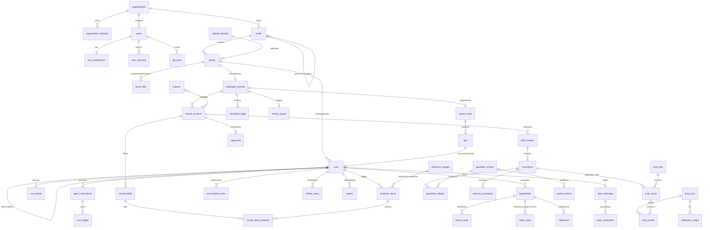
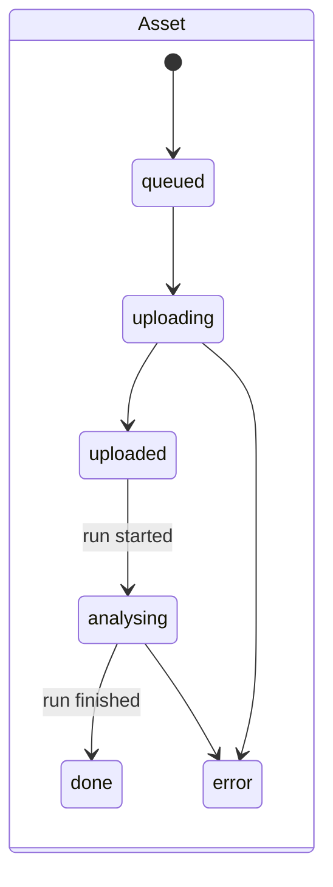
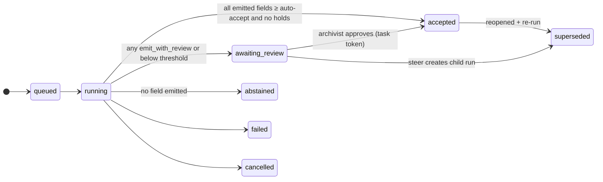
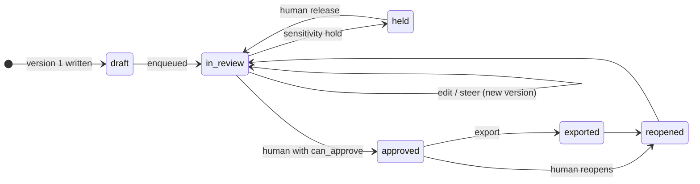

# ZEITZEUGE — Data Model

> **Scope:** every persisted and exchanged shape in ZEITZEUGE.
> **Last updated:** 2026-10-23 (hackathon day 1).
> **Companion:** [`architecture.md`](./architecture.md) — where each store sits and which component writes to it. [`brief-review.md`](./brief-review.md) — the gap ids `BR-n` this model closes.

The model draws on four inputs:

| Source | What it contributes | Status |
|---|---|---|
| The Kanton Schwyz challenge brief (Staatsarchiv, Ralph Ruch) | The five ranked fields (Ortschaft → politische Gemeinde → Gebäude → See/Fluss/Berg → Strasse), the Excel row contract (one row per photo, unique link to the file, confidence per row, explained scoring rule), the Prio-1 set of 50 within ≈ 600 photos of the 21st century, the reference sources (SG.CIV catalogue, E-Pics, public geodata, public research tools) | **Binding** |
| `PROPOSED_SOLUTION.md` §5.3, §8, §9.4, Appendix B | The Evidence Ledger, the per-field provenance block, the abridged ER sketch, the core JSON schemas | Design |
| `apps/web/src/lib/data/*.ts`, `apps/web/src/lib/upload/*.ts` | The shapes every screen already renders against dummy data: case file, queue, theater, history, fonds, evaluation, assist, admin, settings | Built (simulated) |
| `apps/api/migrations/versions/0001_identity_foundation.py`, `apps/api/src/zeitzeuge_api/db/models/*` | Tenancy, users, preferences, sessions, API keys, audit log; RLS policies and grants | **Built and tested** (65 unit tests, cross-tenant RLS suite) |

Where they disagree, §15 says which one wins and why: **the brief decides what must be delivered** (fields, Excel, confidence rule, the 50), and this document decides counts, names and contracts.

---

## Table of contents

1. [Principles the schema enforces](#1-principles-the-schema-enforces)
2. [Conventions](#2-conventions)
3. [Storage map — what lives where](#3-storage-map--what-lives-where)
4. [Domain overview (ER)](#4-domain-overview-er)
5. [Group A — Tenancy & identity (built)](#5-group-a--tenancy--identity-built)
6. [Group B — Holdings: fonds, assets, files](#6-group-b--holdings-fonds-assets-files)
7. [Group C — Investigation: runs, agents, the Evidence Ledger](#7-group-c--investigation-runs-agents-the-evidence-ledger)
8. [Group D — Catalogue: records, versions, fields, provenance, review](#8-group-d--catalogue-records-versions-fields-provenance-review)
9. [Group E — Knowledge: gazetteer, period events, heritage, memory](#9-group-e--knowledge-gazetteer-period-events-heritage-memory)
10. [Group F — Learning & evaluation](#10-group-f--learning--evaluation)
11. [Group G — Public assist](#11-group-g--public-assist)
12. [Group H — Governance, routing, cost, audit trail](#12-group-h--governance-routing-cost-audit-trail)
13. [Non-relational stores: S3, DynamoDB, OpenSearch, Step Functions](#13-non-relational-stores-s3-dynamodb-opensearch-step-functions)
14. [Wire contracts (JSON)](#14-wire-contracts-json)
15. [Reconciliation: mock data ↔ proposal ↔ schema](#15-reconciliation-mock-data--proposal--schema)
16. [Invariants, and where each is enforced](#16-invariants-and-where-each-is-enforced)
17. [Row-level security taxonomy](#17-row-level-security-taxonomy)
18. [Lifecycles (state machines of entities)](#18-lifecycles-state-machines-of-entities)
19. [Closed vocabularies (enumerations)](#19-closed-vocabularies-enumerations)
20. [Migration plan and seed data](#20-migration-plan-and-seed-data)

---

## 1. Principles the schema enforces

The product thesis (P1–P3, `PROPOSED_SOLUTION.md` §3) is only credible if the database refuses the data that would violate it. Each principle becomes a structural rule:

| Principle | Structural rule | Enforced by |
|---|---|---|
| **P1 — No claim without evidence** | A field with `decision ∈ {emit, emit_with_review}` must reference ≥ 1 evidence row from the same run (or a `human` evidence row). | Pydantic validator → deferred constraint trigger `trg_field_requires_evidence` → CI property test (§16) |
| **P2 — Falsification before assertion** | A place-family field (`locality`, `municipality`, `building`, `street`, `landscape_feature`, `place`) may be `emit` only if the selected hypothesis has a terrain test whose status is `corroborated` **or** `not_applicable` and no street test of it is `refuted`; a `refuted` hypothesis can never be selected. EXIF GPS and reference-image matches are hypotheses and go through the same gate. | Adjudicator contract + CHECK on `hypotheses` + trigger on `record_fields` (§16, I-4/I-5) |
| **P3 — Calibrated silence is a feature** | `abstain` is a first-class decision with a closed reason vocabulary; an abstained field has `value IS NULL` and no evidence; confidence is a calibrated number in [0,1], never prose. | CHECK constraints on `record_fields` |
| **Provenance is forever** (§8.2) | Catalogue records are versioned and append-only; every field carries `generated_by`, models, evidence, and (when touched) `reviewed_by`. Machine and human values are never confusable. | No UPDATE/DELETE grant on version tables; `actor_kind` NOT NULL |
| **Only humans release** (§8.3) | An approval row must reference a human user with `can_approve`; the machine never approves. | FK + trigger + CHECK on `audit_log` (`record.approved ⇒ actor_kind = 'human'`) |
| **Isolation in the database** (§9.4) | Every tenant row carries `org_id` directly; RLS is `ENABLE`d **and** `FORCE`d. | Migration pattern from `0001_identity` (§17) |
| **Every number has a stated rule** (brief: "nach welcher Regel die Zuverlässigkeit bewertet wird") | `record_fields.raw_confidence` is the deterministic formula of `architecture.md` §8.5 over the cited evidence (noisy-OR over independent source classes, objections subtract, terrain verdict caps), never a model-stated number; `confidence` is its calibrated image. The inputs (`source_classes`, `corroborating_count`, `objection_count`) are stored on the field so the Excel can print them. | Trigger `trg_raw_confidence_formula` (I-14) + CI property test |
| **The deliverable is a row** (brief MUST M6) | Every catalogue record must be renderable as one Excel row keyed by the delivered filename; the column ↔ field mapping is data (`field_definitions.excel_column`, `priority_rank`), so a later AIS import format is a config change, not code. | `field_definitions` rows + the `ExcelRow` contract (§8.12, §14.10) |

---

## 2. Conventions

These are inherited from the code that already exists (`apps/api/src/zeitzeuge_api/db/base.py`, `core/ids.py`) and apply to every new table.

| Topic | Convention | Why |
|---|---|---|
| Primary keys | `id UUID` (v4), generated in the application (`uuid_pk()`) | Existing pattern; no sequence leaks row counts across tenants |
| Public handles | Prefixed, human-readable IDs where a person reads them back: `run_<ULID>` (e.g. `run_01JBQ7…`), `eval_<date>_<letter>`, API keys `zz_live_<prefix>` | The UI already shows `run_01JBQ7`; ULIDs sort by time |
| Run-local IDs | Evidence `ev_001…`, hypotheses `hyp_A…`, events `e01…` are **unique within a run**, not globally. Stored as `local_id` with `UNIQUE (run_id, local_id)`; addressed in the API as `{run_id}/{local_id}` | Matches the ledger format in §5.3 and every mock; a global evidence id would be unreadable on screen |
| Tenancy | `org_id UUID NOT NULL REFERENCES organizations(id)` on **every** tenant row, even when derivable through a join | An RLS policy must be checkable on the row itself |
| Enums | `VARCHAR + CHECK` holding the enum *value* via `enum_column()` (`native_enum=False`) | Adding a value is not a locking migration; DB, JSON, Cognito group and RLS setting all say `archivist`, not `ARCHIVIST` |
| Timestamps | `timestamptz`; `created_at`/`updated_at` via `TimestampMixin`; append-only tables have **no** `updated_at` | `updated_at` on an immutable table would be a lie |
| JSON | `JSONB` (`JSONDict` decorator) only for payloads whose shape is owned by a versioned JSON Schema (`schema_id` column next to it) | Typed columns for anything a query, constraint or RLS policy needs |
| Numbers | Confidences / strengths / posteriors: `NUMERIC(4,3)` with `CHECK (x BETWEEN 0 AND 1)`. Money: `NUMERIC(12,6)` USD. Coordinates: LV95 `NUMERIC(10,2)`, WGS84 `geography(Point,4326)` | Exact comparison against thresholds; micro-dollar cost accounting |
| Regions on an image | Normalised bbox `{x,y,w,h}` ∈ [0,1], origin top-left, **relative to the recto master file** | Exactly the `Region` type in `record.ts`; converts to IIIF `xywh=` pixels with the master's width/height |
| Years | `SMALLINT` years; brackets as `(year_from, year_to, circa BOOLEAN)` with `CHECK (year_from <= year_to)` | The UI's `"1893–1900"` string is a rendering, never storage (§15) |
| Text from outside | Verso transcriptions, OCR, tips, steer hints and external API responses are stored as **data** in columns named `*_raw`/`claim`/`hint`, never concatenated into prompts without the untrusted-block wrapper | Prompt-injection posture (`architecture.md` §14.1) |
| Source classes | Every evidence item carries `source_class` (`exif · visual · text_in_image · geodata_layer · reference_image · open_web · terrain_geometry · street_level · archival · human`), NOT NULL. Independence is counted per class: ten hits from one website are one class | The confidence formula (I-14) and the Excel `*_Quellen` columns are computed from it |
| Excel columns | Column names are German, ASCII-safe (`Gebaeude`, `Pruefbedarf`), defined **once** in `field_definitions.excel_column`; the `Ergebnisse` sheet order is `priority_rank`, then the fixed trailing columns (§8.12) | The archive reads the workbook; the later scopeArchiv import is a mapping edit |
| Soft delete | Only on `users` (`deleted_at`) — attribution must survive account closure. Catalogue data is never deleted, only superseded | §17 of the proposal; `user.py` docstring |
| Naming | `snake_case` tables (plural), FK `<entity>_id`, constraint names from `NAMING_CONVENTION` | Stable Alembic diffs |

---

## 3. Storage map — what lives where

| Data | Primary store | Secondary / derived | Retention |
|---|---|---|---|
| Tenants, users, preferences, sessions, API keys | Aurora PostgreSQL (`zeitzeuge` DB) | Cognito (credential, groups, `custom:tenant_id`, `custom:role`) | Lifetime of tenant |
| Fonds, assets, file metadata, EXIF witnesses (`captured_at`, `exif_gps`, `exif_hfov_deg`), priority | Aurora | S3 (the bytes) | Forever |
| Scan masters and delivered originals (the Prio-1 set and the rest of the ≈ 600) | S3 `zeitzeuge-prod-originals` (versioned, Object Lock, assets CMK) | — | Forever; deletes denied by the permission boundary |
| Access copies, IIIF tiles, thumbnails, overlays, agent I/O | S3 `zeitzeuge-prod-derivatives` | CloudFront (signed URLs via the API) | Regenerable; Standard-IA after 30 days |
| Runs, agent invocations, evidence, hypotheses, terrain tests, street tests | Aurora | Step Functions execution history (90 days); full agent I/O JSON in S3 | Forever (ledger), 1 year (raw agent I/O) |
| Live run stream (theater) | Aurora `run_events` + `pg_notify('run_<id>')` | FastAPI WebSocket (LISTEN) — no API Gateway, no extra store | Forever (it is the ledger's timeline) |
| Catalogue records, versions, fields, provenance, reviews, approvals | Aurora (append-only) | Postgres full-text (`german` config) + optional OpenSearch projection; S3 exports | Forever |
| Gazetteer, period events, heritage objects | Aurora (+ `pgvector`) | — | Versioned |
| **Reference images** (SG.CIV catalogue entries, E-Pics, Commons geotagged, Smapshot) — global, licence per row | Aurora `reference_images` (+ `pgvector` HNSW, GiST) | S3 `zeitzeuge-prod-assets` `reference/{source}/{external_id}.jpg` thumbnails | Versioned; re-ingestable from the source |
| Collection memory embeddings | Aurora `pgvector` (HNSW) | OpenSearch Serverless kNN **only if `search_enabled`** (off by default, ~USD 222/month) | Forever |
| Few-shot exemplars (agent memory) | Aurora `memory_exemplars` (system of record, RLS) | DynamoDB `agent-memory` (hot read path for Lambda agents) | Until deactivated |
| Eval sets, cases, results, metrics, calibration maps | Aurora | S3 (`eval/` reports) | Forever |
| Public tips | Aurora | — | Until case closed + 2 years |
| Cost ledger | Aurora | CloudWatch metrics, AWS Budgets | Forever |
| Audit trail | Aurora `audit_log` (append-only, no UPDATE/DELETE grant) | CloudWatch Logs | Forever |
| Rate limits, idempotency keys, external-tool cache, run locks | DynamoDB `rate-limit`, `idempotency`, `tool-cache`, `run-locks` (TTL) | — | Minutes to days |
| Step Functions task tokens (archivist approval) | Aurora `pending_tasks` (pipeline role only) | — | Until approved or expired |
| DEM tiles (swissALTI3D), cached horizons | S3 `zeitzeuge-prod-dem-cache` (global, not tenant-scoped) | — | Expires after 90 days; re-downloadable |
| Exports — **the Excel workbook first** (`xlsx`, one row per photo), then ISAD(G) CSV, EAD3, DC, IIIF, RiC-O, XMP | S3 `zeitzeuge-prod-exports` | — | **Expires after 7 days** — the row in `exports` + `export_items` keeps the exact versions and sha256, so any export can be regenerated byte-identically |

Concrete bucket, table and index names are in §13.

---

## 4. Domain overview (ER)



Eight groups, ~57 tables, written by a roster of **20 agents** (`architecture.md` §5.2). Groups A (built) and B–D (P0 for the demo: the Prio-1 set in, five ranked fields, the Excel row out) are the core; E–H are P0/P1 as marked per table.

| Group | Tables | Delivery tier |
|---|---|---|
| A Tenancy & identity | 7 | **Built** (`0001_identity`) |
| B Holdings | 5 | P0 (incl. `priority`, `external_ref`, EXIF columns on `assets`) |
| C Investigation | 15 | P0 (ledger, hypotheses, terrain tests, events, `source_class`), P1 (street tests, verso lines, similar items) |
| D Catalogue | 11 | P0 (the five priority fields, `excel_column`, `xlsx` export) |
| E Knowledge | 8 | P0 (gazetteer, period events, `reference_images` from Commons), P1 (SG.CIV/E-Pics ingestion, heritage, embeddings, exemplars) |
| F Learning & evaluation | 8 | P0 (eval tables on the Commons geotagged gold set, `qc_summary`), P1 (corrections loop) |
| G Public assist | 2 | P2 (screen is built and simulated) |
| H Governance & ops | 7 | P0 (policies incl. `research_tier` and `source_class_weights`, cost ledger, audit extension), P1 (routing overrides, notifications) |

---

## 5. Group A — Tenancy & identity (built)

Already in `0001_identity`. Reproduced here as the reference the rest of the schema hangs off; see the migration for full DDL.

### 5.1 `organizations` — the tenant

| Column | Type | Notes |
|---|---|---|
| `id` | uuid PK | Unit of RLS and of the per-tenant KMS key |
| `slug` | varchar(64) UNIQUE | `stasz`, `ingenbohl`, `demo` (dashboard `ARCHIVES`) |
| `name` | varchar(200) | `Staatsarchiv des Kantons Schwyz` |
| `kind` | `organization_kind` | `archive · museum · association · personal · demo` |
| `canton` | varchar(2) | `SZ` |
| `isil` | varchar(32) | ISO 15511 identifier, carried into every export and OAI-PMH header |
| `contact_email` | varchar(320) | |
| `is_demo` | bool | The guest tenant; keeps eval/cost dashboards honest about which numbers came from real work |
| `settings` | jsonb | Unstructured display settings only — **policies that steer spend or autonomy live in `org_policies` (§12.1), not here** |
| `created_at`, `updated_at` | timestamptz | |

### 5.2 `organization_domains`
`org_id`, `domain` UNIQUE, `verified_at`, `default_role` (default `reviewer` — least privilege for self-registering colleagues). Public mail providers are refused at the service layer.

### 5.3 `users`
`org_id` (RESTRICT), `cognito_sub` UNIQUE (the only stable join to Cognito), `cognito_username`, `email` (lower-cased, UNIQUE), `email_verified`, `pending_email`, profile (`full_name`, `job_title`, `department`, `phone`, `bio`, `locale` default `de`, `timezone` default `Europe/Zurich`, `avatar_key` — an S3 key, never a URL), `role` (`user_role`), `status` (`user_status`), `mfa_enabled`, lifecycle timestamps, `deleted_at` (soft delete), `metadata` jsonb.

Role capabilities (from `enums.py`):

| Role | `can_write` | `can_approve` | Typical persona |
|---|---|---|---|
| `admin` | ✓ | ✓ | Ueli, Kantons-IT |
| `archivist` | ✓ | ✓ | Andrea |
| `reviewer` | ✓ | ✗ | A colleague who corrects but does not release |
| `operator` | ✓ | ✗ | Marco, digitisation |
| `reader` | ✗ | ✗ | Dr. Keller, Historischer Verein |
| `guest` | ✗ | ✗ | Judges via "Als Gast demo starten" |

### 5.4 `user_preferences` (1:1 with `users`)
Appearance (`theme`, `reduced_motion`, `high_contrast`), notifications (4 events × {email, in-app} — `queue_ready`, `hypothesis_refuted`, `batch_complete`, `weekly_digest`), cataloguing (`default_run_mode`, `auto_accept_threshold` CHECK 0.5–1.0, `allow_abstention`, `default_collection`, `default_export_format` — default `xlsx`, R21). Tenancy derived through `users` in the RLS policy.

> **Precedence rule (new, see §12.1):** a user's `auto_accept_threshold` may only make the system **stricter** than the organisation's. Effective threshold = `max(org_policies.auto_accept_threshold, user_preferences.auto_accept_threshold)`. An archivist cannot lower the bar their archive set.

### 5.5 `user_sessions`, 5.6 `api_keys`, 5.7 `audit_log`
As built. `api_keys` stores only `token_hash` (SHA-256) and a display `prefix`; scope `read|write` is intersected with the owner's role. `audit_log` is INSERT+SELECT only — **extended in §12.5** to become the single append-only stream behind `/history`.

---

## 6. Group B — Holdings: fonds, assets, files

### 6.1 `fonds` — the archival unit of description (Bestand / Archivplan node)

Source: `collections.ts` (`Fonds`, `FONDS`), `settings.ts` (`COLLECTIONS`), and the brief. The finding aid's period and the span ZEITZEUGE actually described are **two separate claims by two parties** and are stored separately (the latter is derived, §6.5).

The fonds the challenge is judged on is **«Fotobestand 21. Jh. (unerschlossen)»** — slug `foto21`, level `fonds`, extent ≈ 600 `photographs`, `digitised = true`, finding-aid period 2000–2026 — in the Staatsarchiv tenant, mirrored into the demo tenant. The historical fonds (Bettschart, Goetz, Braun, Ansichtskarten, …) stay as reference holdings and as the historical example.

| Column | Type | Null | Notes / mock source |
|---|---|---|---|
| `id` | uuid PK | | |
| `org_id` | uuid FK | | |
| `parent_id` | uuid FK → fonds | ✓ | Archivplan hierarchy (fonds → series → file) |
| `slug` | varchar(64) | | `foto21`, `bettschart`, `goetz`, `braun`, `ansichtskarten`, `leidbilder`, `graphische`; `UNIQUE (org_id, slug)` |
| `reference_code` | varchar(128) | | ISAD(G) 3.1.1 — `StASZ Foto/21Jh`, `StASZ Foto/Bettschart`; `UNIQUE (org_id, reference_code)` |
| `title` | varchar(300) | | `Fotobestand 21. Jh. (unerschlossen)`, `Fotosammlung Bettschart` |
| `level` | `description_level` | | ISAD(G) 3.1.4: `fonds · subfonds · series · file · item` |
| `scope_note` | text | ✓ | ISAD(G) 3.3.1 (UI copy key `collections.fonds.<id>` is presentation only) |
| `creator_name` | varchar(200) | ✓ | `Josef Alois Bettschart` |
| `creator_dates` | varchar(40) | ✓ | `1843–1900` (free text as in the finding aid) |
| `creator_authority_uri` | text | ✓ | GND / HLS / Wikidata URI when known |
| `finding_aid_from`, `finding_aid_to` | smallint | | ISAD(G) 3.1.3 as the finding aid states it |
| `finding_aid_circa` | bool | | |
| `extent` | integer | | ISAD(G) 3.1.5 — `600` (foto21), `1200` (Bettschart) |
| `extent_unit` | `extent_unit` | | `plates · photographs · prints · cards · mixed` |
| `digitised` | bool | | Not digitised ⇒ nothing to describe (Leidbilder, Graphische Sammlung) |
| `ais_ref` | varchar(128) | ✓ | Identifier in scopeArchiv (the Staatsarchiv's AIS) for write-back |
| `cover_asset_ids` | uuid[] | ✓ | Display covers; must be assets whose dating sits inside the fonds period |
| `created_at`, `updated_at` | timestamptz | | |

### 6.2 `upload_batches`

Source: `upload/types.ts`, `upload/zip.ts`, history `uploaded` events.

| Column | Type | Notes |
|---|---|---|
| `id`, `org_id` | uuid | |
| `created_by` | uuid FK users | |
| `source` | `batch_source` | `browser · zip · s3_prefix` (J2: point at an S3 prefix; the Webtransfer delivery lands as a ZIP or an S3 prefix) |
| `source_ref` | text | ZIP filename or `s3://…/prefix/` |
| `label` | varchar(64) ✓ | `prio1` (the 50 Priority-1 photos), `rest600` (the remainder of the ≈ 600); the dashboard counter "Prio-1: n/50" and the batch Excel export are keyed on it |
| `fonds_id` | uuid FK ✓ | Default fonds for the batch (`foto21` for the challenge delivery) |
| `run_mode` | `run_mode` | `fast · standard · deep` |
| `asset_count`, `paired_count`, `issue_count` | int | |
| `issues` | jsonb (`schema: upload.issues/1`) | `[{code, assetId?, detail?, blocking}]` — codes in §19 |
| `sfn_execution_arn` | text ✓ | Bulk Distributed Map execution |
| `status` | `batch_status` | `uploading · ready · running · done · failed` |
| `created_at`, `finished_at` | timestamptz | |

### 6.3 `assets` — one photograph (recto + optional verso is **one** asset)

Source: `upload/types.ts` `QueuedAsset`, `archive.ts` `ArchivePhoto`, queue/dashboard rows.

| Column | Type | Null | Notes |
|---|---|---|---|
| `id`, `org_id` | uuid | | |
| `fonds_id` | uuid FK | | |
| `batch_id` | uuid FK ✓ | | |
| `signature` | varchar(128) | ✓ | The archive's own identifier — `StASZ Ansichtskarten/0042`. `UNIQUE (org_id, lower(signature))` (the upload validator's `duplicate-signature` rule, made durable). Null for the undescribed 21st-century delivery until the archive assigns one |
| `external_ref` | varchar(260) | | **The delivered filename** (`IMG_4821.JPG`) — the "eindeutige Zuordnung zur Bilddatei" the brief demands; `UNIQUE (org_id, batch_id, external_ref)`; becomes the Excel `Dateiname` key |
| `priority` | smallint | ✓ | `1` = Priority 1 (the 50 photos Ralph Ruch selected); null = not prioritised |
| `captured_at` | timestamptz | ✓ | EXIF `DateTimeOriginal` — the primary date witness for born-digital files; fills the `date` field with `source_class = exif` evidence |
| `exif_gps` | geography(Point,4326) | ✓ | EXIF GPS — a **hypothesis** (origin `exif`), never a fact: still sent through the falsifier |
| `exif_make`, `exif_model` | varchar(64) | ✓ | Camera; `exif_model` is the key into the sensor-width lookup |
| `exif_focal_mm` | numeric(6,2) | ✓ | 35 mm-equivalent when the EXIF says so, else actual focal length |
| `exif_hfov_deg` | numeric(6,2) | ✓ | Horizontal field of view from focal length + sensor width — removes one unknown from the horizon match (`terrain_tests.hfov_deg`) |
| `outside_canton` | bool | | Set when the subject point resolves outside SZ ("in Einzelfällen sind auch Orte ausserhalb des Kantons möglich"); exported as `Ausserhalb_SZ` |
| `status` | `asset_status` | | `queued · uploading · uploaded · analysing · done · error` (exactly the upload screen's states) |
| `pairing_rule` | varchar(32) ✓ | | `recto_verso · front_back · a_b · numeric` (`pairing.ts` `PAIR_RULES`) |
| `pair_markers` | jsonb ✓ | | `{recto: "_r", verso: "_v"}` — shown so the pairing can be argued with |
| `phash` | bit(64) ✓ | | Forensics perceptual hash of the recto |
| `duplicate_of` | uuid FK assets ✓ | | Forensics duplicate detection (Hamming distance ≤ threshold) |
| `forensics` | jsonb ✓ (`schema: forensics.facts/1`) | | Aspect ratio, border geometry, grain, format, full EXIF summary, verso-present heuristic, `born_digital` flag (⇒ materiality and verso agents return `not_applicable`) |
| `display_key` | varchar(64) ✓ | | Seed/demo only: the `photoKey` i18n caption key (`brunnenMythen`). Null for real uploads |
| `source_licence` | jsonb ✓ | | For non-archive material (gold set, demo images): `{holder, licence, href, credit}` — `ATTRIBUTION.json` shape |
| `created_by` | uuid FK users | | |
| `created_at`, `updated_at` | timestamptz | | |

### 6.4 `asset_files` — the bytes, by side and role

| Column | Type | Notes |
|---|---|---|
| `id`, `org_id`, `asset_id` | uuid | |
| `side` | `asset_side` | `recto · verso` |
| `role` | `file_role` | `master · access · thumbnail · iiif_tiles · xmp_jpeg` — master/access is the archival master/access-copy distinction already used for the hero (`archive.ts` `accessSrc`) |
| `bucket` | varchar(63) | `zeitzeuge-prod-originals` for masters, `zeitzeuge-prod-derivatives` otherwise |
| `s3_key` | text | `orgs/{org}/assets/{asset}/{side}/{role}.{ext}` (§13.1) |
| `original_filename` | varchar(260) ✓ | `ansichtskarten_0042_r.jpg` |
| `mime_type` | varchar(64) | One of `ACCEPTED_TYPES` (jpeg, png, tiff, webp, avif) |
| `bytes` | bigint | `CHECK (bytes <= 209715200)` for masters (`MAX_FILE_BYTES`) |
| `sha256` | char(64) | Fixity — an archive checks this |
| `width_px`, `height_px` | int | Needed to convert normalised regions to IIIF pixels |
| `dpi` | int ✓ | |
| `exif` | jsonb ✓ | Raw EXIF, data only |
| `kms_key_arn` | text | Tenant CMK that encrypted the object |
| `created_at` | timestamptz | |

`UNIQUE (asset_id, side, role)`. A verso without a recto is a validation error at upload (`missing-recto`) and a CHECK at the asset level (trigger: an asset must have a recto master before `status` leaves `uploading`).

### 6.5 `fonds_stats` (materialised view) and `detected_series`

`fonds_stats` reproduces `collections.ts` `FondsStats` from data, refreshed after each approval/run batch:

| Column | Derivation |
|---|---|
| `fonds_id` | |
| `described` | assets with ≥ 1 record version |
| `approved` | records whose head version is approved |
| `prio1_total`, `prio1_processed`, `prio1_reviewed` | assets with `priority = 1`; of those, with ≥ 1 record version; of those, with a human `field_review` or approval — the dashboard's "Prio-1: n/50 bearbeitet · m geprüft" (brief MUST M2/M9) |
| `place_unknown` | head versions whose `locality` **and** `municipality` fields are `abstain` — "the residue, honestly counted" |
| `median_seconds` | median `runs.duration_ms` of the latest full run per asset |
| `decades` | jsonb `{1890: 268, …}` from the `date` field midpoint (for `foto21`: years, from `captured_at`) |
| `places` | jsonb `[{name, count}]` grouped by the `municipality` field |
| `described_from`, `described_to` | the span actually described → `findingAidDrift()` compares it to the finding aid |

The dashboard's `catalogued = 1'284` and the archive switcher read **this view** so the three screens cannot disagree (the invariant the mock enforces by summing `STATS`).

`detected_series` — collection memory clustering a fonds into shoots (`DetectedSeries`):

| Column | Type | Notes |
|---|---|---|
| `id`, `org_id`, `fonds_id` | uuid | |
| `label` | varchar(200) | Generated label; the mock's `key` is an i18n key for the seeded series |
| `member_count` | int | |
| `cohesion` | numeric(4,3) | Mean intra-cluster cosine similarity |
| `year_from`, `year_to` | smallint ✓ | |
| `method` | varchar(64) | `hdbscan@pgvector:<embedding_model>` |
| `computed_at` | timestamptz | |

`series_members (series_id, asset_id, similarity)`. A series is also the `reason = series` in the triage queue: "14 similar photographs hang on this decision".

---

## 7. Group C — Investigation: runs, agents, the Evidence Ledger

This group is the product. `runs` is one investigation of one asset; the Evidence Ledger (§5.3 of the proposal) is the set of `evidence_items` + `hypotheses` + adjudication for that run.

### 7.1 `runs`

Source: `dashboard.ts` `Run`, `theater.ts` `RUN`, `editor.ts` `RECORD`, history `run` events.

| Column | Type | Null | Notes |
|---|---|---|---|
| `id`, `org_id` | uuid | | |
| `public_id` | varchar(32) UNIQUE | | `run_01JBQ7…` (ULID) |
| `asset_id` | uuid FK | | |
| `kind` | `run_kind` | | `initial · rerun · steer · tip · eval` |
| `parent_run_id` | uuid FK runs | ✓ | Set for `steer` and `tip` runs — partial re-execution (M3) |
| `mode` | `run_mode` | | Requested: `fast · standard · deep` |
| `reached_stage` | `run_mode` | ✓ | Where the cascade (M1) actually stopped — `fast` resolved ~60 % |
| `status` | `run_status` | | `queued · running · awaiting_review · accepted · abstained · failed · cancelled · superseded` (UI maps `awaiting_review → review`, §15) |
| `outcome_confidence` | numeric(4,3) | ✓ | Minimum confidence over emitted fields — what the dashboard shows and what auto-accept compares against |
| `agents_total`, `agents_completed` | smallint | | 20 for a full run (the roster, `architecture.md` §5.2); fewer when the cascade stops early or agents return `not_applicable` (born-digital ⇒ no verso, no materiality) |
| `abstentions` | smallint | | |
| `sfn_execution_arn` | text | ✓ | Step Functions execution — the replayable audit trail |
| `models_manifest_sha` | char(64) | | Hash of the `models.yaml` the router resolved — makes a run reproducible |
| `code_version` | varchar(64) | | Git SHA of the agent image |
| `triggered_by` | uuid FK users | ✓ | Null for batch/system runs |
| `batch_id` | uuid FK | ✓ | |
| `cost_usd` | numeric(12,6) | | Sum of `cost_ledger` — denormalised for the dashboard, reconciled nightly |
| `started_at`, `finished_at` | timestamptz | ✓ | `duration_ms` is generated |
| `error` | jsonb ✓ | | Problem+json shape, no internals |
| `created_at` | timestamptz | | |

### 7.2 `agent_invocations` — one agent doing one job in one run

Source: `agents.ts` `AGENTS` (extended to the 20 roster ids, R24), `theater.ts` `WINDOWS`. The window offsets the theater draws are derived: `start = started_at − runs.started_at`.

| Column | Type | Notes |
|---|---|---|
| `id`, `org_id`, `run_id` | uuid | |
| `agent_id` | `agent_id` | One of the 20: `forensics · scene · heritage · materiality · verso · text-in-image · skyline · geo · memory · research · chronology · synthesiser · falsifier · streetlevel · redteam · adjudicator · cartographer · multilingual · sensitivity · curator` (`research` = Open Research, `streetlevel` = Street-Level Verifier; `heritage` is the Building Identifier) |
| `tier` | smallint | 0–4, from the roster (UI `Tier`): 0 forensics · 1 perception · 2 grounding (`geo`, `memory`, `research`, `chronology`) · 3 adversarial (`synthesiser`, `falsifier`, `streetlevel`, `redteam`, `adjudicator`) · 4 production + learning |
| `attempt` | smallint | Retries by Step Functions |
| `status` | `invocation_status` | `pending · running · succeeded · failed · skipped · reused` |
| `reused_from_id` | uuid FK agent_invocations ✓ | **Partial re-execution:** a kept agent on a steer run points at the invocation whose output it reuses — provenance stays intact, nothing is recomputed |
| `model_binding` | varchar(64) ✓ | Router task-kind that resolved (`vision.describe`, `reason.adjudicate`…) |
| `model_id` | varchar(128) ✓ | Exact provider id, e.g. `anthropic.claude-opus-5-5`, `openai/gpt-…` for the red team; null for deterministic agents (`forensics`, `falsifier`) |
| `region` / `inference_profile` | varchar(64) ✓ | Where inference ran — the residency answer per call; `external` for public-tools providers (OpenAI, Google, search API) under `org_policies.research_tier = public_tools` |
| `input_sha256` | char(64) | Hash of the canonical input — replay cache key for the golden demo run |
| `output_schema_id` | varchar(128) | e.g. `zeitzeuge://schemas/agent/scene.inventory/1` |
| `output` | jsonb ✓ | Validated, size-capped structured output (≤ 64 KB); full I/O in S3 |
| `io_s3_key` | text ✓ | `runs/{run}/agents/{agent}/{attempt}/io.json` |
| `started_at`, `ended_at` | timestamptz ✓ | |
| `input_tokens`, `output_tokens`, `cache_read_tokens`, `cache_write_tokens` | int | |
| `cost_usd` | numeric(12,6) | |
| `error` | jsonb ✓ | |

`UNIQUE (run_id, agent_id, attempt)`.

### 7.3 `run_events` — the theater feed and the WebSocket stream, made durable

Source: `theater.ts` `TheaterEvent`.

| Column | Type | Notes |
|---|---|---|
| `id`, `org_id`, `run_id` | uuid | |
| `seq` | int | Monotonic per run; `UNIQUE (run_id, seq)`; the client resumes a dropped socket with `?after=seq` |
| `local_id` | varchar(8) | `e01…` |
| `t_ms` | int | Milliseconds since run start (`t` in the mock is seconds) |
| `agent_id` | `agent_id` | |
| `kind` | `run_event_kind` | `note · evidence · objection · abstain · verdict` + system kinds `state · cost · error` |
| `summary` | text | Agent-produced one-liner (German); untrusted text, rendered escaped |
| `message_key` | varchar(64) ✓ | i18n key — used by seeded/golden runs (`horizonMatch`) |
| `evidence_local_id` | varchar(8) ✓ | `ev_007` |
| `posteriors` | jsonb ✓ | `{"hyp_A":0.96,…}`; CHECK: values ∈ [0,1] and sum within 1 ± 0.01 ("every set sums to 1") |
| `kills` | varchar(8)[] ✓ | Hypotheses refuted outright by this event (`["hyp_B","hyp_C"]`) |
| `created_at` | timestamptz | |

The Agent Theater's derived views (`agentStateAt`, `posteriorsAt`, `killedAt`, `costAt`) are pure functions of `agent_invocations` + `run_events` — the replay of a past run and the live run use the same code path.

### 7.4 `evidence_items` — the ledger

Source: proposal §5.3 + Appendix B `EvidenceItem`; `record.ts`/`editor.ts` `EvidenceItem`.

| Column | Type | Null | Notes |
|---|---|---|---|
| `id`, `org_id`, `run_id` | uuid | | |
| `local_id` | varchar(8) | | `ev_001`; `UNIQUE (run_id, local_id)` |
| `kind` | `evidence_kind` | | `visual · textual · geometric · external · archival · human` |
| `source_class` | `evidence_source_class` | | **NOT NULL.** `exif · visual · text_in_image · geodata_layer · reference_image · open_web · terrain_geometry · street_level · archival · human` — the unit of independence for the confidence formula (I-14): ten hits from one website are one class; a federal layer, a reference image and a street plate are three. Printed in the Excel `*_Quellen` columns |
| `agent_id` | `agent_id` | ✓ | Null only for `human` |
| `invocation_id` | uuid FK | ✓ | The agent call that produced it |
| `model_id` | varchar(128) | ✓ | Null for geometry (`falsifier`) and human |
| `created_by` | uuid FK users | ✓ | Set **iff** `kind = 'human'` (CHECK) |
| `observation` | text | | `"Twin-peaked rock massif on the horizon…"` |
| `observation_key` | varchar(64) | ✓ | i18n key for seeded runs (`twinPeak`) |
| `region` | jsonb | ✓ | `{x,y,w,h}` normalised; CHECK each ∈ [0,1] and `x+w ≤ 1`, `y+h ≤ 1` |
| `side` | `asset_side` | ✓ | `verso` for evidence read off the back |
| `source` | text | ✓ | External citation: `swisstopo Siegfriedkarte, sheet rev. 1917` |
| `source_uri` | text | ✓ | Dataset/API URL, Wikidata entity, map tile request |
| `artifact_s3_key` | text | ✓ | Overlay PNG, rendered horizon, map crop |
| `strength` | numeric(4,3) | | [0,1] |
| `implies` | jsonb | ✓ | `{date_from?, date_to?, rule: terminus_post_quem|terminus_ante_quem}` |
| `period_event_id` | uuid FK | ✓ | When the evidence is a period-tool hit (Sihlsee 1937; a building demolished after the EXIF date) |
| `gazetteer_entry_id` | uuid FK | ✓ | When the evidence resolves a toponym |
| `reference_image_id` | uuid FK reference_images | ✓ | When the evidence is a match against an already-described reference image (`source_class = reference_image`, §9.8) |
| `reused_from_id` | uuid FK evidence_items | ✓ | Carried over unchanged into a steer run |
| `created_at` | timestamptz | | |

Support/refutation is many-to-many with hypotheses:

`evidence_links (evidence_id, hypothesis_id, relation)` with `relation ∈ {supports, refutes}` and `UNIQUE (evidence_id, hypothesis_id)` — an item cannot both support and refute one hypothesis.

**Immutable:** no UPDATE grant. Corrections produce new `human` evidence, never edits.

### 7.5 `hypotheses`

Source: Appendix B `Hypothesis`, `record.ts` `HYPOTHESES`, theater `PRIORS`.

| Column | Type | Null | Notes |
|---|---|---|---|
| `id`, `org_id`, `run_id` | uuid | | |
| `local_id` | varchar(8) | | `hyp_A`; `UNIQUE (run_id, local_id)` |
| `kind` | `hypothesis_kind` | | `place · building · street · feature · date · subject · photographer` — one kind per ranked field family, so a building can be contested independently of the locality |
| `statement` | text | | `Brunnen, view E toward the Mythen`; `Alterszentrum Acherhof, Schwyz` |
| `statement_key` | varchar(64) | ✓ | Seed i18n key (`brunnen`) |
| `gazetteer_entry_id` | uuid FK | ✓ | For place / building / street / feature hypotheses |
| `camera_pose` | jsonb | ✓ | Predicted pose `{lv95:[e,n], bearing_deg, tilt_deg, hfov_deg}` — input to the falsifier and the street-level verifier; `hfov_deg` is taken from `assets.exif_hfov_deg` when present |
| `prior` | numeric(4,3) | | From the synthesiser |
| `posterior` | numeric(4,3) | ✓ | Set by the adjudicator |
| `status` | `hypothesis_status` | | `open · refuted · surviving · selected · rejected` |
| `refuted_by_evidence_id` | uuid FK | ✓ | Required when `status = 'refuted'` (CHECK) |
| `origin` | `hypothesis_origin` | | `synthesiser · exif · reference_match · steer · tip` — EXIF GPS, a reference-image match and a crowd tip all enter as hypotheses, never as facts |
| `created_at` | timestamptz | | |

CHECK: priors of all hypotheses of one `(run_id, kind)` sum to 1 ± 0.01 (deferred trigger). A `refuted` hypothesis can never become `selected` (I-5).

### 7.6 `objections` — the red team's output

| Column | Type | Notes |
|---|---|---|
| `id`, `org_id`, `run_id`, `hypothesis_id` | uuid | |
| `evidence_id` | uuid FK ✓ | The objection's supporting evidence (`ev_018` "quai objection") |
| `from_agent` | `agent_id` | `redteam` (or `chronology` for date contradictions) |
| `model_id` | varchar(128) | Must be a **different family** from the hypothesis' author (I-6) |
| `claim` | text | "Find the cheapest way this conclusion is wrong" — the answer |
| `severity` | numeric(4,3) | |
| `resolution` | `objection_resolution` | `open · upheld · dismissed · partially_upheld` |
| `resolution_note` | text ✓ | From the adjudicator |

### 7.7 `terrain_tests` — the falsifier's verdicts (the heart of the system)

Source: proposal §6.1, `horizon.ts` `CAMERA_POSE`, `SUMMITS`.

| Column | Type | Null | Notes |
|---|---|---|---|
| `id`, `org_id`, `run_id`, `hypothesis_id` | uuid | | One test per place hypothesis (Map state) |
| `status` | `terrain_status` | | `corroborated · refuted · inconclusive · not_applicable` — `not_applicable` is a correct output (interiors, haze, no relief), not an error |
| `not_applicable_reason` | varchar(64) | ✓ | `no_horizon · interior · haze · flat_terrain · extreme_crop` |
| `correlation` | numeric(4,3) | ✓ | Normalised cross-correlation, e.g. `0.941` |
| `columns` | int | ✓ | Image columns compared, e.g. `1280` |
| `threshold_corroborate`, `threshold_refute` | numeric(4,3) | | The thresholds used (0.85 / 0.45 by policy) — stored per test so a policy change never silently reinterprets history |
| `pose_lv95_e`, `pose_lv95_n` | numeric(10,2) | ✓ | Refined camera position `2687540 / 1206310` |
| `pose_wgs84` | geography(Point) | ✓ | `46.9982, 8.6021` |
| `ground_elevation_m` | numeric(7,2) | ✓ | From the GeoAdmin height service |
| `eye_height_m` | numeric(4,2) | | default 1.6 |
| `bearing_deg`, `tilt_deg`, `hfov_deg` | numeric(6,2) | ✓ | `74.6`, `-2.1`, `38.6` — `hfov_deg` is fixed from `assets.exif_hfov_deg` when EXIF gives the focal length (one unknown fewer in the match) and `hfov_source ∈ exif · fitted` records which |
| `accuracy_m` | int | ✓ | `±180 m` |
| `summits` | jsonb | ✓ | `[{gazetteer_entry_id, name, elevation_m, x, y, bearing_deg}]` — **only summits that produce a distinct local maximum** (Haggenspitz rule, §15) |
| `synthetic_horizon_s3_key` | text | ✓ | ĥ(θ) as JSON |
| `overlay_s3_key` | text | ✓ | The cyan-curve PNG |
| `dem_source` | varchar(64) | | `swissalti3d@<release>`, tiles listed in `dem_tiles` jsonb |
| `evidence_id` | uuid FK | ✓ | The geometric evidence item this test wrote (`ev_007`) |
| `compute_ms` | int | | |

CHECK: `status = 'corroborated' ⇒ correlation ≥ threshold_corroborate`; `status = 'refuted' ⇒ correlation < threshold_refute`.

### 7.8 `horizon_curves` — the skyline extractor's output

| Column | Type | Notes |
|---|---|---|
| `id`, `org_id`, `run_id`, `asset_file_id` | uuid | |
| `points` | jsonb | `[[x,y],…]` normalised to the full scan, origin top-left (`HORIZON_CURVE`) |
| `per_column_angles_s3_key` | text ✓ | h(u), one elevation angle per image column |
| `method` | varchar(64) | `sam2@sagemaker` · `unet-sky@v3` · `sky-reference-segmentation` (how the hero curve was produced) |
| `quality` | numeric(4,3) | Segmentation confidence; low ⇒ falsifier `not_applicable` |

### 7.9 `date_estimates` and `date_constraints` — chronology

Source: `record.ts` `DATE_RANGE`, `DATE_CONSTRAINTS`, `DATE_PEAK`; `editor.ts` `CaseFile.dating`; proposal §6.4.

`date_estimates` (1 per run):

| Column | Type | Notes |
|---|---|---|
| `id`, `org_id`, `run_id` | uuid | |
| `window_from`, `window_to` | smallint | Drawing window **per run**: `[captured_at − 1, captured_at + 1]` when EXIF exists, else the fonds' finding-aid range (1990–2026 for `foto21`, 1860–1950 for the historical fonds). Never one global scale (R22) |
| `peak_from`, `peak_to` | smallint ✓ | The emitted bracket, e.g. 2014–2014 (EXIF) or 1893–1900; null if the agent abstains |
| `distribution` | jsonb | `{ "1893": 0.11, … }` — a probability distribution over years, sums to 1 |
| `method` | varchar(64) | `exif@forensics` (EXIF date, strength from `source_class = exif`) or `chronology@opus` |

`date_constraints`:

| Column | Type | Notes |
|---|---|---|
| `id`, `org_id`, `date_estimate_id` | uuid | |
| `evidence_id` | uuid FK | Each constraint *is* an evidence item (`ev_014` photochrom patent; a building present on the swissimage orthophoto of year Y) |
| `year` | smallint | |
| `rule` | `date_rule` | `post` (terminus post quem) · `ante` (terminus ante quem) |
| `strength` | numeric(4,3) | Soft priors (clothing, poles) are low; an EXIF date is high but still a constraint, not a fact |
| `label` | text | `Photochrom process patented 1889`; `Gebäude auf swissimage 2012 vorhanden` |
| `enabled` | bool | The archivist can "drag a constraint off" — doing so is a `field_review` and creates a new date estimate on the steer run, never an UPDATE here |

### 7.10 `transcription_lines` — verso intelligence

Source: `editor.ts` `VERSO_LINES`, proposal §6.4. Rows exist only when the asset has a verso file; born-digital assets have none and the agent returns `not_applicable`.

| Column | Type | Notes |
|---|---|---|
| `id`, `org_id`, `run_id`, `asset_file_id` | uuid | Verso file |
| `line_no` | smallint | |
| `raw` | text | Diplomatic transcription — `Aufn. Sommer 189?` |
| `reading` | text | Normalised — `Aufnahme Sommer 189[7|9]` |
| `textract_text` | text ✓ | Reader 1 (printed/typed) |
| `vlm_text` | text ✓ | Reader 2 (paleography prompt, Kurrent/Sütterlin) |
| `readers_agree` | bool | Disagreement is a confidence signal and is **never silently resolved** |
| `normalised` | bool | Abbreviation expansion applied (`Gde. → Gemeinde`) |
| `script` | `script_kind` | `print · typewriter · kurrent · suetterlin · latin_hand · stamp · postmark` |
| `region` | jsonb ✓ | bbox on the verso |
| `confidence` | numeric(4,3) | |
| `contains_pii` | bool | Set by the sensitivity guard |

### 7.11 `text_findings` — text in the image (signs, captions, boat names)

`id, org_id, run_id, region, text_raw, reading, finding_kind (sign · caption · imprint · plate · boat_name · street_plate · shop_name · banner · bus_destination · licence_plate), reader (textract · vlm · both), confidence, evidence_id, is_pii bool`. For the 21st-century set this is a P0 source: a shop name or street plate is the cheapest route to a named building or street (`source_class = text_in_image`); a `licence_plate` is PII and is handed to the sensitivity guard, never exported.

### 7.12 `similar_items` — collection memory hits

Source: `editor.ts` `SIMILAR`/`SimilarHit`, `neighboursOf()`.

| Column | Type | Notes |
|---|---|---|
| `id`, `org_id`, `run_id` | uuid | |
| `neighbour_asset_id` | uuid FK assets ✓ | A neighbour inside the tenant's own holdings (series within the 600) |
| `reference_image_id` | uuid FK reference_images ✓ | A neighbour in the reference corpus (§9.8) — exactly one of the two FKs is set (CHECK) |
| `similarity` | numeric(4,3) | Cosine |
| `relation` | `similarity_relation` | `same_shoot · same_place · same_series · same_massif · duplicate · reference_match` (mock `noteKey`) |
| `rank` | smallint | Top-k order |
| `method` | varchar(64) | `pgvector-hnsw:<embedding_model>` or `hybrid-bm25+knn` |

### 7.13 `steers` — human steering (M3)

Source: `editor.ts` `STEER_CHAINS`, `classifySteer()`; history `steered` events.

| Column | Type | Notes |
|---|---|---|
| `id`, `org_id` | uuid | |
| `source_run_id` | uuid FK | The run being steered |
| `steer_run_id` | uuid FK ✓ | The partial re-run it produced |
| `record_version_id` | uuid FK ✓ | The version the archivist was looking at |
| `user_id` | uuid FK | |
| `hint` | text | `Das ist in Brunnen, nicht in Gersau` — untrusted; becomes a `human` evidence item + a `steer` hypothesis |
| `chain` | `steer_chain` | `place · building · street · date · collection` |
| `classifier` | varchar(32) | `regex@v1` (the UI's rule) or `haiku@v1` |
| `invalidated_agents` | agent_id[] | DAG walk result |
| `kept_agents` | agent_id[] | |
| `seconds` | int ✓ | Wall clock of the partial run (`~10 s` vs `~120 s`) |
| `created_at` | timestamptz | |

CHECK: `invalidated_agents ∩ kept_agents = ∅` and `|invalidated| + |kept| = 20` (see §15 for the mock gap this closes).

### 7.14 `run_cache` (demo resilience)

`(input_sha256, agent_id, model_id) → output_s3_key, created_at`. Used only when `org.is_demo` or for the golden run; makes the "live" demo deterministic (proposal §13.4).

### 7.15 `street_tests` — the street-level verifier's verdicts (agent `streetlevel`)

Source: `architecture.md` §7.5; proposal §6.3. The urban analogue of `terrain_tests` for the share of photographs without a usable horizon (village streets, single buildings): the view at the hypothesised pose is fetched from a street-level imagery provider and compared by a VLM judge, red-teamed. It is **weaker than geometry** — a model judges, not a ray-cast — and is labelled "VLM-judged" in the UI and the Excel.

| Column | Type | Null | Notes |
|---|---|---|---|
| `id`, `org_id`, `run_id`, `hypothesis_id` | uuid | | One test per place/building/street hypothesis that the falsifier could not test (`terrain_tests.status = not_applicable`) or that the deep pass escalates |
| `status` | `terrain_status` | | `corroborated · refuted · inconclusive · not_applicable` (same vocabulary; `not_applicable` = no street-level imagery within range, interior, or `research_tier` forbids the provider) |
| `similarity` | numeric(4,3) | ✓ | The judge's match score ∈ [0,1] |
| `threshold_corroborate`, `threshold_refute` | numeric(4,3) | | The thresholds used (`org_policies.street_corroborate` 0.75 / `street_refute` 0.35), stored per test |
| `provider` | `street_test_provider` | | `street_view · mapillary · swisstopo_3d` — Street View only under `research_tier = public_tools` |
| `reference_image_uri` | text | | The fetched view (provider URL or request), cached crop in `derivatives` |
| `judge_model_id` | varchar(128) | | The VLM that judged (`balanced` binding); never the same family as the red team that reviews it |
| `overlay_s3_key` | text | ✓ | Side-by-side PNG (photo · fetched view · judge's marked correspondences) |
| `evidence_id` | uuid FK | ✓ | The `visual` evidence item with `source_class = street_level` this test wrote |
| `compute_ms` | int | | |

CHECK: `status = 'corroborated' ⇒ similarity ≥ threshold_corroborate`; `status = 'refuted' ⇒ similarity < threshold_refute`. A `refuted` street test blocks `emit` on the place-family fields of that hypothesis (I-4) and lowers the formula's cap (I-14); it never selects a hypothesis on its own.

---

## 8. Group D — Catalogue: records, versions, fields, provenance, review

### 8.1 Model: head + immutable versions

```
catalogue_records (mutable head: status, pointer to current version)
    └─< record_versions (immutable snapshot, monotonically numbered)
            └─< record_fields (one row per field per version, with provenance)
                    └─< record_field_evidence (citations into the ledger)
```

Every human edit, every steer and every re-run produces a **new version**. A version is never updated; the head moves. That is how "an archival system must never lose what it once said" is implemented, and how the history screen can show `from → to` for every edit.

### 8.2 `catalogue_records`

| Column | Type | Notes |
|---|---|---|
| `id`, `org_id` | uuid | |
| `asset_id` | uuid FK UNIQUE | One record per photograph |
| `fonds_id` | uuid FK | Denormalised for RLS-friendly filtering and OAI sets |
| `current_version` | int | |
| `status` | `record_status` | `draft · in_review · approved · held · exported · reopened` |
| `approved_version` | int ✓ | Last version a human released |
| `publication_hold` | bool | True while any active `sensitivity_flags.action = 'hold'` exists (trigger-maintained) |
| `public_assist` | bool | Published to `/help-identify` |
| `created_at`, `updated_at` | timestamptz | |

### 8.3 `record_versions` (append-only)

| Column | Type | Notes |
|---|---|---|
| `id`, `org_id`, `record_id` | uuid | |
| `version` | int | `UNIQUE (record_id, version)`; must equal previous + 1 (trigger) |
| `run_id` | uuid FK ✓ | The run whose adjudication produced it (null for a pure human edit) |
| `parent_version` | int ✓ | |
| `actor_kind` | `actor_kind` | `machine · human` — **the distinction the product rests on** |
| `actor_user_id` | uuid FK ✓ | Required iff `actor_kind = 'human'` |
| `change_kind` | `version_change` | `generated · steered · edited · rejected · filled · approved_snapshot · reopened` |
| `formula_weights` | jsonb | Snapshot of `org_policies.source_class_weights` and the terrain/street caps in force when the version's `raw_confidence` values were computed — so I-14 can be re-verified forever even after the policy changes |
| `summary` | text ✓ | |
| `created_at` | timestamptz | |

Optimistic concurrency: `PATCH /records/{id}/fields/{name}` sends `If-Match: <version>`; a mismatch is `409 version_conflict` (the API error already listed in `reference.ts`).

### 8.4 `field_definitions` (reference, global)

One row per catalogue field; makes the ISAD(G)/DC/EAD/RiC-O/IIIF **and Excel** mapping data rather than code (source: the brief's priority list, `reference.ts` `ISAD_ELEMENTS`, proposal §6.2 and §8.1). Two columns carry the brief: `priority_rank smallint ✓` (1–5, the order «Ortschaft → politische Gemeinde → Gebäude → See/Fluss/Berg → Strasse») and `excel_column varchar(64) ✓` (the `Ergebnisse` column, §8.12).

**The five ranked fields and the two points** (BR-2). Each is a separate field with its own decision, confidence, evidence and review flag — the brief's SHOULD "zu einzelnen Metadatenfeldern separate Konfidenzwerte oder einen Prüfbedarf ausweisen" is therefore structural, not a presentation trick. None of them has an ISAD(G) element: like `place`, they are **access points** (R1), carried in DC as `dcterms:spatial`, in EAD3 as `<geogname>` inside `<controlaccess>` (with `@localtype` naming the rank), in RiC-O as `rico:hasOrHadSubject → rico:Place`.

| `key` | Brief term | `priority_rank` | `excel_column` | Resolved from | Typed value (§14.4) | Owning agent |
|---|---|---|---|---|---|---|
| `locality` | Ortschaft | 1 | `Ortschaft` | `ch.swisstopo-vd.ortschaftenverzeichnis_plz` identify at the subject point; gazetteer | `{name, plz, lv95}` | geo |
| `municipality` | politische Gemeinde | 2 | `Gemeinde` (+ `Gemeinde_BFS`) | swissBOUNDARIES3D Gemeinde identify | `{name, bfs_nr}` | geo |
| `building` | Gebäude | 3 | `Gebaeude` | GWR (EGID) + OSM/Wikidata/Places name; text-in-image; reference image | `{name, egid?, address?, wikidata_qid?, lv95}` | heritage (Building Identifier) |
| `landscape_feature` | See / Fluss / Berg | 4 | `See_Fluss_Berg` | swissNAMES3D + terrain-test summits + lake/river polygons in view | `[{name, kind ∈ lake·river·peak, lv95}]` | geo / falsifier |
| `street` | Strasse | 5 | `Strasse` | `ch.swisstopo.amtliches-strassenverzeichnis`, GWR address, street plates, street-level check | `{name, plz_ortschaft}` | geo / streetlevel |
| `subject_point` | Motiv (what the photo shows) | — | `Motiv_LV95_E`, `Motiv_LV95_N` | The point the five fields are resolved from | `{lv95, wgs84, precision_m}` | geo |
| `camera_point` | Aufnahmestandort | — | `Aufnahmestandort_LV95_E`, `Aufnahmestandort_LV95_N`, `Aufnahmerichtung_Grad` | Falsifier / street test / EXIF GPS | `{lv95, wgs84, bearing_deg, accuracy_m}` | falsifier |

The two points are deliberately distinct: a photograph of the Mythen taken from Brunnen has its **subject** on the Mythen (feature, municipality Schwyz) and its **camera** in Brunnen (municipality Ingenbohl). The archive catalogues what the photo shows; the camera point is an extra, labelled column. Once any witness fixes the subject point, locality, municipality, building and street are `identify` calls with a citable federal layer as evidence — the **Point → Fields resolver** (`architecture.md` §7.7) — so the priority chain costs nothing extra and each field cites a layer.

**The remaining fields** (unchanged; `place` becomes the composite of the five for ISAD(G)/DC exports):

| `key` | ISAD(G) | Dublin Core | EAD3 | RiC-O | Value type | Owning agent (default) |
|---|---|---|---|---|---|---|
| `reference_code` | 3.1.1 | `dc:identifier` | `<unitid>` | `rico:identifier` | text | — (archive's Signatur) |
| `title` | 3.1.2 | `dc:title` | `<unittitle>` | `rico:title` | text (+ fr/it/en) | text-in-image / cartographer |
| `date` | 3.1.3 | `dc:date` | `<unitdate>`/`<unitdatestructured>` | `rico:isAssociatedWithDate` | date bracket — from EXIF (`source_class = exif`) when present | forensics / chronology |
| `level` | 3.1.4 | — | `@level` | `rico:hasRecordSetType` | enum | — (`item`) |
| `extent` | 3.1.5 | `dcterms:extent` | `<physdesc>` | `rico:hasExtent` | text | forensics |
| `photographer` | 3.2.1 | `dc:creator` | `<origination>` | `rico:hasCreator` | agent ref | adjudicator |
| `subject` | 3.3.1 | `dc:description`, `dc:subject` | `<scopecontent>` | `rico:scopeAndContent` | text + subject terms | scene |
| `place` | *access point (place)* — **not** 3.1.1 | `dcterms:spatial` | `<geogname>` in `<controlaccess>` | `rico:hasOrHadSubject → rico:Place` | composite place ref derived from the five ranked fields | cartographer |
| `process` | 3.4.4 | `dc:format`, `dcterms:medium` | `<physfacet>` | `rico:hasCarrierType` | enum + text | materiality |
| `language` | 3.5.3 | `dc:language` | `<langmaterial>` | `rico:hasOrHadLanguage` | ISO 639 | verso |
| `note` | 3.6.1 | `dc:description` | `<odd>` | `rico:descriptiveNote` | text | cartographer |
| `archivist_note` | 3.7.1 | — | `<processinfo>` | `rico:history` | text (auto: "described with ZEITZEUGE run_…") | cartographer |
| `alt_text` | — | — | `<dao>@linktitle` | — | text (de/fr/it/en) | multilingual |

### 8.5 `record_fields`

Source: `editor.ts` `EditorField` + `FieldProvenance`; proposal §8.2 provenance block; Appendix B `FieldDecision`.

| Column | Type | Null | Notes |
|---|---|---|---|
| `id`, `org_id`, `record_version_id` | uuid | | |
| `field_key` | varchar(32) FK field_definitions | | `UNIQUE (record_version_id, field_key)`; one row each for `locality`, `municipality`, `building`, `landscape_feature`, `street` (the ranked fields) and the rest |
| `decision` | `field_decision` | | `emit · emit_with_review · abstain` — `emit_with_review` **is** the brief's "Prüfbedarf" |
| `abstain_reason` | `abstain_reason` | ✓ | Required iff `abstain`: `insufficient_evidence · conflicting_evidence · out_of_scope · sensitivity_hold` — exported verbatim in the Excel `Unbestimmt` column ("unklare Merkmale transparent kennzeichnen") |
| `value_text` | text | ✓ | Rendered value — `Brunnen`; `Ingenbohl`; `Alterszentrum Acherhof` |
| `value` | jsonb | ✓ | Typed value per field (§14.4): locality `{name, plz, lv95}`; municipality `{name, bfs_nr}`; building `{name, egid?, address?, wikidata_qid?, lv95}`; feature `[{name, kind, lv95}]`; street `{name, plz_ortschaft}`; date `{from, to, circa}`; agent `{name, authority_uri}` |
| `value_uri` | text | ✓ | `https://www.wikidata.org/entity/Q…` |
| `lang` | varchar(5) | ✓ | For multilingual siblings (`title@fr`) |
| `confidence` | numeric(4,3) | ✓ | **Calibrated** (via `calibration_maps`), null iff abstain |
| `raw_confidence` | numeric(4,3) | ✓ | **The formula output** (`architecture.md` §8.5, I-14): noisy-OR over independent source classes × objection penalties, capped by the terrain/street verdict. Deterministic and recomputable from the cited evidence — never a model-stated number. Kept for the reliability diagram |
| `source_classes` | varchar(32)[] | | The distinct `source_class` values of the cited corroborating evidence — printed as "3 Quellenarten bestätigen (Geodaten, Referenzbild, Schild im Bild)" |
| `corroborating_count` | smallint | | Number of cited evidence items with `relation = supports` |
| `objection_count` | smallint | | Upheld, unresolved objections against the selected hypothesis — "0 Einwände" |
| `generated_by` | varchar(64) | | `zeitzeuge/adjudicator@1.4.0` |
| `agent_id` | `agent_id` | ✓ | Owning agent (`geo` for place) |
| `models` | varchar(128)[] | | `{anthropic.claude-opus-5-5, openai/<red-team model>}` — every model that touched the field, the red team's included (I-6) |
| `method` | varchar(128) | ✓ | `terrain_falsification+gazetteer_rerank` |
| `generated_at` | timestamptz | | |
| `origin` | `field_origin` | | `machine · human · carried` (carried = unchanged from the previous version) |
| `reviewed_by` | uuid FK users | ✓ | |
| `review_action` | `review_action` | ✓ | `accepted_unchanged · edited · rejected · filled` |
| `reviewed_at` | timestamptz | ✓ | |
| `overrode_confidence` | numeric(4,3) | ✓ | The machine confidence a human overruled (history `overrode`) |

`record_field_evidence (record_field_id, evidence_id, role)` — `role ∈ {primary, supporting, contested}`. This is the join that the P1 invariant is written against.

CHECKs:
- `decision = 'abstain' ⇒ value_text IS NULL AND value IS NULL AND confidence IS NULL AND abstain_reason IS NOT NULL`
- `decision <> 'abstain' ⇒ confidence IS NOT NULL AND abstain_reason IS NULL`
- `origin = 'human' ⇒ reviewed_by IS NOT NULL`
- `decision <> 'abstain' ⇒ array_length(source_classes, 1) ≥ 1 AND corroborating_count ≥ 1` (the formula has something to compute on)

### 8.6 `field_reviews` — every human touch

Source: history `edited`/`rejected` events, profile `RECENT_CORRECTIONS`.

| Column | Type | Notes |
|---|---|---|
| `id`, `org_id`, `record_id` | uuid | |
| `from_version`, `to_version` | int | |
| `field_key` | varchar(32) | |
| `action` | `review_action` | `accepted_unchanged · edited · rejected · filled · constraint_disabled` |
| `from_value_text` | text ✓ | Null when the field had abstained (history "had abstained") |
| `to_value_text` | text ✓ | |
| `overrode_confidence` | numeric(4,3) ✓ | |
| `reason` | text ✓ | |
| `user_id` | uuid FK | |
| `created_at` | timestamptz | |

Each review that changes a value also writes a `human` evidence item into the active run so that the new field value satisfies P1 with an honest citation: *"Entered by A. Betschart"*.

### 8.7 `approvals`

| Column | Type | Notes |
|---|---|---|
| `id`, `org_id`, `record_id` | uuid | |
| `version` | int | The exact version released |
| `approved_by` | uuid FK users | Trigger: user role must satisfy `can_approve`; never a machine |
| `fields_count`, `abstentions_count` | smallint | history `approved` payload |
| `mode` | `approval_mode` | `individual · bulk_threshold` (queue slider) |
| `threshold_used` | numeric(4,3) ✓ | For bulk approvals — which threshold let it through |
| `pending_task_id` | uuid FK ✓ | The `pending_tasks` row whose Step Functions token this approval released |
| `created_at` | timestamptz | |

### 8.8 `review_queue` — triage (§9.2 #7)

Source: `queue.ts` `QueueItem`. A table (not a view) because each row's **rank must carry its reason**, computed by the triage scorer at the moment the run finishes.

| Column | Type | Notes |
|---|---|---|
| `record_id` | uuid PK FK | |
| `org_id` | uuid | |
| `gain` | numeric(4,3) | Expected information gain — drives the default order; Prio-1 assets get a fixed bonus so the 50 surface first |
| `reason` | `gain_reason` | `series · boundary · refuted · verso · waiting · priority` |
| `reason_count` | int ✓ | "14 similar photographs hang on this decision" |
| `min_confidence` | numeric(4,3) | Weakest emitted field — what the bulk threshold compares (`minConfidence()`) |
| `estimated_seconds` | int | Expected human time |
| `enqueued_at` | timestamptz | `waitingDays` is derived |
| `assigned_to` | uuid FK ✓ | |

Rows are deleted when the record is approved (the queue is a work list, not history — the history lives in `audit_log`).

### 8.9 `sensitivity_flags`

Source: `admin.ts` `GUARDRAIL_POLICIES`, history `held` events, proposal §5.2 #16.

| Column | Type | Notes |
|---|---|---|
| `id`, `org_id`, `record_id` | uuid | |
| `run_id` | uuid FK ✓ | |
| `policy` | `guardrail_policy` | `minors · living_persons · pii · sensitive_content · face_recognition` |
| `action` | `guardrail_action` | `hold · flag · allow` (as configured at detection time) |
| `detector` | varchar(64) | `rekognition.detect_faces` · `bedrock.guardrails` · `haiku.context` · `text_findings.licence_plate` (21st-century photos: plates are PII) |
| `region` | jsonb ✓ | Face bbox — detection only, **no identity is ever stored** |
| `evidence_text` | text ✓ | Redacted reason (`"recognisable child, dated ≥ 1930"`) |
| `released_by` | uuid FK ✓ | Only a human releases a hold |
| `released_at` | timestamptz ✓ | |
| `created_at` | timestamptz | |

### 8.10 `exports`

Source: the brief (MUST M6), history `exported`, `settings.ts` `EXPORT_FORMATS`, `reference.ts` `EXPORT_STANDARDS`.

| Column | Type | Notes |
|---|---|---|
| `id`, `org_id` | uuid | |
| `format` | `export_format` | `xlsx · isad_csv · ead3 · dc_xml · iiif_manifest · rico_jsonld · xmp_jpeg` (canonical ids, §15; `xlsx` first — it is the deliverable) |
| `scope` | `export_scope` | `batch · record · selection · fonds · approved_since` — `batch` is the Prio-1 workbook (`upload_batches.label = prio1`) |
| `batch_id` | uuid FK ✓ | Set for `scope = batch` |
| `record_count` | int | |
| `includes_unapproved` | bool | **Only the `xlsx` format may be true**: the brief wants a row for every processed photo including machine-only rows, distinguished by `QC_Status`. Every other format exports approved versions only |
| `s3_key` | text | |
| `sha256` | char(64) | |
| `created_by` | uuid FK | |
| `created_at` | timestamptz | |

`export_items (export_id, record_id, version)` — an export names the exact versions it contained. **Only approved versions are exportable** for every format except `xlsx` (CHECK via trigger: `version = approved_version OR format = 'xlsx'`), the fail-closed default of §8.3; the workbook carries the machine/human distinction in every row instead.

### 8.11 `oai_records` (view)

`identifier = oai:zeitzeuge:{org.slug}:{record_id}`, `datestamp = approval.created_at`, `setSpec = fonds.slug`, payload rendered on demand from the approved version. Status: planned (P2), the view costs nothing to define now.

### 8.12 The Excel row contract — `exports.format = xlsx` (brief MUST M6, M7, M8; SHOULD S3, S4, S8)

The workbook is produced by `services/exporters/xlsx.py` (openpyxl) from the tables above; it must work at hour 3 of the build with empty confidences, because the deliverable has to exist before the agents do. One workbook, four sheets:

| Sheet | Content | Source tables |
|---|---|---|
| **Ergebnisse** | One row per photograph in the batch, columns below | `assets`, `catalogue_records`, `record_versions` (head), `record_fields`, `field_definitions`, `runs`, `terrain_tests`/`street_tests`, `field_reviews`, `approvals` |
| **Belege** | One row per evidence item cited by an emitted field: `Dateiname · Feld · Quellenart · Quelle · URL · Beobachtung · Staerke · Agent · Modell` | `record_field_evidence` ⋈ `evidence_items` |
| **Methode** | The confidence rule in plain German (`architecture.md` §8.5), the thresholds used (`org_policies` at export time), the definition of every column, and the sentence «Konfidenz ≥ 0.90 = übernahmefähig; darunter Prüfbedarf» (the brief's 90 % note, applied to our scale) | `org_policies`, `calibration_maps`, static text |
| **Spalten** | `excel_column ↔ field_key ↔ ISAD(G) / Dublin Core / EAD3 / scopeArchiv` — so the SHOULD "an ein später festgelegtes Importformat anpassen" is a mapping edit | `field_definitions` |

`Ergebnisse` columns, in this order. The first five field groups follow `priority_rank`; every ranked field carries its own confidence and its own source list (SHOULD S4):

`Dateiname · Datei_SHA256 · Signatur · Prio · Ortschaft · Ortschaft_Konfidenz · Ortschaft_Quellen · Gemeinde · Gemeinde_BFS · Gemeinde_Konfidenz · Gemeinde_Quellen · Gebaeude · Gebaeude_Konfidenz · Gebaeude_Quellen · See_Fluss_Berg · See_Fluss_Berg_Konfidenz · See_Fluss_Berg_Quellen · Strasse · Strasse_Konfidenz · Strasse_Quellen · Motiv_LV95_E · Motiv_LV95_N · Aufnahmestandort_LV95_E · Aufnahmestandort_LV95_N · Aufnahmerichtung_Grad · Aufnahmedatum_EXIF · Ausserhalb_SZ · Gesamtkonfidenz · Pruefbedarf · Unbestimmt · QC_Status · QC_Von · Bemerkung · Run_ID · Erzeugt_am`

| Column | Derivation |
|---|---|
| `Dateiname` | `assets.external_ref` — **the unique key to the image file** the brief demands; `Datei_SHA256` = the recto master's `asset_files.sha256` so the link survives a rename |
| `Signatur`, `Prio` | `assets.signature` (empty until the archive assigns one), `assets.priority` |
| `<Feld>` | `record_fields.value_text` of the head version; empty when `abstain` |
| `<Feld>_Konfidenz` | `record_fields.confidence` (calibrated), 3 decimals; empty when `abstain` |
| `<Feld>_Quellen` | `source_classes` rendered in German + `corroborating_count` + `objection_count`: «3 Quellenarten (Geodaten, Referenzbild, Schild im Bild) · 0 Einwände»; the full citations are on `Belege` |
| `Gemeinde_BFS` | `value.bfs_nr` of `municipality` |
| `Motiv_LV95_*`, `Aufnahmestandort_LV95_*`, `Aufnahmerichtung_Grad` | `subject_point` and `camera_point` values; empty when not resolved — **never invented** |
| `Aufnahmedatum_EXIF` | `assets.captured_at` (ISO date); empty when the file carries none |
| `Ausserhalb_SZ` | `assets.outside_canton` as `ja`/`nein` |
| `Gesamtkonfidenz` | **min over the emitted ranked fields** (= `runs.outcome_confidence`) — the brief's "Konfidenzwert pro Bildzeile"; empty when nothing is emitted |
| `Pruefbedarf` | The ranked fields with `decision = emit_with_review`, comma-separated (`Strasse, Gebaeude`) |
| `Unbestimmt` | The ranked fields with `decision = abstain` and their `abstain_reason` (`Strasse (insufficient_evidence)`) — "unklare Merkmale transparent kennzeichnen statt erfinden" |
| `QC_Status` | Derived, no column: `maschinell` (no human touch) · `geprüft` (every emitted ranked field `accepted_unchanged` or the version approved) · `korrigiert` (≥ 1 `edited`/`rejected`/`filled` review) · `offen` (in review with abstentions still unfilled) |
| `QC_Von` | The reviewer's or approver's `full_name` (initials in the demo tenant) |
| `Bemerkung` | `archivist_note` + the sensitivity hold reason, if any (never the PII itself) |
| `Run_ID`, `Erzeugt_am` | `runs.public_id` of the producing run; export timestamp |

Rows for photographs without a finished run are still written (every column empty except `Dateiname`, `Datei_SHA256`, `Prio`, `QC_Status = offen`), so the workbook always has exactly one row per delivered file.

---

## 9. Group E — Knowledge: gazetteer, period events, heritage, memory

Knowledge tables are **global** (shared reference data, read-only to tenants) except where a tenant's own learning extends them (`org_id` nullable: null = global, set = tenant-private).

### 9.1 `gazetteer_entries`

Source: proposal §7.2.

| Column | Type | Notes |
|---|---|---|
| `id` | uuid | |
| `org_id` | uuid ✓ | Null = global (swissNAMES3D, Gemeinden); set = tenant-specific (a farm name only Muotathal knows) |
| `canonical_name` | varchar(200) | `Ingenbohl` |
| `entry_type` | `gazetteer_type` | `canton · gemeinde · locality · peak · pass · lake · river · building · landmark · road · railway` |
| `bfs_nr` | int ✓ | Federal municipality number (Gemeinden) |
| `canton` | char(2) | |
| `parent_id` | uuid FK ✓ | Brunnen → Ingenbohl → SZ |
| `lv95_e`, `lv95_n` | numeric(10,2) | |
| `geom` | geography | Point, or polygon for Gemeinden/lakes |
| `elevation_m` | numeric(7,2) ✓ | Peaks (Grosser Mythen 1898) |
| `valid_from`, `valid_to` | smallint ✓ | Merger history (historical Gemeinden) |
| `wikidata_qid`, `gnd_id`, `hls_url`, `swissnames3d_id` | varchar ✓ | Authority links |
| `embedding` | vector(1024) ✓ | Name+context embedding for fuzzy recall |
| `source` | varchar(64) | `swissNAMES3D@2026`, `BFS-Gemeindestand`, `curated` |

Indexes: GiST on `geom`; trigram GIN on `canonical_name`; HNSW on `embedding`.

### 9.2 `gazetteer_aliases`

| Column | Type | Notes |
|---|---|---|
| `id`, `entry_id` | uuid | |
| `org_id` | uuid ✓ | Learned aliases are tenant-private until promoted |
| `alias` | varchar(200) | `Brunnen a/ Vierwaldstättersee`, `Muotathal` (historical spelling of Muotathal/Muotatal) |
| `lang` | varchar(5) ✓ | `de`, `de-CH`, `gsw` |
| `alias_kind` | `alias_kind` | `official · historical · dialect · abbreviation · learned` |
| `source_correction_id` | uuid FK ✓ | M5: every learned alias names the correction (and so the archivist) behind it |

### 9.3 `period_events` — the Chronology Tool Pack's corpus

Source: proposal §6.4; `DATE_CONSTRAINTS`. For the 21st-century fonds the corpus is extended with `building_built` / `building_demolished` entries for 2000–2026 (the brief: "einige Gebäude existieren heute möglicherweise nicht mehr"), each citing the swissimage orthophoto year or the Zeitreihe map revision on which the change is visible; the historical entries stay for the historical fonds.

| Column | Type | Notes |
|---|---|---|
| `id` | uuid | |
| `key` | varchar(64) UNIQUE | `sihlsee_impoundment`, `photochrom_patent`, `ds_schiller_launch`, `<egid>_demolished` |
| `label_de` | text | `Aufstau Sihlsee (Etzelwerk)`; `Abbruch … (swissimage)` |
| `event_kind` | `period_event_kind` | `lake_impoundment · railway_opening · electrification · steamer_service · building_built · building_demolished · road_built · fire · flood · process_introduced · publisher_active · postcard_back_style` |
| `year_from`, `year_to` | smallint | |
| `implied_rule` | `date_rule` | What seeing (or not seeing) it implies: `post`/`ante` |
| `visual_signature` | text | What the agent should look for (`river, not lake, in the Sihl valley`) |
| `gazetteer_entry_id` | uuid FK ✓ | |
| `geom` | geography ✓ | |
| `source_citation` | text | HLS article, swisstopo map revision, SGV fleet list |
| `confidence` | numeric(4,3) | Of the historical fact itself |

### 9.4 `heritage_objects`

KGS/ISOS/GWR-backed buildings: `id, name, object_kind (church · monastery · hotel · bridge · station · …), egid (GWR) ✓, kgs_nr ✓, built_from/built_to, demolished ✓, gazetteer_entry_id, geom, embedding vector(1024), reference_image_uris text[]`.

### 9.5 `memory_embeddings` — collection memory

| Column | Type | Notes |
|---|---|---|
| `id`, `org_id` | uuid | Tenant-private, RLS'd — one archive's memory never answers another's query |
| `asset_file_id` | uuid FK ✓ | Image embedding |
| `record_version_id` | uuid FK ✓ | Text embedding of the approved description |
| `modality` | `embedding_modality` | `image · text · multimodal` |
| `model_id` | varchar(128) | The embedding model (region decision in `architecture.md` §13.3) |
| `dim` | smallint | |
| `embedding` | vector | HNSW index per `(model_id)` partial index |
| `created_at` | timestamptz | |

### 9.6 `memory_exemplars` — few-shot learning without fine-tuning (M5)

`id, org_id, agent_id, field_key, input_asset_id, expected_output jsonb, source_correction_id, active bool, uses int, created_at`. Retrieved by similarity into the agent's prompt as a labelled exemplar block.

### 9.7 `geo_cache` (Aurora) — optional

Not needed: the infra already provides DynamoDB `tool-cache` (§13.2). GeoAdmin is rate-limited; the demo path never calls a live API.

### 9.8 `reference_images` — the indexed reference holdings (brief MUST M5, SHOULD S7)

The brief names the sources: the Staatsarchiv's own described **SG.CIV** fonds (place names in «Titel» and «Thema»; reference example SG.CIV.01.2 «Friedhof Schwyz, 1893»), **E-Pics** of the ETH-Bibliothek, and other public image collections. This table is the one index over all of them — image + text embeddings, a point, a licence per row — so agent #8 answers "has an already-described photograph shown this?" with a citable record (`source_class = reference_image`). Global (`org_id` null) with a tenant overlay for private reference material.

| Column | Type | Null | Notes |
|---|---|---|---|
| `id` | uuid | | |
| `org_id` | uuid FK | ✓ | Null = global reference corpus; set = an archive's private reference material |
| `source` | `reference_source` | | `stasz_sgciv · epics · commons · smapshot · memobase` |
| `external_id` | varchar(200) | | `SG.CIV.01.2`, an E-Pics record id, a Commons file title, a Smapshot image id; `UNIQUE (source, external_id)` |
| `title` | text | | `Friedhof Schwyz, 1893` |
| `thema` | text | ✓ | The catalogue's «Thema» field / Commons categories |
| `place_text` | text | ✓ | Place names as the source states them (data, not instructions) |
| `gazetteer_entry_id` | uuid FK | ✓ | Resolved toponym, when the ETL could resolve it |
| `geom` | geography(Point,4326) | ✓ | Commons geotag / Smapshot pose / resolved toponym — the ground truth that also builds the gold set (§10.2) |
| `captured_year` | smallint | ✓ | |
| `licence` | jsonb | | `{holder, licence, href, credit}` — attribution is an obligation; the Excel `Belege` sheet prints `credit` |
| `source_uri` | text | | The catalogue / E-Pics / Commons / Smapshot URL cited in the evidence item |
| `thumb_s3_key` | text | ✓ | `reference/{source}/{external_id}.jpg` in `zeitzeuge-prod-assets`; fetched slowly, identified by User-Agent, or supplied as an export by the archive |
| `embedding` | vector | ✓ | Image embedding (HNSW, partial index per `model_id`) |
| `text_embedding` | vector | ✓ | Title + Thema + place text |
| `model_id` | varchar(128) | | The embedding model |
| `ingested_at` | timestamptz | | |

Indexes: GiST on `geom`; HNSW on `embedding` and `text_embedding`; trigram GIN on `title`. Written by the reference ETL (`zeitzeuge_admin` role) and, for the tenant overlay, by the `learn` Lambda. Ingestion order for the build: Commons geotagged photographs of the Schwyz municipalities first (licence-clean, coordinates included, same era as the test set), then SG.CIV entries from the archive's export or a slow identified fetch of the public catalogue, then E-Pics, Smapshot and Memobase.

---

## 10. Group F — Learning & evaluation

### 10.1 `corrections` — what a human taught the system

Source: `profile.ts` `Correction`, `CONTRIBUTION_STATS`.

| Column | Type | Notes |
|---|---|---|
| `id`, `org_id`, `field_review_id` | uuid | |
| `user_id` | uuid FK | Attribution, kept after account deletion (soft delete) |
| `field_key` | varchar(32) | |
| `from_value_text`, `to_value_text` | text | |
| `effects` | `correction_effect`[] | `alias · eval_case · exemplar` (one correction can teach several) |
| `alias_id`, `exemplar_id`, `eval_case_id` | uuid FK ✓ | What it produced |
| `status` | `correction_status` | `pending · applied · rejected_by_curator` — the curator agent may decline to generalise a one-off |
| `created_at` | timestamptz | |

Profile stats (`reviewed 412 · aliases 34 · evalCases 18 · confirmed 96 %`) are aggregates over `field_reviews` and `corrections` by `user_id`.

### 10.2 `eval_sets`, `eval_cases`

Source: `evaluation.ts` `GOLD_SET`, `STRATA`; proposal §11.1; `architecture.md` §17.

The gold set that calibrates and scores the system is drawn from the **same distribution as the test set**: Wikimedia Commons geotagged photographs of the Schwyz municipalities (CC, 21st century, coordinates as ground truth ⇒ locality and municipality by identify, the building often from the title), 150 cases, 20 % held out. ETH-Bibliothek / Commons historical photographs remain a second set for the historical fonds only (BR-7).

`eval_sets`: `id, org_id ✓ (null = shared gold set), name, version, total, held_out_count, created_at, frozen_at` — a frozen set is immutable.

`eval_cases`:

| Column | Type | Notes |
|---|---|---|
| `id`, `eval_set_id` | uuid | |
| `asset_id` | uuid FK ✓ | Gold images are ingested as assets in the eval tenant |
| `reference_image_id` | uuid FK ✓ | The `reference_images` row the case was built from (Commons geotag) |
| `stratum` | `eval_stratum` | `landscape · village · building · street · interior · outside_sz` |
| `source` | `eval_source` | `commons_geotagged · eth · commons · stasz · correction` |
| `licence` | jsonb | `{holder, licence, href}` — attribution is an obligation for CC BY-SA |
| `held_out` | bool | The 20 % nobody on the team has looked at |
| `truth` | jsonb (`schema: eval.truth/1`) | `{locality?, municipality_bfs_nr?, building?, feature?, street?, lv95?, year?, solvable: bool}` — one truth slot per ranked field; a missing slot means "not scored", never "wrong" |
| `created_from_correction_id` | uuid FK ✓ | M5 regression cases — every QC correction on the Prio-1 set becomes one |

### 10.3 `eval_runs`, `eval_results`, `eval_metrics`, `reliability_bins`, `ablation_results`, `qc_summary`

`eval_runs`: `id` (`eval_2026_10_24_c`), `eval_set_id`, `config` (`eval_config`: `single_vlm · no_falsification · full · archipanion` — the last only when Ralph Ruch supplies Archipanion's output on the 50; imported, not run), `strata` filter, `git_sha`, `models_manifest_sha`, `images`, `started_at`, `finished_at`, `cost_usd`.

`eval_results` (per case per eval run):

| Column | Type | Notes |
|---|---|---|
| `eval_run_id`, `eval_case_id` | uuid PK | |
| `run_id` | uuid FK ✓ | The investigation that produced it |
| `locality_correct`, `municipality_correct`, `building_correct`, `feature_correct`, `street_correct` | bool ✓ | One per ranked field; null when abstained or when the truth has no slot |
| `review_flagged_wrong` | smallint ✓ | Of the fields flagged `emit_with_review`, how many were actually wrong — the "Prüfbedarf precision" numerator |
| `geo_error_m` | int ✓ | Subject-point error, only where a point was resolved — **null, never 0, elsewhere** |
| `date_error_years` | numeric(5,1) ✓ | Historical fonds only |
| `date_bracket_hit` | bool ✓ | Historical fonds only |
| `emitted_fields`, `abstained_fields` | smallint | |
| `unsupported_claims` | smallint | Emitted claims without valid evidence — the hallucination numerator (structurally 0 for `full`) |
| `abstention_justified` | bool ✓ | Truth says unsolvable |
| `cost_usd`, `latency_ms` | | |

`eval_metrics` (materialised per eval run × metric × stratum): `metric_id` (`locality · municipality · building · feature · street · coverage · hallucination · ece · abstentionPrecision · reviewFlagPrecision · geo · cost · latency`; `datingMae · datingHit` only for historical fonds), `stratum`, `value` (null where undefined), `target`, `higher_is_better`, `n`. The pooled value is **derived** by stratum-weighted mean (`pooled()`), never stored — the same rule the screen follows.

`reliability_bins`: `eval_run_id, field_key ✓, stated_bin, observed, n, config` — `RELIABILITY` (`observed` vs `baseline` = two configs).

`ablation_results` is a view: rows A and B from their eval runs, row C read off `eval_metrics` of the `full` run (one measurement, never written twice).

`qc_summary` (view, per org × batch) — the brief's quality control made visible (MUST M9). Over the assets of a batch (`prio1` by default): `total`, `processed` (≥ 1 record version), `confirmed` (`QC_Status = geprüft`), `corrected` (`korrigiert`), `open` (`offen` or `maschinell`), and per ranked field `override_rate` = corrected ÷ reviewed from `field_reviews`. Read by the Prio-1 QC panel on `/evaluation` and the "Prio-1: n/50" counter on `/dashboard`; the Excel `QC_Status` column is the same derivation per row (§8.12).

### 10.4 `calibration_maps`

| Column | Type | Notes |
|---|---|---|
| `id` | uuid | |
| `field_key` | varchar(32) | Per field (`locality` calibrates differently from `street`) |
| `method` | varchar(32) | `isotonic · platt` |
| `knots` | jsonb | `[[raw, calibrated], …]` |
| `fitted_on_eval_run_id` | uuid FK | Provenance of the calibration itself — fitted on the non-held-out Commons geotagged cases |
| `ece_before`, `ece_after` | numeric(5,4) | |
| `active` | bool | One active map per field (partial unique index) |

The formula (I-14) writes `raw_confidence`; the adjudicator step applies `confidence = map(raw)`; M4 ("when we say 0.9 we're right ~90 %") is this table. The `Methode` sheet of the Excel prints both the formula and the active map's `ece_after`.

---

## 11. Group G — Public assist

Source: `assist.ts`. Status: P2 in the build plan; the screen is built against this shape.

### 11.1 `assist_cases`

| Column | Type | Notes |
|---|---|---|
| `id`, `org_id`, `record_id` | uuid | |
| `public_slug` | varchar(32) UNIQUE | `/mithilfe/a1` |
| `question` | text | Plain-language ask (`assist.cases.<key>` for seeds) |
| `known_fields` | jsonb | Snapshot of `[{fieldKey, value, confidence}]` from the approved/current version — "publishing the unknown without this would be asking the public to start from nothing" |
| `missing_fields` | varchar(32)[] | Fields the pipeline abstained on — the actual ask |
| `status` | `assist_status` | `open · solved · withdrawn` |
| `published_at`, `closed_at` | timestamptz | |
| `views` | int | Incremented by the API (rate-limited per IP hash via DynamoDB `rate-limit`) |

Never published while `catalogue_records.publication_hold` is true (trigger).

### 11.2 `tips`

| Column | Type | Notes |
|---|---|---|
| `id`, `org_id`, `case_id` | uuid | |
| `contributor_name` | varchar(120) ✓ | Attributed only with consent (§17 of the proposal) |
| `contributor_place` | varchar(120) ✓ | The Gemeinde they wrote from |
| `contact_email_hash` | char(64) ✓ | For a reply; never displayed |
| `claim` | text | Untrusted free text |
| `consent_attribution` | bool | |
| `verdict` | `tip_verdict` | `checking · corroborated · refuted · insufficient` |
| `run_id` | uuid FK ✓ | The `tip` run that cross-examined it |
| `agents` | agent_id[] | Agents it was re-run through |
| `seconds` | int ✓ | |
| `posterior` | numeric(4,3) ✓ | |
| `submitted_at`, `decided_at` | timestamptz | |
| `ip_hash` | char(64) | Abuse control; raw IP never stored |

A tip never writes a field. It becomes a `tip` hypothesis + `human` evidence on a child run; only the adjudicator + an archivist's approval can move it into a record.

---

## 12. Group H — Governance, routing, cost, audit trail

### 12.1 `org_policies` (1:1 with `organizations`)

Source: `admin.ts` `ADMIN_DEFAULTS`, `BUDGET`.

| Column | Type | Default | Notes |
|---|---|---|---|
| `org_id` | uuid PK | | |
| `emit_at_fast` | numeric(4,3) | 0.85 | M1: emit from the Haiku pass at/above |
| `emit_at_standard` | numeric(4,3) | 0.80 | …and from the Sonnet pass |
| `auto_accept_threshold` | numeric(4,3) | 0.92 | CHECK ≥ 0.5; floor for every user's preference |
| `terrain_corroborate`, `terrain_refute` | numeric(4,3) | 0.85, 0.45 | Falsifier thresholds |
| `street_corroborate`, `street_refute` | numeric(4,3) | 0.75, 0.35 | Street-level verifier thresholds (§7.15) |
| `research_tier` | `research_tier` | `public_tools` | `swiss_only · eu · public_tools`. The brief clears the images for public tools and names Claude, OpenAI, Google Maps and Google image search as allowed aids, so the Staatsarchiv and demo tenants run `public_tools`; `swiss_only`/`eu` keep the residency-only posture for archives that need it. The router and the tool library consult it before every call; every change lands in `audit_log` (`policy.research_tier_changed`) |
| `source_class_weights` | jsonb | `{exif: 0.6, visual: 0.3, text_in_image: 0.5, geodata_layer: 0.7, reference_image: 0.6, open_web: 0.4, terrain_geometry: 0.9, street_level: 0.5, archival: 0.7, human: 0.95}` | The `w_class` of the confidence formula (I-14) — defaults, re-fitted by calibration; the values in force are printed on the Excel `Methode` sheet |
| `allow_abstention` | bool | true | Switchable off only with a recorded warning |
| `fail_closed` | bool | true | Sensitivity gate default |
| `per_run_cap_usd` | numeric(8,2) | 1.50 | Router refuses to start a stage that would exceed it |
| `daily_cap_usd` | numeric(8,2) | 120 | API returns `503 budget_exhausted` beyond it |
| `budget_total_usd` | numeric(10,2) | 2000 | |
| `alarm_fractions` | numeric[] | {0.25,0.5,0.75} | Mirrors CloudWatch billing alarms |
| `updated_by`, `updated_at` | | | Every change also lands in `audit_log` |

### 12.2 `guardrail_policies`

`(org_id, policy) PK, action, locked bool`. CHECK: `policy IN ('minors','face_recognition') ⇒ action = 'hold' AND locked` — the two policies the product refuses to let an operator weaken.

### 12.3 `model_bindings` (versioned routing config)

The source of truth is `services/agents/router/models.yaml` in the repo; this table records **which manifest was active when** so runs are reproducible, and holds tenant overrides set on `/admin`.

| Column | Type | Notes |
|---|---|---|
| `id` | uuid | |
| `org_id` | uuid ✓ | Null = platform default |
| `manifest_sha` | char(64) | |
| `stage` / `task_kind` | varchar(64) | `fast · standard · deep · adversarial`, or task kinds |
| `model_id` | varchar(128) | |
| `region` | varchar(32) | `eu-central-2` · `eu` (cross-region profile) · `external` (a public-tools provider such as OpenAI for the red team; allowed only when `org_policies.research_tier = public_tools`) |
| `fallback_model_id` | varchar(128) ✓ | |
| `max_cost_usd` | numeric(8,4) ✓ | |
| `active_from`, `active_to` | timestamptz | |

### 12.4 `cost_ledger` (append-only)

| Column | Type | Notes |
|---|---|---|
| `id`, `org_id` | uuid | |
| `run_id`, `invocation_id` | uuid FK ✓ | Null for non-run costs (embeddings backfill, eval) |
| `service` | `cost_service` | `bedrock · openai · google · search_api · textract · translate · rekognition · sagemaker · lambda` — public-tools providers are costed like every other call |
| `model_id` | varchar(128) ✓ | |
| `region` | varchar(32) | `external` for public-tools providers |
| `units` | jsonb | `{input_tokens, output_tokens, cache_read, cache_write}` or `{pages}` / `{seconds}` |
| `unit_prices` | jsonb | Price table version used — prices change; history must not |
| `cost_usd` | numeric(12,6) | |
| `created_at` | timestamptz | |

Views: `cost_daily (org_id, day, service, cost_usd)`, `cost_per_image (org_id, mode, p50, p95)`. The dashboard's `cost = 214 of 2000` and `/admin` budget read these.

### 12.5 `audit_log` — extended into the single history stream

The built table already is append-only. The `/history` screen (`history.ts`) needs domain events with an explicit **machine/human** distinction. Migration `0007` adds:

| Column | Type | Notes |
|---|---|---|
| `actor_kind` | `actor_kind` NOT NULL default `human` | `human · machine · system` — **never inferred from the action** ("a human can trigger a run, and the machine never approves anything") |
| `actor_label` | varchar(64) ✓ | Machine actors: `pipeline`, `guardrail`, `curator` |
| `record_id`, `asset_id`, `run_id` | uuid ✓ | Indexed — the history filters by record |
| `fonds_id` | uuid ✓ | Collection filter |

New action vocabulary (extends `AuditAction`):

| `action` | History `kind` | `details` payload (mock fields) |
|---|---|---|
| `asset.uploaded` | `uploaded` | `{count}` |
| `run.completed` | `run` | `{seconds, costUsd, agents, abstentions, status, confidence?}` |
| `run.steered` | `steered` | `{hint, chain, affected, kept, seconds}` |
| `record.field_edited` | `edited` | `{fieldKey, isadTag, from?, to, overrode?}` |
| `record.field_rejected` | `rejected` | `{fieldKey, isadTag, value, overrode}` |
| `record.approved` | `approved` | `{version, fields, abstentions}` |
| `record.reopened` | `reopened` | `{version, reasonKey}` |
| `record.held` | `held` | `{reasonKey: minor·person·pii}` |
| `record.exported` / `export.created` | `exported` | `{format, records}` |
| `batch.exported` | `exported` | `{format: xlsx, batch_label, records, includes_unapproved}` — the Prio-1 workbook |
| `policy.updated` | — | `{before, after}` |
| `policy.research_tier_changed` | — | `{from, to}` — always recorded, never silent |
| `tip.received` / `tip.decided` | — | `{verdict, posterior}` |

CHECK: `action <> 'record.approved' OR actor_kind = 'human'`. The history CSV export (`toCsv()`) is a `SELECT` over this table.

### 12.6 `notifications`

`id, org_id, user_id, event (queue_ready · hypothesis_refuted · batch_complete · weekly_digest), channel (email · in_app), payload jsonb, sent_at, read_at`. Delivery honours `user_preferences`.

### 12.7 `pending_tasks`

Human-approval wait states of Step Functions: `id, org_id, record_id, run_id, sfn_execution_arn, state_name, task_token (text), heartbeat_due_at, expires_at, completed_at, outcome (approved · expired · superseded)`. Written by the `notify` Lambda when `AwaitArchivist` starts; read and completed only by the `zeitzeuge_pipeline` role (column-level grant — the API calls a `SECURITY DEFINER` function `release_task(record_id, version)` and never sees the token). Status P0 — it is what makes approval a durable state.

---

## 13. Non-relational stores: S3, DynamoDB, OpenSearch, Step Functions

Names below are the ones `infra/modules/*` creates (`zeitzeuge-prod-*`, region `eu-central-2`).

### 13.1 S3 — buckets and key layout

All buckets: public-access block, BucketOwnerEnforced, TLS-only policy, `force_destroy = false`. Every object carries tags `org_id` and `kind` for cost allocation and lifecycle.

| Bucket | Encryption · lifecycle | Key layout | Written by |
|---|---|---|---|
| `zeitzeuge-prod-originals` | assets CMK, versioned, **Object Lock**, deletes denied by the permission boundary | `orgs/{org_id}/assets/{asset_id}/{recto\|verso}/master.{ext}` | Browser (presigned PUT pinned to key, size, type, SSE-KMS) |
| `zeitzeuge-prod-derivatives` | assets CMK, → Standard-IA at 30 days | `orgs/{org_id}/assets/{asset_id}/{side}/access.jpg` · `thumb.webp` · `iiif/…` · `xmp.jpg`  — `orgs/{org_id}/runs/{run_id}/agents/{agent_id}/{attempt}/io.json` · `overlays/{ev}_horizon.png` · `horizons/{ev}.json` | Intake Lambda, agents, falsifier |
| `zeitzeuge-prod-dem-cache` | assets CMK, expire 90 days | `swissalti3d/{release}/{tile_id}.tif` · `horizons/{lv95_e}_{lv95_n}_{bearing}.json` (cached-horizon fallback) | Falsifier, `cached-horizon` agent |
| `zeitzeuge-prod-exports` | assets CMK, **expire 7 days** | `orgs/{org_id}/exports/{export_id}.{xlsx\|csv\|xml\|json\|jsonld\|zip}` — the Prio-1 workbook is `…/{export_id}.xlsx` | API export job |
| `zeitzeuge-prod-assets` | assets CMK, versioned (noncurrent 7 days) | `avatars/{user_id}/{uuid}.{ext}` (built), `eval/goldset/{case_id}.jpg`, `reference/{source}/{external_id}.jpg` (§9.8), `seed/archive/*` | API, eval harness, reference ETL, seed |
| `zeitzeuge-prod-sfn-inventory` | assets CMK, expire 30 days | `inventory/…/bulk-manifest/{date}/manifest.json`, `batches/{batch_id}/manifest.json` (the API-written manifest for the Prio-1 and rest-600 batches), `results/` (Distributed Map) | S3 Inventory, API, Step Functions |
| `zeitzeuge-prod-access-logs` | SSE-S3, expire 90 days | `alb/`, `cloudfront/`, `bedrock/large/` | AWS services |

Rules: Aurora stores **keys, never URLs** (URLs are signed per request and expire — the pattern `users.avatar_key` set). Masters are never served directly; viewers get the access copy or IIIF tiles.

### 13.2 DynamoDB — five tables, on-demand, database CMK

| Table | Key | TTL | Item shape | Purpose |
|---|---|---|---|---|
| `zeitzeuge-prod-rate-limit` | `pk` (S) | `expires_at` | `{pk: "auth#ip#<hash>", count, expires_at}` | Built: auth throttling; extended to tips and exports |
| `zeitzeuge-prod-idempotency` | `request_hash` (S) | `expires_at` (24 h) | `{request_hash, org_id, route, status, response_ref, expires_at}` | `Idempotency-Key` on `POST /runs`, `/approve`, `/batches`, `/exports`; and the ledger writer's de-duplication of Step Functions retries |
| `zeitzeuge-prod-tool-cache` | `pk` (S) | `expires_at` | `{pk: "geoadmin#search#<sha256(query)>", body (compressed), fetched_at, expires_at}`; also `places#…`, `streetview#…`, `mapillary#…`, `commons#geosearch#…`, `overpass#…`, `websearch#…`, `imgsearch#…`, `revimg#…`, `wiki#…`, `memobase#…` | GeoAdmin SearchServer / height / identify, Wikidata SPARQL, WMTS metadata, and every public-tools provider — OGD etiquette, provider quotas, and a demo that never calls a live API |
| `zeitzeuge-prod-run-locks` | `run_id` (S) | `expires_at` | `{run_id, holder, op: "steer"\|"approve"\|"rerun", expires_at}` | One mutating operation per run at a time (steer during approval → `409 conflict`) |
| `zeitzeuge-prod-agent-memory` | `tenant_id` (S) + `exemplar_id` (S) | — (PITR, deletion protection) | `{tenant_id, exemplar_id, agent_id, field_key, exemplar (JSON), source_correction_id, active}` | Hot read path for agents' few-shot exemplars; written through from Aurora `memory_exemplars` |

There are no GSIs; every access is by key. Anything that needs a query lives in Aurora.

### 13.3 Search

| Option | When | Index |
|---|---|---|
| **Postgres (default)** | `search_enabled = false` (tfvars) | `record_search` materialised view: `tsvector` over title/subject/place/notes with the `german` text-search config + `unaccent`, GIN index; pgvector HNSW on `memory_embeddings`; hybrid score = `0.6·ts_rank_cd + 0.4·(1 − cosine distance)` |
| OpenSearch Serverless `zeitzeuge-prod-records` (VECTORSEARCH) | Only when enabled (~USD 222/month) | Index `records-v1`: `record_id, org_id (keyword, filtered on every query), signature, fonds, title (german analyzer + decompounder), subject, place, year_from, year_to, location (geo_point), embedding (knn_vector, HNSW)`. Rebuilt from Aurora by the `learn` Lambda after each approval |

Tenant isolation in OpenSearch is enforced by a mandatory `org_id` filter in the only query builder, plus the data-access policy that grants only the api and agent roles — weaker than RLS, which is why Postgres stays the default.

### 13.4 Step Functions

The execution history of `zeitzeuge-prod-investigation` (logged at ALL, 90 days) is a **secondary** audit trail. The primary, permanent trail is Aurora (`runs`, `agent_invocations`, `run_events`, `audit_log`), because execution history expires and is not tenant-filtered. `runs.sfn_execution_arn` links the two.

State payloads between states are **references, not data** (`{run_id, asset_id, org_id, ledger_version}`), so no scan bytes, transcriptions or tips ever sit in execution history. The 256 KB state-payload limit then never matters.

The Prio-1 set runs as one `zeitzeuge-prod-bulk` execution over the API-written manifest `batches/{batch_id}/manifest.json` (50 items, `mode = standard`, `await_review = false`); the rest of the ≈ 600 is a second manifest. Each child is an ordinary investigation execution, so the Agent Theater can replay any of the 50.

---

## 14. Wire contracts (JSON)

All contracts are JSON Schema 2020-12 in `packages/schemas/` (single source of truth), generated into Pydantic (API, agents) and TypeScript (web). The shapes below are what the existing screens already consume, so wiring the UI is "a fetch, not a refactor" (`dashboard.ts` header comment).

### 14.1 Agent output envelope (every agent, every tier)

```jsonc
{
  "schema": "zeitzeuge://schemas/agent/envelope/1",
  "run_id": "run_01JBQ7XK3M2Q",
  "agent": "falsifier",
  "attempt": 1,
  "model": null,                         // provider id, or null for deterministic agents
  "status": "succeeded",                 // succeeded | failed | not_applicable
  "evidence": [ /* EvidenceItem[] — §14.2 */ ],
  "hypotheses": [ /* only synthesiser, steer, tip */ ],
  "objections": [ /* only redteam */ ],
  "payload": { /* agent-specific, schema named in payload_schema */ },
  "payload_schema": "zeitzeuge://schemas/agent/falsifier.result/1",
  "usage": { "input_tokens": 0, "output_tokens": 0, "cost_usd": 0.001, "ms": 12043 }
}
```

Agents **never** write to Aurora directly; the ledger writer Lambda validates the envelope and inserts it in one transaction (architecture §6.4).

### 14.2 `EvidenceItem`

```jsonc
{
  "id": "ev_007",                        // run-local
  "kind": "geometric",                   // visual|textual|geometric|external|archival|human
  "source_class": "terrain_geometry",    // exif|visual|text_in_image|geodata_layer|reference_image|open_web|terrain_geometry|street_level|archival|human
  "agent": "falsifier",
  "model": null,
  "observation": "DEM horizon re-rendered from 2687540/1206310 LV95, bearing 74.6°, hfov 38.6° (EXIF) — NCC 0.941 over 1280 columns",
  "region": { "x": 0.035, "y": 0.03, "w": 0.94, "h": 0.165 },
  "side": "recto",
  "source": null,
  "source_uri": null,
  "artifact_uri": "s3://zeitzeuge-prod-assets/orgs/…/runs/run_01JBQ7/overlays/ev_007_horizon.png",
  "strength": 0.94,
  "supports": ["hyp_A"],
  "refutes": ["hyp_B", "hyp_C"],
  "implies": null,
  "created_at": "2026-10-24T02:11:04Z"
}
```

### 14.3 `Hypothesis` and `FieldDecision`

As Appendix B of the proposal, with these additions: `Hypothesis.kind ∈ place · building · street · feature · date · subject · photographer`, `Hypothesis.origin ∈ synthesiser · exif · reference_match · steer · tip`, `status`, and `gazetteer_entry_id`. `FieldDecision` carries `source_classes`, `corroborating_count` and `objection_count`; `FieldDecision.evidence` MUST be non-empty when `decision != "abstain"`; the Pydantic model raises before anything reaches the database, and `raw_confidence` is recomputed from the cited evidence (I-14), never taken from the envelope.

### 14.4 Typed field values

```jsonc
// locality (Ortschaft, priority 1)
{ "name": "Brunnen", "plz": 6440, "lv95": [2687540, 1206310] }
// municipality (politische Gemeinde, priority 2)
{ "name": "Ingenbohl", "bfs_nr": 1367 }
// building (Gebäude, priority 3)
{ "name": "Alterszentrum Acherhof", "egid": null, "address": "Acherhofstrasse 1, 6430 Schwyz",
  "wikidata_qid": null, "lv95": [2691980, 1208150] }
// landscape_feature (See / Fluss / Berg, priority 4) — a list, in view order
[ { "name": "Vierwaldstättersee", "kind": "lake", "lv95": [2686000, 1206000] },
  { "name": "Grosser Mythen", "kind": "peak", "lv95": [2695100, 1210300] } ]
// street (Strasse, priority 5)
{ "name": "Bahnhofstrasse", "plz_ortschaft": "6440 Brunnen" }
// subject_point (Motiv) and camera_point (Aufnahmestandort)
{ "lv95": [2687540, 1206310], "wgs84": [46.9982, 8.6021], "precision_m": 60 }
{ "lv95": [2687210, 1206080], "wgs84": [46.9961, 8.5978], "bearing_deg": 74.6, "accuracy_m": 180 }
// place (composite access point for ISAD(G)/DC exports, derived from the five)
{ "label": "Brunnen, Gemeinde Ingenbohl SZ", "gazetteer_entry_id": "…", "bfs_nr": 1367,
  "wikidata_qid": "Q…", "lv95": [2687540, 1206310], "wgs84": [46.9982, 8.6021], "precision": "site" }
// date — from EXIF when present, else a bracket
{ "from": 2014, "to": 2014, "circa": false, "display": "2014", "source": "exif" }
{ "from": 1893, "to": 1900, "circa": false, "display": "1893–1900" }
// photographer / creator
{ "name": "Photoglob Zürich", "kind": "corporate", "authority_uri": null }
// process
{ "term": "photochrom", "label_de": "Photochromdruck", "aat_uri": null }
```

`bfs_nr`, `plz` and the coordinates must be verified against the federal registers when the gazetteer is loaded; the values above illustrate the shape only.

### 14.5 `CaseFile` — `GET /api/v1/records/{id}` (drives `/records/[id]`)

The editor's `CaseFile` type is the contract, with relative times replaced by timestamps and strings replaced by structures:

```jsonc
{
  "id": "…uuid…", "signature": null, "externalRef": "IMG_4821.JPG", "priority": 1,
  "fonds": { "id": "…", "slug": "foto21", "title": "Fotobestand 21. Jh. (unerschlossen)" },
  "recto": { "iiif": "https://…/iiif/3/{file}/info.json", "access": "https://…signed…", "width": 4032, "height": 3024 },
  "verso": null,
  "exif": { "capturedAt": "<DateTimeOriginal, ISO 8601>", "make": "Apple", "model": "iPhone 5s", "focalMm": 4.15, "hfovDeg": 62.3, "gps": null },
  "run": { "id": "run_01JBQ7", "seconds": 94, "cost_usd": 0.21, "status": "awaiting_review" },
  "version": 3,
  "priorityFields": [
    { "key": "locality", "rank": 1, "excelColumn": "Ortschaft", "decision": "emit", "value_text": "Brunnen", "value": { /* §14.4 */ },
      "confidence": 0.94, "rawConfidence": 0.91, "sourceClasses": ["geodata_layer","reference_image","text_in_image"],
      "corroboratingCount": 3, "objectionCount": 0, "reviewFlag": false, "abstain_reason": null,
      "provenance": { "agent": "geo", "models": ["anthropic.claude-sonnet-…"], "evidence": ["ev_001","ev_007","ev_012"],
                      "generated_at": "2026-10-24T02:11:09Z", "reviewed_by": null, "review_action": null } },
    { "key": "municipality", "rank": 2, "excelColumn": "Gemeinde", "decision": "emit", "value_text": "Ingenbohl", "confidence": 0.96, /* … */ },
    { "key": "building", "rank": 3, "excelColumn": "Gebaeude", "decision": "emit_with_review", "value_text": "Hotel …", "confidence": 0.71, "reviewFlag": true, /* … */ },
    { "key": "landscape_feature", "rank": 4, "excelColumn": "See_Fluss_Berg", "decision": "emit", "value_text": "Vierwaldstättersee; Grosser Mythen", "confidence": 0.93, /* … */ },
    { "key": "street", "rank": 5, "excelColumn": "Strasse", "decision": "abstain", "value_text": null, "confidence": null, "abstain_reason": "insufficient_evidence", /* … */ }
  ],
  "fields": [ /* the remaining fields (title, date, subject, place composite, …), same shape */ ],
  "points": {
    "subject": { "lv95": {"easting": 2687540, "northing": 1206310}, "wgs84": {"lat": 46.9982, "lon": 8.6021}, "precisionMetres": 60 },
    "camera":  { "lv95": {"easting": 2687210, "northing": 1206080}, "wgs84": {"lat": 46.9961, "lon": 8.5978}, "bearing": 74.6, "accuracyMetres": 180 }
  },
  "evidence": [ /* EvidenceItem[] with region and source_class */ ],
  "camera": { "lv95": {"easting": 2687210, "northing": 1206080}, "wgs84": {"lat": 46.9961, "lon": 8.5978},
              "groundElevation": 612, "eyeHeight": 1.6, "bearing": 74.6, "tilt": -2.1, "hfov": 62.3, "hfovSource": "exif",
              "accuracyMetres": 180, "correlation": 0.941, "columns": 1280, "status": "corroborated" },
  "streetTest": null,
  "dating": { "range": {"from": 2013, "to": 2015}, "peak": {"from": 2014, "to": 2014},
              "constraints": [{ "id": "ev_003", "year": 2014, "rule": "post", "label": "EXIF DateTimeOriginal", "enabled": true }] },
  "versoLines": null,
  "similar": [{ "reference_image_id": "…", "source": "stasz_sgciv", "external_id": "SG.CIV.01.2", "title": "Friedhof Schwyz, 1893", "thumb": "…", "similarity": 0.83, "relation": "reference_match" }],
  "excelRow": { "Dateiname": "IMG_4821.JPG", "Ortschaft": "Brunnen", "Ortschaft_Konfidenz": 0.94, /* … every §8.12 column */ "QC_Status": "maschinell" },
  "qc": { "status": "maschinell", "by": null },
  "holds": []
}
```

`camera`, `points.camera` and `points.subject` are `null` when nothing resolved them — the screen then says "not resolved" rather than inventing a position (the rule the mock already enforces via `sameScan`); the Excel columns stay empty for the same reason. `excelRow` is the exact row the workbook will contain, so the Case File can show "this is what the archive gets".

### 14.6 Run stream — `WS /api/v1/runs/{id}/stream`

Server → client messages (one JSON per frame):

```jsonc
{ "type": "event",  "seq": 12, "t_ms": 70000, "agent": "falsifier", "kind": "evidence",
  "summary": "…", "evidence_id": "ev_007", "posteriors": {"hyp_A":0.96,"hyp_B":0.02,"hyp_C":0.01,"hyp_D":0.01}, "kills": ["hyp_B","hyp_C"] }
{ "type": "agent",  "agent": "redteam", "state": "running", "t_ms": 66000 }
{ "type": "cost",   "cost_usd": 0.142 }
{ "type": "status", "status": "awaiting_review" }
{ "type": "ping" }
```

Client → server: `{ "type": "resume", "after": 11 }`. Replay of a finished run uses the same frames from `run_events`.

### 14.7 `QueueItem` — `GET /api/v1/queue`

`queue.ts` `QueueItem` with `waitingDays` → `enqueued_at`, `src` → signed thumbnail URL, `fields` = the five ranked fields (R20), plus `min_confidence`, `priority` and `externalRef`. Sort keys: `gain` (default) · `waiting` · `confidence` · `priority` · `signature`.

### 14.8 `HistoryEvent` — `GET /api/v1/history`

`history.ts` `HistoryEvent` with `day`+`time` → `at` (ISO), `actor` = `actor_kind`, `actorName` = user full name or machine label. Filters: `preset`, `actor`, `fonds`, `q`, `day`. CSV: `GET /api/v1/history.csv` (same columns as `toCsv()`).

### 14.9 Others

| Endpoint | Contract source |
|---|---|
| `GET /api/v1/dashboard` | `dashboard.ts` `REVIEW_QUEUE`, `STATS`, `TREND`, `RECENT_RUNS`, `COST` |
| `GET /api/v1/fonds`, `/fonds/{slug}` | `collections.ts` `Fonds` + `FondsStats` + `DetectedSeries` |
| `GET /api/v1/eval/metrics?strata=` | `evaluation.ts` `GOLD_SET`, `METRICS`, ablation rows |
| `GET/PUT /api/v1/admin/policies` | `admin.ts` `ADMIN_DEFAULTS`, `GUARDRAIL_POLICIES`, `BINDINGS`, `BUDGET` |
| `GET /api/v1/admin/cascade?fast=&standard=` | `projectCascade()` (server computes from the latest eval run's confidence histograms) |
| `GET /api/v1/assist/cases`, `POST /assist/cases/{slug}/tips` | `assist.ts` `OpenCase`, `Tip` (public, rate-limited) |
| `GET /api/v1/batches/{id}/export?fmt=xlsx`, `GET /api/v1/records/{id}/export?fmt=xlsx` | §14.10 `ExcelRow` — the workbook of §8.12 |
| `GET /api/v1/eval/qc?batch=prio1` | §14.10 `QcSummary` |
| Errors | RFC 9457 `application/problem+json` with `code` (built: `core/errors.py`) |

### 14.10 `ExcelRow` and `QcSummary`

`ExcelRow` is one object per photograph whose keys are exactly the `Ergebnisse` columns of §8.12, in order:

```jsonc
{ "Dateiname": "IMG_4821.JPG", "Datei_SHA256": "…", "Signatur": "", "Prio": 1,
  "Ortschaft": "Brunnen", "Ortschaft_Konfidenz": 0.94, "Ortschaft_Quellen": "3 Quellenarten (Geodaten, Referenzbild, Schild im Bild) · 0 Einwände",
  "Gemeinde": "Ingenbohl", "Gemeinde_BFS": 1367, "Gemeinde_Konfidenz": 0.96, "Gemeinde_Quellen": "…",
  "Gebaeude": "Hotel …", "Gebaeude_Konfidenz": 0.71, "Gebaeude_Quellen": "…",
  "See_Fluss_Berg": "Vierwaldstättersee; Grosser Mythen", "See_Fluss_Berg_Konfidenz": 0.93, "See_Fluss_Berg_Quellen": "…",
  "Strasse": "", "Strasse_Konfidenz": null, "Strasse_Quellen": "",
  "Motiv_LV95_E": 2687540, "Motiv_LV95_N": 1206310, "Aufnahmestandort_LV95_E": 2687210, "Aufnahmestandort_LV95_N": 1206080, "Aufnahmerichtung_Grad": 74.6,
  "Aufnahmedatum_EXIF": "<YYYY-MM-DD aus EXIF>", "Ausserhalb_SZ": "nein",
  "Gesamtkonfidenz": 0.71, "Pruefbedarf": "Gebaeude", "Unbestimmt": "Strasse (insufficient_evidence)",
  "QC_Status": "maschinell", "QC_Von": "", "Bemerkung": "", "Run_ID": "run_01JBQ7", "Erzeugt_am": "2026-10-24T09:02:44Z" }
```

The workbook endpoint streams the `xlsx`; the JSON form is what the Case File's `excelRow` preview and the eval harness consume. A `null` confidence serialises as an empty cell, never as `0`.

`QcSummary` (`qc_summary` view, §10.3): `{ "batch": "prio1", "total": 50, "processed": 0, "confirmed": 0, "corrected": 0, "open": 50, "overrideRate": { "locality": null, "municipality": null, "building": null, "landscape_feature": null, "street": null } }` — the numbers above are the state at kickoff; the panel on `/evaluation` and the counter on `/dashboard` read the same object.

---

## 15. Reconciliation: mock data ↔ proposal ↔ schema

Found while building this model. Each one is a place where two artefacts would contradict each other in front of a judge.

| # | Where | Discrepancy | Resolution in this model | Action |
|---|---|---|---|---|
| R1 | `record.ts`, `editor.ts` (`ISAD_TAGS.place = "3.1.1"`) vs `reference.ts` (`3.1.1 = reference code`) | ISAD(G) 3.1.1 is the **reference code**, not place. Place has no ISAD(G) element; it is an access point (`dcterms:spatial`, EAD `<geogname>`). An archivist will notice. | `field_definitions.place.isad = null`, DC `dcterms:spatial` | Change the UI tag for place to "Zugangspunkt Ort · dcterms:spatial" |
| R2 | `editor.ts` `STEER_CHAINS` | Each chain lists 15 agents (`affected + kept`); `multilingual`, `sensitivity`, `curator` are in neither, and `research`/`streetlevel` do not exist yet. History shows `affected 5, kept 10`. | Tier-4 agents downstream of `cartographer` are always invalidated; CHECK `|invalidated| + |kept| = 20` | Recount every chain over the 20-agent roster (`place`, `building`, `street`, `date`, `collection`) |
| R3 | Export format ids | `settings.ts`: `isad, ead, dc, ricox, iiif, xmp`; `reference.ts`/`editor` messages: `isadCsv, ead, dc, iiif, ricoXml, xmpJpeg`; `user_preferences.default_export_format` default `isad` | Canonical: `xlsx · isad_csv · ead3 · dc_xml · iiif_manifest · rico_jsonld · xmp_jpeg`; API accepts the legacy aliases; `default_export_format` default `xlsx` | Unify `settings.ts` to the canonical ids |
| R4 | RiC-O media type | `reference.ts` says `ricoXml` with media type `application/ld+json`; messages say "RiC-O / JSON-LD"; proposal §9.3 says `ricoxml` | RiC-O is emitted as **JSON-LD** (`rico_jsonld`) | Rename the id |
| R5 | Run status | UI `RunStatus = running · review · accepted · abstained · failed` | DB `run_status` is richer (`queued`, `awaiting_review`, `cancelled`, `superseded`); API maps `awaiting_review → review`, `queued → running` | None (mapping in the API) |
| R6 | Roles | `settings.archive.roles.*` messages have 4 labels; `UserRole` has 6 (`reviewer`, `guest` missing) | DB is right | Add the two labels to all three locales |
| R7 | `history.ts` `PHOTOS` | `q7` has signature `StASZ Ansichtskarten/0312` but `collection: "Bettschart"` | Fonds is derived from the asset, never typed per event | Fix the mock (`Ansichtskarten`) |
| R8 | `ev_011` | `record.ts` key `axenstrasse` ("Axenstrasse built", 1893 post); `editor.ts`/theater key `quaiMap`. The Axenstrasse opened in the 1860s, so "post 1893" from it is doubtful | The constraint comes from `period_events`; one key per event | Use `quaiMap` everywhere; verify the year before the pitch |
| R9 | Dates as strings | Mock values `"1893–1900"`, parsed back by `parseBracket()` | Stored as `{from, to, circa}`; string is display only | None |
| R10 | Relative times | `minutesAgo`, `waitingDays`, `hoursAgo`, `daysAgo` | Timestamps; relative rendering is client-side | None |
| R11 | Cost figures | Settings `RUN_MODES` fast/standard/deep = 0.02/0.17/0.64 USD; dashboard `perImageUsd 0.167`; eval cost metric ≈ 0.05; proposal §12 standard 0.05–0.09, blended 0.012–0.020; theater run 0.21 | One price table in `cost_ledger.unit_prices`; all screens read measured `cost_per_image` | Pick one story before the pitch; the Business-Potenzial slide quotes these |
| R12 | Agent count | The roster is **20** (#0–#19, including Open Research and Street-Level Verifier); any copy that says 17 or 18 is wrong | `agent_id` enum has 20 values; `agents_total = 20` | `agents.ts` has the 20 ids (R24); the pitch says twenty |
| R13 | Haggenspitz | Proposal §6.1 labels three summits | `terrain_tests.summits` only holds summits with a distinct local maximum | Two labels on stage |
| R14 | Curator tier | Proposal topology puts Curator-Feedback in tier 5; UI `Tier` is 0–4 with curator in tier 4 | `agent_invocations.tier` stores the roster's tier (4) | None |
| R15 | Evidence ids in queue rows | `QUEUE_ITEMS[*].evidence` (`ev_021…`) look global | Evidence ids are run-local; API addresses `{run_id}/{ev}` | None |
| R16 | Model generations | UI/proposal name older Claude generations; `infra/modules/bedrock` binds `eu.anthropic.claude-opus-5-5` / `eu.anthropic.claude-sonnet-5` / a dated Haiku id; the current generation is Opus 5.5 / Sonnet 5.5 / Haiku 5.5 | `model_id` is free text resolved from `models.yaml`; the Haiku binding is `eu.anthropic.claude-haiku-5-5`; UI labels come from the manifest, not from `agents.ts` | See `architecture.md` ADR-07 |
| R19 | Agent ids vs deploy units | Roster ids (`agents.ts`: `scene`, `heritage`, `text-in-image`, `geo`, `synthesiser`, …) differ from the Lambda keys (`intake`, `built`, `signage`, `vehicles`, `grounding`, `hypothesise`, `produce`, `learn`, `notify`, `cached-horizon`, …), and the 19-function set adds `research` and `streetlevel` | `agent_invocations.agent_id` always uses **roster** ids; the Lambda key is an implementation detail recorded in `io_s3_key` | Mapping table in `architecture.md` §5.3; rename `vehicles` → `scene`; add the two functions |
| R17 | Auto-accept in two places | `user_preferences.auto_accept_threshold` (per user) and `ADMIN_DEFAULTS.autoAccept` (per archive) | Effective = `max(org, user)` (§5.4) | Show the org floor on `/settings/cataloguing` |
| R18 | Landing counter | Hero `described = 12'438` vs dashboard/collections `1'284` | Different claims: landing is a marketing counter | Label the landing figure or align it — a judge will compare |
| R20 | One `place` field (`editor.ts`, `record.ts`, `field_definitions`) vs the brief's five ranked fields «Ortschaft → politische Gemeinde → Gebäude → See/Fluss/Berg → Strasse» | A single value with a `precision` level cannot carry five decisions, five confidences and five review flags | Five fields `locality · municipality · building · landscape_feature · street` with `priority_rank`, plus `subject_point`/`camera_point`; `place` stays as the composite for ISAD(G)/DC (§8.4) | `editor.ts`/`record.ts` render `priorityFields` first; the four triage fields on `/queue` become the five ranked fields |
| R21 | `settings.ts` `EXPORT_FORMATS`, `reference.ts` `EXPORT_STANDARDS` | No `xlsx` export exists anywhere in the UI, although the Excel table is the brief's MUST deliverable | `export_format` gains `xlsx` first; `default_export_format` defaults to it; `scope = batch` for the Prio-1 workbook | Implement the export contract of `architecture.md` §11.6: `xlsx` first and default, canonical ids, legacy ids as API aliases; «Excel herunterladen» on the fonds and batch screens |
| R22 | `record.ts` `DATE_RANGE` 1860–1950 for every record; `date_estimates.window_from/to` described as one global scale | A 2014 photo drawn on an 1860–1950 axis is wrong, and EXIF dates are not brackets | Window per run (`captured_at ± 1`, else the fonds range); `method = exif@forensics` for EXIF dates (§7.9) | The timeline component reads `dating.range` from the CaseFile instead of a constant |
| R23 | `public/archive/*`, `ATTRIBUTION.json`, `collections.ts` `FONDS` | All 15 seeded photographs are 19th/20th-century photochroms and prints; the brief's set is 21st-century and the judge is its curator | The Staatsarchiv and demo tenants get the fonds `foto21` with the real Prio-1 photos (§6.1, §20.2); the photochroms stay as the historical example and the landing hero | Seed the 50 delivered files; point the demo tenant's default fonds at `foto21` |
| R24 | `agents.ts` `AGENTS` | 18 ids; `research` (Open Research) and `streetlevel` (Street-Level Verifier) missing; `heritage` is named "Built-Heritage" only | `agent_id` enum = the 20 roster ids; tiers per §7.2 | Implement the roster contract of `architecture.md` §11.6: the two ids with tier 2 / tier 3 and family `claude-sonnet`, `redteam` on family `openai`, labels at the current model generation, `heritage` relabelled «Gebäude-Identifikation (Built-Heritage)»; `AGENT_COUNT` then derives 20 and `FAMILY_COUNT` 6 |

---

## 16. Invariants, and where each is enforced

Defence in depth: each invariant is checked at the **schema contract** (Pydantic/JSON Schema), in the **database** (constraint or trigger), and in **CI** (a test that tries to break it).

| ID | Invariant | Contract | Database | CI test |
|---|---|---|---|---|
| I-1 | `decision ≠ abstain ⇒ ≥ 1 evidence`, all from the same run (or `human`) | `FieldDecision` validator | Deferred constraint trigger `trg_field_requires_evidence` on `record_fields` + `record_field_evidence` | Property test: random ledgers, assert no emitted field without evidence survives insert |
| I-2 | `abstain ⇒ value, confidence null; reason set` | Pydantic | CHECK | Unit |
| I-3 | Confidence, strength, posterior ∈ [0,1]; posteriors per event sum to 1 ± 0.01 | Pydantic | CHECK + trigger | Unit |
| I-4 | A place-family field (`locality`, `municipality`, `building`, `street`, `landscape_feature`, `place`) is `emit` only if the selected hypothesis' terrain test ∈ {corroborated, not_applicable} **and** no street test of that hypothesis is `refuted` | Adjudicator output schema | Trigger on `record_fields` joining `terrain_tests` and `street_tests` | Integration on the golden run |
| I-5 | A refuted hypothesis is never selected | — | CHECK on `hypotheses` + trigger | Unit |
| I-6 | Red-team model family ≠ author model family (`openai` reviews `claude-*`; never Claude reviewing Claude) | Router policy | CHECK via `model_families` lookup on `objections.model_id` | Unit over `models.yaml` |
| I-7 | Record versions immutable and gap-free | — | No UPDATE/DELETE grant; `version = prev + 1` trigger | Integration (try UPDATE as `zeitzeuge_app` → denied) |
| I-8 | Only humans with `can_approve` approve; only approved versions export | API dependency | Trigger on `approvals`; trigger on `export_items`; CHECK on `audit_log` | Integration |
| I-9 | Every tenant row carries `org_id` and is RLS-forced | Migration template | `ENABLE` + `FORCE` RLS | `test_rls.py` extended to every new tenant table (read/update/delete/insert across tenants → 0 rows / denied) |
| I-10 | Locked guardrails stay `hold` | Admin API | CHECK on `guardrail_policies` | Unit |
| I-11 | Signature unique per archive | Upload validator | `UNIQUE (org_id, lower(signature))` | Unit |
| I-12 | Evidence regions within the image | Pydantic | CHECK on jsonb fields | Unit |
| I-13 | No identity data from faces | Sensitivity guard contract | No column exists for it | Schema review |
| I-14 | `record_fields.raw_confidence` equals the stated formula over the cited evidence: `raw = 1 − Π_classes (1 − w_class · max_strength_in_class)` over the distinct `source_class` values of the supporting citations, × `(1 − severity)` per upheld unresolved objection, `0` if the selected hypothesis' terrain test is `refuted`, capped at `0.6` if it is `inconclusive`; `w_class` from `org_policies.source_class_weights` at write time; `source_classes`, `corroborating_count`, `objection_count` equal the same aggregation | `FieldDecision` validator recomputes and rejects a mismatch | Trigger `trg_raw_confidence_formula` recomputes on insert and raises `check_violation` on a mismatch > 0.001; weights snapshot stored in `record_versions.formula_weights` | Property test: random ledgers → the stored number equals an independent reimplementation of the rule |

Sketch of I-1 (Postgres):

```sql
CREATE FUNCTION assert_field_has_evidence() RETURNS trigger LANGUAGE plpgsql AS $$
BEGIN
  IF NEW.decision <> 'abstain' AND NOT EXISTS (
       SELECT 1 FROM record_field_evidence rfe
       JOIN evidence_items e ON e.id = rfe.evidence_id
       JOIN record_versions v ON v.id = NEW.record_version_id
      WHERE rfe.record_field_id = NEW.id
        AND (e.run_id = v.run_id OR e.kind = 'human')
  ) THEN
    RAISE EXCEPTION 'evidence_missing: field % emitted without evidence', NEW.field_key
      USING ERRCODE = 'check_violation';
  END IF;
  RETURN NULL;
END $$;

CREATE CONSTRAINT TRIGGER trg_field_requires_evidence
  AFTER INSERT ON record_fields
  DEFERRABLE INITIALLY DEFERRED
  FOR EACH ROW EXECUTE FUNCTION assert_field_has_evidence();
```

The API maps that `check_violation` to `422 evidence_missing` — the error code already published on `/api` (`reference.ts`). I-14's trigger raises `confidence_rule_violation`, mapped to `422 confidence_rule_violation`; the same formula, reimplemented in `services/exporters/xlsx.py`, prints the rule on the `Methode` sheet — one rule, three places, no model in the loop.

---

## 17. Row-level security taxonomy

Same mechanics as `0001_identity`: `SET LOCAL app.org_id / app.user_id / app.role` per transaction; the app connects as `zeitzeuge_app` (NOSUPERUSER, NOBYPASSRLS); every policy is written against `current_setting('app.org_id', true)`.

| Class | Tables | Policies |
|---|---|---|
| **T — tenant CRUD** | `fonds`, `upload_batches`, `assets`, `asset_files`, `catalogue_records`, `review_queue`, `sensitivity_flags`, `assist_cases`, `org_policies`, `guardrail_policies`, `notifications`, `detected_series`, `series_members`, `memory_embeddings`, `memory_exemplars` | select/insert/update/delete where `org_id = app.org_id` |
| **A — tenant append-only** | `runs`¹, `agent_invocations`¹, `run_events`, `evidence_items`, `evidence_links`, `hypotheses`¹, `objections`, `terrain_tests`, `street_tests`, `horizon_curves`, `date_estimates`, `date_constraints`, `transcription_lines`, `text_findings`, `similar_items`, `steers`, `record_versions`, `record_fields`, `record_field_evidence`, `field_reviews`, `approvals`, `exports`, `export_items`, `corrections`, `cost_ledger`, `tips`¹ | select + insert only; UPDATE/DELETE privilege revoked from `zeitzeuge_app`. ¹ status columns updated only by the `zeitzeuge_pipeline` role via a narrow `UPDATE (status, …)` column grant |
| **G — global read** | `field_definitions`, `period_events`, `heritage_objects`, `calibration_maps`, `model_bindings` (org_id null rows), `gazetteer_entries`/`gazetteer_aliases` (org_id null rows) | select for all; writes only by `zeitzeuge_admin` migration/ETL role |
| **GT — global + tenant overlay** | `gazetteer_entries`, `gazetteer_aliases`, `reference_images`, `model_bindings`, `eval_sets`, `eval_cases` | select where `org_id IS NULL OR org_id = app.org_id`; insert/update only own `org_id` (global `reference_images` rows are written by the reference ETL as `zeitzeuge_admin`) |
| **B — bootstrap** | `organizations`, `users`, `api_keys` (+ preferences, domains, sessions) | As built: `app.role = 'bootstrap'` for pre-auth reads |
| **P — public** | `assist_cases` (open only), via a `SECURITY DEFINER` view `public_assist_cases` exposing `public_slug, question, known_fields, missing_fields, published_at` and an `access` thumbnail | Anonymous API role reads the view only; tip insert through the API with DynamoDB rate limiting |
| **AL — audit** | `audit_log` | As built: insert any, select own tenant, no update/delete |

Three database roles: `zeitzeuge_app` (API), `zeitzeuge_pipeline` (ledger writer Lambda, Step Functions callbacks), `zeitzeuge_admin` (migrations, ETL). None is superuser or `BYPASSRLS`; the CI leak test refuses to run as one.

---

## 18. Lifecycles (state machines of entities)







Tip: `checking → corroborated | refuted | insufficient` (terminal; a new tip is a new row). Hypothesis: `open → refuted | surviving → selected | rejected`. Terrain test and street test: written once in a terminal state.

**QC status (derived, not a state machine).** The brief's quality control is read off the tables above, never stored as a column, so it cannot drift from the reviews that justify it:

```
maschinell  : head version has actor_kind = machine and no field_review on the record
geprüft     : every emitted ranked field has a field_review accepted_unchanged, or the head version is approved
korrigiert  : ≥ 1 field_review with action ∈ {edited, rejected, filled} on a ranked field
offen       : record in_review with ≥ 1 ranked field still abstain and not filled
```

`maschinell → geprüft | korrigiert` happens through `field_reviews`/`approvals`; `offen` persists until the archivist fills or accepts the abstention. The same derivation feeds `qc_summary` (§10.3), the Excel `QC_Status` column (§8.12) and the `/dashboard` counter.

---

## 19. Closed vocabularies (enumerations)

| Enum | Values | Source |
|---|---|---|
| `organization_kind` | archive, museum, association, personal, demo | built |
| `user_role` | admin, archivist, reviewer, operator, reader, guest | built |
| `user_status` | pending, active, suspended, deleted | built |
| `api_key_scope` | read, write | built |
| `description_level` | fonds, subfonds, series, file, item | ISAD(G) 3.1.4 |
| `extent_unit` | plates, photographs, prints, cards, mixed | `collections.ts` |
| `batch_source` | browser, zip, s3_prefix | proposal J2 |
| `batch_status` | uploading, ready, running, done, failed | new |
| `batch_label` (free text, conventions) | `prio1` (the 50 Priority-1 photos), `rest600` (the remainder of the ≈ 600) | the brief |
| `asset_status` | queued, uploading, uploaded, analysing, done, error | `upload/types.ts` |
| `asset_side` | recto, verso | `upload/types.ts` |
| `file_role` | master, access, thumbnail, iiif_tiles, xmp_jpeg | `archive.ts` |
| `upload_issue_code` | missing-signature, duplicate-signature, missing-recto, too-large, wrong-type (+ zip: not-a-zip, zip64-unsupported, encrypted, unsupported-compression, empty) | `upload/types.ts`, messages |
| `pairing_rule` | recto_verso, front_back, a_b, numeric | `pairing.ts` |
| `run_kind` | initial, rerun, steer, tip, eval | new |
| `run_mode` | fast, standard, deep | `settings.ts` `RUN_MODES` |
| `run_status` | queued, running, awaiting_review, accepted, abstained, failed, cancelled, superseded | `dashboard.ts` (+ internal) |
| `agent_id` | forensics, scene, heritage, materiality, verso, text-in-image, skyline, geo, memory, research, chronology, synthesiser, falsifier, streetlevel, redteam, adjudicator, cartographer, multilingual, sensitivity, curator (20) | `architecture.md` §5.2; `agents.ts` (R24) |
| `model_family` | deterministic, claude-opus, claude-sonnet, claude-haiku, openai, aws-ml (+ nova as the in-AWS fallback family for the red team) | `architecture.md` §5.2 |
| `invocation_status` | pending, running, succeeded, failed, skipped, reused | new |
| `run_event_kind` | note, evidence, objection, abstain, verdict, state, cost, error | `theater.ts` |
| `evidence_kind` | visual, textual, geometric, external, archival, human | proposal / `record.ts` |
| `evidence_source_class` | exif, visual, text_in_image, geodata_layer, reference_image, open_web, terrain_geometry, street_level, archival, human | the confidence rule (I-14) |
| `hypothesis_kind` | place, building, street, feature, date, subject, photographer | Appendix B + the five ranked fields |
| `hypothesis_status` | open, refuted, surviving, selected, rejected | new |
| `hypothesis_origin` | synthesiser, exif, reference_match, steer, tip | new |
| `objection_resolution` | open, upheld, dismissed, partially_upheld | new |
| `terrain_status` | corroborated, refuted, inconclusive, not_applicable (shared by `terrain_tests` and `street_tests`) | proposal §6.1 |
| `street_test_provider` | street_view, mapillary, swisstopo_3d | §7.15 |
| `reference_source` | stasz_sgciv, epics, commons, smapshot, memobase | §9.8 |
| `research_tier` | swiss_only, eu, public_tools | §12.1 |
| `cost_service` | bedrock, openai, google, search_api, textract, translate, rekognition, sagemaker, lambda | §12.4 |
| `date_rule` | post, ante | `record.ts` |
| `script_kind` | print, typewriter, kurrent, suetterlin, latin_hand, stamp, postmark | proposal §6.4 |
| `similarity_relation` | same_shoot, same_place, same_series, same_massif, duplicate, reference_match | `editor.ts` |
| `steer_chain` | place, building, street, date, collection | `editor.ts` |
| `record_status` | draft, in_review, approved, held, exported, reopened | new |
| `version_change` | generated, steered, edited, rejected, filled, approved_snapshot, reopened | history kinds |
| `actor_kind` | human, machine, system | `history.ts` |
| `field_decision` | emit, emit_with_review, abstain | proposal §5.3 |
| `abstain_reason` | insufficient_evidence, conflicting_evidence, out_of_scope, sensitivity_hold | Appendix B |
| `field_origin` | machine, human, carried | new |
| `review_action` | accepted_unchanged, edited, rejected, filled, constraint_disabled | §8.2 + history |
| `approval_mode` | individual, bulk_threshold | `/queue` |
| `gain_reason` | series, boundary, refuted, verso, waiting, priority | `queue.ts` |
| `guardrail_policy` | minors, living_persons, pii, sensitive_content, face_recognition | `admin.ts` |
| `guardrail_action` | hold, flag, allow | `admin.ts` |
| `hold_reason` (history) | minor, person, pii | messages `history.holds` |
| `export_format` | xlsx, isad_csv, ead3, dc_xml, iiif_manifest, rico_jsonld, xmp_jpeg (+ oai_dc via OAI) — `xlsx` first, it is the deliverable | §8.12, §15 R3/R21 |
| `export_scope` | batch, record, selection, fonds, approved_since | §8.10 |
| `gazetteer_type` | canton, gemeinde, locality, peak, pass, lake, river, building, landmark, road, railway | proposal §7.2 |
| `alias_kind` | official, historical, dialect, abbreviation, learned | new |
| `period_event_kind` | (§9.3; `building_built` / `building_demolished` carry the 2000–2026 entries for `foto21`) | proposal §6.4 |
| `embedding_modality` | image, text, multimodal | new |
| `correction_effect` | alias, eval_case, exemplar | `profile.ts` |
| `eval_stratum` | landscape, village, building, street, interior, outside_sz | §10.2 |
| `eval_source` | commons_geotagged, eth, commons, stasz, correction | §10.2 |
| `eval_config` | single_vlm, no_falsification, full, archipanion | `evaluation.ts` ablation; `archipanion` is an imported comparator (`architecture.md` §17) |
| `tip_verdict` | checking, corroborated, refuted, insufficient | `assist.ts` |
| `assist_status` | open, solved, withdrawn | new |
| `notification_event` | queue_ready, hypothesis_refuted, batch_complete, weekly_digest | `settings.ts` |
| `api_error_code` | invalid_request, validation_failed, unauthenticated, token_expired, forbidden, forbidden_tenant, not_found, conflict, version_conflict, evidence_missing, payload_too_large, unsupported_media_type, rate_limited, budget_exhausted, upstream_unavailable, database_unavailable, … | `core/errors.py` + `reference.ts` |

---

## 20. Migration plan and seed data

### 20.1 Alembic revisions

| Rev | Content | Tier |
|---|---|---|
| `0001_identity` | **Done.** Tenancy, users, preferences, sessions, API keys, audit log, RLS, grants | — |
| `0002_holdings` | `fonds` (+ seed of `foto21` and the historical fonds), `upload_batches` (`label`), `assets` incl. `priority`, `external_ref`, `captured_at`, `exif_gps`, `exif_make`, `exif_model`, `exif_focal_mm`, `exif_hfov_deg`, `outside_canton`; `asset_files`; extensions `vector`, `postgis`, `pg_trgm`, `citext` | P0 |
| `0003_investigation` | `runs`, `agent_invocations` (20-value `agent_id`), `run_events`, `evidence_items` (+ `source_class`, `reference_image_id`), `evidence_links`, `hypotheses` (7 kinds, 5 origins), `objections`, `terrain_tests`, `street_tests`, `horizon_curves`, `date_estimates`, `date_constraints`, `transcription_lines`, `text_findings`, `similar_items`, `steers`, `run_cache` | P0 (`street_tests` P1) |
| `0004_catalogue` | `field_definitions` (+ seed incl. the five ranked fields, the two points, `priority_rank`, `excel_column`), `catalogue_records`, `record_versions` (+ `formula_weights`), `record_fields` (+ `source_classes`, `corroborating_count`, `objection_count`), `record_field_evidence`, `field_reviews`, `approvals`, `review_queue`, `sensitivity_flags`, `exports` (`xlsx` first, `scope = batch`, `includes_unapproved`), `export_items`, I-1…I-8 + I-14 triggers | P0 |
| `0005_knowledge` | `gazetteer_entries`, `gazetteer_aliases`, `period_events` (+ 2000–2026 building events), `heritage_objects`, `reference_images`, `memory_embeddings`, `memory_exemplars`, HNSW/GiST/trgm indexes | P0 (gazetteer, events, `reference_images` from Commons) / P1 |
| `0006_eval_learning` | `eval_sets`, `eval_cases` (new strata, `truth` per ranked field), `eval_runs`, `eval_results` (per-field correctness), `eval_metrics`, `reliability_bins`, `calibration_maps`, `corrections`, view `qc_summary` | P0 |
| `0007_governance` | `org_policies` (+ `research_tier`, `source_class_weights`, `street_corroborate`, `street_refute`), `guardrail_policies`, `model_bindings`, `cost_ledger` (`cost_service`), `notifications`, `pending_tasks`, `audit_log` columns + new actions (`batch.exported`, `policy.research_tier_changed`), views `cost_daily`, `fonds_stats` (+ Prio-1 counters), `oai_records` | P0 |
| `0008_assist` | `assist_cases`, `tips`, public view and role | P2 |

Every revision ships its RLS policies and grants in the same file — the pattern `0001` set. `test_rls.py` gains one parametrised case per new tenant table.

### 20.2 Demo seed (`scripts/seed_demo.py`, extended)

The guest tenant must open every screen **already populated and runnable**, and the demo must run on the photographs the brief is judged on. The seed loads, for the `stasz` and `demo` organisations:

| Seed | From | Rows |
|---|---|---|
| 7 fonds: `foto21` + the 6 historical fonds | the brief; `collections.ts` `FONDS` | 7 |
| **50 Prio-1 assets** (real, from the Webtransfer delivery; `priority = 1`, `external_ref` = delivered filename, EXIF columns filled by intake) in the Staatsarchiv tenant and mirrored into the demo tenant, batch `prio1` | the challenge delivery | 50 / 50 |
| 15 historical demo assets + files (landing hero, historical example) | `public/archive/*` + `ATTRIBUTION.json` (licence on each asset) | 15 / 30 |
| Worked case `q1` — run `run_01JBQ7` on a Prio-1 photo once processed (until then the seeded historical case): 20 invocations, events, evidence items with `source_class`, hypotheses, 1 terrain test (`CAMERA_POSE`, 2 summits), date estimate + constraints, similar items incl. a `reference_match`, record v1–v3 with the five ranked fields | `theater.ts`, `record.ts`, `editor.ts`, `horizon.ts` | ~80 |
| 11 further records in review | `queue.ts` `QUEUE_ITEMS` (q2–q12) — **no** camera/evidence boxes for scans other than q1 | ~80 |
| Fourteen days of history | `history.ts` (deterministic generator, seed `20261024`) → `audit_log` | ~70 |
| **150 Commons geotagged gold cases** (`reference_images` rows + `eval_cases`, 20 % held out) + eval run `eval_2026_10_24_c` + metrics + reliability bins | the reference ETL; `evaluation.ts`, `calibration.ts` | ~150 cases |
| Org policy (`research_tier = public_tools`, default weights), guardrails, bindings | `admin.ts` | 1 / 5 / 5 |
| 4 assist cases, 4 tips | `assist.ts` | 8 |
| 4 members, 2 API-token placeholders | `settings.ts` (tokens flagged as placeholders, as on screen) | 6 |

The seed is idempotent (`ON CONFLICT DO NOTHING` on natural keys) and labelled as example data where it is example data, with a one-click reset for the demo tenant only. The Prio-1 rows are **not** example data and are never reset.
